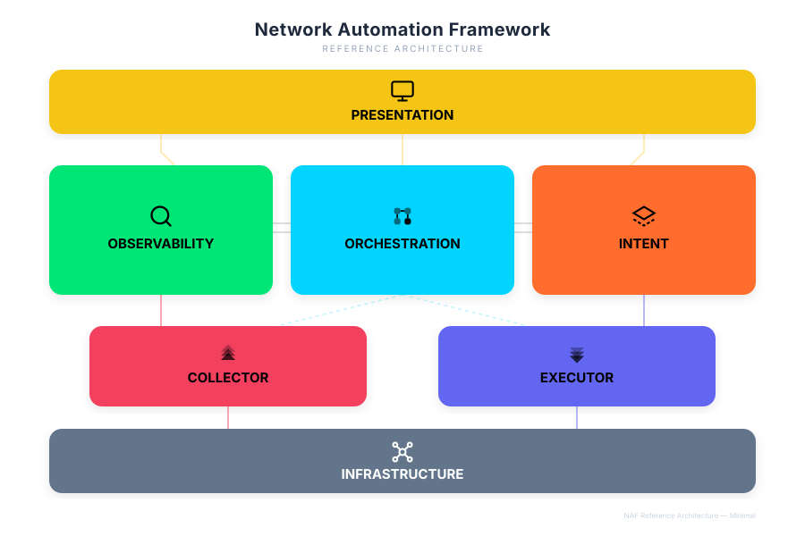

# SATOM and the NAF Framework

> **Audience:** architects, auditors and integrators who need to place SATOM
> in a vendor-neutral reference model, and the team that keeps this mapping
> honest. The matrix in §6 is the **only** place the conformance state is
> recorded; every other document links here instead of repeating it.
>
> **Status line (generated from the matrix, checked by a test):**
>
> <!-- naf-verdict:begin -->
> SATOM is mapped to the NAF Framework (commit da82b12), with 4 documented deviations.
> <!-- naf-verdict:end -->

---

## 1. Source, version pin and licence

- **Source:** Network Automation Forum, *The NAF Framework* —
  https://reference.networkautomation.forum/Framework/Framework/
- **Repository:** https://github.com/Network-Automation-Forum/reference,
  file `docs/Framework/Framework.md`.
- **Pinned commit: `da82b12` (2026-04-28)** — the last change to that file
  when this mapping was written. The framework carries **no version number**,
  so every SATOM surface that names it names this commit; a later rewrite of
  the framework cannot silently invalidate the matrix below. The release
  checklist ([release pipeline](release-pipeline.md)) diffs the upstream file
  against the pin on every cut.
- **Licence:** the reference repository is published under **CC0 1.0**. The
  diagram and the block icons on this page are reproduced from it unchanged
  (see `NOTICE`); their use follows the project's brand guidelines (block icon
  to the left of the block title).
- **There is no NAF certification.** The wording used here and everywhere
  else in SATOM is *mapped to*, never *certified*.

## 2. Why SATOM aligns with it

1. **Vendor-neutral and community-maintained.** The framework is not a
   product's architecture rebranded as a standard.
2. **MUST / SHOULD / MAY makes conformance checkable.** Each requirement is a
   sentence that is either met, partly met or not met — a matrix, not an
   opinion.
3. **A shared vocabulary.** Customers, auditors and integrators who know the
   framework can read SATOM's architecture without learning SATOM's names
   first (§4 translates them).
4. **SATOM as one block in a customer's stack.** A customer's NetBox can be
   the Intent block and their SIEM part of Observability; the framework's
   block boundaries are where SATOM plugs in.
5. **A yardstick for the roadmap.** Every open row in §6 is a dated piece of
   work, and the status line at the top moves only when a row does.

## 3. The framework in one picture

The framework defines **six functional blocks** — Intent, Executor,
Collector, Observability, Orchestrator and Presentation — "besides the actual
network infrastructure" (its own wording). Infrastructure is drawn in the
diagram and gets a row in the naming table, but it is the thing being
automated, not a block of the automation system. Two cross-cutting
expectations apply to every block: version control with CI/CD, and
machine-friendly APIs documented by schema.

## 4. What SATOM calls each block

SATOM's names predate the mapping. This table is the translation; the product
keeps its names (renaming "Source of Truth" would touch four language
catalogs and dozens of pages for no functional gain), and the documentation
says "in NAF terms this is …" where the two differ.

| NAF block | What SATOM calls it | Read this when the names differ |
|---|---|---|
|  **Intent** — desired state | Templates, Template bindings, Baselines (template combos), the Exception Library, Change types, the secret vault | SATOM calls the desired state *Templates* and *Baselines*; the NAF Framework calls this block *Intent*. |
|  **Observability** — actual state, kept and processed | **Source of Truth** (configuration history), Monitoring (the time-series store), the health engine and alerts, Drift, Sentinel, Scout, Release Advisor | **The main collision.** SATOM's *Source of Truth* is the history of the **actual** configuration of each appliance. In NAF terms that is **Observability**, not Intent. |
|  **Collector** — reading the network | Device sync, Deep capture, Metrics collection (scrape targets), Log collection, the FortiAnalyzer log view | *satom-harvester* is **not** the NAF Collector: it harvests vendor knowledge (API schemas, release notes), not network state. |
|  **Executor** — writing the network | The CLI writer, Policy operations and Clone, Provisioning, write actions, Firmware upgrade, Observatory fix | The code calls a Process node's handler an "executor". That is a Process-engine term, not the NAF Executor. |
|  **Orchestrator** — coordinating the blocks | Processes (Studio), Scheduled Actions, Change Requests and the CR orchestrator, Integration hooks | The SATOM *reconciler* is deployment and HA machinery (it brings a node to the released commit); it is not the NAF Orchestrator. |
|  **Presentation** — people and other systems | The web console, the `satom` CLI, API v1, the Documentation Center, notifications (bell, e-mail, webhook, syslog/CEF) | — |
|  **Infrastructure** — the network itself | The managed appliances: FortiWeb, FortiADC, FortiGate, FortiAnalyzer, FortiAuthenticator | Not a block of the automation system. |

A second collision lives inside SATOM itself: **"Baselines"** names both the
template combos of System provisioning (Intent) and Sentinel's behavioural
baselines (Observability). The user guide says which one it means each time.

## 5. How to read the matrix

- One row per requirement sentence of the framework, grouped by block, with
  the level the framework gives it (**MUST**, **SHOULD**, **MAY**) and two
  cross-cutting rows for the expectations that apply to every block.
- **Status** is one of `met`, `partial`, `gap`, `accepted-gap`, `n/a`. An
  `accepted-gap` row states its reason after the dash: the requirement is
  understood and deliberately not pursued at this time.
- **Evidence** is a file in this repository (a test checks that each one
  exists), so a rename cannot leave the matrix pointing at nothing.
- The status line at the top of this page is derived from the matrix: the
  number of *documented deviations* is the number of **MUST** rows whose
  status is not `met`. A test fails when the sentence and the matrix
  disagree.
- **"Conformant" is a word the test owns.** No published document may claim
  conformance with the framework while any MUST row is not `met`; when every
  MUST row is `met`, the status line changes and the word becomes available.

## 6. Conformance matrix — state at v3.3.8

<!-- naf-matrix:begin -->
| Block | Level | Requirement | Status | Evidence |
|---|---|---|---|---|
| Intent | MUST | Represent any network-related aspect in a structured form | met | `app/models.py` (Template, Baseline), `app/models_tpl_binding.py`, `app/services/baselines.py` |
| Intent | MUST | Create, read, update and delete the desired state | partial | GUI only today: `app/views/templates.py`, `app/services/templates.py`; API CRUD is the open item |
| Intent | MUST | Expose that data through a standardized, documented API | gap | `app/api_v1/routes.py` has no template, baseline or binding route |
| Intent | SHOULD | Model in a neutral representation derived into vendor artefacts | accepted-gap — SATOM is a Fortinet-specific product by design; `app/services/template_compat.py` translates between firmware builds, not between vendors | `app/services/template_compat.py` |
| Intent | SHOULD | A unified view of the desired state across sources | partial | Templates and baselines are unified; IP addressing is delegated to NetBox through `app/services/netbox_client.py` |
| Intent | SHOULD | Governance metadata, validation, versioned access | met | `app/services/templates.py` (versions, approval, author, source firmware), `app/services/template_compat.py` |
| Intent | MAY | Rendering, decomposition and artefact generation | met | `app/services/template_bindings.py` (render), the dry-run → canary apply path |
| Executor | MUST | Interact with the supported write interfaces | met | REST clients in `app/clients/`, SSH in `app/services/cli_writer.py` (NETCONF and gNMI are not offered by the managed products) |
| Executor | SHOULD | Deploy full or partial configuration, reboots, software updates | met | Templates, `app/services/policy_ops.py`, the upgrade flow, `app/services/provision_runner.py` |
| Executor | SHOULD | Task input from the intended state or derived through Observability | met | Baselines and templates; `app/services/observatory_fix.py` applies from observed findings |
| Executor | SHOULD | Dry-run before executing | met | Every device write previews its diff first (`app/services/fortiweb_ops.py`) |
| Executor | SHOULD | Transactional execution | met | CLI sessions abort on the first error and re-read (`app/services/cli_writer.py`); REST writes are verified by `app/services/device_verify.py` |
| Executor | MAY | Imperative and declarative, idempotent operations | partial | Declarative templates (`app/services/template_bindings.py`) next to imperative actions; idempotence is not measured as a property |
| Collector | MUST | Retrieve live data over the read interfaces | met | REST clients, read-only SSH (`app/services/ssh_ops.py`), FortiAnalyzer JSON-RPC (`app/services/faz_logs.py`), `app/services/metrics_collect.py` |
| Collector | MUST | Extend beyond device APIs to SNMP, syslog, flow telemetry and packet capture | accepted-gap — logs reach SATOM through FortiAnalyzer; there is no SNMP client, syslog receiver or flow collector, in a Fortinet-only estate | `app/services/faz_logs.py` |
| Collector | SHOULD | Normalise values across vendors and methods | partial | Normalised across firmware builds and channels (`app/services/api_library.py`), single vendor by design |
| Observability | MUST | Persist historical data | met | `app/services/sot_store.py` (content-addressed configuration history), `app/services/metrics_collect.py` (time-series store), the audit log |
| Observability | MUST | Powerful programmatic access to that history | gap | The time-series store is bound to loopback without an API in front of it; there is no configuration-history or diff route in `app/api_v1/routes.py` |
| Observability | SHOULD | A capable query language | met | MetricsQL dashboards (`app/services/vm_store.py`), internal to the console |
| Observability | SHOULD | Events when the actual state differs from the intended state | gap | `app/services/alerts.py` (drift) compares a configuration with its previous snapshot, not with the bound template |
| Observability | MAY | Enrichment with contextual and third-party information | met | `app/services/release_advisor.py`, `app/services/drift_attribution.py`, Sentinel (`app/services/sentinel/`) |
| Orchestrator | MUST | Coordinate processes across the blocks without touching the network directly | met | `app/services/process_engine.py`, `app/services/cr_orchestrator.py` |
| Orchestrator | SHOULD | Event-driven execution (synchronous, asynchronous, scheduled) | partial | Integration hooks react to events (`app/services/integration_hooks.py`); a Process starts only by hand (`app/views/process.py`) |
| Orchestrator | SHOULD | Reverse or compensating actions on error | partial | Reverts exist per domain (`app/services/observatory_fix.py`, `app/services/provision_runner.py`); nothing chains them |
| Orchestrator | SHOULD | Dry-run of a workflow | met | Unarmed Process runs (`app/services/process_engine.py`) |
| Orchestrator | SHOULD | Scheduled execution of a workflow | partial | Scheduled Actions (`app/services/scheduled_actions.py`) are schedulable; Processes are not |
| Orchestrator | SHOULD | Logging and traceability of past and current workflows | met | `app/models_process.py` (ProcessRun, ProcessRunStep), `app/models_cr_types.py`, the audit log |
| Orchestrator | MAY | Correlate events and infer the course of action | partial | Cooldown and `app/services/drift_attribution.py` only |
| Presentation | MUST | Robust and flexible authentication and authorization | met | Local accounts with TOTP, LDAP and RADIUS (`app/services/directory_auth.py`), RBAC with ADOM scoping (`app/services/access.py`), owner-capped API tokens (`app/models_api_token.py`) |
| Presentation | MAY | Many forms: GUI, ITSM, messaging, documentation, dashboards | met | The console, NetBox and ticket integrations (`app/services/change_requests.py`), hooks, the Documentation Center (`app/views/manual.py`) |
| Cross-cutting | SHOULD | Version control and CI/CD for every component | met | Signed releases (`docs/release-pipeline.md`), the audit runner, the reconciler |
| Cross-cutting | SHOULD | Machine-friendly APIs documented via schema | partial | `docs/api_v1.md` is prose; there is no OpenAPI document |
<!-- naf-matrix:end -->

Infrastructure has no rows: the framework places no requirement on the
network itself.

## 7. The open rows, and what closes them

The status line counts four MUST rows that are not `met`:

1. **Intent — create, read, update and delete the desired state.** Possible
   from the console, not from outside it. Closing it means create, update and
   delete routes for templates, bindings and baselines under the same
   capability model as the WAF carve-outs, with every apply going through the
   existing dry-run → canary path.
2. **Intent — a documented API for the desired state.** Templates, baselines
   and bindings have no route in API v1 at all; read routes close this row,
   and the write routes above close the previous one.
3. **Observability — programmatic access to the history.** The configuration
   history and the time-series store are complete but reachable only from
   inside the console. Closing it means configuration-history and diff
   routes, a findings route, and a read-only metrics query route in front of
   the loopback-bound store.
4. **Collector — telemetry beyond device APIs.** Accepted for now: in a
   Fortinet-only estate, logs and flows arrive through FortiAnalyzer. A
   syslog receiver and SNMP polling would close it; the row says so rather
   than hiding the choice.

SHOULD rows marked `partial` or `gap` (event-driven Processes, compensation,
scheduled Processes, intent deviation events, a schema-documented API) are
the roadmap behind the MUST rows; each becomes `met` in the release that
ships it, and this page changes in that same release.

## 8. Keeping this page honest

- **One matrix.** The Documentation Center article and every other manual
  link here; none repeats the status table.
- **A test owns the wording.** `tests/test_naf_alignment_doc.py` parses the
  matrix, recomputes the number of deviations, checks that every evidence
  file exists, that the pinned commit and source URL are identical on every
  surface, that no document claims conformance while a MUST row is open, and
  that the release checklist still carries the upstream-diff item.
- **Update the matrix in the release that changes a row** — not before (a
  claim without code) and not after (code without a claim).
- **Upstream drift.** At every release cut, diff the upstream
  `Framework.md` against the pinned commit. If it changed, re-run the
  mapping and bump the pin on every surface. The check is a release-checklist
  step, never a network call inside a test.
