# SATOM — User Guide

> **Audience:** operators and network/security engineers who use the web UI to
> manage FortiWeb, FortiADC, FortiAuthenticator and FortiAnalyzer appliances day
> to day, and to read FortiGate configuration. No knowledge of the
> codebase is assumed. For architecture and internals see the
> [Engineering Manual](engineering.md); for a non-technical summary see the
> [Management Overview](management-overview.md).

---

## Table of contents

1. [Signing in & accounts](#1-signing-in--accounts)
2. [Core concepts](#2-core-concepts)
3. [Products (ADOMs): Global, FortiWeb, FortiADC, FortiAuthenticator, FortiAnalyzer, FortiGate](#3-products-adoms)
4. [Registering and operating devices](#4-registering-and-operating-devices)
5. [Server Policy](#5-server-policy)
6. [Cloning & migrating policies](#6-cloning--migrating-policies)
7. [Server Objects & the generic object editor](#7-server-objects--the-generic-object-editor)
8. [Web Protection (WAF)](#8-web-protection-waf)
9. [Exceptions & signature carve-outs](#9-exceptions--signature-carve-outs)
10. [Certificate Manager](#10-certificate-manager)
11. [Backups & restore](#11-backups--restore)
12. [Firmware upgrades](#12-firmware-upgrades)
13. [Fleet tools](#13-fleet-tools)
14. [Monitoring: fleet health, metrics & probes](#14-monitoring-fleet-health-metrics--probes)
15. [Automation: scheduled actions, change requests, jobs](#15-automation)
16. [Reports & database tools](#16-reports--database-tools)
17. [Product workspaces: FortiADC, FortiAuthenticator, FortiAnalyzer, FortiGate](#17-product-workspaces)
18. [API tokens](#18-api-tokens)
19. [Appearance: logo, colours & themes](#19-appearance-logo-colours--themes)
20. [The operator console](#20-the-operator-console)
21. [Provisioning new appliances](#21-provisioning-new-appliances)
22. [Updating SATOM itself](#22-updating-satom-itself)
23. [Studio: custom views, plugins & Lua](#23-studio-custom-views-plugins--lua)
24. [High availability](#24-high-availability)
25. [AppIDs](#25-appids)
26. [Settings, tab by tab](#26-settings-tab-by-tab)
27. [Operations: log collection and importing a backup](#27-operations-log-collection-and-importing-a-backup)
28. [System provisioning: profiles and baselines](#28-system-provisioning-profiles-and-baselines)
29. [Template library & the section catalog](#29-template-library--the-section-catalog)
30. [The endpoint registry & the API explorer](#30-the-endpoint-registry--the-api-explorer)
31. [Release notes & the SATOM changelog](#31-release-notes--the-satom-changelog)
32. [Troubleshooting](#32-troubleshooting)
33. [AI Advisor](#33-ai-advisor)
34. [The Audit Log](#34-the-audit-log)
35. [Integrations: NetBox, change tickets and your own Python](#35-integrations-netbox-change-tickets-and-your-own-python)
36. [Putting any appliance under change control](#36-putting-any-appliance-under-change-control)
37. [The Tools menu: certificate inspector, false-positive explainer, tracer](#37-the-tools-menu-certificate-inspector-false-positive-explainer-tracer)
38. [Bookmarks: the panel you file yourself](#38-bookmarks-the-panel-you-file-yourself)
39. [Concept Map: where does X live?](#39-concept-map-where-does-x-live)
40. [Upgrade Flow: a maintenance window as one workflow](#40-upgrade-flow-a-maintenance-window-as-one-workflow)
41. [Stored Assets: what each ADOM actually holds](#41-stored-assets-what-each-adom-actually-holds)
42. [Process: procedures the system walks for you](#42-process-procedures-the-system-walks-for-you)
43. [Upgrading to 2.0](#43-upgrading-to-20)
44. [Container operations (Docker nodes)](#44-container-operations-docker-nodes)
45. [Upgrading to 3.0](#45-upgrading-to-30)
46. [Wiki: articles the team writes for itself](#46-wiki-articles-the-team-writes-for-itself)

---

## 1. Signing in & accounts

- Browse to the app URL and log in. A fresh install seeds one administrator,
  `admin`, with no default password: it is the one given to the installer
  (`--admin-password=…` / `SATOM_ADMIN_PASSWORD`) or a random one the installer
  writes to `initial-admin-password` in the install directory (root-only,
  `0600`; the installer prints its path). **Change it on first login**
  (Profile → password) and delete that file.
- **Account protection:** 10 consecutive failed logins lock the account for
  15 minutes. Login attempts are rate-limited per IP (5/min).
- **2FA:** TOTP can be enabled per account, with QR enrollment on
  `Settings → Security`. Enabling it issues **backup codes that are shown
  exactly once** — save them then; you can regenerate a fresh set later, which
  immediately invalidates the old one. Set a **recovery email** on the same tab
  if you want *Forgot password* to be able to reach you (§26.13).
- **Directory auth:** LDAP and RADIUS backends are configured at
  `Settings → Authentication` (§26.7), alongside local accounts. That tab also
  **tests** the connection against unsaved form values, and **syncs directory
  users** into local rows so an admin can assign a profile *before* first
  sign-in — synced accounts are created **disabled**, pending approval.
- **Who can reach the app at all** is a separate question from who can sign in:
  `Settings → Access Control` (§26.2) carries an **IP whitelist**. It means
  *everywhere* when left empty, and loopback and admins are always allowed so it
  cannot lock you out. There is no per-username allowlist any more — the
  directory group, the approval gate and the profile already decide that.
- **Roles.** Three effective profiles ship, and they gate what you can do:
  - *readonly* — see everything, change nothing;
  - *operator* — day-to-day changes (`config_write`): policies, objects,
    exceptions, backups;
  - *admin* (`user_manage`) — everything, including Settings, users, registry,
    templates, scheduled actions, and the Database section.

  **These three are seeded, not a closed set.** `Settings → Profiles` (§26.3)
  composes profiles freely from the granular permission catalog, so a profile
  that can, say, use the Lua Studio but not administer users is a configuration,
  not a feature request.
- Every write you make is recorded in the **Audit Log** with before/after
  change history.

## 2. Core concepts

**DB-first pages.** The app keeps a local, queryable copy of each device's
whole configuration (populated by *Rediscovery* and *Deep Capture*). Pages
render from that cache in milliseconds and show a freshness badge like
`DB · 2h ago`. This means:

- the UI works even when a device is **down, slow, or license-locked**;
- what you see can be *behind* the box — press the **refresh/live** control
  (⟳ / "refresh from device") when you need the current truth. A refresh is a
  full device sync, so it needs `config_write` on every page that offers it
  (Server Policy, Server Objects, Web Protection, the configuration sections);
  read-only users see the cached data and no refresh button;
- after you save a change through the app, the affected page re-reads live, so
  your own edits are never stale.

**Dry-run first.** Every write to a device shows a **preview** (exactly what
will be PUT/POSTed) before you apply. Nothing touches an appliance until you
explicitly confirm. Applied writes are snapshotted and audited.

**Jobs dock.** Long operations (backups, discovery, deep captures, bulk
applies, firmware) run as **background jobs**. A dock at the bottom of the
screen tracks progress and survives page navigation; the **Jobs** page (Global
→ Jobs) lists everything with Pause / Resume / Stop. Each toast in the dock can
be minimised to one line (**−**) and restored (**□**, or a click on its title);
the choice lasts for the browser session.

**Notifications.** The bell in the top bar collects job results and system
notices, scoped to the product you are working in. The bell's *Clear* only marks
them read; **Clear all** on the Notifications page deletes them (after a
confirmation).

## 3. Products (ADOMs)

The app currently hosts six workspaces, in the style of FortiManager ADOMs.
**The list is data, not code:** the ADOM registry is a database table, and an
admin creates, renames, reorders, deactivates or deletes workspaces at
`Settings → ADOMs` (§26.11) — including which shared capabilities (banner, API
tokens, firmware, naming, regex) each one offers. `global`, `fortiweb` and
`fortiadc` are the exception: their keys are wired into URL scoping, so they can
be deactivated but not deleted. What you see below is this installation's
current list:

| ADOM | URL | Purpose |
|---|---|---|
| **Global** | `/` | Fleet-wide dashboard and cross-product tools: Monitoring (with Metrics and Analysis), Search, Service Diagram, Architecture, Fleet Objects, WAF, Jobs, DNS Lookup, and an **Automation** sub-menu (with Certificate Manager, and an **API** sub-menu holding Schema builds and Build compatibility); and fleet administration under **Administrator**, in sections (Access, Change Management, Devices, Objects, Studio, System) |
| **FortiWeb** | `/web/` | Everything WAF: FortiWeb's own menu for the selected device (Policy, Server Objects, Web Protection, System, …), the device-scoped WAF tools under Operations → WAF (Search Attack ID, Exceptions & Signature, WAF Artifacts), Operations, FortiWeb administration |
| **FortiADC** | `/adc/` | Load-balancer management: the device's own menu when a layout exists for its build (otherwise a FortiADC group with Signatures only), and an ADC API console |
| **FortiAuthenticator** | `/fac/` | Identity and access: the unit's own menu (users and groups, RADIUS and TACACS+ clients, Fortinet SSO, certificates…) drawn from its measured GUI, and a FAC API console |
| **FortiAnalyzer** | `/faz/` | Logging and analytics: the device's own menu when a layout exists for its build (otherwise the curated menu: Device Manager, FortiView, Log View, Incidents & Events, Reports), and a JSON-RPC API console |
| **FortiGate** | `/fgt/` | Next-generation firewall: the FortiOS menu of the selected unit — Network, Policy & Objects, Security Profiles, VPN, User & Authentication, Security Fabric, System, Log & Report — read live over the REST API, with dry-run-first writes on the pages a measured layout draws (§17.4) |

The **Global** dashboard is where every session starts: the health of SATOM's
own infrastructure (the HA nodes, the code repository, the backup server), one
tile per ADOM with its appliance count, the Jobs and Certificates tiles, and a
row of shortcuts to the global sections. A tile opens that ADOM.

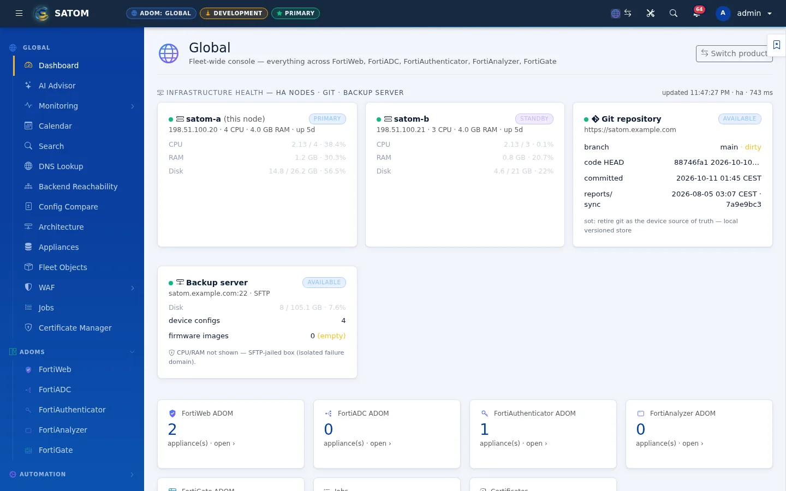
*The Global dashboard: infrastructure health, one tile per ADOM, and the global sections.*

Each product workspace mirrors its appliance's own GUI menu, so an operator who
knows the device knows where to look. How that menu is built differs by
product (§3.2); §17 covers what each workspace adds beyond the shared pages.

Switch ADOMs from the product selector or the `‹ Global` link at the top of
each sidebar. **The ADOM is per browser tab** — you can keep FortiWeb open in
one tab and FortiADC in another; switching in one tab never changes the other.
Data is strictly scoped: a FortiADC session sees only FortiADC jobs,
notifications, templates and appliances (and vice versa); Global sees all.

**A profile can be confined to some ADOMs** (§26.3). Then the selector and the
sidebar offer only those ADOMs, opening another one is refused, and the Global
console shows the union of them — their devices, records, jobs and counters —
never the whole fleet.

### 3.1 The selected device is per ADOM

Most per-device pages read an **implicit device context** rather than asking
which appliance you mean on every page. That context is **one slot per ADOM**:
picking a FortiWeb on the Service Diagram and picking a FortiAuthenticator on
the FAC dashboard are two independent choices, and neither disturbs the other.
The Global console reads FortiWeb's slot, as it always has.

**An ADOM that holds exactly one appliance does not ask.** With no choice to
make, that appliance is the context on every page of the ADOM — the dashboard
and the menu alike. It is a *resolution*, not a selection: nothing is written
to your session, so the picker still shows what you actually chose and the
Select button still means something. From two appliances up, the choice is
real and the pages ask for it.

An appliance in maintenance mode is counted only for operators who may see
maintenance devices, so this can never hand you a device the picker hides.

### 3.2 The device menu: drawn from the device's own GUI

In the **FortiWeb**, **FortiGate**, **FortiAuthenticator**, **FortiADC** and **FortiAnalyzer** ADOMs the sidebar
has one device menu, named after the product, and it is the **device's own
menu**: the groups, sub-menus and pages the Fortinet GUI shows, in the
device's order. SATOM does not keep a menu of its own for these products. It
builds the menu from the **GUI layouts** measured on real firmware builds,
which reach the node through the knowledge packs (§22.4), so the menu follows
the selected device (§3.1):

- **Per firmware build.** Each page uses the layout measured on the device's
  exact build, else the same version, else the same train, else the closest
  older train. The page header says which build the layout comes from (with a
  *knowledge pack* badge) and warns when it is not the device's own.
- **Only pages the build has.** When the device's own build was measured, a
  page that only another build's menu has is left out unless that build was
  measured serving the page's collections. A build nobody measured shows every
  page of the nearest layout, since leaving pages out by measurement would empty
  its menu.
- **All pages**, the first entry of the group, opens a grid with every page in
  the device's menu order, one card per top-level group.
- A knowledge pack that brings new layouts shows up in the menu within about a
  minute (the menu is cached for 60 seconds per product and build).

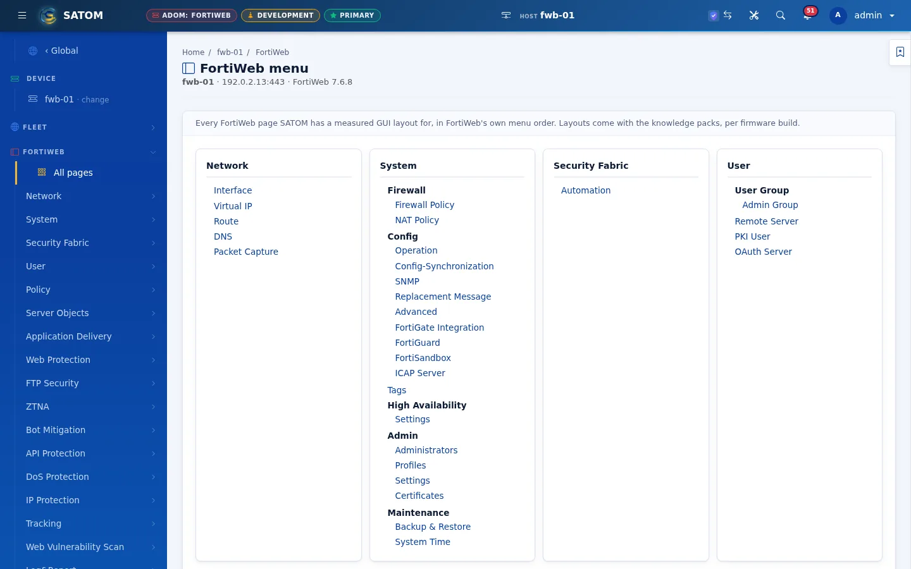
*FortiWeb ADOM, device fwb-01: the FortiWeb group is FortiWeb's own menu; All pages lists every page by group.*

Pages open SATOM's GUI pages (`/workspace/<id>/fwgui/<page>`): the device's
structure (tabs, columns, dialogs and fields, with their show/hide rules)
inside the SATOM frame, and the SATOM tools on top. FortiWeb's Server Policy
keeps its own hand-tuned view (§5).

**The old SATOM menus are gone.** The FortiWeb ADOM no longer draws the
Loadbalancer (Server Objects), WAF (Web Protection Profile, Web Protection, the
protection areas) and Configuration groups, and the FortiGate and
FortiAuthenticator ADOMs no longer draw their former SATOM section menus. The
**Classic view** button is gone from every list and settings page too. What
moved and what did not:

- **Bookmarks keep working.** An old URL for a collection that a measured page
  draws redirects to that page.
- **Collections no measured page draws yet have no menu entry.** They come
  back as their pages are measured and arrive in a knowledge pack. A bookmark to
  such a page still opens it.
- **FortiWeb WAF tools** — Search Attack ID, Exceptions & Signature and WAF
  Artifacts — are now under **Operations → WAF** (§9). They are drawn in every
  device ADOM, in the same place; outside FortiWeb they are greyed out and say
  why on hover. The URLs and permissions are the same.

**When there is nothing to draw.** In the FortiWeb ADOM, with no device
selected or no layout imported for it yet (fresh install, offline node, no
knowledge pack), the FortiWeb group keeps one entry, **Server Policy**. It
opens the device's Server Policy view, SATOM's own Server Policy list with a
notice when no layout exists, or the Service Diagram, where you pick
a device, when none is selected. The FortiGate and FortiAuthenticator ADOMs draw no device group in
that case. Their dashboards, the page each ADOM opens on, still list SATOM's
section pages (§17.2, §17.4).

**FortiADC and FortiAnalyzer draw their own menu only where a layout
exists.** A FortiADC or FortiAnalyzer whose firmware build has a measured layout
in the knowledge packs gets the device's menu like the other three. Otherwise
a FortiADC keeps a FortiADC group with **Signatures** only, and a FortiAnalyzer
keeps the curated menu of §17.3 (the live JSON-RPC section pages), so neither
ADOM ends up empty.

**Where the shared groups sit.** Every device ADOM draws the same SATOM groups
in the same order around the device menu: **Operations** first, the device
menu, **Administrator**, Plugins. Operations opens with the
fleet pages (Dashboard where the ADOM has one, Calendar, Architecture, Service
Diagram, Monitoring, Search, DNS Lookup, Troubleshooting, Fleet Objects and WAF
in FortiWeb and FortiADC, Jobs), then holds Device Backups and Import Backup,
and ends with the **Automation** sub-menu;
**Diagnose Log Collection** is in Operations › Troubleshooting (§27). There is
no separate **Fleet** group, and no separate Automation group in a device ADOM
(the Global ADOM draws Automation as a sub-menu of its Global block, above
Jobs). The **API** sub-menu of Automation holds the console (Registry &
console, device ADOMs) and **Schema builds** and **Build compatibility** (every
ADOM, Global included). **System Automations** is under Administrator →
System; Automation keeps **Automations**, the work operators schedule (§15).
**Appliances** is under
Administrator; **Certificate Manager** is under Automation (Certificate Manager in every
ADOM: live in Global, FortiWeb and FortiADC, drawn disabled with the reason in
FortiGate, FortiAnalyzer and FortiAuthenticator). **Administrator** is split
into sections — Access, Change Management, Devices, Objects, Studio and System
— and both the sections and their entries are alphabetical in the console's
language; a section with no entry you may open is not drawn. **Studio** holds
Python Console in every ADOM, and also Plugin Studio and Lua Studio in Global. The Global ADOM keeps its **Global** block for the fleet pages
and has no Operations group. A profile that cannot see one of those groups
keeps the entry where it was before — Appliances under
Operations, the API menu (console, Schema builds, Build compatibility) as a
group of its own in a device ADOM and inside the Global block in Global
(`registry.view` without `config_write`), Studio as a group of its own, and **Process** in a group of
its own — so the reorder takes no page away from anyone. Each entry keeps its
own permission; moving it changed where it is drawn, not who sees it.

**The Global ADOM has no device menu.** It is the fleet-wide console. Its
Operations → WAF lists the fleet pages (Overview, Inventory, Profiles, Coverage,
Artifacts, Exceptions) but not the three FortiWeb tools above. Those are
FortiWeb-ADOM pages, and a link from Global would switch the tab's ADOM
without saying so.

## 4. Registering and operating devices

**Appliances** (sidebar → Operations → Appliances in each ADOM, Global → Appliances in
the Global ADOM, or the Global dashboard). The entry is shown to anyone holding
`appliances.view`; adding or editing a device still needs `config_write`:

1. **Add appliance** — name, host/IP, port, kind (fortiweb / fortiadc /
   fortiauthenticator / fortianalyzer / fortigate), credentials (stored
   encrypted), TLS verification mode.

   > **If a new appliance never syncs, check TLS verification first.** An
   > appliance that presents a self-signed certificate fails
   > `CERTIFICATE_VERIFY_FAILED` *before it ever authenticates*, so the row
   > sits at `unknown` forever with credentials that are perfectly good. Either
   > import its CA under Settings → Trust store, or set verification off for
   > that device. This is the single most common cause of a brand-new device
   > that will not come online.

   FortiAuthenticator authenticates with a **per-user API key**, not the login
   password: issue one by ticking *Web service access* on an Administrator
   account on the unit, and store that key as the appliance password.
   FortiGate likewise takes a **REST API administrator token** (`execute
   api-user generate-key <api-user>` on the FortiGate) as the password, never
   a login password; a read-only admin profile is enough (§17.4).

   **Editing** an appliance keeps its stored credentials, which nobody can
   read back. Changing its host, port, username or platform — or turning its
   TLS verification off — therefore needs the password entered again in the
   same save (and the SSH password too when the device has a separate one);
   otherwise the save is refused. The same rule applies to
   `PUT /api/appliances/<id>`.

   **SSH credentials, when they differ from the API ones.** The Edit page
   has two optional fields for the CLI login. Use **SSH user, if different
   from the API user** when the API user cannot open SSH. A FortiGate
   registered with a REST api-user is the usual case. Use **SSH password, if
   different from the API credential** when the stored password is an API key,
   as on FortiAuthenticator. Left empty, SSH logs in with the API username and
   password. Diagnose Log Collection and Diagnostic Battery discovery (§27)
   log in with this SSH user and SSH password, and the other read-only SSH
   sessions also log in as the SSH user. If you change the
   SSH user while a separate SSH password is stored, enter that password again
   in the same save (or remove it), as for a username change.
2. **Test connection** — validates REST reachability and credentials.
3. **Discovery / Rediscovery** — sweeps every registry endpoint and stores the
   device's full configuration in the local cache (recorded as a harvest with
   trigger `rediscovery`, so Device health counts it); also records the
   firmware. Hardware is NOT collected here: use **Scan hardware (SSH)** on
   Device health (FortiWeb only: the scan is the FortiWeb `diagnose hardware`
   battery, so the button is not offered in the other ADOMs). Run it after registering and after any large out-of-band
   change. With *Capture full WPP + policy depth* on, the deep pass shows which
   server policy or WPP it is walking and how many are left.
4. **Deep capture** — a deeper sweep that walks each server policy's whole
   object graph (pools, members, WAF profile sub-policies…). This is what
   powers the DB-first policy detail and the Service Diagram. Can run
   fleet-wide and is normally scheduled nightly.
5. **Factory catalog** (the device's **Web Protection Profile** list in the
   FortiWeb menu → *Factory catalog*, or Template Library → *Factory catalog*;
   needs *View registry*) — the FortiWeb
   predefined Web Protection Profiles, stored once per **firmware version,
   build number and REST API version**. The first deep pass on a build reads
   them in full; later deep passes rebuild a predefined profile from the
   catalog when the appliance's own rows match, and read it in full again once
   a week. Turn on *Re-read predefined WPPs in full* on the Rediscovery page to
   read them now. On the catalog page you can open a profile's full tree,
   **compare the same profile between two builds** (what the vendor changed in
   its defaults), and **save an entry as a template**, stamped with that
   firmware and API version.

Each appliance's detail page is the hub for device-level actions:

- **VS/Policy Inspector** — a tree report of each policy and everything it
  references.
- **SSH Console** — read-only troubleshooting presets (`get system status`,
  HA status, routing table, sniffer…) plus a command box. Destructive CLI is
  not offered. Only `get`, `show` and `diagnose` are accepted. A `diagnose`
  command whose name changes the device (kill, clear, reset, delete,
  failover, sysrq/crash, set, enable/disable, format…) is refused, including
  abbreviations such as `diag sys kil`. Running a command (even a read-only one) needs **Run appliance
  actions** (`appliances.apply`); without it the console link is not shown and
  the page lists the presets with a read-only notice.
- **Backups / Restore / Upgrade / Boot partition** — see §11–§12.
- **Sync devices** — the fleet list can be shared/re-imported so a fresh
  install inherits the same inventory.

**Capacity limits** (Administrator → Capacity) define per-model object
ceilings; clone and exception workflows check headroom before creating
objects.

**Every action on a device is a job.** Test connection, console commands,
restores, failovers, saves in the Workspace and the object editor, certificate
pushes, searches on the box: each one runs in the background and shows what
it is doing.

- An action that finishes within about two seconds behaves as it always did.
- A longer one appears in the Jobs dock (bottom right) with each call it makes
  to the device, for example `GET /api/v2.0/cmdb/server-policy/policy · 200 ·
  310 ms`. The page gets its normal result when the action ends, even if
  you went to another page in the meantime.
- A form you submitted opens a progress page with the same steps. *Keep
  working* takes you back; the action continues.
- Two changes to the same device run one after the other. The second shows
  **queued** and can be stopped while it waits. Once a change has started on
  the device it cannot be stopped, so the device is never left half-changed.
- The appliance page has a **Jobs on this device** card with the running and
  recent jobs; every job is also on Global → Jobs, with its steps under
  *Details*.

## 5. Server Policy

FortiWeb ADOM → sidebar group **FortiWeb** → **Server Policy** (the device's own
menu, §3). The page is drawn in **FortiWeb's own layout** for the device's
firmware build: the same toolbar, the same columns in the same order and the
same row behaviour as the appliance GUI, inside the SATOM frame. The layout
comes from the knowledge packs (§7.4 explains the banner above the table).

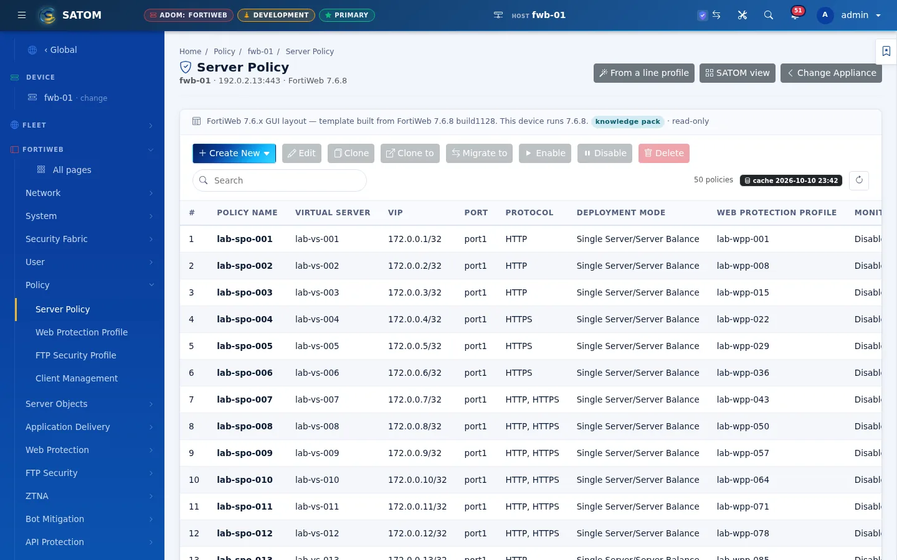
*Server Policy on fwb-01: FortiWeb's toolbar plus the SATOM actions, and the cache badge.*

- **Rows come from the SATOM cache** of the device, not from a live read. The
  badge at the right of the toolbar says when the cache was taken; **⟳
  (Refresh)** pulls the live configuration from the device and returns to this
  list (it needs `config_write`). The VIP and Port columns are joined from the
  policy's deep capture; a policy without one shows **—** there.
- **Click** a row to select it; **double-click**, **Enter** or **Edit** opens
  it. Tick the **checkboxes** (or the one in the header for every visible row)
  to select several: the actions below then run on all of them, and **Edit**
  needs exactly one.
- **Search** filters the visible rows by name (plain text or `/regex/`).
  **Filters** below the toolbar adds VIP / IP, backend pool, backend server IP,
  certificate type and status; the VIP and backend filters read the deep
  capture.
- A policy that was cloned or migrated carries a **copies** badge beside its
  name; hover it for each copy, where it landed, when, by whom, and the reason
  of an attempt that failed.
- **Create New** opens FortiWeb's *Create New* menu. An entry marked
  **conditional** may be hidden on this device by a setting SATOM cannot see.
  The form starts with FortiWeb's own defaults; a policy with no HTTP, HTTPS or
  HTTP/3 service is refused before anything is written, the preview included.
  If any step of the create fails, the objects that run created are deleted
  again, newest first, and the result lists what was undone.

### Toolbar actions on the selected policy

FortiWeb's toolbar is extended with SATOM's policy actions. Each one acts on the
**selected rows** and always shows a dry-run preview before anything is
written:

| Button | What it does |
|---|---|
| **Clone** | Deep-clones the policy tree on this FortiWeb under a new name (§6). |
| **Clone to** | Deep-clones the policy tree onto another FortiWeb (§6). |
| **Migrate to** | Clones onto another FortiWeb and, only if that lands cleanly, disables the source. The source is never deleted (§6). |
| **Enable** / **Disable** | Turns the policy on or off. Disable stops the traffic and keeps the object. |
| **Delete** | Safe cascade: the policy plus only the objects *nothing else uses*. Web Protection Profiles, certificates, services and shared objects are kept, and the preview lists both. |

The six actions open SATOM's policy dialog on this page. Its options, preview
and background job are the ones described in §6. A link to
`…/workspace/<id>?act=<action>&policy=<name>` opens the list with that dialog
already open for that policy. **Clone to** and **Migrate to** stay disabled
while no other FortiWeb is registered. A user without `config_write` sees the
list without the action buttons.

The page header adds two buttons:

- **From a line profile** — the wizard in §5.1 (needs `config_write`).
- **Change Appliance** — back to the device picker.

### Editing a policy

**Edit** opens FortiWeb's *Edit Server Policy* dialog for the policy's protocol,
with the device's own sections, sub-dialogs and inline tables:

- Fields show and hide **as you edit**, as FortiWeb's GUI does (§7.4).
- Rows of the inline tables open in their own dialog. **Create New** is offered
  in a table's toolbar only when SATOM knows that sub-table and can read its
  rows; a table SATOM cannot read is never written blind.
- The pencil beside a reference selector (Virtual Server, Server Pool, HTTP
  Service…) opens the selected object in a **panel stacked over the dialog**;
  **Esc** closes it.
- Below the dialog, **Not in GUI, but in CLI** lists every field this policy has
  on the device's build that FortiWeb's GUI does not show (§7.6).
- **Save** works as described in §7.5: you review the change first, then
  apply it. Before the write, the dialog runs the same checks as the object
  editor: a template-managed Web Protection Profile stays read-only, another
  user's edit lease blocks the save, every reference value is checked against
  the device (§7.1) and the build compatibility check runs (§7.3). After a
  successful write, SATOM reads the policy back from the device so the page
  shows the stored value.

### Without a knowledge pack

When no FortiWeb GUI layout has been imported on this node yet (a fresh
install, or the knowledge feed switched off) the list still opens, with a note
saying so: FortiWeb 7.6's default columns, the same toolbar actions and
filters. **Create New** then opens SATOM's New Server Policy form and **Edit**
opens SATOM's policy view: rendered from the deep cache with the resolved
service topology (VIP + port → virtual server → pool → real servers), **Check
live health** for the real per-backend health-check state, and a minimal-diff
edit form with a **＋** next to creatable references.

The old SATOM list at `/web/workspace/<id>` is gone; the address now opens this
list (an `act`/`policy` deep link included).

To enable or disable a policy or a backend, change a backend's IP or port, or
swap a policy's certificate **at a set date and time**, use a Scheduled Action
(§15).

### 5.1 New Server Policy from a line — the wizard

`/web/workspace/<id>/spo-wizard`, reached from the **From a line profile**
button in the Server Policy page header.

You pick a **line**, and its profile supplies the network segment, the
certificate class and the Web Protection Profile. The wizard then runs the whole
chain in one order: IPAM reserves the VIP, DNS publishes the name, the CA issues
the certificate, and the device gets the objects. The point of the wizard is not
speed — it is that a failure halfway through this chain strands a reserved
address and an issued certificate that nobody finds by looking at the appliance.

**Preview writes nothing.** *Preview* builds a plan and returns **every** reason
the run cannot proceed, not just the first. It reserves no address, creates no
record, issues no certificate and touches the device only to read it, so it is
safe to press at any time and at any permission level that can already see the
device. *Apply* is the only button that writes, and it needs `config_write`.

**A blocked plan is never applied** — dry run included. There is no "just to
preview it" path past a blocker; allowing one is how a blocker becomes advisory.

**The name collision is checked live, against the device.** The derived object
names are compared with the appliance's own object list at plan time, not with a
cached copy — a run that dies after reserving an address is worse than one that
never started. An **unreachable device is itself a blocker**, not an assumption
that the box is empty. The same live read confirms that the line's **Web
Protection Profile exists on the device**; a missing profile blocks the plan
(deploy the template first) instead of failing at the last step.

**Names follow Administrator → Naming.** Object names are rendered from the
saved Naming patterns and variables for the device's product (§13.3), falling
back to the defaults for any element left empty. When the wizard issues a
certificate, the created policy serves HTTPS with it (predefined `HTTPS`
service + that certificate).

**The port of each domain** goes into `{port}` in the names. Each domain row
has a **Port** column, and a flow that creates policies through the wizard's
API passes `port` per domain. Left blank, the port written in the address is
used (`shop.example.com:8443`); with none there, `443` when the policy carries
a certificate and `80` when it does not, and the plan warns that a name carries
a port nobody typed. The preview prints the four derived names and where the
port came from (*given*, *from the address*, *default*). A name with a
character the devices refuse (anything but letters, digits, `_` and `-`; a dot
from `{host}` is the usual one) blocks the plan as `naming_unsafe`. Rewrite it
with a variable.

**A segment can hold several networks.** On **Network Segments** each segment
lists one or more networks (CIDR + gateway, optionally an interface of its
own; blank uses the segment's interface). With **Reserve the VIP from IPAM**,
the VIP is taken from the **first network with a free address**: if IPAM
refuses one (full, or any other error) the next is tried, and the address step
says which networks refused and why. The preview lists the order. A network no
IPAM backend can serve is reported as a warning ("will NOT be tried"); only
when none can be used does the plan block. The VIP goes on the interface of
the network it came from, and an address released after a later failure goes
back to that same network. A **VIP typed by hand** must sit in one of the
segment's networks (`address_not_in_segment` otherwise; `198.51.100.5/24` is
accepted). The gateway is recorded with each network; no flow writes it to the
device. Segments saved before this change read as one network, unchanged, and
a CIDR the page cannot parse drops that network only, never the segment.

**Line profiles** are declared on Global ADOM → Administrator → **Line
Profiles** and are always filed as FortiWeb profiles — the product the wizard
reads them for.

**It refuses to guess.** A segment the chosen line does not receive is refused
— the wrong-network failure this feature exists to prevent. When a line offers
several segments you choose one; the wizard does not pick for you. A blank
hostname means *do not publish* and never quietly becomes the web address. A
backend that cannot write records, plus a requested hostname, is a refusal — not
a step that reports success and publishes nothing.

**On failure, what was undone and what was left behind are reported as separate
lists.** Compensation is driven by what the run *recorded*, never by inspecting
the current state of the world:

- A DNS failure releases the address **by its handle**, and only if IPAM handed
  it out. A hand-typed VIP is not SATOM's to hand back to a pool.
- A device failure removes the record this run created and releases the address
  this run took.
- An **issued certificate is named and NOT revoked**. Revocation is destructive
  and irreversible, and a certificate that exists is not harmful.
- Objects already written to the device are **listed, not deleted**. Deleting
  one that a human may already have bound elsewhere is a destructive guess.

The result keeps `compensated` ("we undid this") and `stranded` ("we did not
undo this") as two lists and renders them separately, because they are opposite
facts and folding them would let a leftover read as a cleanup. The certificate
is deliberately in the second list.

#### Choosing the IPAM and DNS backends

Because Settings → DNS Records is a registry of N backends (§26.9), the wizard
offers two selectors — **IPAM backend (the address)** and **DNS backend (the
hostname)** — each listing only the *enabled* rows that carry that role.

- Both default to **Auto**, which follows the scopes declared in Settings → DNS
  Records. Auto is **byte-for-byte the behaviour of an install that never picks
  anything**, which is what makes the selectors purely additive.
- Every option prints the backend's **provider and its declared scope**
  (`any (catch-all)` when it declares none), because a name is not what decides
  which backend answers. The note under each selector repeats the scope of the
  current choice and the outcome of its last connection test.
- A selector with no eligible row is disabled and says so, pointing at Settings
  → DNS Records.

**A pick is validated, not trusted.** The row you name is checked against the
same rules Auto uses — read from the same scope column, not re-derived — and
each way it can fail has its own code, because each has a different fix:

| Code | Meaning | Fix |
|---|---|---|
| `backend_unknown` | No such row (it was deleted since the page loaded). | Reload the page. |
| `backend_disabled` | The row exists but is disabled. | Enable it in Settings. |
| `backend_wrong_role` | The row does not carry the role you are using it for. | Give it the role, or pick another row. |
| `backend_out_of_scope` | The row's scope does not claim this zone or pool. | Widen that backend's scope, or pick the one that claims it. |

**An invalid pick is refused, never quietly downgraded to Auto** — even when a
catch-all backend is present that *would* have answered. A silent fallback would
run the work on a backend nobody named while the page still showed the one that
was chosen.

**A pick overrides the scope *choice* only; it never widens a scope.** The scope
is an earlier declaration by the same operator, and the wizard is not the place
to overrule it by accident. What a pick *does* resolve is an **`AMBIGUOUS`**
tie: both tied backends are in scope, so naming one is a legitimate answer to a
question the configuration left open. That is the selectors' main use case.

**Pick-level and scope-level blockers are kept apart.**
`ipam_backend_rejected` / `dns_backend_rejected` mean *the backend you named
cannot do this*, and send you to that row. `ipam_not_resolved` /
`dns_not_resolved` mean *the scope rules produced no single answer*, and send
you to the scope rules. Folding them would send an operator who named a backend
off to fix a scope, when the fix is to one row — or to the choice itself.

**A chosen backend that cannot act raises a warning**, not silence. Choosing an
IPAM backend with *Reserve the VIP from IPAM* switched off, or a DNS backend
with no hostname given, warns that nothing will be reserved or published. A
control that silently does nothing reads as a control that worked.

**Apply writes where Preview said it would.** The plan records the backend ids
it resolved, and *Apply* acts on those ids rather than resolving a second time.
The registry is editable between the two presses, so a second resolution could
answer differently and write to a backend the summary never named. A recorded
`null` therefore means exactly one thing: no backend carried that role when the
plan was built.

## 6. Cloning & migrating policies

**Clone**, **Clone to** and **Migrate to** recreate a whole policy tree
(virtual server, VIP, pool + members, health checks, content routing, and
optionally the full WAF profile) on the same or another FortiWeb. **Migrate
to** clones first and disables the source only if the clone lands cleanly; the
source is kept, never deleted.

Where to start:

- **One policy** — on the Server Policy list (§5), select the row and press
  **Clone**, **Clone to** or **Migrate to**. The dialog opens on the list with
  that policy filled in.
- **Many policies** — tick their checkboxes on the same list and press the same
  buttons: one dialog, one bulk run (§6.5). *Clone to* and *Migrate to* are
  disabled while no other FortiWeb is registered.

What the guided dialog does for you:

- **Pre-flight checklist** (runs automatically): source readable, destination
  reachable, name collisions, WAF profile present/identical/different on the
  destination, VIP IP conflicts, certificate warnings (key material can only
  move over SSH), and capacity headroom. Blocking findings disable Apply.
- **Dummy VIP rules:** cloned VIPs are rewritten to a placeholder IP so a
  clone can never take real traffic by accident. Admins configure the rewrite
  rules in Settings → Clone / Migrate. A rule replaces the leading octets and
  keeps the rest (`198.51` → `240.51` turns `198.51.100.7` into `240.51.100.7`);
  when no rule matches, the fallback address is used (default `203.0.113.9`).
  Single clones can override the suggested IP; bulk clones always use the
  rules.
- **Admin defaults:** whether the Web Protection Profile is copied by default
  comes from the same settings page and is shown read-only. Tick **Override
  admin defaults** to change it for this run only.
- **WAF profile choice:** if the destination already has a *different* profile
  with the same name, you choose — use the destination's, or copy the source
  profile under a new name.
- Objects that already exist on the destination are **validated and skipped**,
  never overwritten. The clone lands **disabled** for a manual cutover.
- **Rule content travels with the rule.** Objects whose meaning lives in
  per-rule sub-tables — a Custom Access Rule's URL / source-IP / rate-limit
  filters, a URL Access Rule's match conditions — are copied with those rows,
  not as a bare name. A rule copied without them would appear on the
  destination and match no traffic, and nothing in the job result would say so.
  If a sub-table does not exist on the destination's firmware it contributes
  nothing rather than being invented.

### 6.1 Choosing what happens to the Web Protection Profile

A policy's WAF profile is the biggest thing a clone can bring with it, so it is
the one decision the dialog always asks about. There are three answers:

| Choice | What lands on the destination |
|---|---|
| **Copy the profile subtree** | the profile and all of its sub-tables are recreated. The default for a destination that does not have the profile. |
| **Create it only if it is missing** | an existing profile with that name is left **completely** alone — object *and* sub-tables. |
| **New, compare and decide** | you are shown every change this run would make **inside** the existing profile, and you tick the ones you want. |

> ⚠ **"Leave the subtree on" is not the same as "only if it is missing".**
> With the subtree on, an existing profile *object* is left alone but its ~40
> sub-tables are still classified one at a time — so a signature list the
> destination profile lacks gets **added to a live, possibly shared, profile**.
> If that is not what you want, pick *only if it is missing*.

**Reuse a profile the destination already owns.** Instead of copying anything,
you can point the cloned policy at a profile that is already on the destination.
The subtree is pruned *and* the policy's profile field is rewritten — pruning
alone would leave the copy naming the source's profile, which the appliance
answers with `-651`.

### 6.2 New, compare and decide — and what a "no" actually does

This is the only clone mode that **edits a live object on purpose**, so nothing
is ever pre-ticked and the pre-flight says **WARN**, never *ok*.

You are shown two kinds of offer:

- the profile's **own fields** that differ from the destination's ("retune"),
  each listed as `field: destination -> source`;
- each **row** the run would add or change inside the profile's sub-tables.

Every box you leave unticked is a **"keep the destination's own"**, and since
1.12.0 that answer is carried through completely:

1. the declined item is **removed from the plan**, not skipped at write time —
   an item left in saying `create` describes a write that will not happen, and
   every count, report and verification reads the plan;
2. **every field still being written that NAMED the declined section is put
   back to the destination's own value.** This is the half that used to be
   missing. Without it the profile was still written carrying the *source's*
   name for a section that was not being created, the destination ended up
   naming something it does not have, and the appliance seated a default of its
   own — so a "keep the original" produced neither the original nor the source;
3. anything that was **itself going to be created** and can no longer stand —
   an object naming the declined section, or a row whose parent object you
   declined — is **dropped too**, transitively, and listed in the result under
   *cascaded* with the reason. It is never written and never silently blanked.

The run report names all three outcomes, so you can check the answer you gave
against what the run actually did:

- **reverted** — `label · field · the destination value that was kept`
- **cascaded** — `label · why it could no longer be created`
- **dropped / kept / retuned** — the counts

> **If the source changes between comparing and applying, the apply refuses.**
> The comparison and the apply are two requests, and the apply **re-plans**.
> Offers are matched by a stable key built from what identifies the object on
> the appliance — collection, key, parent, kind — never by position. If the new
> plan offers something your answer never covered, SATOM stops and asks you to
> re-run the comparison. "Never shown, so skip it" would write nothing you saw
> and call the run green; "never shown, so take it" would write something you
> never saw at all.

### 6.3 Certificates, SNI and backends

- **SNI policies are cloned.** The policy and its member rows travel over REST;
  no key material is involved (an SNI row names a certificate, it does not
  contain one).
- **Certificate key material can be carried over SSH**, as part of the clone,
  when you enable it. It is fetched **before the first write**, because a
  certificate is a dependency: a failure halfway through an apply would leave
  you committed — on a *migrate*, after the source has already been disabled.
  A failure here **blocks** and writes nothing. A certificate name the
  destination already holds is **left alone**: overwriting one that is already
  serving traffic is a change to live traffic that nobody asked for. A
  certificate read without its private key cannot be carried — copying the
  public half alone would create a certificate the destination can never serve
  with.
- **Backend reachability (optional, off by default).** Two independent checks
  that are never merged into one verdict: the destination appliance pings the
  backend itself, and this node opens a TCP connection to the real port.
  `unknown` is reported as `unknown` — it is not folded into either answer. It
  is off by default because a bulk run means one timeout per policy per member,
  and because it sends traffic to third-party hosts.

### 6.4 Rows the destination already owns

The appliance enforces uniqueness on a **natural key** — a *subset* of a row,
not the whole row. So a destination row with the same key but different content
used to be invisible to the planner and present to the box: the plan said
*create*, the appliance refused the duplicate, and the destination went on
serving the old value under a green run.

Such a row is now planned as **update** and written as the **minimum edit** —
the destination's row with the source's **non-empty** fields laid over it,
addressed by the *destination's* row id. A blank on the source means "this box
does not use this field", not "erase what the other box has".

> Consequence, stated plainly: a reconciled row is **not** a byte-for-byte copy
> of the source row. It is the destination's row carrying everything the source
> names. A row that must match exactly has to be deleted and re-created, and the
> cloner never deletes.

Turning reconciliation **off** does not silently skip those rows — it
**refuses the apply**. A skipped row leaves the destination serving the old
value under a run that looked successful.

### 6.5 Bulk runs

Bulk and the single-policy dialog go through the **same** function, so every
option described above is true of a 60-policy run and of one dialog.

- **Profiles are handled once per run**, keyed on the *pair* (source profile,
  landing profile). Two policies landing on the same profile *name* from
  different source profiles are not a repetition, and skipping the second would
  drop rows in silence.
- **Pre-flight analysis runs in parallel.** Measured on a live appliance: 10
  policies, **51.45 s → 20.99 s** at 4 workers, with an identical plan
  footprint and the selection order preserved. The worker count is yours to
  set; the ceiling exists because the appliance saturates.

## 7. Server Objects & the generic object editor

Object pages are drawn from **the device's own menu**. In the FortiWeb ADOM the
sidebar group **FortiWeb** lists every page SATOM has a measured GUI layout for
on the selected device's firmware build, in FortiWeb's menu order (Server
Objects → Server → Server Pool, System → Admin → Settings, and so on), and **All
pages** shows the same menu as a grid. The layouts come with the knowledge
packs, so the menu follows the build the device actually runs.

- SATOM's old menus (Loadbalancer / Server Objects, WAF, Configuration) are no
  longer drawn. Old URLs and bookmarks redirect to the page of the device's
  menu that draws the same collection.
- **Not in GUI, but in CLI** — a menu group of its own: every object the
  device's build has that no page of its GUI edits (measured: the crawl opens
  every menu entry and records what each page reads), one page per CLI root,
  with list, edit dialog and the usual dry run. Each page says so above its
  list. FortiADC has the same group (§17.1).
- A page that the GUI draws with a widget SATOM cannot measure (Feature
  Visibility, Fabric Connectors, External Connector) is drawn from the build's
  CLI tree at its place in the menu.
- A collection that no measured page draws yet has no menu entry. It comes back
  when its page is crawled.
- FortiGate and FortiAuthenticator pages are built the same way and behave as
  described here, with one difference: their editors read the values from the
  device, where FortiWeb's read the SATOM cache.

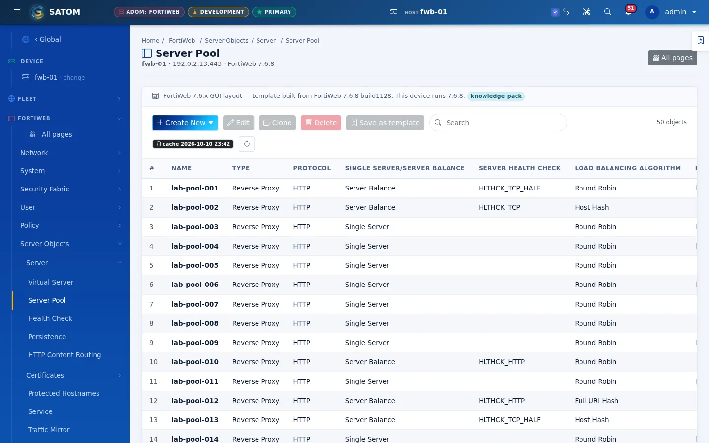
*Server Pool on fwb-01: FortiWeb's toolbar and columns inside the SATOM frame.*

### Working with a list page

- **Rows come from the SATOM cache.** The badge at the right of the toolbar
  says when the cache was taken; **⟳ (Refresh)** pulls the device's
  configuration into the cache and returns to the page (`config_write`).
  FortiWeb's predefined entries are read live from the device instead, carry a
  **live** badge and are read-only.
- **Click** selects a row; **double-click**, **Enter** or **Edit** opens it in
  its editor. **Search** filters the rows.
- **Create New** is FortiWeb's own menu. Where FortiWeb's layout has no Create
  New but SATOM's classic page had one (CA Group, CRL, admin replacement
  messages), a **Create New** button opens SATOM's object editor instead. It is
  never offered for certificates REST cannot create or for file-backed
  objects.
- **Clone** copies the selected object under a new name, with its sub-table
  rows. **Delete** removes it. Both show a dry run first, and Delete runs the
  reference check in §7.2.
- **Save as template** reads the selected object from the device and saves it
  to the Template Library as a *pending* template (§29), filed under the same
  section the classic page used. A Web Protection Profile is captured with its
  sub-policies. This needs the template-save permission.
- **Deep clone** (inline Web Protection Profiles) copies the profile *and* the
  objects it references under new names. The Web Protection Profile list also
  has **Hide default profiles** and **Factory catalog** (§8).
- **Certificates:** **Import** writes Local, CA, Intermediate CA and XML
  certificates over the certificate-only SSH session, because REST cannot
  create them. On Local certificates, **Generate** opens the Certificate Manager
  (§10).
- **File-backed objects** (XML schema, WSDL, DTD, JSON schema, OpenAPI):
  **Upload** files the document in SATOM's artifact store, and **Stored copies**
  lists what is there.
- Under the table, the **config template library** of the object's section
  lists the templates for this object type: View, Apply to devices (with
  dry-run preview and the compatibility verdict), Clone, Delete, New template.

### The editor

Opening an object shows **the dialog FortiWeb opens for it**: its sections,
tabs, folding blocks and inline tables, laid out for the device's build. §7.4
explains the banner and the badges, and §7.5 explains how Save works.

- **Inline tables** (pool members, VIP lists, match conditions…) behave like
  FortiWeb's grid. A row opens in its own dialog. **Create New** is offered
  only for tables SATOM knows and can read, so a table SATOM cannot read is
  never written blind.
- **Reference selectors** are filled from the device's own objects. The pencil
  beside one opens the selected object in a **panel stacked over the dialog**,
  the way FortiWeb drops in a sub-page. **Esc** closes the panel, and choices
  made in the panel feed back into the selector that opened it.
- Below the main dialog, **Not in GUI, but in CLI** lists the fields this
  object has on the build that FortiWeb's GUI does not show (§7.6).

The stacked panel, and the **Create New** button that FortiWeb lacks, use
SATOM's own **object editor** (`objedit`):

- Fields render like the FortiWeb GUI: curated labels, enums with GUI names,
  toggles, reference dropdowns; anything uncurated still shows with a raw-JSON
  escape hatch, so nothing is uneditable.
- **Sub-tables** are edited in place, several levels deep. Every reference
  dropdown has **✎** (edit the selected object) and **＋** (create a new one
  in place).
- If the device is unreachable, the editor renders from the **local cache**
  with an info banner. Fields stay editable and Save still targets the device.
- Every save previews as a dry-run diff before applying.


### 7.1 Reference fields are checked before the write

A **reference field** does not take free text: it names an object that must
already exist on the appliance (a URL-rewrite policy, a user-tracking policy, a
certificate…). If you save a name the device does not have, FortiWeb refuses the
**whole** save with `errcode -651: Invalid input value.` — a message that names
neither the field nor the value, and that also discards the correct fields you
changed in the same save.

SATOM asks the appliance first. When a value is not there you get a refusal that
says which field, which value, which collection, and which names do exist:

> `subresource-integrity-policy: "admin" — "waf/subresource-integrity-policy"
> has no configured objects on this device, so there is nothing
> "subresource-integrity-policy" can name yet`

Three things worth knowing:

- The check runs on **Preview** as well as on **Apply**. A preview that hid a
  certain refusal would have you approve a plan the device will reject.
- **Nothing is written** when a reference is refused — not even the fields that
  were fine. Fix the value and save again.
- If the appliance cannot be reached for the check, the save is **not** blocked.
  The response lists the fields it could not verify (`unverified_refs`); the
  device remains the authority and will still answer -651 if the value is wrong.

A field that offers a **dropdown** is a reference field. A few fields that the
appliance treats as selects still render as text because the collection they
draw from could not be confirmed on this firmware — those are passed to the
device unchecked, exactly as before.

### 7.2 Deleting an object that something else uses

**Delete** refuses while another object still names the one you are removing.
The appliance keeps its own count of references, and SATOM reads it before
sending anything:

> `refusing to delete "urw-full": it is referenced by 2 object(s) —
> inline-protection(wpp-full-lab), inline-protection(wpp-pol-shop-cms). Remove
> those references first, then delete it.`

Why this exists: FortiWeb does **not** reliably refuse deleting an object that
is in use. When it accepts one, nothing fails — the profiles and policies that
named it keep pointing at a name that no longer resolves, and you find out when
traffic breaks.

What to expect:

- The check runs on the **pre-check**, before the confirmation prompt. You see
  the refusal instead of confirming a delete that should not happen.
- Some collections report *how many* references there are but not *which*. The
  message says so rather than showing an empty list.
- If the object cannot be read back from the appliance, it is **not** deleted —
  there is no way to tell an unreferenced object from an unreadable one.
- If this firmware does not report a reference count for that collection at
  all, the delete proceeds as before. A capability the device lacks is not
  treated as a refusal.
- Deleting a **row inside** an object (a sub-table entry) is not affected: the
  parent's reference count says nothing about one of its rows.

To remove an object that is genuinely referenced, clear the references first —
the message names where to look. If you are certain the appliance's count is
wrong, the delete endpoint accepts `force: true`; forced deletes are recorded
in the audit log as `ref_check=forced`.

### 7.3 Fields the build does not have, and fields only the CLI serves

Every Save is also checked against the appliance's **exact firmware build**
(see [Build compatibility](build-compatibility.md)). The preview shows the
result above the request, in a yellow box (red when it blocks):

- *Applies, but on 8.0.6 `token-secret` does not exist in …: it will be
  skipped* — the field is **removed** from the write instead of being sent and
  silently dropped by the appliance (FortiWeb answers 200 for a field it does not
  have). When SATOM knows the new name it says so in brackets. If every field
  you changed is missing on that build, the save is refused.
- *… = '…' is not valid in … (allowed: …): blocked* or *… is out of range …:
  blocked* — a value the build does not accept. The **Apply** is refused
  (`Refused by the build compatibility check: …`); the dry run still shows it.
- *not measured on X — cannot be guaranteed* — SATOM has no evidence for that
  build. The write goes ahead; harvest the build (§30.12) to know.

On some builds some settings exist **only in the CLI**. For those fields the
editor uses the **CLI writer** ([CLI writer](cli-writer.md)):

1. **Preview.** Below the REST request a card *CLI script — fields this build
   serves only by CLI* shows exactly what will be typed (`config` / `edit` /
   `set` / `next` / `end`; secrets masked). A dialect not yet verified on a lab
   box is labelled *dialect not lab-verified*.
2. **Apply.** REST is sent first; the CLI script runs only if REST succeeded.
   If the appliance rejects a line, the change is discarded with `abort` —
   nothing half-applied — and the card says *CLI refused: …* and whether the
   readback confirms nothing was applied.
3. **Readback.** After the CLI script, SATOM reads the object back in a new
   session (and over REST when REST serves it) and shows **Readback (CLI)** and
   **Readback (REST)**, field by field. The editor does not reload, so the
   readback stays on screen. A field that reads back different fails the save
   and is named.

Today this rarely shows: FortiWeb 7.6.8 and 8.0.6 have **no** CLI-only field, so
every FortiWeb field still goes by REST. Fields SATOM cannot classify on the
build are listed as *Not known on this build (sent by REST as before)*. The
permission is unchanged (the editor's write permission); every CLI write is in
the audit log as `config.cli_write`, with field names and the outcome, never a
value.

The cards above belong to SATOM's object editor (the stacked panel and the
SATOM editor pages). On a page in the device's layout the same split runs on
the server, and the Server Policy dialog marks such a field **CLI** in the
*Channel* column of its review (§7.5).

On FortiGate and FortiAuthenticator pages in the device's layout, the "Not in
GUI, but in CLI" section is part of the form, as on FortiWeb (§7.6). On the
FortiADC and FortiAnalyzer tabs, the section is itself the editor of those
fields (*Read values over CLI*, *Preview CLI change*, *Apply*). Objects only
the CLI serves are edited the same way on the device's *Not in GUI, but in CLI*
page (§7.7). On FortiAuthenticator they are also edited on the menu page that
hosts them, which says *Served only by the CLI on this build*.

### 7.4 Pages in FortiWeb's layout: banner and badges

The note above every list and dialog names the layout it is drawn from:
*FortiWeb 7.6.x GUI layout — template built from FortiWeb 7.6.8 build …. This
device runs 7.6.8.* A **knowledge pack** badge means the layout came from an
imported knowledge pack. Hover the badge to see where it came from. When the
fit is not exact, the note becomes a warning:

| Banner | Meaning |
|---|---|
| *No layout was measured on … itself; this one is from …, the closest build of the same train* | Fields this device has and the layout does not place are listed under **Not in GUI, but in CLI** (§7.6). |
| *This layout was built from … Newer firmware adds or renames fields …* | The device runs a newer build than any layout. Fields the newer build adds are not shown in the form. |
| *… older than every layout template … Some fields shown may not exist on this firmware* | The device runs an older build than any layout. |
| *The firmware of this device is not known yet* | Run a firmware check on the device. |
| *Operation mode not cached for this device* | Fields that depend on the operation mode are shown and marked. |

Fields **show and hide as you edit**, the way FortiWeb's GUI does: every field
and section carries FortiWeb's condition, and the device's facts are already
applied. A condition SATOM cannot evaluate leaves the field shown. When
FortiWeb would hide fields for the current values, the title bar says
*N fields hidden by FortiWeb for these settings*.

Badges next to a label:

| Badge | Meaning |
|---|---|
| **conditional** | FortiWeb shows this field only under a condition SATOM cannot evaluate here. Hover to see what it depends on. |
| **key not measured** | The GUI crawl could not tell which REST field this control shows. Hover to see the candidates. |
| **choices not measured** | FortiWeb offers a list of choices the crawl could not read. Type the value the way the CLI takes it. |
| **No API on this build (GUI only)** | The field has no API on this build. It is shown the way the GUI shows it and is never saved. A whole page can be GUI-only too, and is then drawn read-only. |
| **read-only** / an endpoint name | FortiGate and FortiAuthenticator: the GUI draws the field read-only, or saves it into another object that is edited on its own page. |

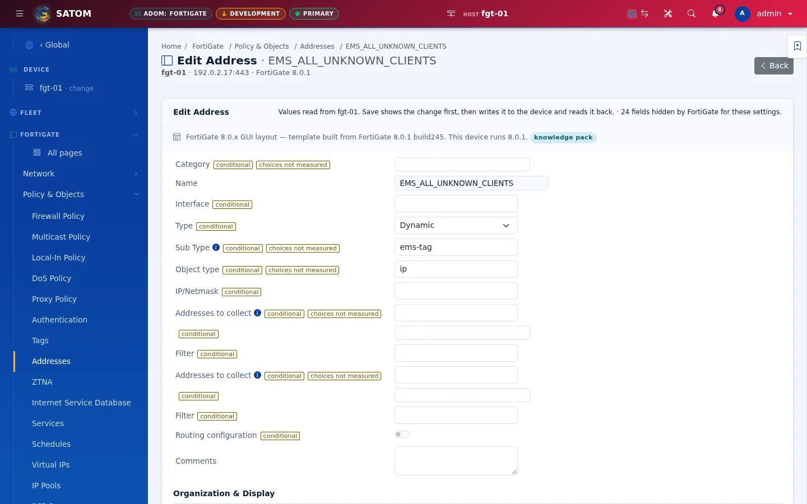
*Edit Address on fgt-01: conditional fields and "choices not measured" badges.*

A **settings page** (a single object such as System → Admin → Settings) adds
**Save as template**, which captures the whole object as a pending template,
and **⟳**, which refreshes it from the device, to the page header. The section's
config template library is listed below the form.

### 7.5 How a save travels

The same sequence runs on every page in a device's layout. Nothing is written
before you have seen the change.

1. **Save** collects the fields you changed. Fields hidden by the show/hide
   rules are not sent, and a field you did not touch is never sent back.
   Changed fields in **Not in GUI, but in CLI** travel with the rest.
2. SATOM runs a **dry run** for each object the change touches. Most changes
   touch only the dialog's own object. A field that FortiWeb's GUI saves into
   another object goes to that object, and a form that FortiWeb's GUI writes
   through its own GUI API goes through that API.
3. **Review the change** lists each field with *Was*, *New* and *Channel*
   (`REST`, `REST (GUI API)` or `CLI`). An *Endpoint* column appears when more
   than one object is involved, and the raw request is folded underneath. Choose
   **Back to the form** or **Apply to <device>**.
4. **Apply** writes the objects in order and stops at the first refusal. The
   message names the endpoint that refused and what was already written.
5. On FortiWeb object pages and in the Server Policy dialog, the server checks
   the change before anything leaves SATOM, in this order:
   - a template-managed Web Protection Profile is read-only: the save is
     refused and points you to the Template Library. This holds when the
     profile is opened from a policy's pencil, too;
   - another user's edit lease on the object blocks the save, and nothing is
     sent. A row of an inline table is checked against its parent's lease;
   - every reference value must exist on the device (§7.1);
   - the build compatibility check runs (§7.3): a blocking finding refuses the
     apply and names the finding, and fields the build does not have are
     stripped instead of being lost behind a success. The dry run is never
     refused by this check; the object editor shows its report in the review.
     If every changed field is missing on the build, nothing is saved.

   The channels then split. REST fields go by REST. Fields the build serves
   only by CLI go through the CLI writer over SSH, and only after the REST part
   succeeded. If REST fails, the CLI part is not sent. The *Channel* column of
   the review names the CLI fields of every object in the change, a bound
   object's included.
6. After a successful apply, SATOM releases your edit lease on the object (a
   row of an inline table leaves its parent's lease alone), updates its copy
   and the page reloads.
   FortiGate and FortiAuthenticator pages re-read the object from the device.
   If the device stored a different value, the page says *Saved, but the device
   stored different values: …*.

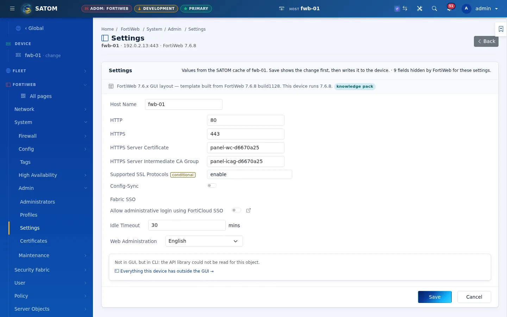
*System → Admin → Settings on fwb-01, with "Not in GUI, but in CLI" below the form.*

### 7.6 Not in GUI, but in CLI

Every object editor, for all five products, ends with a collapsed section titled
**Not in GUI, but in CLI (n)**. SATOM shows **every** field the device has on
its exact build. A field the Fortinet GUI does not show is never dropped and
never merged into another group: it goes here. The section is always drawn,
even when it is empty. An empty section says why: every field is in the GUI,
or the page's GUI layout has not been measured yet.

Two kinds of evidence decide what is "not in the GUI":

- the **API library** of the device's exact build: a field the CLI has and REST
  does not is never in the GUI;
- the page's **GUI layout**, where one was measured: a REST field the layout
  does not place is not in the GUI either. Without a measured layout SATOM
  cannot tell a GUI field from a REST-only one, so those stay in their usual
  groups and the section says so.

Each field carries the channel SATOM writes it by:

| Badge | Meaning |
|---|---|
| **REST** | The REST API serves it. A normal Save writes it. |
| **CLI** | This build does not serve it over REST. Save writes it over SSH through the CLI writer. |
| **unverified on this build** | No source measured the field on this build. It is shown, never hidden. It is not written until a channel is measured. |

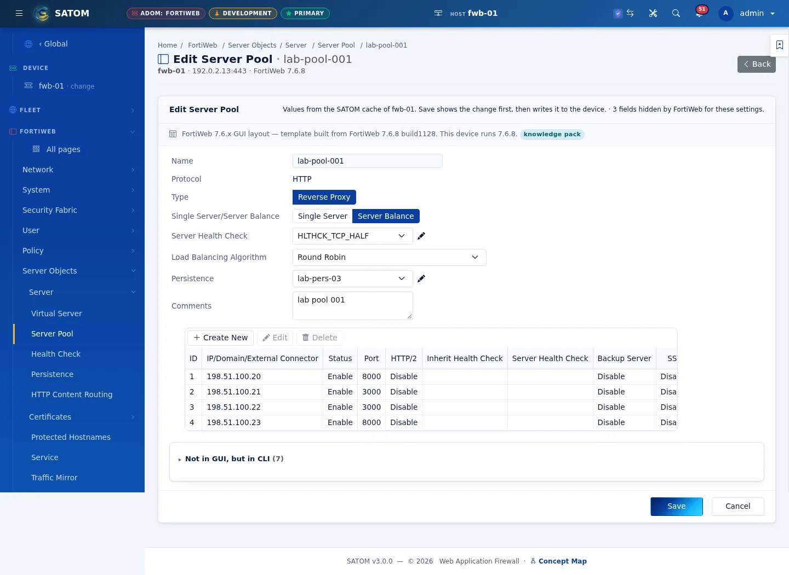
*Edit Server Pool on fwb-01: the member table and the collapsed "Not in GUI, but in CLI (7)" section.*

In an editor you can write to, the fields in the section are part of the form,
and Save sends them with the rest (§7.5). On a Create New form, a CLI-only
field says *set it once the object exists*.

**Read values over CLI** appears when the section has CLI fields and the
object exists. It reads their current values over a read-only SSH session
(`show full-configuration`) and fills them into the inputs; a value you leave
unchanged is not sent back. **Secrets are never returned**: their input says
*secret — not shown*. Reading needs only view permission. Nothing is written.

Where a view has no editor of its own (the FortiADC and FortiAnalyzer
tabs, objects only the CLI serves, read-only users), the section is a table of
*Field / Channel / Type / Value*:

- With `config_write`, each CLI field is an input. Name the row (and its parent
  row, for a nested table), then use **Read values over CLI**, **Preview CLI
  change**, which shows the script, and **Apply**.
- REST fields show *written by the object's own form*.
- Unverified fields show *not writable until measured on this build*.
- A write that names any REST or unmeasured field is refused whole
  (*nothing was sent: …*), so a half-applied change cannot happen.
- When the product's CLI dialect has not been verified on a device yet, a note
  asks you to read the previewed script before you apply.
- Every apply is recorded in the audit log as `appliance.not_in_gui.save`.

### 7.7 The per-device page

**Appliances → *device* → Not in GUI, but in CLI** (`/appliances/<id>/not-in-gui`)
lists everything the device's build has outside the Fortinet GUI, in one
place. Every section in the views links to it as *Everything this device has
outside the GUI →*. The same inventory is on the console, without the values
and the editor: `sudo satom get device not-in-gui <device> [--endpoint <key>]`.

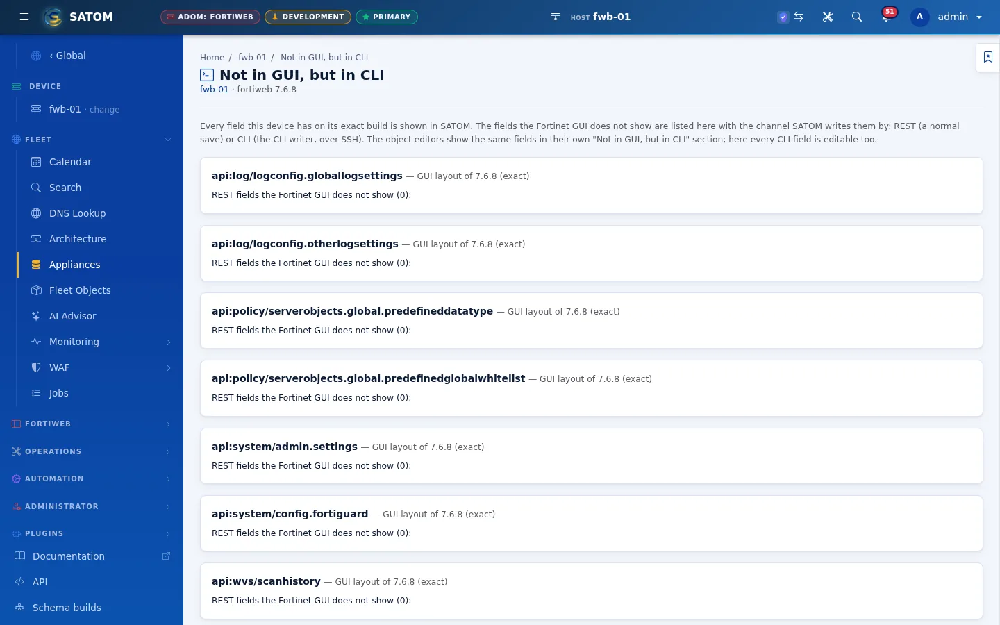
*The per-device page for fwb-01: layout-measured pages, CLI-only objects and CLI-only fields.*

- **Layout-measured pages**: for each page whose GUI layout was measured, the
  REST fields the Fortinet GUI does not show.
- **Objects the device's GUI does not draw**: whole objects the device serves
  over REST that no page of its own GUI reads on this build (FortiADC 7.6.7:
  VDOM and VDOM links, per-VDOM syslog and FortiAnalyzer, DNS, ISP provinces,
  connection pool, alert targets…), each with its rows, read from the device
  when the page opens (read only; secrets are never shown) and a link to the
  page SATOM draws it on. On FortiADC the list also names what the build serves
  that no measured page reads at all (7.6.7: Auto Backup, whose GUI tab is an
  action): this page is where SATOM shows it. An object the build answers 404
  for is not listed.
- **Objects only the CLI serves**: whole objects REST does not have at all (for
  example FortiAuthenticator `system/dns`). Each one is editable as described in
  §7.6.
- **CLI-only fields of objects the REST API serves**: per object, editable the
  same way.

If the device's running build is unknown, the page asks you to run a firmware
check first. For a product with no measured GUI layout and no measured CLI
tree, the page says that SATOM cannot split GUI fields from CLI-only fields yet.
In that case every field the REST API returns stays in the object views, and
nothing is hidden.

## 8. Web Protection (WAF)

In the FortiWeb ADOM, the Web Protection pages belong to the device's own menu:
the **FortiWeb** group in the sidebar. SATOM builds that group from the measured
GUI layout of the selected device's firmware build (the layouts come with the
knowledge packs). The pages therefore have the same names and sit in the same
places as in that FortiWeb's GUI. **Web Protection Profile** is under
**Policy** (Inline / Offline tabs). The protection areas are under **Web
Protection**. On a 7.6 build these are Known Attacks (Signatures / Custom
Signature), Protocol, Access, Input Validation, Cookie Security, Advanced
Protection and Data Loss Prevention. Another build shows whatever its own GUI
has. **All pages** at the top of the group lists every page in the device's
menu order.

The old SATOM **WAF** group of the FortiWeb ADOM (Web Protection Profile, Web
Protection and the protection areas) is gone. Its links still work: an old URL
redirects to the device-menu page that draws the same collection. With no
device selected, or no measured layout for it yet, the FortiWeb group shows
only **Server Policy**. A collection that no measured page draws yet has no
menu entry until its page is crawled. The fleet-wide WAF pages and the
device-scoped WAF tools (Search Attack ID, Exceptions & Signature, WAF
Artifacts) are under **Operations → WAF** (§13.1, §13.2).

### 8.1 Web Protection Profiles and signatures in the device menu

**Web Protection Profile** is a FortiWeb-layout list, with the SATOM tools the
old profile page had:

- **Deep clone** (Inline tab) copies the profile and the objects it references
  (sub-policies, signatures, rules) under new names.
- **Save as template** reads the selected profile from the device and saves it
  to the Template Library as a pending template.
- **Hide default profiles** hides the predefined profiles. It is a per-user
  preference, the same one the old page used.
- **Factory catalog** opens the predefined profiles per firmware build and API
  version.
- A **template-managed** profile carries a **Template** badge. On this device
  it is read-only: Edit becomes View, and Delete is unavailable. To change it,
  edit it in the Template Library.

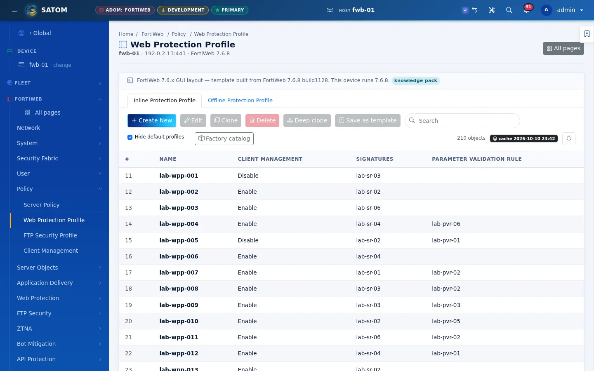
*The Web Protection Profile list in FortiWeb's own layout, with SATOM's profile tools*

**Known Attacks → Signatures** is a FortiWeb-layout list as well. Each signature
policy opens in the FortiWeb-layout object editor.

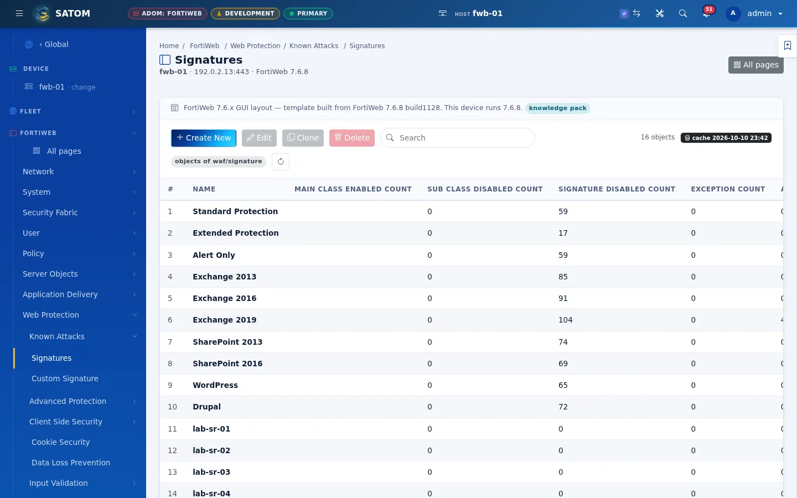
*Known Attacks → Signatures, drawn from the device's own GUI layout*

SATOM's own tools are still served:

- **Signatures editor:** browse signature categories, search the full
  signature catalog (2,400+ signatures by name/class/state), open any
  signature's details, disable it, set alert-only, or add a **per-signature
  exception**, with the same element-type-gated form as the appliance GUI. No
  menu entry leads to it on a device whose layout draws the Signatures page.
  Open it at `/web/web-protection/<device id>/signatures/<signature policy>`.
- **166 curated object kinds** (ported from the desktop manager and validated
  against the vendor admin guide) drive SATOM's own object forms: correct
  enums, field gating, inline help ("what does this do", "how the backend
  reacts"), and an explanation under every Action dropdown.
- **Regex Lab:** open it from the **Tools** menu in the top bar (Regex
  calculator, Regex cheat sheet, Pattern library) on any page. In SATOM's own
  object editor, in the dialogs of the pages in FortiWeb's layout (the Server
  Policy dialog included) and on the Exceptions page, every regex-capable
  field also has a `.*` button. That button opens the lab on the field and
  writes the tested pattern back into it. The lab tests patterns server-side with curated
  examples per section. Its rewrite preview numbers captures the way FortiWeb
  and FortiADC do: `$0` is the **first** `( … )` group, `$1` the second.
- In SATOM's own editor, profile-level editing shows each sub-policy as a
  dropdown with Edit/＋, down to six levels of nesting.

### 8.2 Signature source, signature index and database freshness

Every FortiWeb downloads its own signature database from FortiGuard. SATOM
does not ship signatures, and new signatures need no SATOM release or pack.
SATOM reads them off a device instead.

**The signature source.** On **Administrator → Signatures**, choose one FortiWeb
as the *signature source*: one with a valid FortiGuard licence that updates on
schedule. **Save and collect now** reads its whole signature catalog right away.
This runs as a background job, which the job dock tracks. The read is REST and
read-only:

| What | How |
|---|---|
| Database versions | `GET /api/v2.0/system/config.fortiguard` returns, in one call, the attack-signature DB and the other databases the firmware reports (antivirus, IP reputation, GeoIP, known bots…), with their last update and licence validity. The fallback is `diagnose system update info` over SSH (signature DB only). |
| Catalog | `waf/signature.advanced.dictionaries` + `.details`: every main class, sub-class and signature with its description |

**The signature index.** SATOM indexes each read locally: every signature id
with its class, description and lineage (the DB version it first appeared in,
last seen, removed in). It also keeps a **snapshot** per database version.

- A read whose content equals the latest snapshot writes nothing.
- A new version records what it **added, changed** (description or class)
  **and removed**, and notifies every administrator in the in-app bell. The
  snapshot history lists it, with a details page.
- The first snapshot is the *baseline*: its signatures are not reported as new.
- A read that returns no signatures is refused, so it never empties the index.

The page searches the index by id, description or class (removed signatures on
request). The index also rewrites the catalog that the signature editor and
the WPP views read. The `signature_sync` scheduled action collects too, but
only from the configured source. It refuses any other target, so another box's
older database can never appear as a fleet change.

**Freshness, every FortiWeb.** The daily scheduled action **`signature_check`**
reads the database versions of every FortiWeb (one REST call per box) and
records when they last changed. When the **source's** signature version is not
the one the index holds, it collects and indexes the catalog in the same round.
A failed catalog read makes the round red.

The page lists every device with:

- its signature DB version and the channel it came from (`rest` or `cli`);
- last update and licence;
- the other databases;
- the time of the check;
- a status: *current*, *stale* or *unreadable*.

The alert engine (§26.6) raises a **device alert** in any of these cases:

- The device's signature database is **older than 7 days**. Age is measured
  from the device's own "last update" time. When the device gives none, it is
  measured from when SATOM saw the version change.
- The device reports that it **never** downloaded an update. When the device
  reports an invalid FortiGuard licence, the alert names it as the reason.
- The device's version cannot be read: REST and SSH both refused.

These alerts share the family, toggle, routing and cooldown of the other
device-health alerts. The limit is the setting `alerts.signature_max_days`.

FortiWebs registered with **no signature source**, or with a source that no
longer exists, raise `device.signature_source_missing`. Devices in
maintenance are skipped. A node updated from 2.x has no `signature_check` row
until you create it (`sudo satom execute seed actions --yes` on the primary,
§22.4).

A knowledge pack can carry **signature metadata**: public FortiGuard
encyclopedia data (name, severity, category, CVEs, a link). None does yet,
because FortiGuard's terms do not permit redistributing it, so the section
ships empty until they do. When a pack carries it, the signature search shows
a severity badge and the CVEs next to each id it knows, and the signature's
details add a **FortiGuard** row. Ids with no metadata show as before.

## 9. Exceptions & signature carve-outs

**Exceptions & Signature** is the single place to author every policy-bound
carve-out (WAF exceptions *and* signature customizations) for one FortiWeb.
It is in the **Operations → WAF** submenu of the FortiWeb ADOM, next to Search
Attack ID and WAF Artifacts. It is not on the Global console's WAF menu,
because it is a FortiWeb-ADOM page and a link from Global would switch the
tab's ADOM. The URL is `/web/exceptions/<device id>`.

The page always works on one device: the one selected in the FortiWeb ADOM
(§3.1). Pick it on the Service Diagram or with **change** next to
the device name at the top of the sidebar. If no device is selected,
`/web/exceptions/` sends you to the Service Diagram to pick one.

The page title names the device: **Exceptions & Signature Carve-outs —
<device>**. The carve-outs it lists are *desired state* recorded in SATOM.
Authoring writes nothing to the box: pushing is a separate step. To see who
across the estate holds a given carve-out, use **Fleet inventory** at the top
of the page. It opens Operations → WAF → Exceptions (§13.1).

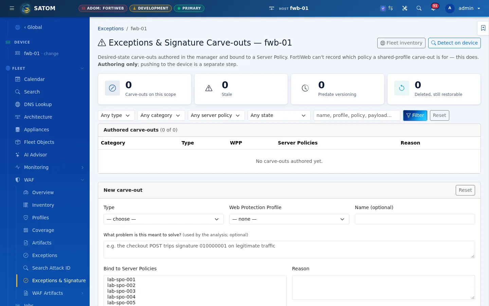
*Operations → WAF → Exceptions & Signature: the carve-outs authored for fwb-01*

The team rules the app enforces:

1. **Templates stay clean.** A template-managed WAF profile cannot receive
   exceptions — the app blocks the save and offers the fix.
2. **Guided clone.** When you try to except a locked/shared profile, the app
   proposes cloning it for that specific server policy (name suggested by the
   Naming catalog), re-binds the policy to the clone, moves the carve-outs,
   and re-submits your change — one flow.
3. **Lifecycle.** Exceptions are bound to server policies. Deleting a policy
   purges its carve-outs; swapping a policy's WAF profile flags them **STALE**
   (never silently deleted) with a banner to re-target. A change made on the
   device itself, outside SATOM, is caught when the page opens: such
   carve-outs are flagged **DRIFT** (below).
4. **Capacity.** Injections check device limits (e.g. 128 filter entries per
   signature set) and clone operations check profile headroom.

Other tools on the page:

- **⬆ Inject to device** — push authored exceptions onto the box: pick the
  live target object, review the dry-run plan, apply.
- **🔎 Detect on device** — read the exceptions that already exist on a box
  and import them as desired-state, bound to the right policy.
- **Which Server Policy holds a carve-out:** a count of carve-outs per
  Server Policy, unbound ones included. A banner above it names the carve-outs
  that went **stale** because their Server Policy was re-bound to another
  profile. Edit a stale carve-out to re-point it (saving clears the flag), or
  delete it.
- **DRIFT — not on the device:** each time the page opens, SATOM reads the
  device's Server Policies and the profile each one uses, and compares them
  with the carve-outs. A carve-out is flagged **DRIFT** when no Server Policy
  it names is still on the device using the profile it was authored for: the
  policy is gone, or it now uses another Web Protection Profile. That happens
  when the change was made on the device itself, outside SATOM, where the
  re-bind hooks behind **STALE** never ran. A warning banner gives the count,
  *n carve-out(s) no longer match the device*, with **Show them**; each such
  row carries a **DRIFT** warning badge next to its category; and the *State*
  filter has a **not on the device** option. Re-point each one at the
  policy's current profile, or delete it. Carve-outs already flagged STALE and
  carve-outs bound to no policy are never flagged DRIFT. If the device's
  policy list cannot be read, nothing is flagged: an unreachable device is not
  evidence that a policy is gone.
- **Filters** (type, category, Server Policy, state, free text over name,
  profile, policy and payload) are applied by the server, so the counts match
  the rows you see.
- Per carve-out: **Inject** (push to this device), **Deploy** (place it on
  other FortiWebs), **Versions and rollback**, and **Delete**. A rollback adds
  a new version and deletes nothing. **Deleted carve-outs that can still be
  brought back** are listed separately, with their bindings.
- **Analyse before implementing** — SATOM's own deterministic analysis of the
  draft is available to anyone who can open the page; the assistant's opinion
  (the draft is sent to the configured AI provider) is added only for users
  holding `advisor.use`.

Authoring, injecting, deploying, deleting and detecting need `config_write`;
without it the page is read-only and those buttons are hidden or disabled.
Deleting always goes through the impact check (the guarded delete).

### 9.1 Search Attack ID — from a block page to a reviewed carve-out

When FortiWeb blocks a request it shows the caller a block page carrying an
**Attack ID** (`000000004106`). That number is the only thing the person who
was blocked can give you, and on its own it says nothing. **Search Attack ID**
resolves it. Paste the reference from the block page and SATOM finds the
attack-log entry it refers to. The whole triage is then on one page: what was
blocked, why, whether it should have been, and the exception that would let it
through if it should not.

Search Attack ID is in the **Operations → WAF** submenu of the FortiWeb ADOM
(`/waf/attack-search/`). It does not depend on the device selected in the
sidebar: the reference chooses the appliance.

- The full reference, `id-<device>-<number>` (for example
  `id-fwb-01-000000004106`), names the appliance. SATOM matches it against
  appliance names, ignoring case. If no name matches, SATOM tries management
  addresses and warns that the device may have been renamed since the block
  page was served.
- A bare MSG ID (`000000004106`, or unpadded `4106`) names no device. Pick the
  appliance yourself.
- An appliance you pick explicitly always wins over the one in the reference.

Opening the page, searching, explaining a field and building a carve-out need
only the `view` permission. **Analyze** and **Ask the AI about this field**
need `advisor.use`. Saving a carve-out, accepting or rejecting a drafted one,
and inserting it need `config_write`.

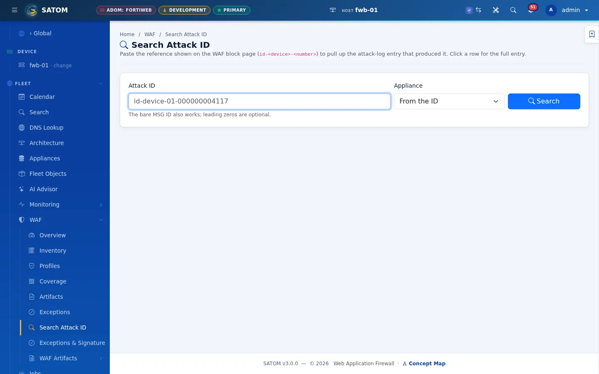
*Operations → WAF → Search Attack ID in the FortiWeb ADOM*

Everything on this page **reads**. Nothing is pushed to an appliance until you
explicitly ask for it in §9.6, and no draft leaves the page approved.

**The results table** lists date, MSG ID, type, subtype, policy, source and
destination address, and action. If the ID matches nothing — a stale block
page, the log rotated, the wrong appliance — you get the most recent entries
instead, in the same columns, so the page never answers with an empty box you
cannot act on.

One extra column matters before you touch anything: the **Web Protection
Profile** behind each policy, and whether it is shared. A profile that only
this Server Policy binds takes an exception in one click. A profile that four
sites share does not — see §9.5. The column names the other policies when it is
shared, and reads `unknown` when SATOM could not read the bindings off the
device, because "could not ask" and "binds nothing" are opposite facts.

### 9.2 The entry panel: explaining one element at a time

Click any row and a panel slides in from the right with the full entry — around
twenty-two fields, each on its own line. Two icons sit beside every one:

- **ⓘ Explain this field.** Opens a short local reading directly under the
  field: what the element is, what *this* value classifies as, and what to look
  at next. It is computed on this node from the value alone. There is no WHOIS,
  no geolocation and no threat-feed call — your client's addresses, hosts and
  URLs are not sent anywhere, and the page still works on an isolated
  management network. The single exception is a reverse-DNS lookup against this
  host's own resolver, hard-capped at 1.5 seconds.
- **💬 Ask the AI about this field.** Sends the question on the click and
  renders the Advisor's answer underneath that same explanation. Leave it there
  for a general reading, or type your own question in the box below and press
  **Ctrl+Enter** (⌘+Enter on a Mac); follow-ups continue the same thread, so a
  second question does not mean restating the entry. This icon is drawn only
  when Scout, the AI assistant, is enabled (§33) — a button that could only ever refuse
  teaches you to distrust the buttons.

  This path explains and **cannot author**: it is told not to draft a carve-out,
  none is returned to the screen, and one drafted anyway is dismissed rather
  than left waiting as an unreviewed proposal.

Every analysis on the page — local or AI — is stamped with the same line:
engine, elapsed time, and tokens. `no tokens` means it was computed locally and
spent none; `tokens not reported` means the provider did not say, which is not
the same claim as zero. Failures are stamped too: a provider that burned forty
seconds and then failed still burned them.

### 9.3 Building the exception

Below the entry sits the carve-out builder. It opens with a proposed **kind of
exception** and the scope already ticked, and tells you why for each box.

- The kind is derived from what actually blocked the request. A block by HTTP
  Protocol Constraints is not fixed by a signature exception, and the log line
  does not say so in those words.
- **Required fields are always taken.** FortiWeb keys an Allow Method or
  HTTP-constraint exception on a URL pattern; leaving it out produces no
  exception at all, so it is marked required up front rather than offered as an
  optional narrowing.
- **A signature exception takes exactly one element** — the most precise the
  entry carries. FortiWeb matches one element per row, so ticking URL *and*
  source address cannot mean "both"; SATOM uses the more precise one and says
  which of your ticks it could not honour.
- **The source address is held back** while the request can be described by URL
  or host. It identifies the caller, not the traffic, so an exception scoped to
  it stops applying the moment that integration is re-addressed. It is one
  click away and the reason it was left off is on screen.

Everything stays editable — this is a starting point, not a decision. Only
fields that *narrow* are ever pre-ticked, so the default cannot widen a
carve-out, and unticking immediately restores the explanation of what is now
missing.

**Preview** assembles the payload on the server from the row the appliance
returned, and shows you the route (policy → profile → module → type), the
**breadth** — what stops being inspected and what still applies — and the exact
body. Breadth is computed from the payload, not from the type: a signature
exception is the narrowest thing there is *only if it names an element.*

### 9.4 Asking the AI to judge the entry

**Analyze** sends the entry to the Advisor and returns a verdict
(`false-positive`, `true-attack`, or `uncertain`), a risk level, and — when
it judges the block a false positive at low or medium risk — a drafted
exception you can **accept, adapt, or reject**.

- SATOM never sends the row your browser is holding. It sends *which* entry and
  *which* appliance, and re-reads the entry from the device. A browser that can
  supply the evidence can invent it.
- Verdict and risk are read from the model's own declared lines. If they are
  missing they stay empty — "the model would not judge" and "the model judged
  it harmless" cannot look the same on a screen that authorises an exception.
- If the model drafts a proposal that contradicts its own verdict, the page
  says so in red instead of offering an ordinary Accept.
- **Accept saves a draft.** It does not push anything to the appliance.

**The verdict advises; you authorise.** You can author a carve-out the Advisor
did not recommend — the common case is a real attack pattern that a known
caller must be allowed to send — but contradicting the verdict (a `true-attack`
reading, or a high/unacceptable risk) requires a written justification of at
least twenty characters, stored on the rule and in the audit log. Refusing it
outright would not prevent the exception; it would move it to the CLI, where
nothing records why.

### 9.5 Shared and template profiles

An exception lives on the Web Protection Profile, and FortiWeb records nothing
about which Server Policy it was authored for. So a carve-out on a profile that
four sites share applies to all four.

SATOM reads the bindings off the device and resolves one of four states:

| state | what happens |
|---|---|
| **exclusive** — this policy owns the profile | authored directly; no clone, because there is nothing to protect it from |
| **shared** — other policies bind it too | refused, naming the other policies, with the guided clone offered |
| **template-managed** | refused the same way (team rule 1, §9) |
| **unknown** — the device could not be read | treated as shared. Unknown is never assumed safe |

The guided clone derives a policy-specific profile, re-binds the Server Policy
to it, and authorises the exception there. **The clone is a real write to the
appliance and is never implicit** — it happens only when you ask for it in the
same action.

The copy is **deep**. A profile is not one object: it names roughly forty
sub-policies, and a carve-out physically lands inside one of them. A profile
that shares its sub-policies therefore shares every carve-out written into
them, and a clone that copied only the top object would look isolated while
leaking exactly as before. So every sub-object the new profile may own is
recreated under this policy's own name — `am-shop` becomes
`am-shop-pol-shop-cms` — and the references are re-pointed to the copies.

Three things are **not** copied, and SATOM says so before it writes anything:

| left shared | why | can you override it? |
|---|---|---|
| **predefined** objects (`Standard Protection`, `Predefined - Known Bots`…) | a copy stops receiving FortiGuard updates | yes, object by object |
| objects an **approved template** governs | copying takes this policy out of the template without anyone deciding to | yes, object by object |
| anything whose **parent stays shared** | re-pointing a reference is a write to the parent, so the copy would push the new name into an object other profiles still read | no — it is a consequence, not a choice |

The Exceptions page previews the clone first: what will be copied, what will
stay shared, and the reason for each. Applying a plan that leaves anything
shared takes an explicit confirmation, because a profile that is isolated in
most places is not a state you can reason about three months later.

Capacity is checked for the whole plan, per object type, before the first
write — a clone that dies half-way is not re-bound, and its orphans have to be
found by hand. Object types with no configured limit are listed as unchecked
rather than passed over quietly.

Saving a draft on the Exceptions page (§9) warns rather than refuses: a draft
in the database lets nothing through. The Attack ID page refuses, because it is
one click from a push. The push itself refuses hardest — that is where the leak
physically happens.

### 9.6 Putting the rule on the appliance

**Insert** is two steps on purpose. The first returns the exact method,
endpoint and body SATOM would send, and writes nothing. The second sends it.
Approving a rule and approving a specific POST against a production WAF are
different acts. It uses the same planner as the Exceptions page.

### 9.7 What is recorded

Every search, every field question with its question text verbatim, every
analysis, and every decision goes to the audit log. Accepting a proposal
records **both** the payload the model proposed and the one you approved —
those are different facts and an auditor needs both. Rejecting one is recorded
too, not erased.

### 9.8 Every carve-out records the build it was written for

A FortiWeb answers a write carrying a field its build does not know with **200
and discards the field** — so a carve-out authored on one build and pushed to
another can land without the very field that made it a carve-out, and report
success. Every carve-out (and its fleet library item) therefore records the
**firmware build and REST API version** of the appliance it was authored on:

- a copy placed on another appliance keeps the **source** build, because its
  payload was written against that build;
- editing the payload restamps it; a rollback or restore brings back the build
  of the old payload. The stamp is versioned but kept out of the content hash,
  so no existing history gained a version;
- **Inject to device** and the Attack ID insert check the payload against the
  target's running build with the template rules (§29.1.1): a field the build
  discarded, renamed or does not serve **blocks** the push. A user with
  **Approve templates** (`operations.template_approve`) can override with a
  reason, audited as `exception.compat.override`.

The API sweep does not measure the carve-out sub-tables yet, so most pushes
show *no evidence* for their fields: that is a **warning, never a pass**, and
the gate starts to bite on its own once a sweep or a knowledge pack records
those fields. Line Profiles show the build of each line's WPP template and the
builds its approval covers.

## 10. Certificate Manager

Automation → **Certificate Manager** — in the Global ADOM, and in every device
ADOM under Operations › Automation (product-scoped: in the FortiWeb ADOM you
see FortiWeb material, in ADC the ADC material, in Global both). SATOM manages
certificates on FortiWeb and FortiADC only, so the FortiGate, FortiAnalyzer
and FortiAuthenticator ADOMs show the entry disabled with that reason, and
Global's **Scan devices** skips those kinds instead of listing them as
unreachable. Administrator role (`user_manage`) required.

- **Inventory & scan:** sweeps each device's certificate stores (FortiWeb via
  REST/SSH, FortiADC via REST), parses X.509 (CN, SANs, issuer, validity) and
  maps **bindings** — which policies / SSL profiles / admin GUI actually use
  each certificate. Removal is fail-closed: a bound or unverifiable
  certificate is refused.
- **Issuance — three origins** (New certificate, one tab each; the inventory
  also has **Generate CSR** and **Import** buttons that open the right tab):
  - **Signed by the configured CA:** SATOM creates the CSR and signs it
    through the configured protocol — **Microsoft ADCS** or **ACME**
    (Let's Encrypt-style, http-01/dns-01) — the protocol is a Settings
    dropdown, not a code change.
  - **CSR for another CA:** SATOM generates the key and the CSR. The key
    stays in SATOM, encrypted; the row waits as *awaiting signature*. Its
    page shows **1. Download the CSR** (file or copy) and **2. Import the
    signed certificate** (paste or upload the PEM; a chain after the leaf
    is fine). The import is refused unless the certificate's public key is
    the stored key and every requested SAN is present. A pasted private key
    or a PKCS#12 is refused there too: the request's key was made in SATOM
    and a PKCS#12 would bring another one.
  - **Import certificate + key:** for a certificate whose CSR was made
    outside SATOM — a PEM certificate and its key, or a PKCS#12 with its
    password. The key is stored encrypted and marked *key from outside*.
- **Rotation (renew → swap → off the device → out of SATOM).** A renewal
  never replaces the certificate in place: it is issued and deployed under a
  new name **N days before expiry**, and takes over every binding of the old
  one **N days later** (its swap date). The old certificate stays on the
  device so **Roll back** can return the bindings in one click; it leaves the
  device **N days after the swap**, and its key leaves SATOM **N days after
  that** (serial, dates and timeline stay as the record). The four numbers
  are defaults in Settings → Certificate Manager → Lifecycle policy and can
  be set per certificate on its page; the swap delay has to be shorter than
  the renew window, so the swap lands before the old certificate expires.
  With **Renew automatically** on, the sweep does the renewal itself for the
  configured CA. For another CA it generates the new CSR and notifies you, and
  the swap is scheduled when you import the signed certificate. Imported
  certificates are only notified: renew them outside and use **Replace**.
  **Swap now** skips the wait.
- **Revoke** works with whichever CA is configured: SATOM runs that CA's
  revoke command. When it cannot (no revoke command, or a certificate signed
  by another CA), the certificate is marked revoked and the **revocation
  register** keeps it *pending at the CA* until someone confirms it there.
  Every revocation is in the register (serial, fingerprint, reason, who,
  result), and the register outlives a deleted record. A certificate still in
  use is refused unless you tick "revoke even though it is in use" (a
  compromised key). With the rotation's "revoke the old certificate", the
  old one is revoked (reason `superseded`) as it leaves the device, never
  while it still serves.
- **Delete** asks for confirmation and is refused while the certificate is
  bound, or when its bindings cannot be read. It can revoke first and take it
  off the device first; either failing stops the delete.
- **A CA in an OPNsense firewall** (System › Trust) signs through the ADCS
  command template with the bundled signer `scripts/opnsense_ca_signer.py`.
  Set **CA** to `https://<firewall>:<port>`, **CA name** to the issuing CA's
  refid, **User** to an API key whose user has only the *System: Certificate
  Manager* privilege, and the API secret in the password box. The class
  **template** is the OPNsense certificate type (`server_cert`, `usr_cert`,
  `combined_server_client`). Submit command:
  `/opt/satom/venv/bin/python /opt/satom/scripts/opnsense_ca_signer.py sign
  --url {ca} --ca-ref {ca_name} --key {user} --cert-type {template}
  --csr {csr} --out {out} --pin-sha256 <pin>`. Get the pin with
  `… opnsense_ca_signer.py pin --url https://<firewall>:<port>` and compare it
  with the firewall's certificate before saving it. The signer checks the pin
  before it sends any credential.
  The private key stays in SATOM: OPNsense receives only the CSR. OPNsense's
  CSR signing drops the request's subjectAltName, so the signer sends the SANs
  separately. The signed certificate stays in the firewall's Trust store as
  the CA's issuance record.
- **The CA secret is also passed to the signer as `$SATOM_CA_SECRET`**, so a
  submit or revoke command can leave out `{password}` and keep the secret off
  the command line. `{password}` still works for signers that only take it
  there (certipy).
- **Deploy:** FortiWeb receives cert+key over SSH (the only transport the
  appliance supports for key material); FortiADC over REST. The Admin GUI
  certificate can be swapped with a dry-run preview.
- **Lifecycle policy:** the default rotation windows above, plus clean-up
  of expired and revoked material from devices, auto-apply or report-only. A
  **Run sweep now** button and a nightly scheduled action keep it moving; the
  page lists everything currently due, and each row shows its **next step**
  and when.

**The ACME DNS-provider registry** lives on the same settings tab
(`Settings → Certificate Manager`), and it is a *registry*, not a fixed list.
Each entry is a provider: a slug, a label, the flag the ACME client needs, a
documentation link, an enable switch, a sort order, and **its own list of
credential fields**. Because the field list is data, adding a DNS provider that
was never shipped is a catalog entry, not a code change.

- **Credentials are saved per provider**, into that provider's own named fields,
  and are never returned to the browser — the audit record names which variables
  were touched, never their values. Each field has an explicit *clear* tick, so
  emptying a credential is a decision rather than a side effect of leaving a box
  blank.
- **Built-in providers cannot be deleted** — disable them instead; only entries
  you added are deletable.
- The shipped catalog and any local additions are layered: the base file plus an
  overlay, so an update to the shipped list never discards your entries.

> **The node's own certificate is a different concern.** This section is about
> certificates **on the appliances**. The certificate *SATOM itself* presents to
> your browser and to its peer is `Settings → Node TLS` (§26.8), and the CAs
> SATOM **trusts** when it dials an appliance are the trust store (§10.1). Three
> different questions, three different pages.

### 10.1 The trust store — the CAs *SATOM itself* trusts

Global → Settings → **Trust store** (admin).

Every appliance row carries a `verify_ssl` switch, and until this page existed
it had only two positions: validate against the **public** roots — which an
appliance signed by your own CA can never satisfy — or validate **nothing**.
That is why the answer to "the new device never syncs" was always the same
`verify_ssl=false`, including on devices where verification would have worked.
This page is the missing third position: name the CA and keep the check on.

- **Import** accepts a pasted PEM or an uploaded file, in two labelled boxes —
  **Root CA** and **Intermediate CA**. A whole chain in one blob is the normal
  case and is handled. Both boxes are submitted as a single transaction, so a
  root cannot land while its intermediate fails and leave behind a chain gap
  you never asked for.
- **The label is a hint, not the verdict.** The role is derived from the
  certificate itself (self-issued ⇒ root), so a root pasted into the
  intermediate box is still recorded as a root. A form field must not be able
  to relabel a trust anchor.
- **Only CA certificates are accepted.** A device's own self-signed *leaf* is
  refused, with the reason: nothing can anchor a chain on it, so importing it
  would appear to work and then fail every handshake.
- **The bundle adds to the public roots; it never replaces them.** A mixed
  fleet — some devices behind your CA, others behind a publicly-signed
  wildcard — keeps working. If the bundle cannot be built at all, verification
  falls back to the public roots, never to *off*.
- The page lists **incomplete chains**: an enabled intermediate whose issuer is
  in neither the store nor the public roots.
- **Probe** aims a real TLS handshake at any device visible in this ADOM and
  separates the three causes, because each needs a different fix: untrusted
  issuer (import a CA), hostname mismatch (correct the appliance's host, or
  reissue with that name in the SAN), and an expired leaf (reissue — no CA
  rescues it). *"Verification failed"* on its own is not an answer.

## 11. Backups & restore

- **Device Backups** (FortiWeb ADOM → Operations) is the config-backup
  **vault**: every backup row shows filename, date, size, source
  (device/upload), firmware and author.
  - *Create Backup* offers a transport selector: **Auto** (REST first, SSH
    fallback), **REST only**, or **SSH only** (`show full-configuration`).
    Unlicensed/locked devices are still backed up via SSH.
  - Upload `.conf` files by hand, download or delete rows at will.
  - Permissions: **View backups** (`backups.view`, held by read-only too)
    lists the vault — metadata only; creating, uploading and deleting need
    **Create** or **Restore backups** (`backups.create` / `backups.restore`);
    a **download** needs `backups.create`, because it is the full device
    configuration. Buttons you cannot use are not shown.
- **Restore** (appliance detail): pick a vault row and apply (FortiWeb). It
  needs **Manage users** *and* **Restore backups** (`users.manage` +
  `backups.restore`). Before a live restore a pre-restore safety backup is
  pulled over the device **REST** API; if it cannot be taken the restore is
  **aborted**, unless you tick *Restore without a pre-restore backup* (for a
  device whose REST backup cannot work, e.g. a backup password is set) — that
  choice is written to the audit log. For FortiADC the vault works
  (pull/upload/download) but config *apply* has no REST transport — the page
  says so honestly.
- **System Backup & Restore** (Global → Administrator) backs up the **manager
  itself**: a `pg_dump` of the database plus the reports tree in one bundle,
  with a verified restore path. **Create backup now** also pushes the bundle to
  the backup server when one is configured (the box is ticked by default).
  **Code rollback** on the same page is an update to an older commit and obeys
  the same staged-rollout safeguard as Software Update → Apply: on a primary
  with a standby, roll the standby back first. On a container install both
  code rollback and offline update packages are refused with the reason
  (deploy a new image tag instead).
- Pre-upgrade/downgrade backups land in the same vault automatically.

**Off-box copies — the source of truth and the external server.** The vault above
lives on this node. Two settings decide what leaves it:

- `Settings → Software Update Repository` (§26.4) is the repository this node
  downloads its own **code** from. It is also the transport the shared
  release-notes corpus (§31.1) rides on. What still works when that remote is
  down, and how to recover afterwards, is
  [git-backup-and-outage.md](git-backup-and-outage.md). It holds no device
  configuration and no firmware.
- `Settings → Backup Server` (§26.5b) configures the **external SFTP
  destination**. That server is where the appliances push their own scheduled
  config backups, where retired firmware is archived, and it is the target of the
  `push_server` option on the system-backup action and the monitoring reports
  (§15, §14.9). The scheduled action **`device_inspect`** is the one that
  uploads the versioned source-of-truth blobs off-box.
- `Settings → Configuration SoT` (§26.5) is where the retention of those blobs
  is set — and it is the **only** one of the three the word *source of truth*
  applies to.

How the local source of truth is versioned and what it does and does not hold:
[source-of-truth-spec.md](source-of-truth-spec.md).

**Recovery custody — the sealed envelope.** A bundle holds a `pg_dump` in which
every appliance credential, the node identity key and the backup-server password
are Fernet ciphertext. The key that opens them is `FERNET_KEY` in `.env`, and the
internal CA key lives in `pki/` — **neither is in git, in the HA datasync or in
any bundle**, on purpose. The consequence is the part worth remembering: *a
bundle restored onto a rebuilt node is a database of unreadable secrets.*

SATOM closes that without putting the key in the backup. Both secrets are wrapped
in a scrypt+AES-GCM envelope at `data/recovery/seal.json`, which the datasync
replicates to the peer within five minutes and every bundle carries off-box from
then on. Whoever steals a bundle holds ciphertext; you, holding a passphrase and
nothing else, can rebuild the installation from any copy.

- **The passphrase is minted at install**, shown once, and never stored by the
  product. A secondary node inherits it through the join key, so both nodes open
  the same envelope. **Write it down somewhere that is not the cluster** — if it
  lives on the same disk as the node, you have three copies of a box you cannot
  open.
- **Seal on the primary, not the standby.** Only the primary holds the internal
  CA key, so a standby seal would produce an envelope that cannot re-issue the
  replication mTLS; and the standby's `data/` is overwritten from the primary
  every five minutes, so the file would not survive anyway.
- Verbs: `satom execute seal recovery` (re-run at any time; it replaces rather
  than accumulates), `satom execute unseal recovery`, and
  `satom diagnose recovery`, which reports an absent, stale, unreadable or
  **unreachable** envelope. A node with no envelope is noisy on purpose.

### 11.1 Cloning one deploy into another

A bundle puts **this** deploy back the way it was. To copy a deploy's
**configuration** into a **different** installation (lab → production, an old pair → a new one) use a
clone: the two installations keep their own `FERNET_KEY`, their own identity and
their own HA pair, and no key ever leaves either node.

1. On the source primary: `sudo satom execute clone export --yes`. The bundle lands in
   `data/clone-exports/` and the command prints a **passphrase once** — it is
   stored nowhere.
2. Copy the file to the target primary. Both deploys must run the **same SATOM
   version**: the import compares the schema revision and every table's columns
   and refuses on any difference.
3. On the target primary: `sudo satom execute clone import <file>` shows the
   plan; add `--yes` to run it (the passphrase is asked on the terminal, or read
   from `$SATOM_CLONE_PASSPHRASE`, never from argv).
4. Check the appliances and schedules, make sure the source no longer acts on
   the same appliances, then `sudo satom execute clone release --yes`.
   `satom get clone status` says whether the node is still holding a clone.

What travels is **configuration only**: appliances and their credentials, users,
profiles and settings, scheduled action definitions, templates, baselines,
exceptions, probes and scrape targets, dashboards, the wiki, the API library;
Script Library scripts and schedules; integration hooks; WAF artifacts;
branding.

What stays behind:

| Left behind | Why |
|---|---|
| Backups: the device vault (`data/backups/`) and the system bundles | backups, not configuration |
| Config history: the SoT store and the live config tree (`data/reports/`) | history of the source's appliances |
| Device cache (objects, snapshots, certificates, hardware, NICs) | the first sync after `clone release` reads it again from the appliances |
| Runs, logs, samples, incidents, notifications, change requests | the target produces its own |
| Firmware images | the target keeps its own |
| Queued script and hook requests | the target would run them a second time |

The list of left-behind tables is the target's, not the bundle's: a bundle that
carries one of them is refused.

How the secrets travel: the export re-encrypts every Fernet token it finds —
columns, settings and tokens inside JSON settings — under a one-time transfer
key, and seals that key with the passphrase (scrypt + AES-GCM). The import opens
it and re-encrypts every token under the target's own key, then checks that the
target can open every token in the database and lists any it cannot. A secret
kept in the external vault travels as its vault marker; the target reaches it
through the same vault configuration, which travels with the bundle, and the
export says how many there are.

What the target keeps: its HA role and peer, node certificate and identity key,
backup server, signature store, recovery escrow and alert state. **Accounts do
not stay:** after the import you log in with the source's users and passwords,
and every browser session opened before the import is logged out — a session
names a user by number, and the numbers now belong to the source's accounts.

The import replaces the target's configuration:

- Before anything changes it checks every checksum, the passphrase and the
  schema, and refuses a bundle exported from this same deploy (use
  `satom execute restore db` for that). It refuses on a standby.
- It takes a safety bundle of the current database, stops the web, scheduler
  and reconciler, and replaces the rows in one transaction. In the same
  transaction it **empties the target's own history, device cache and backup
  index**: those rows name appliances by number, and after the import the
  numbers belong to the source's appliances. The target's system bundles,
  firmware and signature store are kept.
- It moves the replaced file sets, the target's device vault, live config tree
  and SoT store to `data/clone-prev-<time>/` instead of deleting them; the
  directories themselves stay, empty, for the next sync and backup.
- Until the first device sync after the release, the target shows the
  appliances without their objects.
- **The imported deploy starts held:** every scheduled action, Script Library
  schedule and hook that was enabled is switched off, and so are alert e-mail
  and the NetBox push. Two installations polling and writing the same
  appliances is what a clone otherwise produces without anyone noticing.
  `clone release` switches back on exactly what was held — what was already off
  on the source stays off — and computes each schedule's next run from now, so
  the held period is not replayed.
- Rollback: `satom execute restore db <safety bundle> --yes`, and the
  previous file sets from `data/clone-prev-<time>/`.

**From the console:** `Settings → Source of Truth & Backup → Deploy Clone`
(admins, `user_manage`) does the same four steps without a shell. It is not
*Clone / Migrate* under Fleet & Devices, which copies configuration between
appliances.

- **Export** queues the export and shows the **passphrase once**, in the page,
  at the moment you click. The finished bundle is listed with a download
  button.
- **Upload** puts a bundle into the target's import inbox (`data/clone-imports/`)
  and shows what it would bring: source node and version, tables, rows, file
  sets, and every reason it cannot be imported here (a different schema, a
  bundle from this same deploy). Uploads through the page stop at the front
  end's limit (400 MB on a standard install); copy larger bundles to the node
  and use the CLI.
- **Import** asks for the passphrase and for `IMPORT` typed out, checks the
  passphrase **before** it queues anything, then runs. Your session ends with
  everyone else's: log in again with the **source's** account, and *Recent
  clone jobs* shows each step of the import.
- **Release** (shown while the deploy is held) needs `RELEASE` typed out.

Export and import do not run in the web process. They are queued for the
privileged runner (`satom-updater`), which runs the installed CLI — the same
code as the commands above — because an import has to stop the web service
that is serving the page. The passphrase reaches the runner in the request
file only. The runner deletes that file before it does anything else, the HA
datasync does not copy that directory, and the passphrase is never written to a
job's status. On a standby the pane is read-only. In the container runtime the
pane is read-only too, because there is no privileged runner there. A job the
runner cannot finish within 25 minutes is stopped, and the web, scheduler and
reconciler are started again; run imports that big from a shell.

A clone copies a deploy's whole configuration; copying only some of it (by category or by
appliance) into a deploy that keeps its own data is not available yet.


Diagnose Log Collection (under Operations › Troubleshooting) and Import Backup
(next to Device Backups under **Operations**) are covered in §27. Neither is a backup: one collects read-only diagnostics over SSH, the
other parses a config file entirely offline.

## 12. Firmware upgrades

Appliance detail → **Upgrade** (FortiWeb and FortiADC):

1. Upload the `.out` image (or pick a previously uploaded one).
2. The runbook takes a **mandatory config backup**, probes every published
   service *before*, pushes the image, monitors the reboot/recovery, probes
   *after*, and produces a before/after diff plus a status page.
3. **Release-notes advisory:** the app maintains a harvested corpus of vendor
   known/resolved issues; the advisor diffs *current → target* so you see what
   the upgrade fixes and what it inherits.
4. Unattended (scheduled) upgrades only ever run inside an **approved Change
   Request window** (§15) — there is no way to schedule a flash without an
   approval. The scheduled path is **Upgrade Flow**; the Upgrade page itself
   flashes now and has no "Schedule for later" card any more.
5. **Boot partition** (flash the alternate partition / roll back) is the
   **emergency path**: it does not need a change request, so it can roll back
   a change that went wrong outside any window. A live flash requires ticking
   *"I understand this live flash bypasses change control"* and typing the
   appliance name; the attempt (refused or started) and its outcome are written
   to the audit log.

**FortiADC** takes the same steps with its own transport, the one its GUI uses:
the image goes to the box's inactive partition and the box reboots into it, so
there is no maturity question and no partition to choose. The **Boot
Partition** page of a FortiADC also shows both partitions and, when the
inactive one holds a build, offers **Boot alternate partition**: a reboot into
that build with no image sent — the quick rollback. Same gates as the
emergency flash (acknowledgement + typed name, audited), and it is refused
before anything is sent when the inactive partition is empty. The FortiADC
API console and scheduled custom REST calls refuse the paths that change the
box even on a GET (reboot, shutdown, factory reset, partition swap, restore,
image upload): use these pages instead.

**The Firmware library** (Administrator → **Firmware**, admin) is the store the upgrade
step 1 picks from, and it is worth using rather than re-uploading an image per
device.

- Each row is an image with its **version, build, product, platform** (hardware /
  VM / any), size, uploader, notes and a **sha256** recorded at upload. The binary
  lives on disk; the database row keeps the metadata and the hash, so integrity is
  checkable later.
- **Platform is detected from the file name.** Fortinet's naming carries it:
  `FWB_KVM-…`, `FGT_VM64_KVM-…` or `FAD_VM-…` is a VM image, `FWB_1000E-…` or
  `FGT_60F-…` a hardware one. Choosing the file fills Platform (and the
  hypervisor of an install image) and marks it "detected from the file name";
  uploads and backup-server pulls apply the same rule on the server. A
  platform you pick yourself is kept, and a name that does not say stays
  **Any**. When an image is offered to an appliance, the appliance's probed
  hardware type decides the match (its model string only when it was never
  probed).
- **Uploads keep running while you navigate.** A firmware image is hundreds of
  megabytes; it goes up as one request that the Jobs dock tracks across page
  changes, and the sha256 is computed by a background job once the file has
  landed.
- **The page is ADOM-scoped at the query, not in the template** — a FortiWeb
  workspace sees FortiWeb images and Global sees everything, and a hidden row was
  never fetched in the first place. Inside a concrete ADOM the product is not
  offered as a choice, because the upload handler would overrule it anyway.
- **Two artefact families, kept apart:** kind **Upgrade** (`.out`, applies to a
  running appliance) and kind **Install** (a hypervisor image, builds a new
  machine — see 21.5). Choosing the wrong one is the mistake this field exists to
  prevent.
- Images are downloadable and deletable, and a JSON manifest of the library is
  published for the console and the provisioning runs to read.
- Which ADOMs offer a Firmware page at all is the `firmware` capability on the
  ADOM registry (§26.11), so a newly firmware-capable workspace appears without a
  code change.

## 13. Fleet tools

All in the Global ADOM (also linked from the product Operations groups):

### 13.0 Architecture: drawing the path, reading the devices

**Operations → Architecture** (`/net-architecture/`) is the drawn counterpart of the
Service Diagram. The Service Diagram is derived from the FortiWeb cache; an
Architecture drawing is what you say the network is, and SATOM checks it
against what the devices say.

- **Drawing.** Take an element from the **Elements** palette, drag it into
  place, **Link** two elements and fill the inspector on the right (label, IP
  or CIDR, VLAN tag, the SATOM appliance it is, a probe URL). There is no Save
  button: every change saves itself (see *Autosave* below). Saving needs
  `config_write`; viewing does not. A drawing holds at most 300 elements and
  600 links. A drawing with any error — a link to an element that is not
  there, two elements with one id, a CIDR that is not a network, a binding to
  a device of the wrong kind — is refused whole and nothing is stored.
- **Networks behind a firewall.** A LAN or segment element names the
  FortiGate element it sits behind and, optionally, the interface (`port2`).
  Without an interface name, the segment is matched to the FortiGate port
  whose address its CIDR contains. That binding is what puts firewall
  policies on the drawing.
- **Read devices** reads, now and read-only, every bound **FortiGate** the
  current ADOM can see (tick **every 30 s** to repeat it while the page is
  open): its interfaces (address, link, RX/TX) and its
  policies (interfaces, addresses, services, action, NAT, **hit count, bytes,
  last use**), plus the implicit-deny counter. Each policy is drawn as an arrow
  from its source segment to its destination segment (green accept, red
  deny); click a policy in the inspector to light up its path. A policy whose
  interface has nothing drawn behind it says **not drawn: portN** instead of
  disappearing. A bound FortiWeb shows its server policies from SATOM's device
  cache (no live read); FortiADC, FortiAuthenticator and FortiAnalyzer
  elements get their links, nothing is read from them. Any element with a
  probe URL — a back-end, a management host, any other host — gets one HTTP
  GET from SATOM (status, latency, one response header of your choice); the
  probe does not verify TLS and does not follow redirects. Nothing read is
  stored or cached.
- **Scope.** An element bound to a device of another ADOM is drawn but not
  read or linked; each product ADOM sees only its own appliances, so a drawing
  that mixes products is fully readable only from the Global ADOM. Binding an element to a
  device you cannot see is refused on save.
- **Path Diagnostics and Sentinel.** A bound device element links to its Device page,
  to **Path Diagnostics** with that appliance already selected, and to **Sentinel**.
- **Layers.** **L2** draws ports, MAC, speed, link state (green up, red down)
  and VLAN on the firewall links, and on each host the MAC the FortiGate
  learned for its address. **L3** shows addresses, routes and the policy
  flows. **L4** labels each policy with its services, active sessions and
  hits. **L7** draws FortiWeb server policies (from the device cache) to the
  drawn back-ends they publish and shows the HTTP probe answers.
- **Trace a flow.** Enter source, destination, protocol and port (or use
  **Trace from here / to here** on a host). Each FortiGate on the way is asked
  for its route to both ends and for its own policy lookup; the path is drawn
  in colour (cyan allowed, red denied, amber unknown) and the inspector lists
  each firewall with ingress → egress interface, matched policy and action.
  A firewall that cannot be read is listed with its error, never skipped. A
  public address with no network drawn for it lands on the Internet element.
  TCP traces through a FortiWeb or FortiADC offer **Validate with Path Diagnostics**.
  A trace stops after six firewalls ("more than 6 firewalls: stopped"), and
  every trace is written to the audit log as `netarch.trace`.
- **Adding elements.** **Elements** opens a palette with every appliance of
  the fleet the ADOM can see (one click adds it, bound and addressed) and the
  generic types.
- **Autosave, undo, team work.** Changes save themselves; **Undo/Redo** (and
  Ctrl+Z / Ctrl+Shift+Z) step through them. Every save carries the version it
  was based on: if a colleague saved in between, their drawing is shown and
  yours stays one Undo away. Open pages refresh to a colleague's save within
  15 seconds.
- **What it cannot see.** Switches: draw the segments they carry. A FortiGate
  is read over REST with the token SATOM already holds.


- **Architecture** — network diagrams you draw yourself (§13.0). Place the
  elements of a service path (Internet, LAN, segments/VLANs, FortiGate,
  FortiWeb, FortiADC, FortiAuthenticator, FortiAnalyzer, back-end servers,
  management hosts), link them, and SATOM lays the devices' own data on top:
  FortiGate interfaces and policies with hit counters, each policy drawn from
  its source segment to its destination segment, and an HTTP probe of every
  back-end with a URL. Device elements link to Path Diagnostics and Sentinel.
- **Service Diagram** — an SVG network-design diagram of the whole fleet:
  Internet → published services (VIP:port, TLS lock) → appliance chassis →
  pools → backend stacks, grouped in zones. Hover lights up a service's full
  path; search (IP/device/policy/profile/pool) focuses the view; click any
  node for the full cached detail with deep links into configuration.
  Filters: zone / line / department / kind / firmware / protocol / WAF /
  policy state — saved per user.
- **Search** — fleet-wide full-text search over the cached configs and policy
  reports (names, VIPs, backend IPs, certificates, comments…).
- **Fleet Objects** — typed, cross-device object listings (server policies,
  WAF profiles, pools…) with filters and CSV export, plus a generic
  any-field search over the entire cache.
- **WAF:** the fleet-wide FortiWeb picture, in six read-only pages (Overview,
  Inventory, Profiles, Coverage, Artifacts, Exceptions; §13.1). It is a
  submenu of the Global menu and of the FortiWeb ADOM's **Operations** group. In
  the FortiWeb ADOM it also holds the device-scoped WAF tools (§13.2). The
  other ADOMs have no WAF submenu, because they have no FortiWeb objects to
  count.
- **Analysis** — **product-specific by design.** A load balancer, a WAF and
  an identity server do not have the same failure modes, so each ADOM gets a
  page written against the objects that product actually has. There is no
  shared fallback: a workspace whose analyser is not written yet says so
  instead of showing another product's empty panels.

  | ADOM | What Analysis shows |
  |---|---|
  | **FortiWeb** | FortiView traffic/sources per device with filtering, plus an assisted **packet capture** builder that runs the appliance sniffer over SSH and hands you a Wireshark bundle (`.pcap` + TLS key log for decryption) |
  | **FortiADC** | Delivery posture from the cached config: virtual servers and their published services, pools with member counts and **health-check coverage**, real servers, the security profiles each virtual server references (WAF / IPS / AV / DoS), client-SSL profiles and **local certificate expiry** |
  | **FortiAuthenticator** | **Entitlement first** — licensed users, groups, FSSO and SSO-mobility seats used against their ceiling, FortiToken stock, then identity inventory (local/remote users, groups, RADIUS and TACACS+ clients, issued certificates) and unit posture |
  | **FortiAnalyzer** | Its own FortiView group inside the workspace menu (§17.3) |

  Every finding names the object it came from, and the page reads the local
  cache only — it opens with the appliance switched off, and it keeps working
  when the device's configuration API is refusing calls.
- **DNS & LB Lookup** — resolve any name against your configured DNS servers
  (AdGuard/OPNsense/etc., admin-configurable list) and simultaneously match it
  against the fleet's load-balancing config: which policy/virtual server
  publishes it, with a mini policy→pool→backend graph and config deep links.
- **Where these live:** Backend Reachability, Config Compare, Path Diagnostics,
  the **Transaction Tracer** (§37.3) and Scout sit together under
  **Operations › Troubleshooting** in every ADOM (since 2026-10-14; the tracer
  since 2026-10-16 — before that it was a window in the header Tools menu).
  The FortiGate, FortiAnalyzer and FortiAuthenticator ADOMs list only the
  Transaction Tracer and Scout from this set, because the other three work on
  FortiWeb and FortiADC objects. **Diagnose Log Collection** is also in
  Troubleshooting, in all five device ADOMs (§27.1).
- **Backend Reachability** — paste or upload a list of
  `source;policy;destination` lines and ask one question per line: *do the real
  servers behind this policy answer, on the source box and then on the
  destination box?* It needs no workspace tab open and no appliance selected,
  and it **writes nothing** — the pool members are read back from each device
  and probed, never planned or copied.

  Two vantages, never merged into one word: **this node** over TCP to the
  member's real port (always available; a refused port proves the host is up),
  and optionally **each appliance** over `execute ping` (needs SSH, off by
  default, and it is the only vantage that says whether *that box* has a route).
  Three answers, never two — a backend nobody could probe is reported
  `unknown`, never as an outage and never as health.

  Per line you get a verdict — `ok` · `down` · `mismatch` · `unknown` ·
  `error` — plus every finding that earned it: unreachable members, a pool the
  destination is missing a member from, a policy that is not on one of the
  boxes. A destination that cannot be resolved or read does **not** void the
  source half. When the destination does not have the policy at all and SSH is
  on, the source's backends are pinged *from the destination* instead — the
  pre-migration question — and that side is labelled as the different
  measurement it is.

  Lines starting with `#` are ignored; a third field left empty checks the
  source only; up to 200 lines per run. Anything the run could not cover (an
  expired time budget, the target cap, an over-limit line) is named in the
  report rather than quietly omitted. The result copies out as TSV.
- **Config Compare** — paste or upload the same
  `source;policy;destination` list and ask the next question about those
  services: *is this configured the same on both boxes, and if not, what
  exactly differs?* Every object behind the policy is read on both appliances
  and subtracted — virtual server, pool and its members, certificates, content
  routing, allow-lists, the web protection profile. It needs no workspace tab
  open and no appliance selected, and it **writes nothing**.

  **Objects are matched by the field that references them, not by their name.**
  A profile or pool that landed on the destination under a derived name still
  lines up with its counterpart and is reported `renamed` — one finding, rather
  than one object missing plus another appearing. A rename is never repeated as
  configuration drift on the parent that points at it.

  **A web protection profile is compared as one package.** You get its
  fingerprint on each side, how many objects it holds, and which sub-profiles
  differ (`−removed ~changed +added`) — never a row per signature or entry. The
  package's own name is outside the fingerprint, so a renamed profile whose
  contents match reads as `renamed`, not as a wall of differences.

  The comparison is symmetric: a setting only the destination carries is
  reported exactly like one only the source carries. Per-box bookkeeping is
  not — a sub-table row's appliance-assigned `id` never decides whether two
  rows are the same row, and `enable`/`True`, `80`/`"80"`, absent/empty are
  each one value.

  Per line you get a verdict — `identical` · `differs` · `missing` · `error` —
  and, for `missing`, which box does not have the policy at all. Lines starting
  with `#` are ignored; both sides are required (a comparison needs two); up to
  100 lines per run, because one line is two full dependency-tree reads. Any
  line the time budget did not reach is named in the report, never dropped.
  Export is tab-separated, one line per difference.
- **Monitoring / Metrics** — see §14.


### 13.1 Operations → WAF: the fleet-wide pages

**Operations → WAF** shows every FortiWeb this console can see on one set of pages.
In the Global console that is every FortiWeb; in the FortiWeb ADOM, that ADOM's
own boxes. Every page needs `protection.view` and **writes nothing**. The pages
read the source-of-truth snapshots the hourly harvest already took, so opening
them contacts no appliance. The figures are therefore only as recent as the
last harvest, and freshness is shown on every page:

- A snapshot older than **26 hours** is still shown but marked *stale*.
- A device that was never harvested is listed as missing. It is not counted as
  zero policies and is left out of the denominators.
- The page says how many devices actually reported.

| Page | What it answers |
|---|---|
| **Overview** (`/waf/`) | KPI tiles and **What this fleet would want fixed**: policies in monitor mode, with no web protection profile, administratively disabled, or naming a profile missing from the snapshot; TLS policies with no certificate or still accepting TLS 1.0/1.1; custom profiles no policy uses. Six charts (enforcement posture, transport security, protection coverage, signature policy in use, policies per device/ADOM, configuration changes over the last 30 days) and a snapshot-freshness table. |
| **Inventory** | Every server policy in the fleet, with its enforcement (*Blocking*, *Detection only*, *No profile*, *Disabled*), TLS, certificate, virtual server, pool, profile and signature policy. Filters: device/ADOM, enforcement, TLS (plain / weak / TLS), free text. CSV export. |
| **Profiles** | Every web protection profile: custom or predefined, how many policies use it, protections on against slots available. Filter to *orphan* (custom, used by no policy) or *used*. CSV export. |
| **Coverage** | A protection × device/ADOM matrix of *on / applicable*. A profile that has no slot for a protection is left out of that protection's denominator, not counted as "off". CSV export. |
| **Artifacts** | File-backed objects (schemas, WSDL, OpenAPI files…) across the fleet, read from the artifact index. For each one: what the estate needs, what SATOM holds, and so what could not be migrated today. States: *Held*, *Blocked*, *At risk*, *Borrowed*, *Orphan copy*, *Library copy*. CSV export. |
| **Exceptions** | Every carve-out authored in SATOM on every visible device, and which devices hold it. Carve-outs are grouped by their declared library link, or else by identical content. Also listed: stale carve-outs, carve-outs that predate versioning (they cannot be rolled back), and orphans whose appliance is gone. These are **authored** carve-outs, not device state: a carve-out is live only on a box where someone pushed it. CSV export. |

On Artifacts and Exceptions, the filters narrow the table only. The tiles and
charts above it always describe the whole visible fleet.

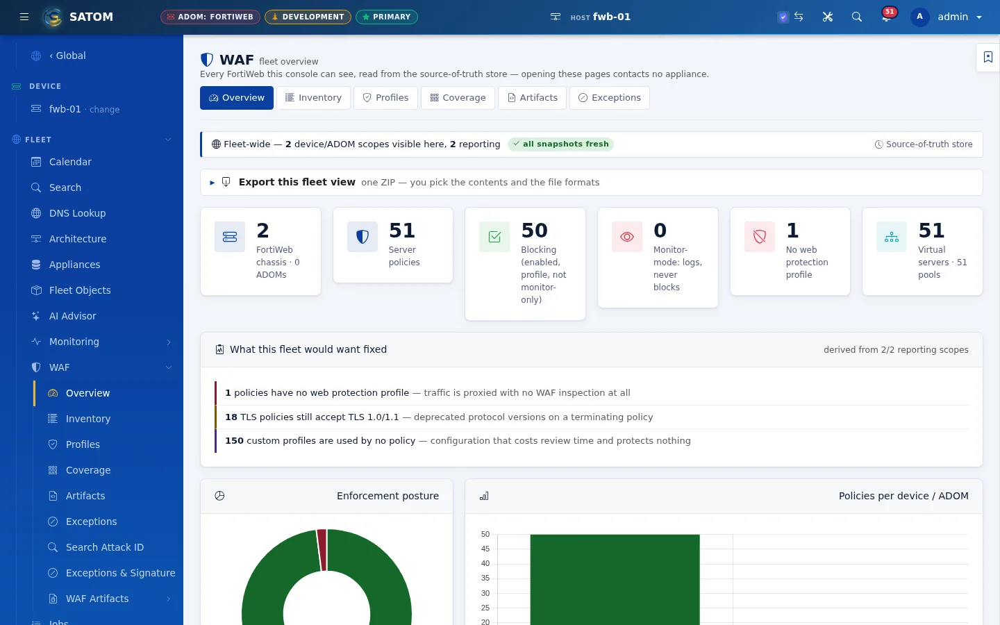
*Operations → WAF → Overview: KPIs and "What this fleet would want fixed"; the
sidebar shows the WAF submenu of the FortiWeb ADOM*

**Export.** Every WAF page has an export panel. Tick the datasets you want
(overview figures and charts, server policies, web protection profiles,
protection coverage, artifacts, exceptions with their profiles) and the
formats (CSV with one file per dataset, an Excel workbook, a PDF report with
charts). You get one ZIP.

- The selection is in the URL, so you can bookmark a bundle.
- If nothing is ticked, the page warns you and produces no file.
- Each export is recorded in the audit log as `waf.export`.

### 13.2 Operations → WAF in the FortiWeb ADOM: the device tools

In the FortiWeb ADOM, the WAF submenu also holds the three device-scoped WAF
tools. They used to sit in the ADOM's own WAF group, which no longer exists.
Their URLs and permissions did not change. The Global console's WAF submenu
does not list them, because they are FortiWeb-ADOM pages and a link from Global
would switch the tab's ADOM.

| Entry | URL | Device |
|---|---|---|
| **Search Attack ID** (§9.1) | `/waf/attack-search/` | Not needed: the block-page reference names the appliance, or you pick it on the page |
| **Exceptions & Signature** (§9) | `/web/exceptions/<device id>` | Needed. With none selected, `/web/exceptions/` sends you to the Service Diagram |
| **WAF Artifacts**: Object types · Inventory · Device audit | `/artifacts/`, `/artifacts/inventory`, `/artifacts/audit` | Needed. With none selected, each page sends you to the Service Diagram with "Pick a device first" |

**WAF Artifacts** is a collapsible entry with three pages. Each page shows one
device and ADOM: the device selected in the sidebar (§3.1). No control widens
it to the fleet; for the fleet-wide view, use Operations → WAF → Artifacts (§13.1).

- **Object types:** statistics for the selected device and ADOM, per object
  type, with the reference for each type.
- **Inventory:** every file-backed object the device and ADOM holds, the
  policies and profiles that use it, and what would block a move. The
  **Upload a file**, **Author content** and **Capture from device** buttons add a
  version to SATOM's artifact store and need `config_write`.
- **Device audit:** what SATOM knows about the device's artifacts, on screen,
  as JSON or as CSV. The CSV has one row per device, policy, profile and
  artifact. It reads only SATOM's index and contacts no appliance. The report
  itself warns that a policy created since the last sweep is missing from it.

XML Schema, WSDL and gRPC IDL can't be read back off a FortiWeb one object at a
time. The device's **Entire** configuration backup does carry their content,
but inside a block the firmware encrypts even without a backup password, and
restoring that backup does not put them back: measured on 7.6.8 and 8.0.6, in
both directions, the restore brings the configuration back and drops every XML
Schema and WSDL object, name included. To move one of these objects, upload the
original file (from the team that owns the API), or fetch it from the service.

**Fetch from the application** (Inventory) is the way in for a FortiWeb already
in production. Give the URL where the SOAP service publishes its WSDL or XML
Schema (often the service address followed by `?wsdl`) and the object name the
policy already references. SATOM downloads it, follows the schemas it imports
or includes from the same host, and stores each one as a version with the
origin **fetched**. It never writes to the appliance. It refuses non-http(s)
URLs, credentials in the URL, documents with a DTD, loopback, link-local and
SATOM's own addresses; it reports redirects and references to other hosts
instead of following them, and stops at 25 documents, 5 levels or 60 seconds.
Imported schemas are named after their file; check the names against what the
policy needs (**Needed by a policy and NOT held**).

FortiWeb checks a schema's references when the file is uploaded, and looks a
relative `schemaLocation` up as an XML Schema object on the device, by name. So
SATOM rewrites every reference it followed to the name it stored that document
under, and says so in the version note. A reference it did not follow is kept
as written and listed in the result: the appliance resolves it itself at
upload, and refuses the file if it can't. On the device, a schema has to exist
before the schema or WSDL that imports it.

A clone or migration takes care of that order. Before the first write it reads
the WSDL and XML Schema content it is about to upload and, for every schema
that content imports: moves it ahead if the plan already creates it, leaves it
alone if the destination already holds it, and otherwise adds it to the plan
right before the importing file, with the copy SATOM holds. The pre-flight
lists those schemas and which file imports each one; one SATOM can't supply is
a missing file like any other, and the files that import it are skipped.

On FortiWeb 8.0.6 build0116 every gRPC IDL upload fails with
`errcode -3000: Internal error processing requested file`, whatever the file;
7.6.8 accepts the same file. SATOM adds that note to the error.

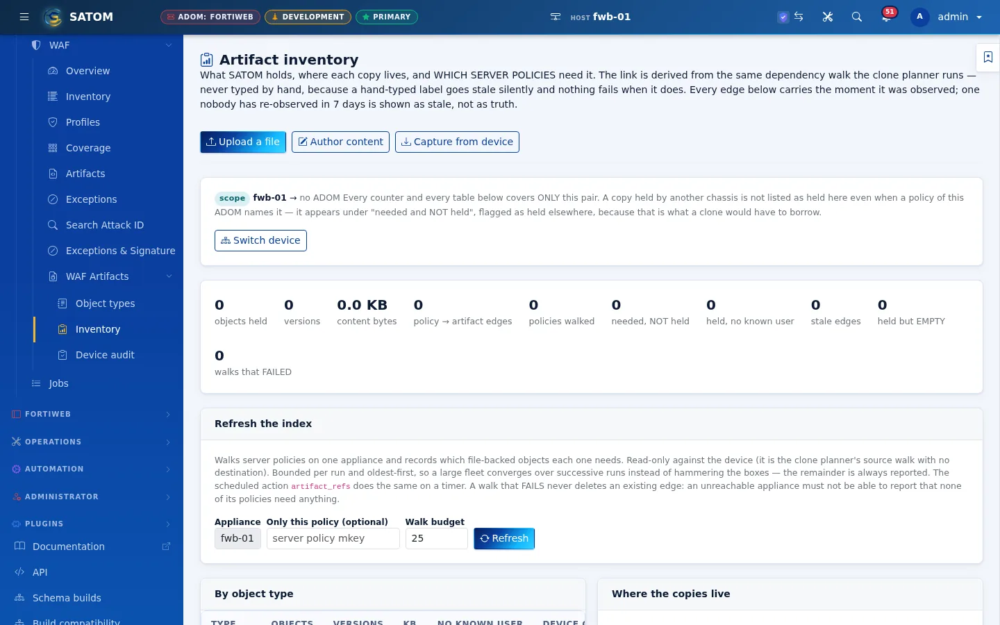
*Operations → WAF → WAF Artifacts → Inventory for the selected device*

### 13.3 Naming: Scheme and Discovery

**Administrator → Naming** is in every device ADOM (FortiWeb, FortiADC,
FortiGate, FortiAuthenticator, FortiAnalyzer). Its two tabs work on **one list
of object types**: every table the product's configuration sync reads,
including the ones no device holds an object of yet. Settings blocks are not
object types and are left out: rows without a name, and an empty endpoint the
API library measured as one settings object on the devices' builds, or that
the FortiAnalyzer / FortiAuthenticator sync saw answer as one object (those
syncs record whether each table answered a list, even an empty one, or one
object). An empty type nothing has measured yet stays listed and is marked
**list or settings block not measured**. A table whose objects are keyed by
number is listed and marked so.

**Scheme** holds the pattern of each object type. Entries marked **builds
names** (the FortiWeb catalog: server policy, pool, WPP, certificate…) are
the ones SATOM fills in when it creates objects from a web address, so they
take the site tokens and the product's variables only (Managed Certificate:
`{class}` `{cn}` `{date}` `{serial}`; Exception WPP: `{name}`, the policy's
name). Every other entry documents your convention and may use any
Discovery token.

The site tokens:

| Token | Value for `https://Blabla.Example.com:8443/x` |
|---|---|
| `{name}` | `blabla-example-com` — the slug, as before |
| `{host}` | `blabla.example.com` — the host as typed, dots kept |
| `{port}` | the port the creating flow gives (the wizard's **Port**), else `8443` from the address |

**Variables** (the table above the patterns, one list **per product**) rewrite
a token with a regular expression so the name is one the devices accept. Each
row has a name, the token it **reads** (a site token or a variable above it,
never one below), a **regular expression** (Python syntax, every match
replaced, `\1` for a group) and what to **replace with**. Use it in a pattern
as `{its_name}`. Example: `host_u` reads `host`, replaces `\.` with `_`; the
pattern `{host_u}-{port}` gives `blabla_example_com-443`. The **Sample web
address** and **Port** fields preview every pattern live; the token values
come from the server, so the preview is what the wizard will build. A
variable list that cannot be computed (a reserved name such as `num`, an
unknown source, a regex that does not compile, a `\2` with one group) saves
nothing, and removing a variable a pattern still uses is refused with the
pattern named. **Restore defaults** resets the patterns and keeps the
variables. FortiADC works the same way with its own list; no SATOM flow builds
FortiADC names yet, so there they are a reference a future flow uses as is.
Existing names are checked against a catalog pattern with `{host}` and every
variable read as free text. Next to each input: what Discovery found on the devices
(**all devices agree** / **devices differ**), **use it** to copy it in, and a
live count of the existing names that follow the pattern you type. Use the
filter box or **Only types with objects on a device** to narrow the list.

**Discovery** reads the names already on a device — from the configuration
tree SATOM keeps for it, no device call — and shows, per object type:

- **Convention found** — the dominant pattern, e.g. `pol-{adom}-{name}` or
  `vs-{name}-{proto}`, with any variant prefix, the separator and the case.
- **Follow it** — how many of the team's objects match it.
- **Naming scheme** — the scheme's pattern for that type and how many objects
  follow it (`(default)` when it is the catalog default).
- **Exceptions**, each with its reason. A **stale name** is the one to read
  first: `name says 'https' but the object's port is '8080'`.
- **Shares {name} with** — object types that carry the same identifier through
  a real reference (policy → pool → virtual server).
- **Vendor** — factory objects, counted apart and never used to infer anything
  (device flag first, then a factory-name list measured per product, then
  physical ports).

A part of a name becomes `{port}`, `{proto}`, `{adom}`, `{host}`… only when it
equals a field of the same object on at least 80 % of the objects; digits that
match nothing are `{num}`; the free part is `{name}`. One object is "too few".

**Adopt** writes the discovered pattern into the scheme entry of that object
type. **Adopt & adapt** opens it in an editor under the row: change a part
(`lab-spo-{num}` → `spo-{name}`), watch how many names follow, then **Save to
scheme**. For a **builds names** entry, Adopt is greyed out when the found
pattern carries a token SATOM cannot fill in (hover for the reason) — adapt it
instead. The ✕ clears the entry. **All devices (fleet view)** shows whether the
devices agree and your scheme pattern; **Export CSV** lists every exception. A
device without a configuration tree offers **Sync device** (read-only).

## 14. Monitoring: fleet health, metrics & probes

Monitoring lives in **every** workspace, not only Global. It is scoped by
device kind, so the FortiWeb workspace shows FortiWeb appliances and nothing
about the manager itself. Three submenus, and they answer three different
questions.

### 14.1 Fleet health — *is the box alive?*

One card per appliance. The badge is the **worst of four independent signals**,
and every signal that is not healthy is printed underneath, so a state is never
unexplained:

| Signal | Warns | Critical |
|---|---|---|
| **Harvest** — the last scheduled config syncs | one failed run | three failed runs in a row |
| **Cache** — the newest stored snapshot | nothing cached, or older than `monitoring.stale_hours` (6 h) | older than 4× that |
| **Probes** — the enabled monitors for that device | a probe alerting, or *all* probes disabled | a probe critical |
| **Capacity** — object-count headroom against the admin cap | over `capacity.warn_pct` | over `capacity.crit_pct` |

Two rules matter when reading it:

- **`unknown` is not `ok`.** A device nothing has been measured about renders
  *unknown*, never *healthy*.
- **A disabled probe is not a passing probe.** Switching off a monitor that
  always fails removes coverage, and the card says so rather than turning green.

When a deep monitor is what makes a device degraded or critical, the alert
says what was measured and against which line. The title carries the reading
and the limit crossed (*Device fortiweb17 is critical — CPU 97.0% (critical
95%)*), and the body lists each alerting probe: what it measures (for CPU and
memory, the whole appliance), the last reading, every limit it is graded
against with where that limit is set (*set on this probe*, *inherited from
fortiweb*, *factory default*) and when it was read. Six probes are spelled
out; the rest are counted. The in-app notification keeps the line breaks.

Appliances in **maintenance** are marked as such and are skipped by automatic
runs and by their alerts. That is the correct way to silence a box you know is
down — not lowering the alert floor.

Fleet health is **two pages**, each a direct entry of the Monitoring menu (there
is no "Fleet health" sub-menu), because a number is read as a claim about the
page it sits on:

- **Device health** (`/monitoring/`) — the appliance cards above. Present in
  every workspace, scoped to that workspace's device kind. On a new node,
  *never harvested* / *probes have never run* usually means nothing is
  scheduled to do that work: the reason then ends with *no 'device_sync'
  schedule on this node* (or `deep_monitor`) and the command that creates
  the schedules, `sudo satom execute seed actions --yes`.
- **SATOM health** (`/monitoring/satom`) — the installation itself: cluster
  peers, repository, external backup server, database, systemd units,
  redundancy, **the host machine** and **Encryption in transit**, where every
  badge is backed by a live probe rather than by configuration. **Global only**
  — a product workspace does not reach it, because those cards carry node
  hostnames and infrastructure addresses.

The **host machine** row grades disk, memory and load **on both HA nodes**, and
it exists because nothing in the product used to measure its own box. Its
limits live in Settings → Thresholds under the *SATOM machine* scope. Disk turns
critical at 92 %, deliberately below 95: a full filesystem stops PostgreSQL
writing WAL, so the alert has to arrive while there is still room to act on it.

### 14.2 Metrics — *how much does it hold, and who changed it?*

`Monitoring → Metrics`. Inventory counts and activity for the **active
workspace**, over a date range. **Nothing here touches an appliance** — it reads
the local cache, the audit log and the change history, so it opens with the whole
fleet off.

**Four inventory cards**, labelled per ADOM rather than shared: FortiWeb counts
Server Policies / Backends / WPPs / Certificates, FortiADC counts Virtual Servers
/ Real Servers / Server Pools / Certificates, FortiAuthenticator counts Users /
Groups / RADIUS clients / Certificates, FortiAnalyzer counts Devices / Log
sources / Reports / Certificates. The totals are rendered **server-side**, so the
cards are still there if the charts fail to draw.

**Where the totals come from differs by product, and the page will not fake it.**
FortiWeb and Global read the daily typed snapshots written by the
`inventory_snapshot` scheduled action (§15) — which is why that action has to be
scheduled daily for the trend to exist at all. New installations seed it daily at
23:50 (`satom execute seed actions`); on an older node the same command adds it. FortiADC has no snapshot pipeline,
so its totals are counted live off the fleet and cached briefly. A product with
neither reports **no totals rather than borrowing another product's**: an ADOM
printing FortiWeb's object counts under its own labels is worse than printing
nothing, because the numbers look like its own.

**Activity over the range:** total audited actions, real (non-dry-run) config
changes, distinct active users, and how many appliances were actually touched —
plus a breakdown of changes by object category (server policy, backend, WAF
profile, certificate, other) derived from the endpoint each change hit.

**Ranges and comparison:** 7 / 30 / 90 days or a custom window, with a
**compare** toggle that puts the immediately preceding window of the same length
beside it — so "is this a busy week" has an answer rather than a number.

**It is ADOM-scoped, precisely.** Audit rows carry their own product stamp;
change-history rows are scoped through the *kind* of the appliance they were made
on, by inclusion rather than exclusion. Manager-level changes with no appliance
count under FortiWeb, which is where they originate. Global sees everything.

### 14.3 Deep monitors — *is the service still serving?*

`Monitoring → Deep monitors`. These reach into the appliance (synthetic request
or read-only CLI over SSH):

| Kind | What it records |
|---|---|
| **Service policy (HTTPS)** | A synthetic request to a published front end: status, latency and days of certificate left. One 200 proves interface, policy, proxy daemon and backend at once. A sweep sends these requests concurrently (up to 16 at a time), and a front end that refuses or times out the connection is not contacted a second time for its certificate |
| **Interface IP / link** | A name → address/state fingerprint per port. The **drift** against the previous sample is the event; an address change grades critical |
| **Processor load** / **Memory usage** | Read from the appliance's own performance summary |
| **proxyd process** | Worker count, memory used and free, and the **set of process IDs** — a different PID is a silent restart, which no ordinary health check shows |

**Not every kind fits every product, and the form says so rather than measuring
zero.** *Service policy*, *processor load* and *memory usage* are offered on
FortiWeb, FortiADC and FortiAuthenticator; *interface* and *proxyd* are
FortiWeb-only. On FortiAuthenticator, load and memory are read from the unit's
**REST** status resource, not the CLI — the FAC shell answers
`No such command.` to the performance summary, which is a *successful* round
trip carrying no reading, exactly the kind of silence a monitor must never
grade as healthy.

### 14.4 Service monitor — telemetry over the API

`Monitoring → Service monitor`. Same engine, no shell access — these read the
appliance's monitoring API only, which means they keep working on a device
whose configuration API is refusing calls (an expired licence, typically):

| Kind | Unit |
|---|---|
| **Concurrent sessions (box)** | sessions, plus connections per second |
| **Server-policy sessions & latency** | sessions, round-trip and application response time, per-member backend health |
| **HTTP throughput** | Mbps, graded on the **peak** of the window, not the average |
| **HTTP transactions** | transactions per bucket |

On **FortiAuthenticator** the ceiling is not bandwidth, it is entitlement, so
the kinds are different:

| Kind | Unit |
|---|---|
| **Licence headroom** | % of the licensed user / group / FSSO / SSO-mobility seats consumed, with the free count spelled out |
| **FortiToken pool** | % of the imported token stock already assigned |

Both grade on **percent consumed** — same direction as every other probe in the
product, so a threshold never has to be read backwards. A counter with no
ceiling, or a pool with no tokens imported, reports `unknown`: neither is
health.

The page also groups results per device: a traffic card per appliance and a
per-policy detail view, both served from stored samples.

> **Reading `sessions` on short-lived HTTP.** Connections per second is the
> number that moves; concurrent sessions can sit near zero under heavy load
> because each request lives microseconds. A threshold on `policy_sessions`
> grades *sessions* — for HTTP front ends, watch the throughput probe instead.

### 14.5 Creating probes

- **Discover from device** offers the sets that apply to that product:
  published policies, a baseline, one probe per interface, or the API telemetry
  set on FortiWeb; a baseline plus the entitlement set on FortiAuthenticator.
  Ports and policy names are picked from the cached configuration, so the
  dialog opens with the appliance switched off.
- **Published policies are dialled once before their probe is created.** A
  front end SATOM cannot connect to (a VIP that nothing routes from SATOM's
  network, such as a lab address or a front end only reachable from the
  client side) gets its probe **disabled**. The reason is shown in its *Last
  result*, and the discovery message counts these probes as "created
  disabled: VIP not reachable from SATOM". A disabled probe does not count in
  Device health. Enable it once SATOM can reach the VIP. A front end that
  connects but answers badly (timeout after connecting, HTTP 5xx) is created
  enabled, because that is a finding about the service. Policies that are
  disabled on the device are not dialled.
- **Every device gets the baseline (interfaces, CPU, memory, and proxyd on
  FortiWeb) without anyone pressing Discover.** It is created when the device
  is added, whether from the form, the REST API (`POST /api/appliances`) or a
  provisioning run. The 3-minute Collection sweep also gives it to any device
  that still has no probe at all. Deleting one probe of a provisioned device
  is respected and the sweep does not put it back. To stop monitoring a device
  completely, disable its probes rather than deleting them all.
- **Interval must be a multiple of the sweep** (3 minutes). A probe only fires
  when its own interval has elapsed *and* a sweep tick happens, so a 5-minute
  probe under a 3-minute sweep would really run every 6 minutes.
- **Probe now** runs the current page's probes for the visible devices. It runs
  in the background and stays out of the progress dock — only a sweep that
  *fails* raises a notification.
- Editing a probe is the pencil icon in the table.

### 14.6 History and charts

Click any sparkline for the drill-down: 1 h / 24 h / 7 d / 30 d or a custom
range, with minimum / average / maximum, a healthy percentage, sample and
transition counts, threshold lines and a per-bucket status strip.

Raw samples are capped per probe (`retention`, ~2 days at the default). Charts
go further because every run also writes roll-ups: **hourly kept 90 days,
daily kept two years**, storing min/avg/max rather than a mean — a four-minute
spike is invisible in an average and is usually the reason the chart is open.
The footer states which table was drawn, because an hourly mean and a
three-minute reading are not the same claim about the appliance.

> **Changing a probe's unit resets its series.** If a probe starts reporting a
> different quantity, its old samples are cleared rather than plotted on the
> same axis. That is a deliberate, manual operation — never a side effect of a
> restart.

### 14.7 Collection — the metrics store

Monitoring → **Collection** (needs config-write).

> **How many devices fits on this node, and how much disk will that take?**
> Both questions have a formula, built from constants measured on a running
> node: **[Sizing a node](sizing.html)**. The short version is that the ceiling
> is device I/O, not storage — a node spends about **0.82 s per device** in each
> 3-minute window, which puts ~110 devices on one installation — and that the
> intervals and top-N values on THIS page are the two dials that move it.

A probe asks one question. That is the right shape for *"is this one thing
still working"* and the wrong shape for a fleet: at scale it becomes one API
call per object per sweep. A **collector** asks once per device and keeps
everything that came back — `policies` returns every policy on the box in a
single call. So the unit here is **(device, collector)**, never (device,
object): the table stays roughly one row per device per collector no matter how
many policies the fleet grows.

| Collector | Products | Default interval |
|---|---|---|
| `box` — CPU, memory, sessions | FortiWeb, FortiADC, FortiAuthenticator | 3 min |
| `capacity` — licence headroom, FortiToken pools | FortiAuthenticator | 3 min |
| `policies` — sessions / conn rate / RTT, every policy | FortiWeb | 3 min |
| `interfaces` — link state and byte counters | FortiWeb | 3 min |
| `traffic` — device total plus top-N policies | FortiWeb | 15 min |
| `transactions` — HTTP transactions, top-N policies | FortiWeb | 60 min |
| `vservers` — virtual servers: sessions / RTT / pool health, every VS | FortiADC | 3 min |
| `identity` — accounts, groups, tokens, certificates, RADIUS/TACACS+ clients | FortiAuthenticator | 15 min |
| `faz` — log volume, storage, alerts, incidents, devices, task queue | FortiAnalyzer | 15 min |
| `http_status` — HTTP response classes counted from the traffic log | FortiWeb | 5 min |
| `infra` — the VM and its hypervisor host (CPU, memory, disk, network, load) | FortiWeb, FortiADC — **only when mapped** | 3 min |

Each row is editable in place: **interval** (1–1440 minutes), **enabled**, and
**top-N** (1–200) on the two collectors that have one. The expensive collectors
are bounded twice — a longer interval *and* a top-N cut ranked by live
connection rate — but the device total is always collected, so the headline
number never depends on where the cut fell.

Three of those need a note, because what they can and cannot tell you is not
obvious from the name:

- `vservers` is FortiADC's counterpart to `policies`, and it reads a runtime
  API that is **not** the one the object browser uses. FortiADC publishes CPU
  and memory as *installed hardware* ("1 CPU/1 allowed"), never as
  utilisation — so those two keep coming from the read-only CLI, and a
  percentage you see for a FortiADC came from there.
- `identity` counts what the directory **contains**. It cannot tell you whether
  authentication is succeeding: no FortiAuthenticator resource reports an
  auth-rate counter, and that signal only exists in syslog, which SATOM does
  not ingest.
- `faz` never fetches a log body. Every series is a counter or a state summary,
  which is the point of monitoring a log collector rather than mirroring it.
- `infra` reads the **hypervisor**, not the appliance: the VM's own counters
  (`/nodes/<node>/qemu/<vmid>/status/current` on Proxmox) and the host's
  (`/nodes/<node>/status`). It needs the device mapped to its VM (hypervisor,
  VM id and node, in the Sentinel topology map) and a registered hypervisor
  (§21.1). A read-only Proxmox API token with the **PVEAuditor** role is
  enough. The target is created only once the mapping is complete, on the next
  sweep after it is saved. An unmapped device, and every hardware appliance,
  has no `infra` row rather than a row that fails every 3 minutes.

- **Run sweep now** runs inside the request and reports targets, errors and
  series written, in the flash message.
- Devices in **maintenance**, and retired rows, are not scraped at all.
- A collector that fails records `satom_scrape_up 0` for that target. Missing
  data is never rendered as health.
- Targets appear automatically for new appliances. The sweep itself is the
  scheduled action **`metrics_scrape`** which, like every action, is **not**
  seeded on a fresh install (§15).

Samples land in a time-series store that runs **on each node, bound to
loopback**. It is not a shared database and it carries no authentication: each
node keeps its own, which is why a board can draw on one node of a pair and
report a query error on the other. Architecture, retention and sizing:
[docs/metrics-architecture.md](metrics-architecture.md).

### 14.8 Analytics boards

Monitoring → **Analytics**: boards of panels over the data the rest of this
section collects. It is a renderer, not a fourth source of measurements.

Built-in boards ship per ADOM. To change one, **Duplicate** it first. Panels
are dragged to reorder; each board has a default range and optional
auto-refresh.

- **Panel types:** line, area, bar, stat, gauge, heatmap, table, status strip.
- **Three ways to choose what a panel draws:**
  - **Probes** — an explicit list.
  - **Rule** — everything matching a kind or device.
  - **MetricsQL** — an expression evaluated against the node's store. One
    expression can draw a hundred devices (`topk(10, …)`), and it is the only
    mode that survives a fleet where enumerating the series is not an option.
    The expression is validated by *running* it, because the store is the only
    authority on its own query language.
- **Ranges:** 1 h, 6 h, 24 h, 7 d, 30 d, 90 d, or a custom window. Ninety days
  is the longest offered because that is how long hourly roll-ups are kept.
- **One resolution per panel.** The server picks the coarsest source any series
  on that panel needs, and the footer states which. Two series on one axis read
  from two different tables is a claim no legend can repair — the finer line
  shows spikes the coarser one averaged away, and it reads as a difference
  between *devices*.
- **A gap stays a gap.** No line is drawn across missing data: carrying the
  last value forward paints a convincing straight line over exactly the outage
  the chart was opened to investigate.
- **A failed query renders as an error, never as an empty chart.** On a canvas
  the two look identical and mean opposite things.

**Collection cadence** (button in the page header) shows every probe's
*declared* interval beside its *effective* one and flags the mismatches. A
probe fires only when its interval has elapsed **and** the sweep ticks, so the
real cadence is the tick rounded up: a 5-minute probe under a 3-minute sweep is
a 6-minute probe, and its own row still says 5. With no sweep scheduled the
modal reports **0** — never a plausible-looking number for collection that is
not happening.

### 14.9 Period reports

Monitoring → **Reports**: daily, weekly and monthly summaries over the last
**complete** period. The windows are half-open, so two adjacent reports can
never claim the same bucket.

Reports are **stored, not recomputed on demand.** Raw samples expire in about
two days, so a summary rebuilt six months later would quietly answer from
coarser data while looking exactly like one built on time.

- Generate on demand, or schedule the **`monitor_report`** action (`period`,
  optional `email`, `keep` for retention, and `push_server` to copy the summary
  to the external backup server).
- Read it in the browser or export **JSON**, **CSV** or plain **text**;
  **Email** sends it to the alert recipients.
- Re-running a period **replaces** its row rather than adding a second one, so
  a retry after a failed mail run updates the report you already have.
- **A mail failure does not fail the action.** The report is written and
  readable; failing the run would leave the action permanently red over an SMTP
  outage.
- A period with no samples reports **unknown**, not a healthy zero.
- Every view (page, text/e-mail, CSV) also carries the **fleet metrics**
  section from the metrics store: min / avg / max per device and metric, the
  policies that were down and the collectors that failed. When the store was
  unreachable it says so instead of printing zeros. In the CSV these are extra
  rows of kind `fleet`, `fleet_policy_down` and `fleet_collector_failed`.

### 14.10 Thresholds — declare a limit once

Settings → **Thresholds** (admin). Before this page every limit lived on an
individual probe, so tuning a fleet meant editing each monitor by hand; in
practice nobody did, and all 42 production probes sat on the same factory
number regardless of what they were watching.

**Six scopes**, picked from the selector at the top: four product ADOMs
(FortiWeb, FortiADC, FortiAnalyzer, FortiAuthenticator — the read-only
FortiGate ADOM has no threshold scope yet), **SATOM** the application, and the
**SATOM machine**. Each scope carries three blocks.

**Measurement limits** — CPU, memory, sessions, throughput, transactions,
licence and token headroom, interface staleness, TLS expiry, response time.

**Device roll-up** — what makes an *appliance* critical rather than a single
reading: the cache-age budget, its critical multiplier, the harvest failure
streak, and the capacity percentages. These used to be constants in the source.

**Binary facts and mute** — see below.

#### How a number is chosen

```
the probe's own column        ← only if the operator typed one there
  ↓ empty
the product scope's value     ← what you set on this page
  ↓ unset
the factory default           ← documented in code, never a crash
```

Two states that look alike and are not:

- **Empty** means *inherit*. Change the product value and every probe that
  nobody has touched moves with it, immediately.
- **`0`** means *this level is switched off*. It is a decision, and inheritance
  never overwrites it.

Newly discovered probes are created **empty**, so they inherit. If they were
stamped with a literal they would be frozen at birth and this page would only
ever affect probes that do not exist yet.

#### Every grade says where its number came from

Both probe pages print the resolved limit **and its origin** — `set on this
probe`, `inherited from FortiWeb`, or `factory default`. Live inheritance means
a probe you never edited can change severity because someone edited a product
default; without the origin printed, that critical would appear with no visible
cause. Each probe also has a **revert to inherited** control, which clears the
column rather than writing the current value back into it.

#### Binary facts

Some conditions have nothing to compare against: *every backend of a policy is
down*, *the policy is administratively disabled*, *`proxyd` is gone*, *a
monitored interface moved*. They were unconditional in the source. Per product
you can now set each one to **critical**, **warning** or **off**.

**Off changes the grade, never the visibility.** The fact is still printed on
the probe. A condition that disappears from the page when you silence it is how
an operator later concludes the check never fired.

#### Targeted, expiring mute

To silence *one* probe — a policy left over from a migration, say — mute it with
a **reason** and a duration of up to 720 hours. While muted it keeps running and
keeps showing its own status; it stops raising the device badge and the alert
mail, and it is reported as **lost coverage** in both. There is no permanent
mute: a silence nobody renews turns itself back on.

Prefer this to the alternatives. Lowering a product default to hide two dead
policies blinds the whole fleet, and putting a healthy appliance into
maintenance switches off its other working monitors as well.

#### What this does not do

It does not decide *who* is mailed or *how often* — that is Settings → Email &
Alerts, which is delivery policy. This page is measurement policy, and the two
are kept apart on purpose.

## 15. Automation

Scheduled work lives on two pages, split by **who the work is for**:

- **System Automations** — SATOM keeping its *own* data current. Administrator
  → System → **System Automations** (`/scheduled-actions/`, administrators
  only). Every ADOM; the list shows that ADOM's rows.
- **Automations** — work on the fleet's services that an operator plans for a
  chosen time. Operations → Automation → **Automations** (`/automations/`,
  needs `config_write`, which operators hold). It is live in the FortiWeb,
  FortiADC, FortiAnalyzer and FortiAuthenticator ADOMs (and Global), and
  drawn disabled with the reason in FortiGate, where no automation applies yet.

An action belongs to one page, decided by the catalog, not by the row: when
an action moves between the two catalogs, its existing rows move with it.
This last happened on 2026-10-14, when the operator actions below moved from
System Automations to Automations.

- **System catalog**, by what it is for:

  | Group | Actions |
  |---|---|
  | Source of truth | `device_sync` (refresh the local cache from a device), `device_inspect` (sync **and** push the SoT off-box), `deep_capture`, `signature_sync` |
  | Backups | `backup` (on-device config backup), `system_backup` (the manager's own `pg_dump` bundle, optionally pushed to the backup server) |
  | Monitoring — all four are the ones §14 asks you to schedule | `metrics_scrape` (the Collection sweep, §14.7 — **every 3 minutes**), `deep_monitor` (the deep-monitor probe sweep, §14.3 — **every 3 minutes**, the seed plan's cadence), `monitor_report` (the period summary, §14.9 — *after* the period closes), `inventory_snapshot` (daily inventory counts for §14.2) |
  | Reads that feed pages | `cert_scan` (the Certificate Manager table), `health_check`, `ha_check`, `stats` |
  | Catalog | `appid_import` (the nightly AppID feed, §25), `knowledge_fetch` (knowledge packs from the feed, daily, by mode — §22.4), `signature_check` (FortiGuard DB versions per FortiWeb + collection from the signature source, daily — §8.1) |
  | Sentinel and inventory | `sentinel_sweep`, `sentinel_baseline`, `sentinel_vuln_sync`, `sentinel_feed_publish`, `artifact_refs`, `netbox_reconcile` |

  Two notes on reading that list. **There is no separate `service_monitor`
  action** — Deep monitors (§14.3) and Service monitor (§14.4) share one storage,
  one runner and one sweep, so the single `deep_monitor` action populates **both**
  pages. Two sweeps would mean two sets of samples for the same box. And
  `git_bundle` is **retired**: git no longer carries the device source of
  truth, so new installs do not seed it, though the handler still works for a
  manual run of the code repository.

  **They arm themselves.** When a node gets its first device, SATOM creates
  its default set of system automations (hourly fleet sync, nightly SoT
  snapshot and system backup, the 3-minute probe, metrics and Sentinel sweeps,
  the period reports, the feed refreshes) and says so in the "Appliance
  created" message. This happens only while the node has **no** system
  automation at all: if one exists, SATOM leaves the set as the administrator
  left it, and a deleted row is not re-created. `sudo satom execute seed
  actions` fills individual gaps on demand.

- **Operator catalog** (Automations):

  | Group | Actions |
  |---|---|
  | Server-policy objects (one device each) | enable/disable a server policy, enable/disable a backend (pool member), **change a backend's IP or port**, swap a server-policy certificate |
  | Firmware | `upgrade_prep` (backup + health, flashes nothing) and `upgrade` — fixed date/time, only inside an approved Change Request window; the scheduled executor does **not** flash yet (it reports each target *not executed*), so flash live from the Upgrade page (§36.6) |
  | Device operations | `reboot`, `ha_failover` — fixed date/time, approved Change Request only |
  | Certificates | the three `cert_manager_*` renewals (server / client+server / client), `cert_lifecycle` (the revoke-and-cleanup sweep, approved Change Request only) |
  | Escape hatch | `custom_rest` — any FortiWeb REST request you define; GET is a live read, writes go through the snapshot + audit + dry-run path; approved Change Request only |

  **Who authorizes what.** An operator can *schedule* a reboot, an upgrade,
  an HA failover, a certificate lifecycle sweep or a custom REST call; it
  *runs* only bound to an approved Change Request, inside its window — and
  approving a change is an administrator's step. The form says so when you
  pick one of these. The binding is written by the change's own **Schedule**
  button, never by the form: a row runs under a change only if it is that
  change's action against devices the change names. Anything else (another
  action, an extra device, the whole fleet) is skipped with the reason and
  leaves the change untouched.
- Schedules: interval / daily / weekly / monthly / once / **cron**, with
  catch-up semantics and a run history per action. **Cron** takes a standard
  five-field expression (minute hour day-of-month month day-of-week: `*`,
  lists, ranges, `/step`, month and weekday names, Sunday as 0 or 7, and a day
  matching either day field when both are restricted) in the console
  timezone; one that can never fire (30 February) is refused. A dedicated scheduler sidecar fires
  them; **Run now** is always available. Every wall-clock field — including the
  one-time **Run at** — is in the console timezone (Settings → General), and
  the list shows **Next run** in that timezone with its zone. A run the
  scheduler was not up for, on an action without catch-up, shows as
  **missed**.

**Scripts** (Operations → Automation → **Scripts**, Global ADOM, needs
`operations.scripts_run`, which operators hold): the Script Library scripts
an administrator published for operators (§23.4). Pick one, fill in its form
and **Run now**, or save the values with a cron expression as a **saved run**.
See §23.4 for how saved runs behave.

**Change Requests** (maintenance windows):

- A CR captures the window, affected devices **and the server policies whose
  clients must be warned** (auto-listed from the cache), the action (e.g.
  firmware image), risk/rollback notes, and an approval trail.
- Workflow: draft → notify (rendered client notice) → **approve** → schedule
  → in-progress → completed/failed, each step time-stamped in a timeline.
- The scheduled action bound to a CR **refuses to run** outside its approved
  window, and refuses any row the change does not cover.
- A change that names no device can be saved and read, but not scheduled:
  its automated run would have no device list to stay inside.

**Jobs** (Global → Jobs): every background job with owner, host/PID, progress
and duration; Pause / Resume / Stop (cooperative — jobs park at safe
checkpoints); orphaned jobs from a service restart are swept and marked on
boot.

## 16. Reports & database tools

Global → Administrator → **Database** (admin only):

- **Reports** — 7 built-in reports (policies by device, expiring
  certificates, carve-outs by policy, audit activity, fleet inventory,
  backups, scheduled-action failures) plus a **4-step no-SQL Query Builder**
  (pick a base table by domain → related tables via foreign keys → columns
  and filters with value dropdowns → grouping/ordering). Built-ins are
  read-only; **Clone** one to customize. Direct SQL is available too, but
  strictly read-only and validated.
- **ER diagram** — a live, professional database diagram (crow's-foot
  notation, domain-colored, searchable, draggable, exportable SVG). Every
  table of the database is in it. Relationships declared as foreign keys are
  solid lines; **dashed** lines are relationships inferred from the column
  name: an integer `<name>_id` column with no foreign key links to the table
  of that name (singular or plural) whose primary key is `id`. History tables
  keep `appliance_id` without a foreign key on purpose, because their rows
  outlive the appliance. The header counts both kinds apart; the list view
  marks inferred ones, and the Query Builder joins on both.
- **Tables browser + SQL console** — read-only introspection with sensitive
  columns masked. Console queries run as the dedicated read-only role
  `satom_console_ro`, which cannot read credential tables or credential
  columns: list columns explicitly instead of `SELECT *` on appliances or
  managed certificates. If the console says the role is not usable, run
  `sudo bash /opt/satom/deploy/install-console-role.sh` on the primary and
  restart. A query (console, CSV export or report widget) that names a
  credential table — `users`, `api_tokens`, `app_settings`,
  `hypervisor_targets`, `dns_backends`, `provision_runs` — is refused before it
  runs and the refusal is audited (`database.query_refused`): column masking
  keys on the result column's name, which `row_to_json(...)` or an alias can
  change.

## 17. Product workspaces

Beyond the shared pages (appliances, monitoring, backups, jobs, automation),
each product ADOM carries its own device menu, so the navigation matches what
the device itself shows. The menu comes from one of two places:

- **The device's measured GUI** — FortiWeb, FortiGate, FortiAuthenticator, and
  FortiADC when its build has a layout.
  The menu is the device's own menu, built per firmware build from the GUI
  layouts in the knowledge packs, with an **All pages** grid. §3.2 explains how
  it is built and what you see when no layout has been imported. The FortiWeb
  pages themselves are covered in §5–§10.
- **A curated menu** — FortiAnalyzer, and a FortiADC whose build has no layout.
  SATOM draws a fixed copy of the product's menu.

### 17.1 FortiADC

The `/adc/` ADOM mirrors the FortiADC 8.0 GUI menu: Server Load Balance, Link
Load Balance, Global Load Balance, Web Application Firewall, Network Security,
Network, Shared Resources, User Authentication, System, Log & Report. That
curated menu is the **fallback**: a FortiADC whose firmware build has a measured
layout in the knowledge packs draws its own menu instead, like the FortiWeb,
FortiGate and FortiAuthenticator ADOMs (§3.2). On those measured pages rows are
read live from the device's REST API (SATOM keeps no FortiADC configuration
cache for them), and a write runs dry first, then sends, records the change and
audits it; secrets are never echoed back.

- **Child tables** (pool members, BFD interfaces, HA monitor lists…) are edited
  from their parent's dialog: **Create New**, **Edit** and **Delete row** write
  the row under its parent (`?pkey=<parent>`), with the same dry run first. A
  row is never written as an object of its own.
- Pages FortiADC draws with a custom widget SATOM cannot measure (High
  Availability › Configuration, Security Fabric › Automation and External
  Connectors) are built from the device's own schema, the metadata the
  FortiADC GUI builds its generic forms from: the fields and their types are the
  device's, the layout on screen is SATOM's.
- **Not in GUI, but in CLI** — a menu group of its own: the objects the device
  has that its GUI does not draw on that build (measured: no page of the GUI
  reads them), one page per CLI path, with list, edit dialog and the usual dry
  run. Each page says so above its list. The last entry of the device's menu,
  also titled *Not in GUI, but in CLI*, opens the per-device page (§7.7), which
  lists all of them with their rows.
- FortiView pages are monitors: they are in the menu at their place, say that
  they draw live data, and link to the same page on the device.

- Object pages use the same form engine: identity/mkey handling, child tables
  (e.g. pool members) derived automatically, dry-run previews, audit on
  apply.
- Form writes (field form, child rows, create) are dry-run first. The raw JSON
  save, raw delete and the list-page Delete apply **immediately** — their
  confirm dialogs say so.
- **Signatures** (Web Application Firewall group, `protection.view`) — WAF
  signature category/severity overview with per-severity actions; deep editing
  through the object detail.
- **API console** (sidebar → Operations → Automation → API → Registry & console, `registry.view`) — the
  registry-driven explorer: browse the ADC endpoint catalog as the GUI menu, run
  live GETs and gated writes against a chosen device, with history and
  syntax-highlighted responses. Writes are **dry-run by default**: without
  **Apply** the console returns the request (method, path, body) and sends
  nothing.
- **Naming** patterns for FortiADC are **reference only**: the object editor and
  the virtual-server wizard do not fill in or check names from them.
- **Firmware** in this ADOM: images from the firmware library are flashed by
  **Upgrade** on the appliance page (REST upload into the inactive partition,
  then a reboot), and **Boot Partition** reboots into the other partition.
  Restore-apply is not wired yet.
- Device actions at parity with FortiWeb: test connection, VS inspector,
  discovery, SSH console with ADC presets, upgrade-prep health battery, SSH
  config backups, Upgrade and Boot Partition.
- **Rediscovery → Capture full depth: every child table (REST)** reads each
  `<parent>_child_<table>` once per parent object (`?pkey=`). Certificate-group,
  CA-group and schedule-group members exist only there; the parent rows do not
  carry them. The result sits beside the sweep snapshot. It is also loaded
  into the cache's deep layer, which Analysis reads (deep-object picker,
  sub-element counts, fleet inventory, FortiADC object inventory), and into
  the API library as measured for that build.
- **VS inspector** draws every reference of a virtual server to the end:
  content routing → pool → members → real servers and health checks; client
  SSL profile → certificate group → certificates → intermediate CA; auth
  policy → user group → RADIUS / LDAP / local user; WAF sub-profiles; method,
  persistence, profiles. **Live (REST)** reads the box; **From last
  rediscovery** draws the same tree from the snapshot and its depth capture
  without contacting the device. A reference to an object that does not exist
  is shown as *not found on the device*, never dropped.

### 17.2 FortiAuthenticator

The `/fac/` ADOM draws the unit's **own menu** in a **FortiAuthenticator**
sidebar group, built from the GUI layouts measured on its firmware build
(§3.2). With the FortiAuthenticator 8.0.3 layouts, for example, that is
**System**, **Authentication**, **Fortinet SSO**, **Certificate Management**
and **Logging**, down to leaves such as Local Users, User Groups, FortiTokens,
RADIUS Service → Clients and TACACS+ Service → Clients. A group with no
measured page (Monitor, on those layouts) is not drawn. **All pages** opens
the whole menu as a grid.

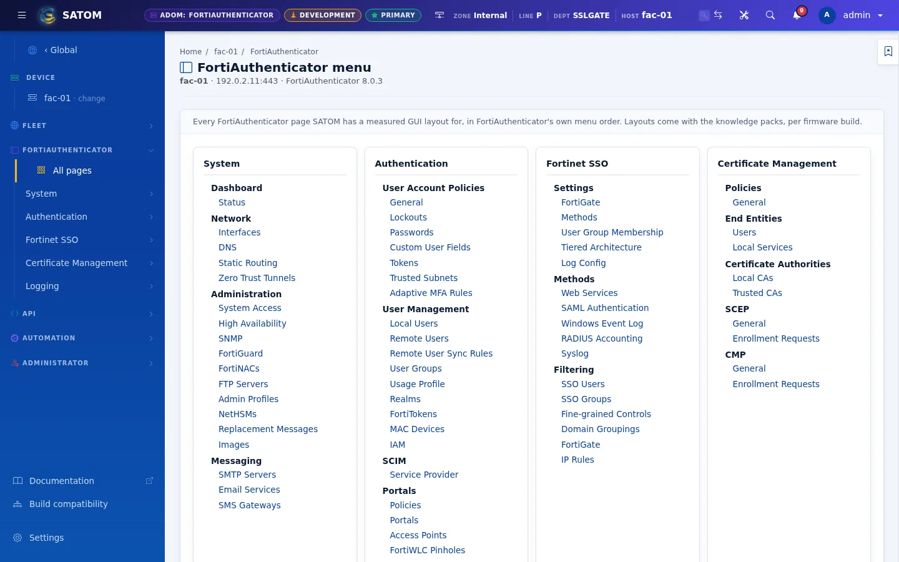
*FortiAuthenticator ADOM: the unit's own menu, every measured page by group.*

- **Rows** come from the SATOM cache (the FAC sweep), else live from the unit.
  Objects are addressed by their detail URL, because RADIUS clients serve no
  `id`. A device refusal is shown as an error, never as an empty table.
- **Writes** follow the FortiWeb routine: **dry run** (the exact request, sent
  nowhere), review, **apply**, read back from the unit, and any field the unit
  stored differently is reported as **drift**. Every apply is audited with a
  before-snapshot. The verbs are `PATCH | POST | DELETE /api/v1/<resource>/`,
  and a save is accepted only for a collection the device's own measured page
  edits. You need `config_write`. Clone and inline-table rows work the same
  way.
- **Objects only the CLI serves** (DNS, interfaces, static routes) are read with
  `show full-configuration` over a read-only SSH session and saved through the
  CLI writer. The dry run shows the script. Create and delete are not offered
  for them.
- **The GUI is wider than the API, and the pages admit it.** A page with no REST
  behind it, or a field measured as having none, is drawn read-only and marked
  **"No API on this build (GUI only)"**. Nothing is sent from it.
- **Not in GUI, but in CLI** is on every object, edit and Create New form
  (§7.3).
- **SATOM's section pages** (`/fac/m/<item_key>`) still exist, and the ADOM's
  dashboard lists them. A section whose every tab a measured page draws opens
  that page instead. The others render the old read-only section page, capped
  at 500 rows with the truncation stated, with an explicit **"No endpoint
  bound."** state where no REST resource is behind the pane.
- **API console** (sidebar → Operations → Automation → API → Registry & console, `registry.view`) — the
  registry-driven explorer over the FAC catalogue, with live GETs and gated
  writes against a chosen device (§30 covers the registry model behind all four
  consoles). Catalog rows can be disabled and restored on the page; re-pointing
  a disabled row keeps it disabled.
- **Analysis** — entitlement, identity inventory and posture (see §13).

**What does *not* apply to FortiAuthenticator.** In the FAC ADOM's Operations
group Device Backups and Import Backup are greyed out (the reason is on hover),
and that is not an oversight. (Diagnose Log Collection, under Operations ›
Troubleshooting, does apply: it runs the FortiAuthenticator battery, §27.1.)

| Feature | In the FAC ADOM? |
|---|---|
| **Certificate Manager (§10)** | **No.** Scanning, issuance, deployment and the lifecycle sweep dispatch on FortiWeb and FortiADC only. The unit's own *Certificate Management* menu group shows **the device's** certificates as the unit draws them. It is not the fleet Certificate Manager, and material there is not managed, bound or swept by §10. |
| **Device Backups (§11)** | **No.** The vault pages are closed to this workspace and not in the FAC menu; the backup transports are written against the FortiWeb/FortiADC backup APIs. |
| **Firmware upgrade (§12)** | **No.** Upgrade and Boot Partition serve FortiWeb and FortiADC only, even on the appliance detail page, and the SSH console, discovery and upgrade-prep actions there are gated to FortiWeb and FortiADC. The firmware library is closed to this workspace too: there is no upgrade path that would consume an image stored there. |
| **Monitoring (§14)** | **Yes**, with product-appropriate kinds — a baseline plus the **entitlement** set (licence headroom, FortiToken pool), and load/memory read over REST rather than the CLI (§14.3, §14.4). |
| **Appliances, Audit log, Network segment** | **Yes** — the shared administration pages. |

> **Two FortiAuthenticator quirks worth knowing.** Its REST paths need the
> trailing slash (`/api/v1/<resource>/`), and secrets are genuinely
> **write-only**: RADIUS client secrets and local-user passwords are *absent*
> from read payloads, not masked — so they can never leak into the
> configuration source of truth. (SATOM's pages additionally refuse to render
> a handful of secret-looking field names even if a future firmware starts
> returning them — a belt to that braces, because the cost of being wrong is a
> credential in every screenshot of the page.)

Full product notes: [docs/fortiauthenticator.md](fortiauthenticator.md).

### 17.3 FortiAnalyzer

The `/faz/` ADOM draws the selected unit's own menu from the GUI layouts
measured on its build, like the other device ADOMs. Only a unit whose build has
no measured layout falls back to the curated menu: **Device Manager**,
**FortiView**, **Log View**, **Fabric View**, **Incidents & Events**,
**FortiAI**, **Reports** and **System Settings**. Of the 139 measured
FortiAnalyzer 7.6.7 pages, 57 are live monitors (dashboards, FortiView, log and
event views) and 28 are managed on the device: SATOM links them on the device
instead of drawing them as configuration, and `Settings → ADOM Menus` (§26.12)
can take them out of the menu.

- The unit speaks **JSON-RPC** on a single endpoint, in two dialects, and the
  endpoint registry stores which one each URI needs — an upgrade that moves a
  URI is a Registry edit, never a code change.
- Section pages read **one tab per request**, so a heavy log view never blocks
  the rest of the page.
- **Device Manager** — Authorize / Delete run in the FortiAnalyzer ADOM you
  type in the dialog (default `root`); the device list spans every FAZ ADOM.
- **API console** (sidebar → Operations → Automation → API → Registry & console, `registry.view`) — same
  registry-driven explorer, JSON-RPC aware, with permission-gated writes that
  are **dry-run by default** (tick **Apply** to send). The status badge shows the
  device's JSON-RPC status code, not the transport's HTTP 200.
- Operational endpoints (alerts, incidents, log statistics, storage) are
  deliberately **excluded from the configuration source of truth**: they change
  between two reads of an idle unit and would defeat change detection.

### 17.4 FortiGate

The `/fgt/` ADOM (since 3.0) reads a FortiGate live over the FortiOS REST API.
SATOM keeps no FortiGate configuration cache. Since the FortiGate GUI layouts
arrived, the pages a measured layout draws can also write, dry-run first.

- **Dashboard** (Operations → Dashboard, and the page the ADOM opens on) — the
  FortiGate device picker (*Select*), the live **Unit status** of the selected
  unit (hostname, firmware, build, serial, model, log disk) and a map of
  SATOM's section pages.
- **The FortiGate menu** — a **FortiGate** sidebar group with the unit's own
  FortiOS menu, built from the layouts measured on its build (§3.2): Network,
  Policy & Objects, Security Profiles, VPN, User & Authentication, Security
  Fabric, System, Log & Report, each down to its pages (Firewall Policy,
  Addresses, Interfaces, SD-WAN…). **All pages** opens it as a grid. Rows are
  read live from cmdb (vdom aware). Monitor views are read-only.

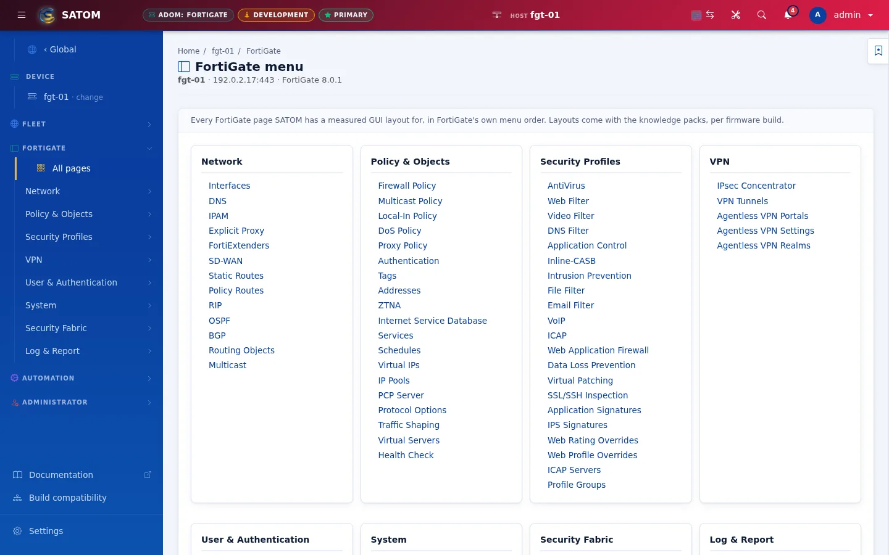
*FortiGate ADOM, device fgt-01: All pages lists the FortiOS menu by group.*

- **Writes** follow the FortiWeb routine: **dry run** (the exact request, sent
  nowhere), review, **apply**, read back from the unit, and any field FortiOS
  stored differently is reported as **drift**. Every apply is audited with a
  before-snapshot. The verbs are `PUT | POST | DELETE /api/v2/cmdb/<path>`
  (CLI-only fields go through the CLI writer), and a save is accepted only for
  a collection the device's own measured page edits. You need `config_write`.
  Clone and inline-table rows work the same way. The REST token decides what
  FortiOS accepts: a read-only admin profile is enough to read, and a write it
  does not grant is refused by the unit.
- **Not in GUI, but in CLI** is on every object, edit and Create New form
  (§7.3). A page or field measured as having no API is drawn read-only and
  marked **"No API on this build (GUI only)"**.
- **API console** (sidebar → Operations → Automation → API → Registry & console, `registry.view`) — the
  FortiGate registry browsed as the FortiGate menu, and a live console. `GET`
  reads the `cmdb`, `monitor` and `log` trees. `POST`, `PUT` and `DELETE` are
  **dry-run by default** (tick **Apply** to send; `registry.execute_write`),
  audited and read back. Writes go to `/api/v2/cmdb/` only, never to the
  monitor tree's actions (reboot, restore, firmware), and a `DELETE` must name
  an object.
- **SATOM's section pages** (`/fgt/m/<item_key>`, 30 pages in 7 areas over 43
  cmdb tables) are no longer in the sidebar; the dashboard still lists them. A
  section whose every table a measured page draws opens that page instead. The
  others render the old **read-only** section page, one tab per table, at most
  500 rows with the truncation stated.
- **A refusal is never an empty table.** A `401` (wrong token, or an unlicensed
  FortiGate-VM, which answers 401 to everything), `403` (the token's admin
  profile does not grant the table) or `404` (no such table on this firmware) is
  shown as an error. On a section page, a real empty table says *"The device
  answered successfully with zero objects — this is not an error."*
- **Secrets are never shown**: password, key and secret fields, and every value
  FortiOS returns as `ENC …`, are dropped before the page renders.
- The shared Fleet and Administration pages and **Build compatibility**
  (§30.11) are reachable from its sidebar; the Release Notes modal (§31.1) is in
  the Tools menu.

Not there yet: backups, firmware, templates, HA status and the Migration
report. Registration and the details:
[docs/fortigate.md](fortigate.md).

## 18. API tokens

Administrators issue bearer tokens (API Tokens section) for the `/api/v1`
integration surface. Scope model: `read ⊂ write ⊂ admin`, capped by the
owner's own role, bound to one product (ADOM). The plaintext token is shown
**once** at creation. The API is read-biased: mutations happen only by
triggering pre-created scheduled actions; nothing destructive is reachable by
any token. Full reference: [docs/api_v1.md](api_v1.md).

## 19. Appearance: logo, colours & themes

`Settings → Appearance` (administrators). Four palettes ship — **SATOM Aurora**
(the default), **Slate**, **Graphite** and the original **Classic** — and you
can create your own.

**What you edit is a list of 34 design tokens**, grouped by sidebar, top bar,
surfaces, accent, brand ramps and glow, text, status, elevation, layout and
typography. You never edit CSS: free-form style text in a themed page is a
stored-injection hole, so every value is validated by kind and the gradients
are parsed structurally.

Practical notes:

- **A theme stores only what it changes.** Anything you leave alone keeps
  following the shipped stylesheet, so a later improvement still reaches you.
- **Contrast is audited as you save.** Each text/background pair is scored;
  below the legibility floor the save asks for an explicit *apply anyway*.
- **Logo and favicon** uploaded here live in the replicated data directory, so
  they survive a rebuild and reach the standby node. (The per-workspace product
  marks are a different, node-local setting.)
- **Built-ins cannot be edited or deleted**, and deleting the active theme
  falls back to the built-in rather than leaving the console unthemed.
- **The way to make a theme is to duplicate one.** *Duplicate* copies an
  existing theme's tokens under a new name and leaves it inactive, so you edit a
  working palette instead of a blank one. Nothing is applied until you press
  **Activate**, which is a separate action — editing a theme that is not active
  changes nothing for anyone. **Preview** renders the current form values without
  saving.
- **Export / import moves a theme between installs.** Export downloads a small
  JSON file — *token overrides only*, no ids and no node state — so it imports
  cleanly onto any install regardless of what themes that one already has. Import
  checks the file's schema tag and **validates every token by kind before the
  theme is created**: a file with a bad value is rejected in full, naming the
  offending tokens, rather than partially imported. A name that already exists is
  suffixed rather than overwritten.
- **If you lock yourself out** with two dark colours: *Revert to the shipped
  look* on this page, activate any built-in, or from a shell on the node run
  `satom execute reset theme`.
- **There is no dark console.** Roughly a hundred and forty status tints are
  still literal values in the stylesheet, so a dark canvas would leave islands
  of light. The public documentation site does offer one.

Full reference: [docs/theming.md](theming.md).

## 20. The operator console

Some failures cannot be fixed from the web interface, because the web interface
is the thing that failed. Every node ships a local command-line tool, `satom`,
with a command tree across four verbs — `get` (state), `show`
(reference), `diagnose` (checks) and `execute` (actions). `satom show tree` prints
the whole tree; `satom show tree --commands` flattens it to one runnable command
per line, with the root-only and destructive ones marked.

The three you will use most:

```bash
satom diagnose all        # every check, one exit code
satom diagnose install    # infrastructure vs. protections — what is not armed
satom show docs           # print any manual, no network needed
```

The exact command count is deliberately not repeated here: `satom show tree`
prints the live tree, and [docs/cli.md](cli.md) is generated from it, so neither
can drift from the console you are running. A number typed into prose can.

Read verbs work as any user; state-changing verbs require root and refuse with
an explanation rather than a traceback. Ask your systems team for the operator
rule the tool prints itself:

```bash
satom show sudoers <account>   # prints the sudoers line; changes nothing
```

Full reference, including the complete command tree and the runbooks:
[docs/cli.md](cli.md).

## 21. Provisioning new appliances

Two entries under **Automation**, answering different questions:

| Page | Question it answers |
|---|---|
| **Device Provisioning** | *Build me an appliance that does not exist yet.* |
| **System Provisioning** | *Apply this system profile or baseline to appliances that already exist.* |

The rest of this section is the first one.

### 21.1 Registering a hypervisor

Settings → **Hypervisors** (admin). The backends are **Proxmox VE** and
**VMware ESXi**, and the registry is multi-target: a site can hold several of
each. Credentials are encrypted at rest, exactly like an appliance row.
**Test** resolves that host's capabilities against the live endpoint and
records the verdict.

> **Capabilities are reported, never assumed.** A free-licensed ESXi host
> answers the vSphere API *read-only*, so SATOM refuses to build through it and
> says why — rather than failing halfway with "provisioning failed", which
> sends you to the wrong end of the problem. Likewise a Proxmox storage without
> the `import` content type cannot receive a disk image, and the page says so
> instead of discovering it mid-run.

**Test** is therefore worth reading rather than glancing at. It answers four
questions, and each one closes off a different option:

| The probe reports | If it is missing |
|---|---|
| Can create / power / delete a machine | nothing can be built here — only **Config only** remains |
| Can receive an uploaded image | you must place the install image on the hypervisor yourself |
| Has a serial console SATOM can drive | **Full** is unavailable; **Semi** is the ceiling |
| Which storages and networks exist | the run form has nothing to offer you |

### 21.2 Choosing a backend

Both backends do the same job and they fail in different places. Neither is
"better" — pick the one whose disadvantage you can live with.

| | **Proxmox VE** | **VMware ESXi** |
|---|---|---|
| How SATOM talks to it | REST API, username + password | vSphere SOAP API |
| Create / boot / delete | yes | **only on a paid licence**, or over the host shell (21.3) |
| Upload an install image | yes, to a storage carrying the `import` role (21.4) | the file upload works; turning it into a machine is a licensed write |
| Serial console SATOM can drive | **yes** | **no — at any licence tier** |
| Highest mode reachable | **Full** | **Semi** |
| Advantage | the only backend where a run can finish with nobody at the console | fits an existing VMware estate; no second virtualisation platform to operate |
| Disadvantage | another platform to run if your estate is VMware | a free licence blocks the write API outright, and unattended first boot is impossible regardless of licence |

> **Why "Full" is Proxmox-only, and why that is not a licensing question.** A
> factory Fortinet appliance boots into a first-boot dialog — `admin`, empty
> password, forced change — and **nothing can reach its API until that dialog
> is completed**. Driving it needs a serial console SATOM can type into.
> Proxmox exposes one. A standalone ESXi's only console is graphical, and
> adding a network serial port to the machine would itself be a licensed
> configuration write. Paying for ESXi unlocks the write API; it does not
> create a console. On ESXi the ceiling stays **Semi**.

### 21.3 When the write API is closed: the ESXi host shell

A free ESXi licence gates the **remote API write calls** — create, power on,
import — while every read keeps working. The host's own shell is a different
path inside ESXi and is not gated the same way, so giving a target SSH
credentials gives SATOM a second way to write.

| | API transport | Shell transport |
|---|---|---|
| Needs | nothing beyond the account you already gave | the host's SSH service running, plus SSH credentials on the target |
| Create / power / delete | blocked on a free licence | works |
| Attach a disk image | OVF/OVA only | any format the host can convert |
| Advantage | no extra service, no extra credential, nothing new exposed | a free-licensed host can build machines |
| Disadvantage | unusable on a free licence | it is a **standing remote-root path into your hypervisor** — that is a security decision, and it is yours |

Three things this path deliberately will not do:

1. **It never switches SSH on for you.** Enabling it is a durable change to the
   security posture of a machine SATOM does not own. The page detects the state
   and tells you what to enable; it does not reach in and enable it.
2. **It never claims the shell works until a command has actually run on it.**
   A capability inferred from "the port looks open" would promise a run that
   dies three steps later — after an address and a DNS record were already
   committed.
3. **It never puts what you typed into a shell command unquoted.** Machine
   names are validated and every value is quoted, so a name containing shell
   syntax is refused at the form rather than escaped somewhere downstream.

> **Honest status:** on the host this was developed against, SSH is switched
> off — so this transport is implemented and unit-tested but **has not been
> exercised end to end against a live host**. The capabilities panel says
> exactly that rather than reporting a confident yes.

### 21.4 Two Proxmox storages, two different jobs

Proxmox lets a storage declare what it may hold, and the two roles provisioning
needs are frequently **on different storages**:

- **`images`** — can hold a running machine's disk.
- **`import`** — can receive an uploaded appliance image.

A stock installation commonly has the default `local` storage carrying
`import` but not `images`, while the thin pools carry `images` but not
`import`. That is a working configuration, not a fault: the run form asks for
both, and they are simply not the same answer.

If **Test** reports that no storage can receive an image, add the `import`
content type to a storage in *Datacenter → Storage* on the hypervisor, picking
one with room for the appliance images you intend to keep. Nothing in SATOM can
grant that — it is the hypervisor's own setting.

### 21.5 Install media is not upgrade media

Firmware → **Upload**, with kind **Install** and the hypervisor flavour: KVM /
Proxmox (`.qcow2`) or VMware ESXi (`.ovf` / `.ova`). An upgrade `.out` applies
to a *running* appliance and cannot build a machine — two different artefact
families, kept apart on purpose.

### 21.6 Modes — advantages and disadvantages

The product cannot promise unattended first boot on every hypervisor, so how
far a run goes is a **choice**, not a guess. Each mode is a different answer to
the first-boot dialog described in 21.2.

| Mode | What it does | Advantages | Disadvantages |
|---|---|---|---|
| **Full** | Address, DNS, machine, boot, then waits for the appliance to answer on the reserved address, registers it and hands the system profile over to System Provisioning (21.9). The first-boot dialog is not scripted: the appliance must come up on that address by itself. | No human step until the configuration push (21.9). Repeatable and auditable end to end — every action lands in the run log. | **Proxmox only.** The most moving parts, so the widest surface for a mid-run failure; this is what rollback exists for. |
| **Semi** | Builds and boots, then stops. You complete the first-boot dialog on the hypervisor console and resume the run; the resume checks the box answers on its address, registers it and finishes the run (21.9). | Works on **every** backend, including a free-licensed ESXi. The one manual step is the one a human is genuinely required for. | Not unattended — the run waits until somebody acts on it. |
| **DHCP** | Builds and boots; the appliance takes a lease and SATOM probes the management address entered on the run (it does not discover the lease), then carries on. | Unattended without needing a serial console. | You must know the address the appliance takes (a DHCP reservation) and enter it on the run; without one the run stops at the reachability step. Not every appliance takes a lease on its factory configuration. |
| **VM only** | Creates and powers on the machine. Stops. | Smallest blast radius. The right choice when another team or tool configures the appliance. | No address, no DNS, no registration — nothing else in SATOM knows the machine exists until you add it. |
| **Config only** | No hypervisor involved: reserve the address, publish the DNS record, register a machine that already exists and hand the system profile over (21.9). | Needs **no hypervisor at all** — the path for physical appliances and for anything built outside SATOM. | You built the machine, so its CPU, memory, disk and network are outside the run log and outside the audit trail. |

> **Stopping is not failing.** *Semi* and *VM only* are designed to stop. Such
> a run lands as **paused** with its reason printed, and you resume it. Marking
> a deliberate handoff as *failed* would teach everyone to ignore the status
> column — and then they ignore the real failures too.

### 21.7 Running one

1. **New run** — name, mode, hypervisor, node / datastore / network, CPU, RAM,
   disk, management address (or tick **use IPAM**), admin account, install
   image and system profile. Started from the Global ADOM you must also say
   which product you are building, because that decides what gets registered at
   the end.
2. **Preflight** prints the exact plan and the host's capabilities *before
   anything is created*. A run that cannot finish is **refused** with the
   blockers named — not started and then failed halfway.
3. **Advance** walks the plan one step at a time and logs each step.
4. A **paused** run is not a failed one — see 21.6. The reason is printed
   verbatim, so *"why did it stop?"* never needs a support round trip.
5. **Rollback undoes the run from what it recorded**, never from inspecting the
   world: the address is released only if SATOM allocated it (a hand-typed
   address belongs to whoever typed it), the machine is deleted only if a
   handle was written down, and a device that already reached **onboarded** is
   deliberately left registered — deleting it would orphan the configuration
   history already hanging off it.

### 21.8 Where the address comes from

Two options, and the choice changes what rollback is allowed to undo:

| | You type the address | **Use IPAM** |
|---|---|---|
| Requires | nothing | an **enabled backend carrying the IPAM role whose scope claims the pool** (Settings → DNS Records, §26.9), and the tick on this run |
| Advantage | always available; you keep full control of the plan | no spreadsheet, no collision, and the record is created for you |
| Disadvantage | you are responsible for the address being free | the run now depends on a second system being reachable |
| On rollback | **left alone** — an address you chose is not SATOM's to release | released, because SATOM allocated it |

IPAM is never implicit: it applies only to a run you ticked it on. The tick is
always offered, so what it needs is checked when the run reaches the address
step — and the two ways it can be missing are **different conditions with
different fixes**, reported separately rather than as one message:

- **No backend is registered at all** (nothing enabled carries the IPAM role).
  The step refuses with *no enabled backend carries the IPAM role*, and the run
  lands **failed** at that step with nothing reserved. The fix is to register
  one in Settings → DNS Records (§26.9) — or to untick the box and type the
  address.
- **Backends are registered but none claims this pool** (`NO_MATCH`), or two
  claim it equally (`AMBIGUOUS`). The step **blocks** the same way, but the
  named backends are printed and the fix is to the **scope or priority of a row
  that already exists**, not to the length of the list. An operator told "no
  provider is configured" while three are wired goes looking in the wrong place.

Publishing the **hostname** is the one place where "nothing registered" is
tolerated: a fleet with no DDI at all is a supported install, so the DNS step
**warns** that the record was not created — printing the record to add by hand —
and the run carries on. A DDI that exists but whose scopes miss the name you
asked for is a misconfiguration, and that one blocks.

### 21.9 The last steps hand over; they do not configure

A run ends with two steps that sound like work and are deliberately thin:

- **Certificate** is a no-op today. It records that no CA profile was selected
  for the run and moves on; the appliance keeps its factory self-signed
  certificate, and its row is registered with certificate verification off
  until you import the device CA in Settings → Trust store.
- **Profile** does not push anything. If you picked a system profile on the
  run, the step marks it *ready* and names it; you then apply it from
  **System Provisioning** (§28), with the dry-run preview, the firmware check
  against the new appliance's build (§29.1.1) and, for a live push, an
  approved profile. A run with no profile simply leaves the configuration to
  you.

That split is on purpose: System Provisioning already owns the dry-run,
canary, approval and firmware gate for exactly this push, and a second copy of
that logic inside the run would drift from the reviewed one. It also means the
new appliance meets the same rule as every other one: a build nobody measured,
or a device that reports no firmware, **blocks** the template apply until an
approver overrides it with a reason.

Backend detail, the capability matrix and the state machine:
[docs/provisioning-hypervisors.md](provisioning-hypervisors.md).

## 22. Updating SATOM itself

Administrator → **Software Update** (admin). Two paths, for two situations:

1. **From the repository** — *Check*, then *Apply*. The normal path on a node
   that can reach the code remote.
2. **An offline signed package** — for a node on a management network with no
   route out. Same update, delivered as a file.

In both cases the web application only **enqueues**. A separate privileged
runner does the work, which is why the application itself never needs the
rights to install packages or restart services.

> **There is a third update path, and it is not on this page.** The **Libraries**
> panel on `Settings → General` (§26.1) updates the **Python dependencies** —
> one package at a time, from a curated allowlist, with a per-package rollback
> point. This page moves the **application code**; that panel moves what the code
> runs on. They use the same privileged runner and the same queue, they are both
> **node-local**, and they are deliberately not merged: a dependency bump and a
> code release have different blast radii and different reasons to happen.

> **On a container install this page is unavailable, and that is the design,
> not a gap.** The updater installs unit files and restarts services as root —
> work a container cannot do to a host it does not own. The equivalent there is
> to deploy a new image tag and recreate the stack. Service control (§26) and
> certificate activation (§10) are absent for the same reason, each refusing
> with a message that names its alternative rather than failing obscurely.
> **With the optional operations agent** (since 2.3.0), a container node
> switches release, restarts its services and installs its certificate from
> **System → Container operations** instead (§44); the git and library updaters
> on this page stay unavailable there, and say so. See
> [Running SATOM in containers](docker.md).

### 22.1 Applying an offline package

**Upload → read the preflight → Apply.** The preflight names every check, and a
blocking one disables Apply:

| Check | What it answers |
|---|---|
| Trust store | Is there a key that could vouch for this at all? |
| Archive | Is the file a well-formed package? |
| Signature & integrity | Is it signed by a trusted key, and do the contents match what was signed? |
| Version | Where does this move the node? |
| Upgrade path | Is this node new enough to accept it? (From 3.3.4, packages need 3.3.3 or newer: a node on 3.3.2 or older applies `satom-update-3.3.3.tar.gz` first.) |
| Python / Dependencies | Are the shipped wheels the ones this node needs? |
| Disk space | Is there room? |
| This node | Which machine, in which role, you are about to change. |

> **Staging is not applying.** Uploading changes nothing. And when you do press
> Apply, the privileged runner **re-verifies everything from scratch** — the
> page you were reading could be minutes old, and *"the button was enabled"* is
> not a safety property.

- **Signing keys live outside the application**, in a root-owned directory the
  web application cannot write to. An empty trust store accepts nothing.
  Manage it from the console: `satom show trust`, `satom execute trust add-key`.
- **Downgrades require an explicit tick.** Going backwards is legitimate and is
  never the default.
- **Local work survives.** Commits that are not on the remote are parked in a
  backup ref before anything is reset, and the update aborts rather than
  continuing if it cannot park them. The apply commits only the paths the
  package itself wrote.
- Uploads are size-capped and the staging area keeps only the newest few.

### 22.2 On a pair

The metrics store, the virtual environment and the installed packages are **per
node** — none of it replicates. Apply on each node, then confirm each one:

```bash
satom diagnose updates    # trust store, runner, staged packages
satom diagnose code       # is the running process actually on the new code?
```

Every release from 2.5.0 publishes its package, its `.sha256` and the public
key it is signed with (`satom-release-2026.pub`). A node installed **before**
2.5.0 trusts that key only after `satom execute trust add-key
satom-release-2026.pub`, run once per node; compare the fingerprint in the
release notes first. Database migrations run as part of the apply. If one
fails, the update rolls back and the status log says which backup to restore.

**Updating from 2.x.** An update is applied by the runner already installed on
the node, so a 2.x node jumping to 3.x is updated by its 2.x runner, which knows
nothing about what 3.x added. From 3.3.2 the release finishes that itself
(`deploy/upgrade-converge.sh`, run by `install-runner.sh` whenever the update
runner calls it):

- installs and arms every unit the applying runner did not install — today the
  Script Library's `satom-scripts.{path,service}` and its queue directories;
- provisions the SQL console's read-only role (primary; a standby skips it);
- creates, **once**, the scheduled actions introduced by 3.x —
  `knowledge_fetch`, `signature_check`, `observatory_scan`,
  `hsts_preload_refresh` (`satom execute seed actions --upgrade`). Actions of the
  2.x set are not recreated, so one you deleted on purpose stays deleted.

Every problem is a warning in the *refresh update runner* step and never fails
the update. The Script Library also needs bubblewrap (`bwrap`): if the node
lacks it, the step says so; install it under **Settings → General → System
packages**. A node already taken from 2.x to 3.0.0–3.3.1 is finished by
updating it to 3.3.2, or by hand: `sudo satom execute reinstall units`,
`sudo bash /opt/satom/deploy/install-console-role.sh` and
`sudo satom execute seed actions --yes` on the primary.

How packages are built and signed:
[docs/offline-update-packages.md](offline-update-packages.md).

### 22.3 API library packs

The same page carries a third card, **API library packs**. A pack holds what
SATOM has learned about vendor APIs — which endpoints and fields each firmware
build serves (from real sweeps, anonymised), the vendor release notes and field
catalog, and the CLI-only blocks per firmware line — for a node that has no
appliance of a build to learn them from. Since 3.0 they are also the only
source of the vendor release notes (§22.4).
It never carries a configuration value or a device name.

1. **Pick a pack.** The release you run carries its own (*this release*); you
   can also upload one downloaded from the release page.
2. **Read the table.** Every item says what importing it would do: `new` (will
   be imported), `update` (replaces a copy an older pack wrote), `present`
   (already on this node), `local` (this node measured it itself — local data
   always wins), `rejected` (a malformed item, with the reason) or `unknown` (a
   section this SATOM does not import, shown as a warning). Each row also shows
   the pack's **lane** and where the current copy came from (`local`,
   `pack:api_pack:<pack>` or `pack:knowledge:<pack>`). Filter by product and by
   section; only `new` and `update` items can be ticked.
3. **Import selected.** It runs as a background job with per-item progress.
   Nothing this node measured or wrote itself is ever replaced; a copy an
   earlier pack wrote is replaced only by a pack built from a newer snapshot.

**Which key checks a pack (3.0).** A 3.0 pack (`satom.api-pack/2`) is verified
only with the keys of its **lane** — `api_pack` for the pack pinned to a
release, `knowledge` for the rolling knowledge packs. Both public keys ship
with the release, so nothing has to be installed first; `satom show trust`
lists them. A 2.x pack (`/1`) is still verified with the update trust store. A
pack signed by a key the node does not trust for its lane is refused with the
`satom execute trust add-key --purpose <lane>` command that fixes it. On a
pair, import on the **primary**: the standby receives the library by
replication and the files by the data sync, and its card is read-only. The
console equivalent is `sudo satom execute apipack import shipped --yes`. An
update imports the release's own pack on the primary by itself, and the page
shows a notice while a shipped pack is pending. Details:
[api-library.md §12](api-library.md).

**Knowledge packs** (`satom-apipack-kb-YYYYMMDD[.N]`) are written by the SATOM
team's separate harvester tool rather than by a node: the CLI schema, hidden
fields and REST fields of every firmware build measured in the team's lab, the
vendor release notes of FortiWeb, FortiADC, FortiAuthenticator, FortiAnalyzer
and FortiGate, field catalogs, the predefined protection profiles per build,
rename candidates and baselines. They are what lets the Build compatibility
page (§30.11) and the Migration Report (§40.3) answer for a build none of your
appliances runs yet. **From 3.0 they no longer ride inside the update:** they
come from the knowledge feed or by upload (§22.4). You do not need the
harvester tool itself. Details:
[knowledge-harvester.md](knowledge-harvester.md).

**Download the update package from the node itself.** In *Offline update
package*, **Check for a newer package online** reads the release feed
(`satom-system-upgrades/latest.json`); **Download & stage** fetches the
package as a job, checks its sha256 and opens its preflight. Nothing is
applied until you press **Apply**. From a shell:
`sudo satom execute update fetch --yes`. A node with no internet still
uploads the file. Details:
[offline-update-packages.md §1.1](offline-update-packages.md).

### 22.4 Knowledge packs — online fetch and air-gapped upload

Release notes, the Upgrade Advisory, upgrade paths and the public FortiGuard
metadata shown next to signature ids all come from **signed packs**, in two
lanes with the same content sections:

| Lane | What it is | How it arrives |
|---|---|---|
| **API pack** | Pinned to a SATOM release (`satom-apipack-<version>`) | Inside the update; imported by the update on the primary |
| **Knowledge pack** | Rolling (`satom-apipack-kb-YYYYMMDD[.N]`), published whenever the knowledge changes | The knowledge feed, or an upload |

The **Knowledge packs** card on Software Update shows, per lane, the pack
installed on this node, its date and its age (a **stale** badge after 30 days),
and what the feed offers. A release's API pack is not imported when a pack
already imported holds the same or newer content; the API pack row then names
the release's pack with **covered by `<pack>`** and takes that pack's date, so
it does not age while the content is current:

- **Check now** reads the feed (`latest.json`) and compares it with the newest
  imported knowledge pack. Nothing is downloaded.
- **Download** fetches the pack into the upload area; its size and sha256 must
  match the feed or nothing is kept.
- **Import** downloads it if needed and imports it as a background job. The
  signature is verified against the knowledge lane's keys; a pack the keys did
  not sign is refused and nothing is imported.

The feed is read over HTTPS with the same proxy and TLS settings as the
system-upgrade feed. **Scheduled fetch (daily)** chooses what the daily
scheduled action `knowledge_fetch` does:

| Mode | Daily action |
|---|---|
| `off` | nothing |
| `notify` | checks and tells the administrators (bell) once per new pack |
| `download` | also downloads and stages the pack |
| `download_import` (default) | also imports it |

The **Feed URL** is the public knowledge feed by default; point it at an
internal mirror if your nodes reach one and not the Internet. Both settings are
replicated: change them on the **primary**. On a standby the action and the
buttons do nothing and say why — its database is read-only and the knowledge
arrives by replication. The last result (status, message, time, pack) is shown
under the table.

**The scheduled action has to exist.** Scheduled actions are data, not code,
so an update does not create `knowledge_fetch` (nor `signature_check`, §8.1).
An update to 3.3.2 or later creates them itself, once, on the primary (see
§22.2, *Updating from 2.x*). Coming from an older 3.x release, run
`sudo satom execute seed actions --yes` once on the primary — it creates only
the missing rows and never touches the ones you edited — or create them on the
Scheduled Actions page. The buttons on this card
work without it.

**Air-gapped network.** On a machine with Internet access, download the pack
named by the feed and its `.sha256` file from the release page (the card links
both after **Check now**), verify the checksum, carry the file over and upload
it under **API library packs** (`/self-update/apipack/upload`), then import it
there — or run `sudo satom execute apipack import <file> --yes`. The signature
check is the same.

From the console:

```
satom show knowledge                                  # installed per lane, age, mode, last result
sudo satom execute knowledge fetch                    # check only (dry run)
sudo satom execute knowledge fetch --yes              # download and stage
sudo satom execute knowledge fetch --import --yes     # download and import
sudo satom execute knowledge fetch --feed https://mirror.example/latest.json --import --yes
```

## 23. Studio: custom views, plugins & Lua

Four admin-only authoring tools, grouped under **Studio**. In the Global ADOM
they have their own **Studio** nav group; in the FortiWeb and FortiADC ADOMs the
same two authoring pages plus the read side (**Custom Views**) appear in their
own **Plugins** nav group. Every entry is shown only to holders of its own
`studio.*` key, so a menu link never answers 403.

They are gated by **four separate permissions** — `studio.python_console`,
`studio.plugin_studio`, `studio.lua_studio` and `studio.script_library` — which are *not* the same thing
as `user_manage`. A profile can be given one studio tool without being given the
others, and without being given user administration.

| Tool | Page | What it authors |
|---|---|---|
| **Python Console** | `/database/py-console` | Throwaway Python over the curated fleet datasets |
| **Plugin Studio** | `/plugins` | Server-rendered custom views/widgets, published as **Custom Views** |
| **Lua Studio** | `/lua` | Device scripts for FortiWeb *Web Scripting* and FortiADC *Scripting* |
| **Script Library** | `/database/scripts` | Python scripts with a form that operators fill in and run (§23.4) |

### 23.1 Plugin Studio and Custom Views

A plugin is a Jinja body plus optional CSS and JS, bound to a list of **curated
datasets** (fleet appliances, cached server policies, pools, WAF profiles,
managed certificates, recent audit activity, fleet counts, scheduled actions).
You pick datasets from a checklist; you never write SQL.

**Lifecycle: draft → testing → published.** The two gates are deliberate:

- you cannot jump from *draft* straight to *published* — a view has to sit in
  *testing* and be previewed first;
- publishing is **refused if the saved body does not render cleanly**. A broken
  view can never be promoted into every engineer's Custom Views list.

A **published** plugin is readable by any signed-in user in that ADOM; *draft*
and *testing* stay author-only. Demoting back to draft is always allowed.

**The sandbox contract** — worth understanding before you write anything, because
it explains what a plugin *cannot* do:

- The body renders in an **immutable Jinja sandbox**. Attribute access to
  mutating methods and the usual `__class__`/`__mro__` gadget chains raise a
  security error: the template can read the data it was handed and nothing else.
- **Data is curated, never author-supplied.** Each dataset is a fixed SELECT-only
  query run through the same masked, row-capped, read-only path the SQL console
  uses. There is no way for a plugin to run its own SQL or reach a write.
- The rendered document is served **only** inside an
  `<iframe sandbox="allow-scripts">` **without `allow-same-origin`**. That gives
  the plugin's JavaScript an *opaque origin*: it cannot read the app's cookies,
  DOM or session, and it cannot fetch anything back from the app. Its datasets
  are injected into the frame as a JSON island precisely because it cannot go
  and get them.
- A render error is a **visible red card inside the frame**, never a broken host
  page.

**Input parameters.** A plugin may declare selectors (device, select, text,
number, date) so the consumer can filter it. Values arrive as `?p_<name>=…` and
reach the body as `params.<name>`. They **never touch SQL** — the dataset stays
fixed, so a parameter can only narrow data that was already loaded, never widen
access. A `device` selector is populated from the live appliance list, scoped to
the ADOM you are in.

> **Custom Views is ADOM-scoped; Plugin Studio is not.** The read-side gallery
> ("Custom Views") is only surfaced in the FortiWeb and FortiADC ADOMs, and every
> plugin is stamped with the ADOM it was authored in. The *authoring* pages are
> reachable from the Global ADOM too, under Studio. Draft and testing views
> (and the editor's live preview) open for holders of `studio.plugin_studio`;
> everyone else sees published views only.

### 23.2 Lua Studio

Author a device script, lint it, read a static analysis of it, and deploy it —
in that order. Targets are **FortiWeb "Web Scripting"** and **FortiADC
"Scripting"**, picked when you create the script.

- **Nothing here ever executes device code.** Linting is `luac -p`, which parses
  without running; the worst a pasted script can do is fail to compile, and the
  error comes back with its line number. FortiADC's *Scripting* is an
  iRule-style event DSL rather than standalone Lua, so `luac` cannot parse it —
  that target gets a **structural** check instead (bracket balance plus at least
  one event block), and the result says which engine produced it.
- **Analysis is static.** It reports what the script touches (request/response,
  headers, URL, pools…) against a curated API dictionary, lists calls it does not
  recognise, and flags cheap mistakes — an unbalanced `end` count, an `=` inside
  a condition, `os.execute`/`io.popen`.
- **Lifecycle: draft ↔ tested, and `deployed` only from a real push.** Marking a
  script *tested* re-runs the lint gate and refuses if it fails. You cannot stamp
  `deployed` by hand — only a successful non-dry-run deploy sets it.
- **Deploy is dry-run by default.** A dry run returns the exact request that
  *would* be sent (endpoint, method, content field, body) and contacts nothing.
  A real push needs **both** `config_write` **and** an explicit confirmation, and
  the lint gate runs again first — a script that does not parse is refused before
  any transport is opened. A real push also needs a **target appliance** saved
  on the script; without one it is refused, and the script is never stamped
  `deployed`.
- The dry-run plan is marked **not verified**: the scripting wire format has not
  been round-tripped live on this fleet, which is exactly why the default is a
  preview and the real push asks twice.

### 23.3 Python Console

Admin-authored Python, run against the **same curated dataset bundle** the
plugins use, in a bubblewrap jail with no environment, no network namespace and
none of the application tree mounted — so a script cannot open the `.env`, the
database or the keyring, and cannot open a socket. Wall-clock, CPU, memory and
process-count caps stop runaway loops. The console receives a JSON snapshot of
the data; it never touches the database itself. Every run is audited, including
the first kilobyte of the source.

### 23.4 Script Library

Python scripts you keep, with a **form** an operator fills in. You write and
test them here (**Administrator → Studio → Script Library**, also reachable from
the Python Console); you publish a version; operators run that version. Gated by
`studio.script_library`.

**A script is a small project.** `main.py` is what runs; other `.py` files are
modules it can import (`from lib.devices import …`), and text files (`.json`,
`.csv`, `.yaml`, …) are data it can open by relative path. Up to 64 files of
512 KiB each. **Upload** takes a single file or a `.zip` of the whole project (a
zip of a folder is unwrapped); the upload is loaded into the editor and saved
at once, as a new version. **Download** gives the current state or any version
as a zip.

**The library page** shows how scripts run in one strip at the top, a search
box and the script table: published version, latest version (flagged when it is
not published), form fields, network, audience and last change. Row actions:
**Edit** (every edit saves a new version), **Compare versions**, **Versions and
runs**, **Download**. **New script** (top right) opens a dialog for the name and
the id.

**The editor** has a file tree, line numbers, Tab / Shift+Tab indentation,
auto-indent after `:`, Ctrl+S to save (the editor also **saves by itself** about
four seconds after you stop typing) and **Check syntax**, which lists every
error with its file and line (click one to jump to it). A draft with a syntax
error is saved anyway, so half-written code is never lost, but it cannot be
published or test-run.

**The form** is defined under **Form**: one row per field, with the variable
name, label, type (`text`, `textarea`, `number`, `select`, `checkbox`,
`password`, and the database fields `lookup`, `lookup_multi`, `dataset`
described below), whether it is required, a default and a help text. The preview next
to it is the exact form operators get. In the script:

```python
from satom_script import inputs, result, log, tcp

log("checking %s:%s" % (inputs["host"], inputs["port"]))   # number fields arrive as numbers
result({"ok": True, "rows": rows})                           # structured output of the run
```

**Database fields** take their values from the SATOM database. Three types:
`lookup` (the user picks one row), `lookup_multi` (several rows) and `dataset`
(no pick: the whole result goes to the script). For each one you build a
query in the field's **Database query** panel: a table, other tables **combined
with it** (the list offers only the tables related to it, with the join
explained, up to two joins away — you never type a key), the columns, filters,
order and a row limit (≤ 500). For a pick list you choose which column is the
**value** the script gets and which is the **label** the user sees.
**Preview rows** runs it right away. The query is read-only, built from the
same catalogue as the Report Builder: credential columns and credential
tables are refused.

The rows are read for **the user's ADOMs**: a profile confined to some ADOMs
(§26.3) sees only their rows, and a table that belongs to no ADOM is refused to
it. The form only stores the chosen value; the full row is read again **when
the run is queued** — with the operator's ADOMs for *Run now*, with the
owner's for a saved run — so a scheduled run never works on a month-old copy,
and a value that has gone away fails the run with a message instead of running
anyway. In the script:

```python
dev = inputs["device"]                 # lookup
log(dev["label"], dev["row"]["appliances.host"])
for d in inputs["targets"]:            # lookup_multi: a list of the same
    ...
for row in inputs["inventory"]["rows"]:   # dataset: {"columns", "rows", "truncated"}
    log(row["appliances.name"])
```

Columns are named `table.column`; values are text (empty for NULL). The script
itself still has no route to the database: SATOM runs the query and hands it
the rows.

Only the fields you defined reach the script; anything else a form submits is
dropped. The values come in on standard input, never as environment variables.
**Password** fields cannot have a default, and their values are masked in
every run record, in the output, in `result()` and in the connection list.

**Settings** holds the name, the description operators see, the timeout
(5–900 s), who may run it (administrators only, or operators) and the
network: **None** (the script cannot open any connection) or **Outbound**
(HTTP(S) clients work as usual; `tcp(host, port)` opens raw TCP, e.g.
`paramiko.SSHClient().connect(host, sock=tcp(host, 22), …)`). Outbound never
reaches this node: loopback and every address of the node are refused, so the
script cannot talk to the database, the metrics store or the web app.

**Credentials** (also under Settings) are the passwords and tokens a script
needs, declared by name (`FGT_ADMIN` = user + password, `API_KEY` = one value)
and read with `secret("FGT_ADMIN")["password"]`. Their values live **only in
the vault** (Settings → Vault), at `<mount>/scripts/<script id>/<NAME>` — never
in the SATOM database and never on the node's disk. The page shows *stored* or
*not set* and lets you replace a value; it never shows one. When a run is
queued, SATOM asks the vault for a **single-use wrapped copy** of each declared
credential and puts only that token in the queued request; the runner, which
has no vault login of its own, unwraps it as the run starts. A token that
somebody else used first, or that waited more than 15 minutes, fails the run
and says so. Values are masked in every run record (the user name is not).
Without a vault, credentials cannot be set and a script that declares one
cannot be queued. Deleting a script deletes its credentials from the vault.

**Test** runs the saved draft on this node with the values you type and shows
the output, the `result()` document and every connection attempt.
**Versions.** Every edit of a script — published or not — saves a **new
version** (*v1*, *v2*, …) automatically, with its code, form and settings; the
starter template a script is created with is not a version, so the first save
is *v1*. Saves by the same person within ten minutes of the version's first
save are grouped into one version (the editor autosaves while you type); an
upload, a restore, another person or a publish always starts a new one, and a
save that changes nothing adds nothing. The last 100 versions are kept, and the
published one always is.

**Publish** approves the latest version under **its own number**: what the
editor showed as *v7* is what operators run as *v7*. Operators keep running the
published version while you edit; a version that is already published cannot
be published again (edit the script to make a new one).

**Versions & runs** lists every version with its status (*published*,
*published before*, *latest · not published*), who saved it and how (edited,
uploaded, restored). Row actions: **View** (read-only, file by file, with
*Changes against the current draft*), **Compare with the previous version**,
**Download** and **Restore** (saves that version's content as a new version;
nothing is deleted). **Compare** in the card header diffs any two versions you
pick: a line diff per file, plus which settings or form changed. The run
history is below.

**Who runs it.** Under Settings, *Who can run it* is **Administrators only**
or **Operators**. A published script with the second audience appears to
every user holding `operations.scripts_run` under **Operations → Automation →
Scripts** (Global ADOM): the form of the published version, **Run now**, the
result, and their own run history. Administrators see every script and every
user's runs and saved runs there too.

**Saved runs.** On the same page, a set of values can be saved with a cron
expression (§15; the next five fire times are previewed as you type). A saved
run is **pinned to the version it was created against**: publishing a new
version changes nothing for it, and the row offers *move to vN*, which checks
the saved values against the new form first. Password values of a saved run
are kept in the vault (`<mount>/scripts-saved/<script>/<id>`), never in the
saved-run file, and each fire hands the runner a single-use wrapped copy;
without a vault, a saved run cannot keep one. The scheduler fires saved runs
on the primary. A fire missed by more than five minutes (scheduler not
running) is skipped, not replayed. A saved run whose owner is deactivated,
loses `operations.scripts_run` or loses access to the script is **paused**
with the reason instead of running on their behalf. Each user keeps at most
50 saved runs.

**How a run is contained.** Runs are executed by `satom-scripts.service`, not by
the web application. That runner has no database connection and no access to
the SATOM encryption key; it reads the frozen files and writes the run record.
Each script runs in the bubblewrap jail of §35.3 (own process, user and network
namespaces, none of SATOM mounted). A queued run holds the form values in a
private file on this node only; the runner rewrites it without them the moment
it starts. On an HA pair `satom-scripts.path` must be enabled on both nodes. An
update arms it on nodes installed before it existed.

## 24. High availability

Global → Administrator → **High Availability** (admin, `user_manage`). This page
was **split out of Software Update** so that the two questions get their own nav
entry: *Software Update* (§22) is "what code is this node running"; *High
Availability* is "how many nodes are there, which one is primary, and is the
standby actually receiving anything".

**Loading it never touches an appliance.** Everything on it comes from this
node's own PostgreSQL plus a best-effort HTTP probe of the peer, so the page
opens with the entire fleet switched off.

**Cluster architecture graph.** One card per registered node, laid out with the
live replication arrow drawn between them: role (primary / standby), host,
reachability, revision, health. Click a node to load it into the editor below.
The arrow's direction is the real streaming direction and its label carries the
current WAL lag — the reconciler drives the staged code rollout along that same
path. Below the graph is a fixed reference table of the **node-to-node channels**
and what each carries, which exists because `:443` (your browser → the app) is
routinely confused with the node-to-node traffic; the heavy sync — the standby's
actual database — is Postgres streaming replication, not the peer HTTPS channel.
Live per-channel encryption status is on Monitoring → SATOM health (§14.1).

**Deployment mode.** A switch between **HA** and **STANDALONE**. It lives in the
replicated settings table, which means it can only be *written* where Postgres is
read-write: **the primary**. On a standby the page says so instead of failing the
save. (The related *deploy automation* switch — reconciler AUTO vs MANUAL — is on
the Software Update page, because it is about how code rolls out.)

**The HA node registry.** Add / update / remove the peer by name (its hostname)
and host. The registry is a file in the replicated data directory: it reaches the
peer on the next data sync, and its *live* state is probed on this page rather
than trusted from the record. You cannot remove the node you are on.

**Database replication & failover.** The card shows the live streaming state read
from the local PostgreSQL — on a primary the sender side (who is connected, in
what state, how many bytes behind), on a standby its own apply lag.

**Manual failover is guarded three ways.** *Promote this node to PRIMARY* only
appears on a node that is genuinely in recovery; it requires typing that node's
hostname exactly; and it does not run in the web worker — it enqueues, and a
privileged runner performs the promotion. Promote only when the old primary is
confirmed **down**: nothing in SATOM arbitrates a split brain for you. On the
primary the card says plainly that failover is initiated from the standby's own
page.

Further reading — neither of these is a page in the product, and both matter the
day something goes wrong:

- [Encryption in transit, node TLS & the service certificate](encryption-and-node-tls.md)
  — what each channel encrypts, and how the node's own certificate is issued and
  renewed (the settings for it are §26.8).
- [Git backup and surviving a Gitea outage](git-backup-and-outage.md) — what
  keeps working when the code remote is unreachable, and how to recover from it.
- [Running SATOM in containers](docker.md) — the third installation shape, whose
  cluster this page does not describe: there the standby is a PostgreSQL
  streaming replica whose scheduler idles until promotion, the reverse proxy
  carries it as `backup` rather than as the other half of a balancer, and
  promotion is an operator decision the stack deliberately refuses to undo for
  you.

### 24.1 The HA link — when the standby stops taking code from the primary

The standby gets new code by running `git fetch` against the **primary's**
repository over SSH, as the service account (its reconciler does it every
minute). That one channel can fail while everything else stays green: root
SSH, the `data/` sync, replication and both web UIs keep working.

**What it looked like (2026-10-11).** `systemd-logind` on the primary lost a
job (`Failed to start session scope session-NNNN.scope: Connection timed out`).
From then on every SSH login of the service account stayed in logind state
`opening`: sshd waits on `pam_systemd` and never runs the command, so every
fetch hung for 120 s and the standby silently stopped converging. The fix was
`systemctl restart systemd-logind` on the primary; the standby caught up within
one reconciler cycle.

**Where you see it now.**

- *Software Update & HA* on the **primary** has an **HA link** card. It shows
  the standby's own account of itself — *in sync*, *N commits behind*, or
  *cannot fetch from this node since <time>: <error>* — plus this node's
  `systemd-logind` (logins of the service account stuck in `opening` for more
  than 60 s, or a `loginctl` that does not answer) and whether `sshd` answers.
  The standby's state comes from its `/healthz/reconciler` probe (the same
  peer-probe pattern as `/healthz/backups`; it publishes the decision, the
  commit counts, short shas, the time and a one-line redacted error — nothing
  else). These probes answer only a request signed with the inter-node
  identity key (HMAC over the request with a ±120 s timestamp window, so both
  nodes' clocks must be NTP-synchronised; the key itself never crosses the wire); anyone else gets `403`, and plain `/healthz` gives them `ok`
  and nothing more. A pair without an identity key therefore shows its peer
  as unreachable on these pages. The lag is computed on the primary against its own
  branch head, because a standby that cannot fetch measures itself against a
  stale `origin` and would read "0 behind".
- Each node's reconciler status is **node-local** (`state/reconciler-status.json`,
  outside `data/`). It used to live in `data/`, which the data sync overwrites
  with the primary's copy every five minutes, so the standby's file always
  named the primary. A fetch timeout is now recorded as a `fetch-error`
  decision with the error and how long the streak has lasted, instead of an
  exception in the journal.
- The *Deploy automation* card on **each** node's Software Update & HA page
  shows **this node's own** last reconciler tick, read from that file — on the
  standby that is the standby's own decision, including *cannot fetch since
  <time> (N failed attempts in a row): <error>*. The record the primary
  publishes into the replicated settings is shown below it, labelled
  *Primary's reconciler*, only on a node it does not describe.
- A code update (and its rollback) now restarts `satom-reconciler` along with
  the scheduler (`try-restart`: a stopped reconciler stays stopped). Before,
  the loop kept running the release it was started with — on 2026-10-11 the
  standby's had been up since the morning on code older than its tree. Until
  a node's reconciler has been restarted once on this release, it still
  writes its record to the old `data/` path; the page reads that as a
  fallback, but only when the record names this node.
- The alert engine (Settings → Alerts, git family) raises **HA link broken**
  when the standby has been failing to fetch for more than 10 minutes or this
  node's login path is wedged — once per incident: it re-arms only after the
  link has been seen healthy again.
- `satom ha check` on the primary prints the same check in the console
  (`satom show runbook ha-link` is the offline procedure).

**Repairing it.** *Repair HA link…* on the card (admin, `user_manage`), or
`sudo satom ha repair` on the primary. Both first show a **preview** — the
current check, what the repair does and what it does not — and change nothing
until you confirm (the button) or add `--yes` (the CLI). Confirmed, it:

- restarts `systemd-logind` on the primary — not from the web worker, but by
  enqueuing an allowlisted request for the privileged runner, the same queue as
  every Settings → Services action (logind is restart-only there and is not
  drawn on the Services card);
- follows the runner's steps, then re-runs the check and shows before and after;
- is written to the audit log (`ha.link.repair`, or `ha.link.repair.refused`).

It does **not** touch the standby or anything over SSH, restart `sshd`, the web
app, PostgreSQL or the data sync, or end open sessions (logind re-attaches
them). It cannot fix a dead `sshd`, an unreachable standby or a refused key —
the check names those separately (`sshd-down`, `standby-unreachable`) so the
button is not pressed for the wrong fault. It **refuses on a standby or a
standalone node** and says why: the login service on the fetch path is the
primary's. The runner re-checks the role against its own PostgreSQL as well.

**Manual fallback**, if the app itself cannot run the check:

```bash
loginctl list-sessions
loginctl show-session <id> -p Name -p State -p Timestamp   # 'opening' for minutes = wedged
journalctl -u systemd-logind --since -2h | grep -i 'session scope'
sudo systemctl restart systemd-logind
# on the standby, read-only: is it fetching again?
journalctl -u satom-reconciler -n 20
```

## 25. AppIDs

Global ADOM → Administrator → **AppIDs** (admin, `user_manage`).

An **AppID** is two things at once, which is why it has its own catalog rather
than living in a policy comment:

- a **billing key** — which customer a FortiWeb Server Policy is charged to;
- an **access-control unit** — the scope an API token can be pinned to, so an
  external integrator only reaches the backends of *their* AppIDs.

Because it decides money *and* permissions, the authority is always the two local
tables — the catalog and the policy bindings — never a file and never a comment
string. Files and URLs are *sources* that feed the catalog.

**Manual vs imported, and the stale badge.** A row you type by hand is a *manual*
entry. A row that arrived from a feed is *imported*. Import is strictly
**additive**: it inserts, updates and stamps `last_seen`. An imported AppID that
stops appearing in the feed is flagged **stale** for review — it is never deleted
and never unassigned, because that would silently de-bill a customer or drop a
token's scope. Manual rows are never auto-staled.

**The upload flow — map once, reuse forever.**

1. **Upload** a CSV, TSV, TXT or PDF. The file is parsed and previewed; nothing
   is imported yet.
2. **Map the columns** to the fields: `app_id` (required), plus customer, label
   and rate, and any number of extra named columns you want carried along.
   Column references are header names, or index numbers if you say the file has
   no header row.
3. **Import.** The mapping is **saved**, and it is reused by every later upload
   *and* by the nightly scheduled action — that is the whole point. You map once,
   not once per file.

**External source (for the nightly).** Configure a URL, its auth mode (none /
basic / bearer) and the credential; the secret is stored Fernet-encrypted and is
never returned to the browser (the page only tells you whether one is set). The
scheduled action **`appid_import`** (§15) fetches that URL, applies the saved
mapping and imports additively. With no source configured the nightly reports
"no source configured" rather than pretending it ran.

**Assignment.** Assign an AppID to a Server Policy by picking the device and the
policy name. The binding is unique per `(appliance, server policy)`, so a policy
belongs to exactly **one** AppID; assigning a second one replaces the first
rather than double-billing. Unassign is a separate action. Deleting an AppID also
deletes its bindings, and says so.

The assignment picker spans both FortiWeb and FortiADC appliances — the catalog
is a single **global** one, not per-ADOM.

## 26. Settings, tab by tab

`Settings` is one page with a **grouped sidebar**: **11 groups, 36 panels**.
Ten of the groups (34 panels) are admin-only (`user_manage`); the remaining
one — **My Account**, holding **Security** and **Change Password** — is
self-service and is the only group a non-admin sees. A group with nothing you may see is not
rendered at all, so the menu never offers a section that is not there.

| Group | Panels |
|---|---|
| **System** | General · Software Update Repository · Scout · Integrations |
| **Source of Truth & Backup** | Configuration SoT · Backup Server · Deploy Clone |
| **Access & Identity** | Users · Profiles · Authentication · Access Control · Vault |
| **Certificates & Trust** | Certificate Manager · Node TLS · Trust store |
| **Network & DNS** | DNS Lookup · DNS Records |
| **Fleet & Devices** | Hypervisors · ADOMs · Policy Links · Clone / Migrate |
| **User Interface** | Appearance · Languages · ADOM Menus |
| **My Account** | Security · Change Password |
| **Monitoring & Alerts** | Email & Alerts · Thresholds |
| **Sentinel** | Settings · Context · Response policy · Border blocklist · Architecture · Incidents console |
| **Path Diagnostics** | Settings · Architecture |

The **Scout** panel (the AI assistant, §33) additionally needs
`advisor.configure`; an admin without it does not see the entry. **Sentinel**
and **Path Diagnostics** settings are admin-only end to end: saving them
(including Path Diagnostics's site-wide on/off switch)
needs *Manage users*, the same as seeing the panes. Sentinel's AI reasoning
ships with an empty model endpoint and stays off until one is set (for example
`http://localhost:11434`), even if its switch is on.

**Integrations is a page, not a pane**, and its row carries the leaving arrow
(↗) for that reason: clicking it replaces the console instead of switching a
tab. It is where SATOM is wired to systems it does not own — NetBox
(maintenance windows and the appliance → device map) and your own Python hooks
— and it is filed under System because that is what it configures. It had no
menu entry at all until 2026-09-21; the page existed and worked, but the only
way to reach it was to type `/settings/integrations`.

**Deploy Clone** copies a whole installation's data into this one, or exports
this one for another (§11.1). It sits in Source of Truth & Backup because it
moves the same estate the backup bundles carry. It is not *Clone / Migrate*
under Fleet & Devices, which copies configuration from one appliance to another.

**Path Diagnostics is its own group, below Sentinel.** Its *Settings* panel holds only
*where to look and how long to wait* — the default look-back window, the
FortiAnalyzer ADOM and device selector the border rung queries, the two
timeouts. What a verdict **means** is on the same panel as a read-only table:
the dominant-phase share and floor, the signals that count as an appliance
being unfit to serve, the order conflicting border rows are resolved in, and
the methods Path Diagnostics is permitted to send. Those are shown rather than offered on
purpose — editing a threshold makes whoever changed it a second author of every
report already filed, and an archived report says nothing about the values in
force when it was written. Each row names the symbol it is read from, and the
values are read off the engine when the page renders, so the table cannot drift
from the code. *Architecture* renders the ten rungs from the same tuple the
engine walks.

**A typed Published host follows the free-target rule.** Left blank, Path Diagnostics
dials the object's VIP as the device reports it. A host you type is dialled
only if the appliance publishes it — its own address on its management or SSH
port, or one of its published services on that service's own port —
unless you hold `monitoring.probe_free` or user management — the same rule as
the certificate inspector and the transaction tracer.

**Three repositories-or-destinations, three separate entries.** Until
2026-08-29 the System group carried one panel called *SoT & Backup*, and it
held a firmware git URL, the SFTP credentials of the backup box and nothing
about appliance configuration at all — under a heading whose first word names
an authority. Reading it as covering all three was the obvious reading and the
wrong one. They are now three entries in two groups, and each states what it is
*not*:

| Entry | What it is | What it is **not** |
|---|---|---|
| **Configuration SoT** (§26.5) | the versioned, hashed history of every appliance's **configuration** | not firmware, not backups, not code |
| **Backup Server** (§26.5b) | an SFTP **destination** three streams are copied to | not an authority — nothing is consulted there to decide what a device is configured to do |
| **Software Update Repository** (§26.4) | the git repo this node downloads its **own code** from | has never held a device configuration or a firmware image |

**Firmware is not a source of truth in this product**, and no panel offers a
setting that says it is. Its authority is the `firmware_images` table plus
`data/firmware/`, on **Infrastructure → Firmware** (§20), which is indexed,
hashed and inside every backup bundle. The retired `sot.firmware_repo_url` /
`sot.firmware_repo_branch` settings pointed at a second git repo holding a
firmware *manifest*; every consumer of them merely printed the URL, nothing ever
read the manifest, and the repo they named declared `firmwares: []` while two
images were loaded on the node. A setting that announces an authority nobody
reads is worse than no setting, so it was removed rather than filled in.

**Sentinel is its own group, and all six of its entries are panes.**
They are ordered by what they are, not by when they arrived: the four
configuration surfaces first, then the reference document, then the live
console. The Border blocklist sits last of the four because it is the one
that is *read by something outside this product*.

**Settings** holds the whole section inline — the pipeline stage by stage, the
live weight table, the ten runnable demonstrations and the form.
**Context** is trusted sources, maintenance windows, the appliance ↔ VM ↔ host
topology map and the local CVE mirror; it looks like reference data and is not,
because a trusted source is worth **−35 points**, the largest single weight in
the whole scoring table, and it is the only thing that tells an authorised scan
apart from an intrusion — the two produce a byte-for-byte identical attack log.
**Response policy** is per-action autonomy and the four operating modes that
preset it — *Alert only*, *Alert and block*, *High*, *Ultra high*, plus
*Custom*, which is what the page reads the moment any of their values is
edited by hand. A mode is a named set of values for knobs that already
existed and nothing in the engine ever asks which one is active, so the name
cannot describe behaviour the table below it does not have. **Architecture** renders the same document served at
`/sentinel/docs`, and **Incidents console** the same live console served at
`/sentinel/` — health tiles, the seven-day figures and the incident table
included.

Nothing in the group leaves the Admin Console, so none of the five is marked as
doing so: every form returns to the pane it was fired from, and the status
filter reloads Settings rather than jumping to `/sentinel/`. Opening one
incident does leave, because an incident is a page of its own.

The incidents console no longer carries its own **Architecture** and
**Context** buttons. They were removed at the same moment those two became menu
entries, and only for that reason: until then the Context button was the *only*
way to reach the page, so deleting it on its own would have removed the
function rather than a duplicate.

Both standalone URLs are still there and unchanged — they are what the top
navigation, the manual's links and the concept map use — and each is rendered
from the *same* file as its pane, so the two surfaces cannot drift apart. The
two configure-once groups sit at the bottom, in this order:
**Monitoring & Alerts**, then **Sentinel** **last**.

The menu itself is defined **once**, in `app/templates/settings/_nav.html`, and
every Settings surface includes that one file — the console and the standalone
`/settings/sentinel` page alike. So the submenu no longer disappears when a deep
link or a save redirect lands you on a standalone page, and an entry added or
renamed changes on every surface at the same moment. On a standalone page the
entries **navigate back into the console** (`/settings/#tab-users`) instead of
switching a pane, because the panes are not on that page: a tab button there
would be a row that highlights and then does nothing.

Regrouping the strip into a menu did **not** rename the panels' targets
(`#tab-auth` and its siblings), so every deep link, every saved URL hash and
every `§26.x` reference in this manual still lands exactly where it did.
Throughout this manual a setting is addressed as `Settings → <Panel>`.

Seven tabs are documented where the feature they configure is documented,
because the setting is meaningless without it. They are not repeated here:

| Tab | Documented in |
|---|---|
| **Thresholds** | §14.10 — measurement policy for every probe and device roll-up |
| **Trust store** | §10.1 — the CAs *SATOM itself* trusts when it dials an appliance |
| **Certificate Manager** | §10 — issuance protocol, lifecycle policy, and the ACME provider registry |
| **Hypervisors** | §21.1 — the Proxmox / ESXi endpoints provisioning may build on |
| **Clone / Migrate** | §6 — dummy-VIP rewrite rules and the copy-WPP default |
| **Appearance** | §19 — themes, tokens, logo and favicon |
| **Sentinel** | `Settings → Sentinel → Settings` — every knob next to the pipeline it configures, the live scoring weights, and ten demonstrations runnable against the real engine, all **rendered in the pane itself**. The same section is also served standalone at `/settings/sentinel` — with the Admin Console submenu still beside it — which is where deep links and the save redirect from outside the console land. **Context**, **Response policy**, **Architecture** and **Incidents console** are panes beside it, rendered from the same files as `/sentinel/context`, `/sentinel/policies`, `/sentinel/docs` and `/sentinel/`. The incidents console's own Architecture and Context buttons went away in the same change that made those two menu entries — a duplicate control, not a door. Every element of that pane — each knob, each group heading, each of the four health chips and each link out — carries a **?**; hovering it (or focusing it, or tapping it) opens the explanation of what the control does, where the code reads it and what breaks at either extreme. That text lives in the same catalog the form is generated from, so it cannot drift from the control it describes. |

The rest follow.

### 26.1 General — identity, logging, and the Libraries panel

Application name (browser title and top bar), environment (which drives the
**PROD**/**DEV** badge), default appliance platform, display timezone, and:

- **Session Lock (minutes)** — an idle timeout (5 to 1440, default 60). A browser
  session with no activity for that long is signed out on its next request,
  with the message *"Your session was locked after N minutes of inactivity."*
  (script callers get a JSON 401). Page loads, navigation and every form or
  button that changes something count as activity; background refreshes — the
  notification bell, job progress, status badges, edit-lock heartbeats and
  other timed panel reloads — do not, so a tab left open still locks. API
  tokens are not affected. The lock is audited as `session.idle_lock`.
- **Log Levels** and **Log Format** — which severities are written to the
  application log file and how (plain, detailed, or JSON lines). Applied at
  start-up and immediately on save.

The status-poll interval and raw-JSON toggle that used to sit here were removed:
nothing ever read them. A separate card opts an admin in or out of
**bug-report notifications** (bell + email).

The **System Information** card is read-only inventory — version, node, Python,
and the library list. Underneath it sits **Libraries**, which is a **second,
separate updater** and is easy to confuse with §22:

- §22 *Software Update* moves the **application code** (a git revision, or a
  signed offline package).
- Settings → General → **Libraries** moves the **Python dependencies** — one
  package at a time, from a **curated allowlist**, with a rollback point recorded
  per package.

They are different mechanisms with different blast radii, and they are
deliberately not merged. Practical notes:

- **"Check for updates"** is the only thing that reaches PyPI, and it does so
  *outside* the page render — the Settings page itself never touches the network,
  so an unreachable PyPI cannot hang or 500 it. Results are cached for hours;
  the button forces a fresh look.
- **The web worker never runs `pip`.** It writes a request that the privileged
  updater applies, and the allowlist is enforced in both places. A package that
  is not on the list is refused before it reaches the queue.
- **It is node-local by default.** The virtual environment does not replicate.
  The card prints which node you are on. Ticking **also the peer** sends the
  same change to the other node, but only **after it succeeded on this one**:
  the two nodes never restart together, so a bad version takes down one node
  for the length of its auto-rollback, not the pair. If the change fails or
  rolls back here, the peer is left untouched and the job says so.
- **Extras are kept.** A package pinned with extras in `requirements.txt`
  (`psycopg[binary]`) is installed, rolled back and re-pinned with them, so its
  companion package moves in lockstep.
- **Each change is a job on the server.** It appears in the job dock and the
  Job Manager with the steps of both nodes. `satom-scheduler` drives it, not the
  browser, so you can close the page and the peer step still happens. The job
  survives the restarts the change itself causes. It ends as an error, naming
  the node, if either node fails or rolls back, if the peer refuses or cannot be
  reached, or if the updater never picks the request up. Reopening Settings
  shows a change that is still running. While the web restarts, the card shows
  "reconnecting…" rather than a failure.

**System packages**, under Libraries, is the same mechanism for the
**operating-system** packages SATOM depends on. Today the list holds one:
`bubblewrap`, the sandbox for operator Python (integration hooks, the Python
console, Script Library). Without it that code is refused, never run
unconfined. The sandbox mounts only `/usr` plus `/bin`, `/sbin`, `/lib` and
`/lib64` exactly as the host has them, so it works on usr-merged systems
(Debian 12, RHEL 9) and on SLES / openSUSE Leap 15, where those are real
directories. All of them are mounted read-only.

- One column per registered node. **ok** means the package is installed *and*
  the sandbox actually works for the service account. **installed, not usable**
  means the binary is there but the kernel will not let the service account
  create namespaces (for example an LXC without user namespaces); the message
  says why. A node that did not answer shows **unreachable**, never *ok*.
- **Install** appears while any node is not *ok*. It asks whether to install on
  every node or only this one. The privileged updater on each node picks the
  distribution's package manager, installs the package and runs the same sandbox
  check before it reports success. Like a Libraries change, it is a **job on the
  server**: the peer is asked only after this node succeeded, the two nodes never
  change at the same moment, and closing the page does not stop it.
- The list is curated and install-only. The web worker sends a package *key*,
  never a package name or a command, and nothing here removes a package.
- New installs bring `bubblewrap` with them (online and offline bundles). This
  card is how a node installed before that gets it.

### 26.1b Services — starting, stopping and restarting this node's units

The **Services** card at the bottom of the tab controls the units this node
runs: the web app, the scheduler, the reconciler, the metrics store, the alert /
certificate-renewal / data-sync timers, nginx and PostgreSQL. It is the same
mechanism as Libraries above — the web worker never runs `systemctl` itself, and
is deliberately not granted it, because a general `systemctl` permission reaches
every unit on the machine and is therefore root by another name. Each click is
queued for the privileged updater, which applies it and then re-reads the unit's
state: a zero exit code from `systemctl` means *the job was accepted*, not that
the daemon came up.

What you can do to each unit is a fixed table, and three restrictions in it are
deliberate:

- **The updater itself is not listed.** It is the component that applies these
  requests. Stopping it would mean no later request could be processed —
  including the one that would start it again.
- **The web app, nginx and PostgreSQL cannot be stopped from here**, only
  restarted. Stopping any of them leaves recovery possible only from a shell,
  and this page exists for the operator who has the browser and not the shell.
- **Nothing is enabled or disabled.** Start and stop are runtime-only, so a unit
  you stop here comes back at the next boot. The **At boot** column shows what
  the node arms, so that is visible rather than surprising. Changing it is a
  durable decision and stays with the installer and the CLI (§20).

Three practical notes:

- **Restarting the web app is safe to click.** It kills the worker handling your
  click, so the page cannot report the result directly — instead the privileged
  runner keeps writing the log while the app is down, and the panel reconnects
  and shows you how it ended, health check included. Expect a few seconds where
  the console is unresponsive.
- **Restarting PostgreSQL** bounces the cluster; a standby reconnects its
  replication stream on its own. If the app is left holding dead pooled
  connections the runner recycles the workers for you rather than leaving you a
  500 with no obvious cause.
- **It acts on this node only.** systemd is node-local; a peer is never touched
  from here. The card prints which node and role you are on. A unit that is not
  installed on this node — `satom-ha-datasync.timer` on a primary or a
  standalone install — is shown greyed with no buttons, not as a failure.

### 26.2 Access Control — who may reach the app at all

One gate here, and it is **empty-means-everywhere**:

- **IP whitelist** — only these source addresses or CIDRs may reach the app.
  Leave it empty to allow all. Each entry is validated as an IP or CIDR on save
  and an invalid one is skipped with a warning rather than silently stored.

**Loopback and admins are always allowed**, on purpose: this page is exactly
where a typo would otherwise lock everybody — including you — out of a running
appliance.

**There is no per-username allowlist.** It was removed: three gates already
answer "who may sign in", each in the place that owns the decision — the
directory group filter (who may authenticate at all, §26.7), *Require
administrator approval* (a first-time directory user lands disabled), and the
**profile** (what they may do once inside, §26.3). A fourth list of names
enforced nothing the other three did not and went stale on every import: an
approved, enabled user still took a blanket `403` on every page. The IP
whitelist stays because it answers a different question — *where* a session may
come from, not who. If your install stored a list, the page shows it, says it is
no longer enforced, and offers a button to clear the dead row.

> The per-user **top-bar banner** picker is *not* here and is not a login
> banner: it is a personal appearance preference, saved against your account, on
> your **Profile** page. Each ADOM can carry a different one.

### 26.3 Users and Profiles

**Users** is the account list — create, disable, delete, assign a profile, and
per row: **Reset password** (local accounts only; 12 to 1024 characters),
**Clear 2FA** (shown when the account has two-factor enabled) and **Unlock**
(shown when the account has failed sign-ins or is locked out; it clears the
counter and the lock and nothing else — a disabled account stays disabled).
Every action needs *Manage users* and lands in the audit log. A profile that
holds only *View users* sees the same list read-only, with no controls; the
sidebar shows it a **Users** entry. The **Admins** counter counts the accounts
that can manage both users and profiles.

**Profiles** is the one that matters for §1: the three named profiles
(*readonly*, *operator*, *admin*) are **seeded, not hard-coded**. This page
composes permission sets from the granular catalog — eleven areas
(Monitoring, Web Protection, Network, Operations, Backups, API Registry, Audit
Log, Appliances, Studio, Users, Profiles), each with its own view/edit/apply-
style actions — and you can create your own profiles freely. The three seeded
ones exist because they reproduce the legacy role behaviour exactly; they are a
starting point, not the ceiling.

A custom profile gets exactly what its keys say. Pages that show device
content (FortiWeb workspace and protection pages, exceptions, artifacts,
FortiADC / FortiAnalyzer / FortiAuthenticator pages, the API registry,
Sentinel, the network tools) need the matching *view* key, and the Global home
lists appliances only with *View appliances*. The sidebar, the top bar and the
home shortcuts offer a page only when the profile can open it, so a narrow
profile sees a short menu rather than links that answer *access denied*.

An **anti-lockout guard** keeps at least one active account holding both user
management and profile management, so this page cannot be used to remove the
last administrator.

**ADOMs.** A profile can be confined to some ADOMs: tick them in the **ADOMs**
card of the profile (no ADOM ticked = every ADOM, which is what every profile
had before). A confined profile:

- sees only its ADOMs in the switcher and the sidebar; opening any other ADOM —
  by link, URL or the `X-ADOM` header — is refused with *Your profile does not
  include the … ADOM* (a JSON caller gets 403);
- sees, in the **Global** console, only the devices and records of its ADOMs:
  appliance lists and pages, jobs, change requests (one that also names a
  device outside its ADOMs is not shown), Sentinel incidents and border maps,
  certificates, reports, metrics and the dashboard tiles; a record it creates
  from Global lands in one of its ADOMs;
- cannot open the database browser, the SQL console or DB reports (raw SQL
  reads every ADOM), nor ADOM Assets from Global (open it from one of its
  ADOMs). Script Library database fields still work: SATOM adds the ADOM filter
  to them (§23.4).

Background work (scheduled actions, sweeps already started, the scheduler) is
not a session and acts on the whole fleet as before; a saved script run reads
its database rows with its **owner's** ADOMs.

**Nobody can grant more than they hold.** A holder of *Manage users* or
*Manage profiles* who is not a full administrator cannot assign or create a
profile wider than their own, cannot reset the password or clear the 2FA of an
account that holds more than they do, cannot add a key they do not hold to a
profile, and cannot edit the profile they are assigned to. You may move
yourself to a narrower profile, never a wider one. The same holds for ADOMs: a
confined administrator composes and assigns profiles only within its own ADOMs
and can never create or assign an unconfined one.

### 26.4 Software Update Repository — where this node downloads its own code from

This is the product's **source code**, and the only one of the three
repositories-or-destinations above that a software update is pulled from. It is
not where appliance configuration is versioned (§26.5) and not where backups are
stored (§26.5b). The panel was labelled *Git* until 2026-08-29 — a tool name,
which distinguished it from nothing.

- **Repository** — remote, branch, HEAD, working-tree status and ahead/behind,
  refreshed on demand.

  > **Which remote should be here?** For an installation you did not build
  > yourself, the answer is the public repository the installer clones by
  > default, `github.com/visionebc/SATOM`. Development happens in a separate,
  > private repository that a customer node is not expected to reach. Between
  > 2026-07 and 2026-08-30 there was a third, intermediate mirror; it has been
  > **retired and deleted**, so a node still pointing at it fails its next
  > update with a `404` on a remote that no longer exists rather than with
  > anything that names the real problem. If **Repository** shows a
  > `satom-prod` URL, re-point it here before the next maintenance window.
- **Configure repository** — set the remote URL, an optional token (embedded in
  the URL, never displayed back) and the branch. It is **folded away behind the
  **Edit** button on the Repository card**, and opens by itself on exactly one
  kind of node: one that has no `origin` at all, i.e. was never registered at
  installation. Such a node also says so, in as many words, above the form.

  > Until 2026-08-29 this was a second card of equal weight, permanently open,
  > whose three boxes render **empty** until the status fetch fills them. A
  > submit before that fetch lands writes blanks over a working remote. The
  > repository is a fact to read; the form is only ever the answer on a fresh
  > install, and that is the one state it now opens in. Whether a repository
  > exists is decided **server-side, on the first render** — a client-side
  > guess flashes the form open on a node that has been registered for a year.
- **Update from Gitea** — a fast-forward-only `git pull`. Python changes need a
  service restart to take effect; the normal path for a code change is §22, not
  this button.
- **Manual git console** — one git command per line, `#` for comments. It is
  **git-only, not a shell**: anything that is not a git subcommand is refused.
- **Recent commits** lists what actually landed.

See also [git backup and surviving a Gitea outage](git-backup-and-outage.md).

### 26.5 Configuration SoT — the only thing SATOM calls a source of truth

The versioned history of every managed appliance's **configuration**. Each
harvest is hashed; an unchanged config writes nothing at all, only a newer
`last_seen_at`, so the version count is a count of real changes. Snapshots are
stored content-addressed under `data/sot/objects/` with the index in Postgres,
replicated to the standby node by `satom-ha-datasync`, and carried inside every
system backup bundle. `device_sync` and `device_inspect` are the actions that
feed it (§15). The design is in
[source-of-truth-spec.md](source-of-truth-spec.md).

#### What does not count as a change

Some values in a harvest move without anyone changing the configuration. They
are left out of the version, so they never raise **Config drift**:

- the appliance's own clock (only inside the object that carries it — time
  zone and NTP settings next to it still count);
- the order of reverse-reference lists, FortiWeb's rolling cookie
  `allow-time`, internal numeric handles (`*_val` next to their name) and
  FortiWeb's echo of the last sub-table edit (`sub_table_*`);
- **FortiADC live state**: `availability` of virtual servers, pools and
  interfaces, and the computed `status` (OK, Expired) of local, CA and
  intermediate CA certificates. The configured state beside them — a virtual
  server's enable/disable/maintain, a certificate's validity dates — still
  counts, and so does `status` in every other table.

When one of these rules is added, the newest version of each device is
re-keyed in place on its next sync: no new version, no alert.

#### Two lifetimes: the snapshot and the change log

Since **2026-08-30** these are two different things and each has its own
window. The **snapshot** is the harvested configuration itself and it is large;
the **change log** is the one-line-per-version record an operator walks back
through to find the value a parameter used to have, and it is roughly a
thousand times smaller. Neither is ever deleted from this node before the
backup server has been confirmed to hold it.

**The change log is never thrown away — it is moved.** Whole past calendar
months are written to the backup server as one plain `JSONL` file per device
and month under `<system_path>/sot-log/`, and the rows leave the database only
after that file has been listed back **at the exact size that was written**.
Every field of every row is in the file, so it is a record on its own and can
be pulled straight off the backup server with `sftp` — no restore of the
database required.

> **Why whole months, never part of one.** Archiving the old half of a month
> means writing that month's file again later with fewer rows in it, which
> would replace a complete archive with a truncated one. A month is therefore
> archived only once it lies **entirely** beyond the window, and a file already
> on the server is **never overwritten**: a name present at a different size
> holds the month and says so.

> **Why a month is also held when its snapshots are still local.** Deleting a
> row whose blob has not gone off-box orphans that blob, and the orphan sweep
> then deletes it — the archive would point at bytes that exist nowhere. One
> such row holds its whole month.

**Do not expect this to free disk.** A row plus its indexes costs ~875 B where
the snapshot it points at costs ~62 KB gzipped: a hundred devices changing
daily add ~32 MB of rows a year against ~2 GB of payload. The window exists so
the table is bounded and the log is provably off-box, not as a space measure —
which is why the default is a **year** and why shortening it to days buys
almost nothing while costing the ability to open a device history without going
to the network.

> **This replaces a stricter rule, deliberately.** Until 2026-08-30 the index
> had no setting at all, on the grounds that a knob whose only effect is
> erasing the record is not a policy. That still holds for a knob that *only*
> deletes; the operator asked for the missing half — a window here and the rest
> off-box, retrievable — and the archive is what makes the shortening safe.

> Until this change `prune()` deleted rows, and that was the documented
> behaviour. Nothing failed: the page rendered, the suite was green. It only
> became a data-loss defect the moment a **one-day** local policy was asked
> for — the whole history would have gone inside a day while every byte sat
> safely on the backup server, unreachable, because `load()` and `diff()` only
> ever opened the local file. `diff()` said so out loud:
> `blob missing (pruned?)`.

**The payload — the gzip snapshot under `data/sot/objects/` — leaves.** Two
numbers govern it, and they are a **union, not a pair of caps**: a snapshot
stays on this node while it is inside the newest **N** for its device **or**
younger than **D** days. Defaults: **2 versions** and **1 day**.

Two, not one, for the versions floor: a diff needs a version *and* the one
before it, and *what changed in the last harvest* is the most-used view in the
product — at one, that view would go to the network every single time.

**Days of change log kept in the database** is the third field on each card.
Default **365**, maximum 36500, and **`0` is a real value here** — unlike the
two payload boxes it means *never trim*, so the whole log stays on this node.
(For the payload boxes zero is meaningless: it would evacuate even the newest
snapshot, so it reads as unset.) A **blank** box is still "I did not choose"
and restores the default.

**These numbers are set per ADOM, and only for ADOMs that are switched on.**
The panel shows the house rule first and then one card per **active** ADOM. Resolution is three deep — ADOM key, house key, product
default — and each card prints **which level answered**, because "2 because you
set it" and "2 because nobody set anything" lead to different next actions.
Leaving all three boxes of an ADOM card empty and saving **clears** that
override so the ADOM inherits again; that is the only way to undo one.

> **An inactive ADOM has no card.** A family switched off in the ADOM registry
> is off across the whole console — its routes 404, it is gone from the
> selector — so offering a retention form for it invites tuning a family this
> node does not manage. But a rule written *before* it was switched off keeps
> resolving for every row still filed under that family, so hiding the form
> must not hide the rule: inactive ADOMs that still carry an override or still
> hold change-log rows are listed underneath, with the numbers and a **Clear
> the override** button. Saving is accepted for any registered ADOM, active or
> not, precisely so that button can work. Per ADOM because the
families are not comparable: a FortiAnalyzer snapshot measures ~6 MB raw where
a FortiWeb's is ~0.5 MB, so one number for all four fits none of them.

A `0`, a blank or a malformed value means *unset* and restores the default,
never "keep nothing" — zero down this path would evacuate the newest payload
too, and the very next diff would go to the network for a config harvested a
minute ago.

#### Confirm off-box, then delete — in that order, always

Evacuation **uploads first, lists the server, and deletes locally only what
that listing confirms**. A listing that fails yields an empty set, so an
unreachable or misconfigured server evacuates **nothing**; it is never read as
permission to delete. This ordering is the single line the whole feature rests
on, and it is checked per blob, not per server: one file missing from an
otherwise healthy listing is kept.

An evacuated version is **not gone**. Opening it — history, diff, restore —
fetches the blob back from the backup server on demand and re-caches it
locally, after verifying that the bytes hash to the name they were stored
under. The row carries `evacuated_at` so the page can say where the payload
currently lives, and a device that reverts to an older configuration re-writes
the blob and clears that flag.

This normally runs by itself after each off-box sync (`device_inspect`). The
**Free space on this node now** card on this pane does the same thing
immediately — its button reads **Upload and free space now**.

> **It was called "Apply the payload policy now" / "Push and evacuate now"
> until 2026-08-30 and nobody could tell from the page whether it deleted their
> history.** It does not. The card now names the two things it removes locally
> — snapshots the server is confirmed to hold, and change-log months the server
> is confirmed to hold — and states plainly that nothing is discarded: an
> evacuated snapshot is fetched back when opened, and an archived month is a
> file on the backup server. It also prints where the archive lands and what
> the last run did. A shared snapshot — the same configuration recorded under a
chassis *and* its per-ADOM rows — only leaves when no retained row anywhere
still wants it on disk.

Blobs no version references at all are still deleted outright; those are
orphans, not history.

**Refresh frequency** — how often every managed appliance is read and its
configuration hashed, in minutes. Default **60**, allowed **5 – 10080** (a
week); out-of-range values are clamped rather than rejected, because the field
has no error channel of its own and a silently dropped value would leave the old
number on screen looking saved. A `0`, a blank or a malformed value means
*unset* and restores the default — never "harvest never".

> **This field does not create a settings key.** The cadence already has an
> author: `device_sync` is the scheduled action that reads a device and mints a
> version (§15), so a key of its own would be a **second author of one number**
> — the panel would show one interval while the scheduler fired on another, and
> neither would be wrong about itself. The field reads and writes that schedule
> row, and **recomputes its next fire**: a stored interval that leaves
> `next_run` alone does not apply until the fire that was already pending goes
> off, which is a setting that looks saved and is inert.

Two consequences worth knowing before typing a small number:

- A short interval costs **device calls**, not storage — an unchanged harvest
  writes nothing at all.
- The panel names the row it drives and links to it, says whether that row is
  **disabled** (in which case nothing is harvested on a schedule at all), and
  reports any *other* `device_sync` schedules it is deliberately **not**
  touching. A harvest pinned to a wall-clock time ("every night at 02:00") is a
  different statement; converting it to an interval would discard it, so it is
  reported and left alone. If no scheduled harvest exists at all, saving
  **creates** one, fleet-wide, at the interval typed.
- Uploading the new SoT blobs off-box is a separate action on its own schedule
  (`device_inspect`) and is edited in Automation, not here.

### 26.5b Backup Server — the external SFTP destination

The box **three separate streams are copied to**. It is a destination, not an
authority: nothing stored there is consulted to decide what a device is
configured to do — that is §26.5.

| Stream | Written by | Path |
|---|---|---|
| Device config backups | the **appliances themselves**, on their own schedule (`config system backup`) | *Config backups path* |
| System bundles | this node's scheduled system-backup action, via `push_server` (§15), **at the hour set on this same pane** | *System bundles path* |
| Firmware archive | images retired from local storage | *Firmware archive path* |

SATOM connects read-mostly: it inventories what it finds on the System Backup
page, diffs device backups against each other, and pulls firmware for
console-driven restores. **It does not author the device backups** — if an
appliance stops pushing, SATOM can report the gap but cannot fill it.

- **Test connection** proves the credentials and the paths before anything
  depends on them. The password is stored Fernet-encrypted; the paths are as seen
  *inside* the SFTP session, because the server chroots the backup user.
- All three paths are on the form. The system-bundles path used to be missing
  from it while the save still read it with a default, so every submit quietly
  rewrote a customised value back to `/system`.
- **Each path carries a “?”** stating what lands in it and, more importantly,
  **who writes it** — the distinction that decides whose fault an empty folder
  is. Three paths side by side, with no such text, said nothing about either.
  The hint text lives in the `title` attribute, so it still appears as the
  browser's native tooltip if the script that upgrades it never loads: a
  control whose whole purpose is to explain must not go silent.

#### System bundle schedule — when, beside where

A path says *where* this node's own backups land and nothing about *when* they
are written, and the hour was reachable only from the Automation list, under an
action name, three pages away from the folder it fills. Whether an empty folder
is a problem depends on both halves.

- **Daily, at HH:MM.** A **wall-clock time in this console's timezone**, which
  is printed beside the field. An hour with no zone next to it is the ambiguity
  that had a nightly job running at 03:00 in winter and 04:00 in summer before
  the scheduler learned about zones at all.
- The field writes the **`system_backup` schedule row** — the action that
  actually dumps Postgres, packs the JSON tree and the SoT blobs and uploads the
  result — and **not a settings key of its own**. Two authors of one hour is a
  page printing 01:30 over a node backing up at 03:00, with neither of them
  wrong about itself. Same rule as the SoT cadence in §26.5.
- **Saving recomputes the next run**, so a new hour takes effect tonight instead
  of after the fire that was already pending. A cadence that is stored but does
  not move the next fire looks saved and is inert.
- The pane states the driving action, whether it is **disabled** (a node writing
  no bundles at all is the one thing a backup page must not be quiet about), and
  the last and next run in UTC.
- **A bundle scheduled some other way** — weekly, or every N hours — is
  **reported and the field is locked**, pointing at Automation. It is not
  converted, and no second nightly run is added: unlike a SoT harvest, which
  costs device calls, a duplicate bundle costs a full copy each (~578 MB on a
  node with ~9 GB free). If nothing is scheduled at all, saving creates it.
- Uploading depends on the credentials above: **a run whose upload fails still
  leaves a local bundle** — which is correct, because then the local copy is the
  only copy.

#### Local bundle retention — the bundle lives off the node it backs up

Added **2026-08-30**. A bundle is SATOM's own backup, so the one place it is
worth least is beside the thing it backs up: the node that loses its disk loses
both. **Bundles kept on this node** therefore defaults to **0**.

- Zero is a **real value** here, not "unset". Everywhere else in Settings a
  stored `0` means *nobody configured this*; collapsing it that way here would
  make the recommended setting unreachable. The pane distinguishes "configured
  as 0" from "not configured, default 0" — same effect, different sentence.
- A local bundle is deleted **only when the backup server is confirmed to hold
  it at the same size**. Name alone would accept a truncated upload, which is
  the exact failure `push_bundle` already guards at write time and would be
  pointless to re-open at delete time. A bundle the server does not hold is
  always kept, whatever the number says.
- The sweep runs automatically **after every successful upload**, and the
  **Apply bundle retention now** button runs it on demand. That button uploads
  nothing: a bundle that was never pushed is reported as kept, never silently
  deleted.
- **Downloading or restoring an off-box bundle fetches it back automatically**
  (to a temp name, renamed only after the size the server reported round-trips).
  Without that, the default policy would make every bundle unrestorable the
  moment it started working: the page would list it and Restore would answer
  *unknown backup*.
- The System Backup page lists the **union** of local and off-box bundles, each
  tagged with where it actually is. `/healthz/backups` and the primary/standby
  comparison keep reporting **local only**, on purpose: that comparison means
  "what does each node physically hold", and folding the shared off-box copy in
  would make two empty nodes look identical to two full ones.

### 26.6 Email & Alerts — this is the delivery policy §14.10 defers to

**Email (SMTP)** — enable/disable, server, port, TLS verification (with an
explicit "uncheck for an internal self-signed server, and know that it is
insecure"), optional authentication, from-name and from-address, default
recipients and a timeout. **Send a test email** uses the *currently saved*
settings — save first, then test.

**Alerts & notifications** — this is where *who is told, and how often* is
decided. §14.10 is measurement policy (what counts as bad); this is delivery
policy (what happens then), and the two are kept apart deliberately.

- **Enable alert dispatch** and the **alert recipients**. Blank recipients fall
  back to the email tab's defaults, and the page prints what that fallback
  currently resolves to.
- **Checks enabled** — tick the individual health checks that may raise mail.
- Delivery-shaping numbers: certificate warning days, a **cooldown** in hours so
  a flapping condition cannot mail every sweep, git-behind and git-unpushed
  limits (a local commit that never reached the remote is a *silent* push
  failure), backup staleness, a drift window, an automation **failure streak**
  that escalates to critical, an automation **overdue** window — because a
  scheduler that stops firing produces no failed runs at all and would otherwise
  be invisible — and the **device alert floor**, the severity at which device
  health starts mailing.
- `satom get alerts status` shows the result of the **last email** the engine
  tried to send, and reports **bad** when it was not delivered — complete
  settings are not delivery. A local relay that refuses the recipient
  (`454 Relay access denied`) shows up there; fix the transport, then use
  **Send test email**.
- **Delivered is not received.** With **Local mail server**, when that server
  delivers straight to the recipient's mail server with no DKIM signature
  (Postfix with no `relayhost` and no signing milter), the mail is delivered
  but the recipient may file it as spam. SATOM marks that as a
  **deliverability error**: a red box on the email tab, a second red line
  after a successful **Send test**, and **deliverability: ERROR** with status
  **bad** in `satom get alerts status`. Before relying on it:
  - the sender address (**From**) needs an SPF record that authorises this
    node's public address, or Gmail refuses the message outright
    (`550 5.7.26 … sender is unauthenticated`);
  - check the recipient's spam folder and mark the first alert *Not spam*.
  The error clears with **External SMTP server** and a provider account, or
  a `relayhost` / DKIM milter on the node.
- The **Scheduled automation** check also raises a warning when a SATOM process
  (web, scheduler, reconciler) is running code older than the files on disk
  for more than 15 minutes — an update that restarted only the web service.
  A stale scheduler fails or skips work only on the scheduled path, so a manual
  run of the same action passes. Fix: `sudo satom execute restart-all`.
- **Preview now** evaluates every enabled check and shows what *would* fire,
  including the resolved recipient list, **without sending anything**. This is the
  right first move when a device is red and no mail arrived.

**Delivery sinks** — the same finding can go to five places, and each one
decides for itself what it wants to hear. Every sink has exactly two knobs: a
**minimum severity** and a **family mask**. A pattern language was deliberately
not built: the rule everybody writes is "everything", which is this with more
surface to get wrong.

The seven maskable families are the same seven checks as *Checks enabled*, and
the mask is written in the family's own name — which is not always the name of
the key prefix behind it:

| family | what it raises | key prefix |
|---|---|---|
| `cert` | Cert expiry | `cert.` |
| `git` | Git divergence | `git.` |
| `device` | Device health | `device.` |
| `backup` | Backup freshness | `backup.` |
| `drift` | Config drift | `drift.` |
| `actions` | Scheduled automation | `action.` |
| `host` | Host resources | `host.` |
| `catalog` | API catalog integrity | `catalog.` |

| Sink | What it is | Default |
|---|---|---|
| **In-app bell** | local, free, always has fired regardless of the master switch | on, `info`, unmasked |
| **Email** | the recipients above; needs the master switch | on, `info`, unmasked |
| **Webhook** | one signed HTTP POST per evaluation; needs the master switch | off |
| **Integration hooks** | one `alert.fired` per finding to your own Python hooks | off |
| **Syslog / CEF feed** | a *record*, not a recipient | off |

Two behaviours here are not oversights and should not be "fixed":

- **A sink with no family ticked delivers nothing**, and the page says so in
  red. An unticked mask and a never-configured one are different intentions,
  and collapsing them would deliver the exact opposite of what the screen shows.
- **Engine failures — and findings from a check the router does not recognise —
  ignore both filters.** A channel silenced by a crashed check looks exactly
  like a healthy quiet one, which is the failure alerting exists to prevent.

**The feed is not a recipient.** Syslog emits on *every* evaluation, for every
matching finding, from the primary **and** from the read-only standby, and it
carries **no cooldown**. A record queried after the fact cannot have six-hour
holes in it, because a hole reads as "nothing was wrong". For the same reason
the feed is **not** counted in `dispatched`: a healthy record must not be able
to make a dead mailbox look alive. TLS transport and the LEEF encoding are not
implemented, and the page says so.

**The webhook** sends one POST carrying every finding that sink accepted — not
one call per finding. It is signed with HMAC-SHA256 over
`v1:<timestamp>:<body>`; the timestamp is inside the signed string, so reject
requests older than your tolerance and a captured POST cannot be replayed
forever. Retries are bounded and selective: 408/425/429 and 5xx are repeated
with backoff, every other 4xx fails once and reports the status. The signing
secret is stored encrypted and never rendered back, so a blank field means
"unchanged" — removing one needs the explicit checkbox. It follows the vault
mode (Settings → Vault) like the other credentials. If it is configured but
cannot be read (vault unreachable in vault-only mode), the field shows
**unreadable — deliveries go unsigned** and each delivery result carries a
`sent UNSIGNED` warning: the alert still goes out, without a signature. Pick the
**Slack-compatible** encoding for Slack, Mattermost or Rocket.Chat; Teams and
Discord want their own shapes, and those are integration hooks.

The wire-level contract for all of this — the signed webhook envelope and
how to verify it, the RFC 5424 and CEF field maps, the `alert.fired` payload
and what is deliberately not implemented — is in
[Alerting & notification delivery](alerting.md).

**Integration hooks are enqueued, not delivered.** Firing one writes a JSON
request that a separate systemd unit executes, so the engine reports them as
`queued` and never as `dispatched`. They *do* take the cooldown — otherwise a
chat hook re-sends every finding every fifteen minutes. If the sink is on and
no hook is bound to `alert.fired`, the engine says so and stamps nothing:
suppressing an alert on behalf of a subscriber that does not exist would be the
worse of the two failures. Starters for Telegram, Slack and Teams are on
`Settings → Integrations → New hook`.

### 26.7 Authentication — sign-in sources and directory import

**Sign-in sources.** Tick as many as you need — Active Directory, LDAP,
FortiAuthenticator/RADIUS — and give each an order. Sign-in walks them in that
order and the **first source that accepts the password wins**. The **local
database is always on** and is not in the list: it is the anti-lockout floor, and
a local account is checked against its local password and never falls through to
a directory.

Order is not cosmetic. An unreachable source burns its **whole timeout** before
the next one is tried, so a dead directory first in the chain makes every login
slow; and every source ahead of the winner sees the failed attempt, which counts
against **that** directory's lockout policy. Put the source most of your people
use first.

Active Directory and LDAP share **one** server connection — they are two bind
styles (UPN simple bind vs service-account search + re-bind), so ticking both
just tries both against the same server.

- **Test** validates the connection using the values **in the form**, unsaved, so
  you can iterate without committing a broken configuration. You pick **which
  source** to test: a green tick for "the chain" would hide the one you were
  editing being broken.
- **Groups to import.** Each source takes a list of groups, and each row a
  **profile its members get on import** — so "import `grp_ops` as operator and
  `grp_ro` as readonly" is one configuration. Leave the profile blank to inherit
  the default above. No rows at all means everything the directory exposes. A
  user listed by two groups keeps the **first** row's profile.
  A group name the appliance does not have **fails the whole import** and lists
  the groups it does have — importing a partial roster and reporting success is
  how a typo survives forever.
- **Sync directory users** imports those accounts as local rows, so an admin can
  assign a profile and decide access **before the user's first sign-in**.
  Imported rows are created **disabled** — pending approval — and you land on the
  Users page to act on them. Nothing about this grants access on its own.

The per-group profile applies to the **importer**. A user who signs in without
having been imported gets the **default profile** (`readonly` as shipped),
because a RADIUS Access-Accept carries no group and asking the appliance for one
would put a REST call on the critical path of every first login. That is the
other half of why the approval gate exists.

Directory accounts manage their own password and MFA at the directory; the
Security tab says so rather than offering controls that would not work.

### 26.8 Node TLS — the certificate *SATOM itself* presents

A different concern from §10 (which is about certificates **on the appliances**)
and from §10.1 (which is about the CAs SATOM **trusts**). This tab is the
certificate the node **serves**, and the "Encryption in transit" card on
Monitoring → SATOM health (§14.1) points here.

- **State** shows the current certificate, its subject and expiry, the node
  hostname it was issued for, the renew mode, and the Postgres SSL policy.
- **Issue** mints one from the internal CA. **Import** takes a cert + key PEM
  pair (plus an optional chain) for a certificate issued elsewhere. **Renew
  now** forces the renewal pass for a certificate issued by the internal CA; it
  is greyed out for an imported one, which it cannot renew.
- **Renewal of an imported certificate** (its own card) decides what happens to
  an *imported* certificate as it ages: *Alert only* (you renew it wherever it
  came from) or *Automatic pull* (fetch the renewed files over SSH from the
  source host and paths you enter, check the key matches, install). **Test
  now** runs one pull immediately, whatever the mode.
- An imported certificate is the one kind that is **shared** between HA nodes:
  the nightly pass publishes it from the node serving it and installs it on the
  peer. CA-issued certificates name their own node and stay node-local.
- **PostgreSQL SSL policy** — minimum protocol version and cipher list for the
  replication/database channel, applied from this tab.

Background: [encryption-and-node-tls.md](encryption-and-node-tls.md).

### 26.9 DNS Lookup and DNS Records

- **DNS Lookup** is the resolver list behind the fleet DNS & LB Lookup tool
  (§13): a variable-length list of name + server rows, each individually
  enabled. Clearing a row removes that server.
- **DNS Records — IPAM / DDI backends** is the *write* side: the **registry**
  of every IPAM / DDI system SATOM may act through (used by ACME dns-01 in §10,
  by provisioning in §21 and by the Server Policy wizard in §5.1). It is a
  registry, not one provider — **more than one is supported**. Add, edit,
  enable, disable, test and delete as many backends as the site runs.

**Each row declares its roles.** The **IPAM** role hands out addresses; the
**DNS** role publishes names. Both default on, and a backend that does both
simply carries both — but real installs split them: phpIPAM owns the pools,
EfficientIP owns the zones. A role is a promise, and it is refused at save time
when the provider could never keep it. `role_dns` on **phpIPAM** is **rejected**
— it has no record CRUD in any installation. On **NetBox** the same role is
**accepted**, because netbox-dns may be present and the live capability probe
is what decides; refusing it up front would lock out a supported deployment.

**Each row declares its scope, its priority and its own secret.** The scope is
a list of `zones` and/or `pools`; an empty scope is a catch-all. The `priority`
is a number, lowest wins. The credential is Fernet-encrypted at rest and is
never sent back to the browser. Scope and *default* are different questions and
both are kept: `zones`/`pools` say what a backend is **allowed to answer**,
`default_zone`/`default_pool` say what to use when the caller **names none**. A
default outside the declared scope is refused rather than silently rewritten.

**How a backend is chosen for a given request:**

1. Only backends carrying the **role** are considered.
2. **The most specific scope wins.** A backend scoped to `sub.example.com`
   answers `www.sub.example.com` ahead of one scoped to `example.com`. A
   backend with **no scope declared answers anything**, and ranks **below**
   every explicit claim — which is why a single-backend install, declaring
   nothing, behaves exactly as the old single-provider setting did.
3. Equal scope: the lowest **priority** number wins.
4. **Equal scope *and* equal priority is refused, not guessed.** The operation
   reports which backends collided so you can break the tie. "The first row" is
   not an answer anybody declared, and choosing one silently is how a record
   ends up published in the wrong customer's zone.

**Zones fold case; pools do not, and the asymmetry is deliberate.** DNS is
case-insensitive by definition, so folding a zone cannot lose a distinction. A
pool identifier is opaque — it may be a subnet id or a name — and two pools may
differ only by case, so pool matching preserves case. Pools are also matched
**exactly, never by network containment**: `10.30.0.0/16` does **not** cover
`10.30.20.0/22`. Doing network arithmetic on a string that may not be an address
is how an allocation lands in somebody else's supernet.

**Three refusals, never folded into one**, because they have three different
fixes:

| Refusal | What it means | Where to go |
|---|---|---|
| `NO_BACKEND` | Nothing enabled carries the role at all. | Register a backend here. **A fleet with no DDI is a supported deployment**: publishing a name then only *warns* and the run continues — both in the wizard (§5.1) and in the provisioning DNS step. |
| `NO_MATCH` | Backends exist; none of them claims this zone or pool, and none is a catch-all. | Widen the scope of a row you already have. This **blocks**. |
| `AMBIGUOUS` | Two backends claim it with the same scope *and* the same priority; both are named. | Lower one priority or narrow one scope. This **blocks**. |

Telling an operator with three DDIs wired that "no provider is configured"
sends them looking in the wrong place, so the three are kept apart everywhere
they surface.

**Secrets.** A blank secret when *editing* keeps the stored one — an empty
password field is how a browser renders "not shown", never "blank it". A
credential is **required when adding**; there is no *clear* tick, so retiring a
credential means deleting the row. **Test these values** probes the values
currently in the form and falls back to the stored secret of the row you are
editing if you left the field blank; when adding, with nothing typed, it refuses
rather than testing with some other backend's credential. The per-row **Test**
probes the saved row and records the outcome, which is the *last test* shown in
the table and on the wizard's selector notes.

**Rollback goes back to the backend that acted.** Allocation and record
creation stamp the backend that answered, and callers persist it
(`provision_runs.ip_backend_id` / `.dns_backend_id`). A release or a delete
honours that recorded id over resolving again, and **refuses rather than
redirecting** when that row has since been deleted — telling you to undo it by
hand in that system. A `ref` only means something inside the system that issued
it: replayed against another backend it frees nothing of yours and can delete a
row that backend legitimately owns. For the same reason, **deleting a backend is
refused while an unfinished run still holds it** as the handle for an address or
a record it created.

**On upgrade** the old single-provider settings are folded into **one unscoped
backend** on first boot, once, keeping the encrypted secret as it was. The old
default zone and default pool are carried across **as defaults, not as a
scope**: they were defaults, you could always write into other zones from the
records modal, and a scope would start refusing those the moment the package was
updated. An install that worked before is not narrowed by the upgrade.

### 26.10 Policy Links — deep links onto every Server Policy page

Up to ten links rendered at the top of every **Server Policy** detail page, with
`{token}` placeholders that each policy fills from its own context — so one entry
(a log search, a ticket query, a dashboard) jumps straight to *that* policy's
data. The available tokens are listed on the tab. A link naming a field the
policy does not have is **skipped, never rendered broken**. Each row can be
enabled and can open in a new tab; the list is shared by all ADOMs.

### 26.11 ADOMs — the product list is data, not code

Create, edit, deactivate and delete ADOMs. This is why §3's six workspaces are a
*current* list rather than a fixed one.

Each row carries a key (lowercase, the URL-scoping identifier), a display name,
title, tagline, description, sort order, an uploaded logo, a default banner, an
**active** flag, a **placeholder** flag (a workspace that is listed but has no
product pages behind it yet), and five **capability** switches — banner, API
tokens, firmware, naming and regex — which decide which shared features that
workspace offers.

**`global`, `fortiweb` and `fortiadc` cannot be deleted**; their keys are wired
into URL scoping and deleting them would orphan data. Deactivate them instead.
Everything else is fully deletable.

### 26.12 ADOM Menus — hide pages SATOM does not draw as configuration

Some pages of a device menu are not configuration SATOM can read and change.
Each kind has its own switch, named after the banner the page shows:

| Switch | The page says | Pages today (one device per ADOM) |
|---|---|---|
| **Hide live-monitor pages** | *Live monitor: … draws this page from live data* — dashboards, FortiView, log and event views | FortiAnalyzer 57 · FortiADC 17 |
| **Hide pages managed on the device** | *Managed on the device: … edits this page through its own GUI calls* | FortiAnalyzer 28 |
| **Hide GUI-only pages (no API)** | *No API on this build (GUI only)* | FortiAuthenticator 64 · FortiADC 17 |

The panel shows these counts live, per ADOM, from the first device of each
product.

A switch that is on takes its pages out of the device menu and the **All
pages** list of **every ADOM, for every user**, on the next page render. A page
leaves only when **every** tab is of a hidden kind: a page with one
configuration tab always stays (FortiAuthenticator has 8 such mixed pages,
FortiADC 2). A menu folder left with no page disappears with it. A direct link
or bookmark still opens a hidden page. "Not in GUI, but in CLI" pages are
configuration and never hidden. The devices, the knowledge packs and the
configuration harvest are not affected. All three are off by default.

The kind is read **per tab**: FortiADC marks its monitors on each view,
FortiAnalyzer on the page. FortiGate monitor-API tabs (for example **System →
Certificates**) list live rows SATOM reads, so they count as configuration.

> **FortiAuthenticator:** 64 of its 93 measured pages are GUI-only on 8.0.3.
> Switching **Hide GUI-only pages** on leaves that menu with about 29 pages.

This panel replaced **FAZ Menu**, which trimmed the curated FortiAnalyzer
menu. A unit with a measured layout no longer draws that menu, so the list of
hidden entries was removed with it.

### 26.12b Languages — which of the five this install offers

SATOM speaks five languages. English is the **source** language: the action
profiles, the CLI help and the docs are authored in it, and every translation
derives from it directly, never through a chain.

| Code | Language |
|---|---|
| `en` | English *(source)* |
| `es` | Español |
| `de` | Deutsch |
| `fr` | Français |
| `it` | Italiano |

This panel answers a **different question** from that list: not "which
languages does the product speak" — that is the same on every install — but
"which of them may a user pick **here**". A site with no French operators does
not want French in the profile picker, and an install part-way through a
translation pass may want to hold a language back until its catalogue is worth
reading.

Tick a language to offer it. Untick it to withdraw it, and it disappears from
the profile picker, from the change-document language question, and from
browser language negotiation — pages render in another language instead.
Withdrawn languages stay **listed on this page**: a form that hid what it
switched off would make the switch one-way.

Three rules are enforced in the service rather than in the form, so a replayed
POST meets them too:

- **The source language is always offered.** `en` renders ticked and disabled,
  and is added back regardless of what is posted. An install able to switch it
  off could lock every user out of a readable page from a checkbox, with no way
  back in.
- **Withdrawing never rewrites anybody's answer.** A user who chose French
  keeps that stored preference exactly as they wrote it; it simply stops being
  honoured while French is withdrawn, and their profile page **says so**.
  Deleting the row would answer a question on their behalf, silently, and
  re-enabling would not bring it back.
- **Unset or unreadable means everything.** An install that never opened this
  page — and a row somebody hand-edited into nonsense — offers the whole
  registry. Offering fewer languages is a change an operator makes on purpose,
  never one a broken row makes for them.

Two columns are reports, not settings. **Change documents** says whether a
*complete* change document can actually be produced in that language; declaring
a language never claims text exists in it. **Chosen by** counts the users whose
stored preference is that language — read it before withdrawing one.

What this gate does not touch is the catalogues. Text keeps being authored and
translated for every language in the registry, so a language switched back on
is complete the moment it reappears instead of starting from empty. That promise
is held by a release guard, not by goodwill: every string the interface can show
must have a translation in `es`, `de`, `fr` and `it`, with the same placeholders
and markup as the English, or the build is red. (Until 3.1.0 nothing checked it,
and about 2,700 strings added since the previous translation sweep rendered in
English in every other language.)

### 26.13 Security and Change Password — self-service, for every account

The two tabs any signed-in user gets.

- **Two-factor authentication (TOTP).** Scan the QR with an authenticator app and
  confirm one code to enable it. Enabling generates **backup codes shown exactly
  once** — save them then. *Regenerate backup codes* issues a fresh set and
  immediately invalidates the old one. **Setting up 2FA, enabling it and
  regenerating codes all ask for your current password first** (and a current
  code once 2FA is on), exactly as disabling 2FA does; you cannot set up a new
  authenticator over one that is already enabled — disable it first.
- **Recovery email** — used by *Forgot password* on the sign-in page to send a
  reset link. Changing it also asks for your current password (and a code when
  2FA is on). It needs server email (§26.6) configured to be worth anything.
  A reset link is single-use and stops working as soon as the password changes.
- Your **active session**, with a clean sign-out. (The hard-coded "Security
  status" checklist that sat here was removed: it computed nothing. The live
  checks are on Monitoring → SATOM health.)
- **Change Password** — current, new, confirm; 12 to 1024 characters.

Directory-backed accounts see an explicit note instead of these controls: they
manage password and MFA at the directory.

Sign-in protections that apply to every account: after the password, the 2FA
code must be entered within **5 minutes**; wrong codes count toward the same
lockout as wrong passwords (10 failures lock the account for 15 minutes) and
are audited as `login.2fa_fail`. *Remember me* keeps a session for **14 days**.
The page you are sent to after signing in must be a page of this console.

### 26.14 Settings endpoints owned by other pages

A few settings are *stored* by this blueprint but *edited* elsewhere, so looking
for them among the tabs is a dead end:

- **Naming** — the object-naming patterns; edited on the Naming page.
- **Classification** — the zone / line / department vocabulary that scopes
  baselines (§28); edited on the Classification page.
- **Segments** — the network-segment registry; edited on the Network Segment
  page.
- **PostgreSQL SSL policy** — saved from the Node TLS tab (§26.8).
- **ACME provider registry** — saved from the Certificate Manager tab (§10).


### Sentinel → Context → Border map

Ties each protected appliance to the collector that sees its border:
**analyzer, ADOM, FortiGate, VDOM**, all typed by you. Leave *FortiGate* empty
to search every device in the ADOM and *VDOM* empty to search every VDOM on
it; the scope line shows how wide the question ended up.

With a complete row, an incident gains a border verdict: the firewall in front
either logged that source in the same window or it did not. A confirmed source
adds points; an unconfirmed one adds none and **blocks** the address from
entering a border blocklist, because FortiWeb may be reporting a client behind
a CDN — blocking that at the border is useless, and blocking the CDN itself
removes every client behind it.

Without a row the border layer reads **not evaluated**, which is not the same
as clean.

Use **Test lookup** before trusting a verdict. A wrong ADOM, a wrong device
name and a collector on a different clock all return zero rows, which looks
exactly like a source the border never saw — the button shows the raw device
answer so you can tell which one you have. If the collector runs on anything
other than UTC, set *Collector clock offset* in Settings → Sentinel → Border
corroboration first.

### Sentinel → Border blocklist

The list SATOM publishes for a border firewall to read, and the place you take
an address off it.

**Sentinel never writes to a FortiGate.** It only publishes the feed, and the
FortiGate reads it; nothing in Sentinel calls the FortiGate API. You create
the deny policy that references the feed, once, before any incident — exactly
as you create the FortiWeb IP list that `block_ip` appends to.

**Turning it on.** Press *Generate token*, then switch on *Publish the border
blocklist feed* in Settings → Sentinel → Border blocklist feed. The page then
shows the URL to paste into the FortiGate's External Connector (*Threat Feed →
IP Address*). That URL **is a credential**: the token is the only thing in
front of it, because a threat-feed connector cannot log in.

**Listing an address.** From an incident (*Border blocklist → List on border
blocklist*) or by hand on this page. Either way it must pass the border veto —
if the firewall in front never logged that address, listing it is refused,
because behind a CDN it is a shared egress and blocking it removes every
client behind it. You can set that refusal aside, but only by ticking the box
**and writing why**; both are recorded on the entry and shown in the table.

**Every entry expires**, and this is the one response path where that matters
most. On FortiWeb the *appliance* expires a block, and that expiry survives
SATOM being dead. A feed has no such timer — so the list is rebuilt from the
database on every fetch and filtered by expiry, which means a stopped
publisher can never serve an expired address. What it cannot fix: if the
FortiGate cannot *reach* this node it keeps its last successful copy and those
entries **freeze**. That is why every rendered list carries `generated_at` and
`stale_after` in its header.

**Releasing.** One click on the row. It happens immediately and the address
leaves on the border's next fetch. The row is kept, with who released it and
why — *"why was this customer blocked last Tuesday"* is the question that
actually gets asked.

**What is refused outright**, no matter what: anything that is not a public
unicast host (loopback, private, link-local, multicast, reserved), anything
inside your never-block list, and — while `protect_cidrs` contains a line that
does not parse — *everything*. An unreadable protection list cannot be
evaluated, and the permissive reading of one is "protect nothing".

**At the entry ceiling** a new listing is refused rather than pushing out the
oldest: evicting a row that is still inside its TTL would silently unblock an
address, and the only sign would be traffic resuming.

**The audit mirror** is optional and off by default. Point it at a **separate**
git repository — never SATOM's own source repo, which is published publicly by
the release tooling; a blocklist committed there would disclose which
addresses attacked which customer.

## 27. Operations: log collection and importing a backup

Two entries under **Operations** look alike but do different things. **Diagnose
Log Collection** (Operations › Troubleshooting, in every device ADOM) runs a
read-only diagnostic battery on live devices over SSH. **Import Backup**
(Operations, FortiWeb ADOM) parses a configuration file offline. An
administrator chooses each ADOM's battery under Administrator → **Diagnostic
Battery** (27.2). §11 covers Device Backups.

### 27.1 Diagnose Log Collection — a read-only diagnostic battery over SSH

Any device ADOM → Operations › Troubleshooting → **Diagnose Log Collection**
(`config_write`). It is in the FortiWeb, FortiADC, FortiGate, FortiAnalyzer and
FortiAuthenticator ADOMs. The Global ADOM does not show it. Before 2026-10-14
it was a FortiWeb-only entry directly under Operations.

**What it is not:** it is *not* a viewer of the appliance's on-box log database.
It does not page attack or event logs.

**What it is:** tick one or more devices of the active ADOM and give the run a
label. SATOM opens one SSH session per device, runs **that ADOM's diagnostic
battery** and writes each device's output to its own labelled `.txt`. The page
shows the battery read-only, with its source (**Product default**, or
**Chosen** by an administrator on a date). Administrators also get a link to
Administrator → Diagnostic Battery.

- **Read-only by construction.** Every command, from the battery or the
  custom-commands box, is checked before the session opens. Only `get`, `show`
  and `diagnose` are accepted. A `diagnose` command whose name shows that it
  changes the device, never returns, floods the session or sends traffic is
  refused by the battery rule (27.2). In the custom box, a refused line
  rejects **the whole run** (`Refused: '<command>': <reason>`), not just that
  line.
- **One battery, many builds.** For each device, SATOM checks every command
  against the discovery catalog of that device's firmware build (27.2). If the
  build does not have the command, it is not sent and the report says
  `SKIPPED: not present in <build>: …` — also when the build lists the
  command as a branch without `<Enter>`, which needs a subcommand there
  (FortiADC `diagnose hardware get sysinfo`). A command the battery rule refuses on
  that device is shown as `SKIPPED (blocked): …`. This includes a command that
  the build's discovery describes, directly or through a parent, as changing
  something. If a build has not been discovered yet,
  every command is sent. When the device answers with its own "no such command"
  text ("Command fail", "Parsing error", "you must specify", "The number of
  parameters is incorrect", "Incorrect number of parameters"…), the report adds `[not available on this
  build]`. Each report ends with the number of commands that ran and the
  number skipped. The progress list shows the same counts per device.
- **SSH login.** The session logs in with the appliance's SSH user and SSH
  password when they are set (§4), and otherwise with the API credentials.
  Before 2026-10-14 the page always sent the API password, which a
  FortiAuthenticator's SSH refuses.
- Long fleet runs happen in the background and report progress through a file, so
  the status keeps updating no matter which worker serves the poll.
- **History** lists every previous run; open any file in the browser or download
  it. That is what makes this useful for a support case: the artefact is a plain
  text file with a label and a timestamp.
- The page needs `config_write` even though it writes nothing to the device,
  because it opens an administrative SSH session with the stored credentials.
- The **FortiWeb default battery** is the same on FortiWeb 7.6.8 and 8.0.6
  (measured; the page lists every command it runs). A few entries print nothing on a VM without HA
  (DB sync status, HA device info, netstat log); that is expected, and they
  answer on HA or hardware units. `diagnose debug proxy log 3` was removed on
  2026-10-14: it printed nothing on either build, and the device describes
  `diagnose debug proxy` as set/get, so the number sets a debug level. The
  FortiADC, FortiGate, FortiAnalyzer and FortiAuthenticator defaults are short
  lists of commands that answered on lab units of those products.

### 27.2 Diagnostic Battery — choosing the commands per ADOM

Any device ADOM → Administrator → **Diagnostic Battery** (`user_manage`). The
page edits the battery of the **active** ADOM. In the Global ADOM it is a
read-only summary of the five batteries (commands, source, last update,
discovered builds), and batteries are changed from inside each device ADOM.

- **Current battery** lists the commands Diagnose Log Collection runs. Choose
  commands from the discovered tree (**Choose commands**, filterable, one group
  per top-level `diagnose` branch). Use **Add commands by hand** for anything
  that cannot be ticked: `get`/`show` commands, commands with arguments, or
  commands a build does not list. **Save** keeps the order of commands already
  in the battery and appends new ones. **Reset to default** returns to the
  product default. Saves, resets and discoveries are recorded in the Audit Log.
- **The battery rule.** Each command is checked when it is saved and again
  before each run. A battery saved before a rule became stricter therefore
  cannot send what the rule now refuses. The rule refuses a `diagnose` command:
  - by **name**, when a word changes the device: kill, clear, reset, delete,
    failover, sysrq/crash, enable/disable, set, format, fsck, rmmod and
    similar. Abbreviations count, because the CLI completes them: `diag sys
    kil` reads as kill.
  - by the device's **own description** of the command or of any parent, for
    example "Kill a process.", "set/get debug level…" or "Generate one system
    info log file every 2 minutes.".
  - in a battery only, when the command never returns, floods the session or
    sends traffic: top, sniffer, debug flow, ping, traceroute, test.

  The name rule also applies to the SSH Console and to every other read-only
  SSH caller (§4). Before 2026-10-14 they accepted any `diagnose` command,
  including `diagnose debug kernel sysrq command crash`.
- **Discovery** (section **Discovery**: choose an appliance of the ADOM, then
  **Discover commands**). SATOM types `<path> ?` on the device CLI over SSH and
  walks the `diagnose` tree. The result is stored per product and firmware
  build and appears in the build table (Build, Firmware, Device, Discovered,
  Duration, Probed, Runnable, Blocked, Truncated). Each node is classified by
  name and description **before** it is asked, and a refused node is never
  asked. Only one discovery runs at a time across the fleet. Each discovery
  uses three SSH sessions and stops after one hour or 8,000 nodes. Measured in
  the lab: FortiGate 8.0.1, 3,015 nodes in about ten minutes; FortiAnalyzer
  7.6.7, 612 nodes; FortiADC 8.0.4, 598 nodes.
  - FortiWeb and FortiADC close the SSH session when `?` follows a node with
    exactly one child (`diagnose hardware cpu`). SATOM reads such a node by
    TAB completion on a new session.
  - FortiAuthenticator sometimes gives no answer to `?`. The node is asked
    again on a new session with a longer wait, then by TAB completion.
  - On FortiWeb, `?` after some leaves **runs** the command. Blocked commands
    are never asked, so only read-only commands can run this way. Even so, run
    discovery on a lab unit or in a maintenance window, as the page
    recommends.

### 27.3 Import Backup — parse a config file with no appliance at all

FortiWeb ADOM → Operations → **Import Backup** (`backups.restore`; operator
and admin hold it).

Upload a FortiWeb configuration backup — `.conf`, `.txt`, `.cfg`, `.zip` or
`.gz` — and it is parsed **entirely offline**. **No appliance is contacted**, at
any point. The result is a structured per-device snapshot: detected firmware,
total object count, per-section counts, and the raw text, all browsable
afterwards from the same page.

Use it for a box you do not manage, a backup someone emailed you, or a
pre-migration comparison. A file that is encrypted, truncated or simply not a
FortiWeb configuration is rejected with the reason and **no snapshot is stored** —
a half-parsed snapshot that looks real is worse than no snapshot.

## 28. System provisioning: profiles and baselines

FortiWeb ADOM → Operations → Automation → **System Provisioning** — the second of the two
entries named in §21. Device Provisioning builds an appliance that does not
exist; this one applies *system* configuration to appliances that already do.
The entry appears in the FortiWeb ADOM only.

The page lists the system profiles (tick **Hide old versions** to see only the
newest of each), and its header carries four buttons: **Baselines** (28.4),
**Compare templates** (§29.3), **Compatibility matrix** (§29.4) and **New
profile**. Each profile row also has a **Compare with a newer version** button,
which opens the comparison with that profile already chosen as the current
template.

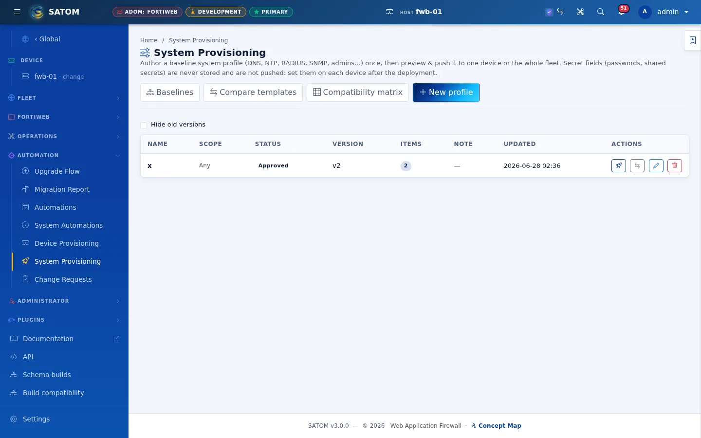
*System Provisioning — the system profiles of the FortiWeb ADOM, with the comparison tools one click away.*

Every route on this page requires `config_write`, except approve/reject, which
require the template-approval permission (`operations.template_approve`), and
the read-only comparison, which needs only `operations.view`.

### 28.1 Composing a system profile

A **system profile** is a declarative list of configuration elements — DNS, NTP,
RADIUS, SNMP, administrators, and in fact any `cmdb` object the endpoint registry
knows about, offered grouped by the GUI section it belongs to. For each element
you pick the object, say whether it is a singleton or carries an mkey, and supply
its values as JSON. Rows reorder with the up/down buttons, and the order is the
order they are pushed in.

Every element writes a `cmdb` endpoint — never the GUI's own API, which no
build has evidence for. The **NTP** element writes `system/ntp` (`ntpsync`,
`syncinterval`); the NTP servers themselves are rows of `system/ntp/ntpserver`,
and the time zone and daylight saving live in the Global settings. Profiles
built with the old "NTP / time" element, which wrote the GUI's
`system/maintenance.systemtime`, are refused by the firmware check; rebuild
that element as **NTP**.

A profile also carries a **scope** — zone, line, department — drawn from the
Classification vocabulary. That is what later lets a baseline match devices.

**Secrets are never persisted and are not pushed.** Elements that carry secret
material are flagged sensitive, and saving the profile **strips** every
secret-looking field out of the stored body — recursively — before it is
written. A deployment therefore pushes those elements without their secrets:
the apply preview names them, and the RADIUS shared secret, admin passwords and
SNMPv3 auth/priv keys are set on each device afterwards. A template is a thing
that gets versioned, shared, exported and reviewed; a template is not a place
for a password.

Saving stores the profile as a **versioned Template of kind `system-profile`**
(§29). Editing it creates a **new version** rather than overwriting the old one.

### 28.2 Applying to one device or to the fleet

Apply asks for a target hostname and a **Change ID** — both are required, and both
land in the audit record, so a system-wide push is always attributable to a
change.

Then it is two-phase, as everywhere else in the product:

1. **Preview** — `dry_run`, showing the exact planned requests per device.
   Nothing is contacted for real.
2. **Confirm** — a **canary-gated** live write: the first device goes first and
   the rest only follow if it succeeded. The result reports `{canary, rest,
   aborted}`. Only an **approved** profile can be deployed live (approval is
   `operations.template_approve`, admin-only); a pending or rejected profile
   keeps its preview, and the refused attempt is audited. The preview also
   shows the firmware check for each device, and the live push is refused for a
   build the profile does not fit or was not validated for, for a build nobody
   measured, and for a device that reports no firmware (§29.1.1). An approver
   can override with an audited reason.

**Variables are rendered per device.** A profile may carry `{{ variable }}`
placeholders (§29.1.4). Each device's writes are rendered from that device's
binding to the profile, as the Template Library's **Apply** does, so the preview
shows the values each device will receive. A device whose binding leaves a
variable unset is named in the preview (*The live deploy will be refused: …*),
and the live deploy, canary included, is then refused with the device and the
variable named. There is no override: set the value on the device's binding
first. A profile without placeholders is pushed the same to every device.

Choosing *Entire fleet* is explicit. Selecting "selected devices" and then
selecting nothing is **refused**, rather than being quietly treated as "all" —
the empty selection is exactly the shape a fleet-wide accident takes.

### 28.3 Approval

A saved profile is pending until someone with the approval permission
**approves** it (making it selectable for baselines) or **rejects** it with a
reason the author can read. Approval and authorship are separate permissions on
purpose.

### 28.4 Baselines

A **baseline** is a *combo* — a zone × line × department permutation — with a set
of **approved** templates assigned to it. It answers "what should every device in
this scope have".

- **Generate** creates a combo for every zone × line × department permutation
  that does not have one yet. (It does **not** read a device: a baseline is
  composed from approved templates, not captured from a box.)
- **Assign / unassign** attaches an approved template to a combo, one at a time
  from the combo's own page, or one template to many combos at once from the
  catalog grid.
- **Matching devices** are computed from the appliances' own classification. An
  empty facet on a combo means *any*, so a combo with no zone matches every zone.
- **Apply** is the same two-phase machinery: a dry-run preview across the matching
  devices, then a confirmed rollout that runs as a **background job** with live
  progress in the job dock — a fleet rollout must not live inside an HTTP request.
  Every composing template must pass the firmware check on every matching
  device, against builds its approval covers (§29.1.1); one refusal stops the
  whole rollout unless an approver gives an override reason.
- `{{ variables }}` render per device here too, and each composing template
  takes the variables of **its own** binding on that device. The preview names
  every device left without a value, and the rollout is then refused before it
  starts, with the devices and variables named (no override).
- A baseline that matches no devices, or that has no composing templates, says so
  and does nothing.

The filter (zone / line / department / name) can be **saved to your account** and
is restored on your next visit.

## 29. Template library & the section catalog

Two pages that are the same data seen from two ends: the **Template Library** is
where desired state is authored and reviewed, and the **Section Catalog** is the
approved subset, arranged the way FortiWeb arranges it. Two read-only tools
answer the questions that come up when firmware moves: **Compare templates**
(29.3) and the **Template compatibility matrix** (29.4).

### 29.1 The Template Library

FortiWeb ADOM → Administrator → **Template Library** (users without
`user_manage` who hold `operations.view` find it under **Operations**). A
template is a named,
**versioned** blob of desired state of a given kind (web-protection profile,
system profile, and the other configuration kinds). Editing never overwrites:
saving produces a **new version** of the same kind and name, and the previous
version stays.

The page header links to **FortiWeb Sections** (the Section Catalog, 29.2;
admins only), the **Factory catalog**, the **Compatibility matrix** and
**Compare**, next to **New Template**. Each row carries its firmware and
self-check badges and a **Compare with a newer version** button beside View,
Apply to devices, Clone and the review actions.

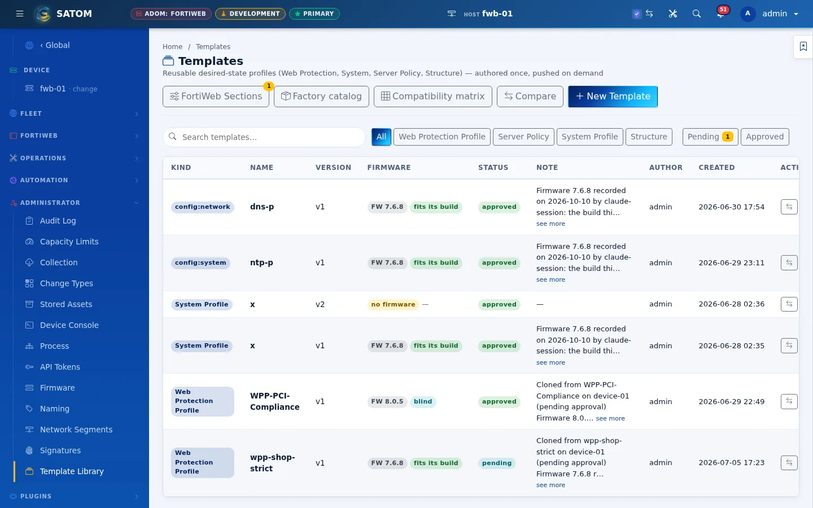
*The Template Library — each template with the firmware build it was written for, and the tools that judge it against other builds.*

**Templates can be captured from the FortiWeb pages.** The pages that draw
FortiWeb's own GUI carry the same tools the older SATOM pages had:

- **Save as template** on a Web Protection Profile list and on configuration
  objects, and on settings forms (System Time, DNS, SNMP, HA and the like),
  where the whole form is captured. A template saved this way is filed under
  the same section the older section page uses, so both list it.
- The **config template library** of the object's section, scoped to the
  object type on the page: View, Apply to devices (dry-run preview with the
  firmware verdict), Clone, Delete and New template. It is the same shared
  library, not a copy.
- On Web Protection Profiles, **Deep clone** (the profile and the objects it
  references); a template-managed profile shows a lock badge and its Delete is
  disabled (29.1.4).

Permissions are split three ways, and they are not the same permission:

| Action | Needs |
|---|---|
| Browse the library | `operations.view` |
| Create / edit / clone / delete a template | `operations.template_save` |
| Apply a template to **one** device | `operations.template_apply` |
| Apply to **several** devices (a fleet rollout) | `operations.apply` **and** an approved template |
| Approve / reject / revoke approval | `operations.template_approve` (admin) |

So an operator can author a draft and try it on a single box; making it
fleet-deployable is a separate, gated decision by someone else.

**Lifecycle: pending → approved (or rejected) → applied.**

- A new or edited template lands **pending**.
- **Approve** makes it fleet-deployable. **Reject** records a reason the author
  can read. **Revoke approval** returns an approved template to pending.
- Applying is two-phase everywhere: a POST without confirmation returns a
  **dry-run preview** and contacts nothing; a confirmed apply runs canary-first
  as a **background job** in the job dock.
- **Approval status and deployment are different things.** A template can be
  approved and never applied. The one deliberate exception: approving a **Web
  Protection Profile** template *does* start a fleet-wide rollout immediately,
  because the team rule is that a template-managed WPP is read-only on the devices
  — the approved version is what must be on every one of them (§9). That
  rollout passes the firmware check below first; when the check refuses a
  device the rollout is **held** and the page says why. The lock follows the
  template's device bindings (29.1.4), but the approval rollout itself goes to
  every FortiWeb you can see in the ADOM.

### 29.1.1 Firmware build and API version

Every template records the **firmware build its body was written for** and the
REST API version it speaks (shown in the library's *Firmware* column and in the
View dialog). FortiWeb answers a write carrying a field the build does not know
with **200 and discards the field**, so a body is only meaningful together with
the build it came from.

- **Captured** templates (*Save as template* on a Web Protection Profile, on a
  configuration object or on a settings form) take the build the appliance was
  running.
- **Hand-written** templates (New Template, section *New template*, System
  Provisioning) must pick their build from the list of builds SATOM knows (API
  library, declared firmware, builds running in the fleet). A new version keeps
  its predecessor's build unless you change it. When SATOM knows no build at all
  (a fresh install with no appliance and an empty API library) the template is
  saved without one and says so.
- Templates saved before this existed show **no firmware**. Their fields are
  still checked against every target; renames cannot be, because nothing says
  which build the body came from. Record the build they fit (29.1.3).
- **Adapted** templates (29.1.2) carry the build they were adapted to.

**Checked at save.** The body is compared against its own build through the API
library. A field that build does not serve is flagged in the library right away
(*does not fit its build*), not discovered at apply time.

**Checked at apply.** The dry-run preview of every apply path (Template Library,
section page, System Provisioning, baselines) shows a verdict per device for the
device's running build:

| Verdict | Meaning | Effect |
|---|---|---|
| same / ok | every checked field is served by that build | passes |
| fields would be discarded | the build does not serve some fields of the body | **blocks** |
| renamed | the build serves the field under a new name | **blocks** — adapt the template |
| endpoint not served | the build rejects the endpoint itself | **blocks** |
| no evidence for that build (`unmeasured`) | nobody measured that build | **blocks** — measure the build first |
| device reports no firmware | nothing to compare against | **blocks** |
| fields never measured (`blind`) | the endpoint is served, its fields were never read | warning, never green |
| new fields not decided | the build adds fields the template does not decide | warning, naming the fields — adapt the template to decide them (29.1.2) |

A build nobody measured used to pass as a warning, which turned "unknown" into
"accepted" by omission; it now blocks like a missing endpoint. A *blind*
endpoint still warns, because it at least proves the object can exist on that
build.

Sub-table rows and endpoints outside the API sweep are listed as *not checked*
rather than counted as fine. A blocked apply can be forced by a user holding
`operations.template_approve` who types an **override reason**; the override,
the reason and what it overrode are written to the audit log. The one block no
override lifts is an unset device variable (29.1.4): there is no value to
write.

**Approval is for builds.** Approving records the builds the template was
validated for: its own build plus every build its product runs in the visible
fleet. A **fleet rollout** (several devices, a baseline, a live System
Provisioning push) to a build outside that set is refused until an approver uses
**Revalidate for fleet builds** in the View dialog. A new version starts with no
validations.

**A template that does not fit is adapted, never edited in place** — see
29.1.2.

**Line profiles and the new-policy wizard.** The Line Profiles page shows, for
each line, the build its Web Protection Profile template was written for and
the builds its approval covers; the template dropdown lists each version's
build. The *From a line profile* wizard binds the profile that is already on
the device by name and writes no template field, so it never blocks on
firmware. It does **warn** when the line's template does not fit the device's
build, or was never validated for it, because the profile on that device may
have been pushed incomplete.

**Exceptions carry a build too.** Every carve-out records the firmware build
and API version of the appliance it was authored on; a carve-out placed onto
other appliances keeps the build it was written for, and editing its payload
restamps it with the appliance's current build. A rollback or restore brings
back the build the old payload was written against (carve-outs saved before
this show *unrecorded*). **⬆ Inject to device** and the Attack ID insert show
the verdict for the target's build in the dry-run: fields discarded, renamed or
an endpoint not served **block** the push, and an approver can override with an
audited reason. Unlike templates, *no evidence* is still a **warning** for a
carve-out, never green: today the API sweep does not measure the exception
sub-tables, so most pushes show it, and the check starts blocking on its own
once a sweep records those fields.

### 29.1.2 Adapt to firmware: every new field is decided

In the View dialog, pick a target build under **Adapt to firmware** and press
**Preview**. SATOM lists three kinds of change:

- **renames** — fields the target serves under a new name; the value is carried
  to the new name;
- **removals** — fields the target does not serve; they are dropped;
- **new fields** — fields the target adds over the template's own build. Each
  one must be **decided**: *keep device default* (the template leaves the field
  alone) or *set a value* (the value is written into the new version's body).
  Leaving them out silently is how a template "passes" and the upgraded device
  still behaves differently, so **Save adapted version** is refused until every
  new field has a decision.

A field whose value is a **secret** (a password, a shared secret, a key; for
example `jwt-token-secret`, which appears on 8.0.6) offers only *keep device
default*: a template never stores a secret, so you set it on the device.

**Save adapted version** writes a **new pending version** (adapting is
authoring, so it needs `operations.template_save` and a fresh approval) stamped
with the target build. Its note lists every rename, removal and decision, and
the decisions are stored with the version. The original version is untouched.
Two cases are refused: a body whose object the target does not serve at all
(no field change can make an endpoint exist), and a body with nothing to
change.

An apply to a newer build whose new fields the template has not decided is not
blocked; the preview **warns** with the field names, because the device default
applies to them.

### 29.1.3 Recording the build of a legacy template

A template saved before builds were recorded shows **no firmware**, and newer
builds cannot be judged against it. In its View dialog, **Find the build it
fits** checks the body against every **measured** build of the ADOM and lists
them best fit first (nothing discarded, nothing unmeasured, the oldest build on
a tie). **Record that build** stamps the best fit as the build the template was
*authored* for (never as *captured*) and appends a dated line to its note.

Recording needs `operations.template_approve`, and it is refused when:

- the template already records a build — a stamp is never rewritten; adapt the
  template to another build instead (29.1.2);
- no measured build fits the body without discarding fields — re-capture it
  from a device;
- no build of the product has been measured yet.

### 29.1.4 Device bindings and per-device variables

A template is the **shared intent of its ADOM**. A device does not get a copy:
it gets a **binding** to the template family (kind + name), managed in the View
dialog under **Devices this template governs** (`operations.template_save`).
For each binding you choose:

| Field | Meaning |
|---|---|
| **Device** | a device of the template's own ADOM; a binding cannot cross ADOMs (a FortiWeb template cannot govern a FortiADC) |
| **Version** | **newest approved** (the default: the device follows each new approved version) or one version **pinned** |
| **Variables (JSON)** | the device's own values for the body's placeholders, as a flat object `{"name": "value"}` |

A device has at most one binding per family; binding it again updates the
binding. The bindings table shows, per device, the version it follows, the
build it is checked against, the verdict (*fits* / *does not fit*, with the
reason) and its variables. A binding whose family has no approved version, or
whose pinned version no longer exists, whose device reports no firmware, or
that leaves a variable unset, shows as not fitting.

**Variables.** A value that differs per device (an address, a host name) is
written in the body as `{{ name }}` (letters, digits, `_`, `.`, `-`). The View
dialog lists the names the body asks for. A value that is exactly one
placeholder takes the variable's value as is; a placeholder inside a longer
string is replaced by its text. **Apply** (in the Template Library, in the
section libraries on the FortiWeb pages, and in System Provisioning and its
baselines, §28.2 and §28.4) renders the body per device, and
refuses a device whose binding leaves a variable unset — with no override,
because a literal `{{ name }}` would otherwise be written to the box. A body
without placeholders is pushed the same to every device.

**The Web Protection Profile lock follows the bindings.** An approved WPP
template with **no binding** keeps the old rule: the profile is read-only on
every FortiWeb of its ADOM. Once it has bindings, it is read-only **only on the
bound devices**. The lock never reaches a device of another ADOM.

Bindings also decide which templates the matrix counts as *bound* (29.4) and
which templates the upgrade pre-flight checks for a device (29.5).

### 29.2 The Section Catalog

Template Library → **FortiWeb Sections** (admin, `user_manage`; a badge on the
button counts the templates pending approval). It lists **only templates whose
status is `approved`**, grouped by the FortiWeb section each kind belongs to,
with an unknown-section bucket last so nothing silently vanishes.

Two things it is not:

- It is **not a live device browser.** That is the device's own pages in the
  FortiWeb ADOM, which read what is on the box. This page is **desired state** — what someone decided
  should be true, approved.
- It is not the whole library. Pending and rejected templates are absent by
  construction, so the catalog is clean without anyone curating it.

**This is the connective tissue to §28.** The approved templates listed here are
exactly the pool that baselines draw from: a template is authored in the library
(29.1), approved, appears here grouped by section, and is then assignable to a
zone × line × department combo in System Provisioning (28.4). A template that
never got approved cannot reach a baseline, which is the point.

### 29.3 Compare templates

System Provisioning → **Compare templates**, also linked from the Template
Library (**Compare**), from the matrix and from the **Compare with a newer
version** button on every row of both lists (`operations.view`). It answers one
question before anything is provisioned: *is this newer template a valid
replacement for the one the device has, on this build or on this device?* It
is read-only: nothing is saved or sent.

Pick:

- **Current template** — the one a device has now.
- **Newer template** — any template of the same kind in the same ADOM. Opened
  from a row, it defaults to the next version of the family, or else the newest
  version adapted from the current one; when neither exists, the page says so
  and asks you to choose.
- **Firmware build** — optional. Empty means the device's running build when a
  device is chosen, otherwise the newer template's own build.
- **Device (optional)** — a device of the ADOM, to check its variables and its
  own build as well.

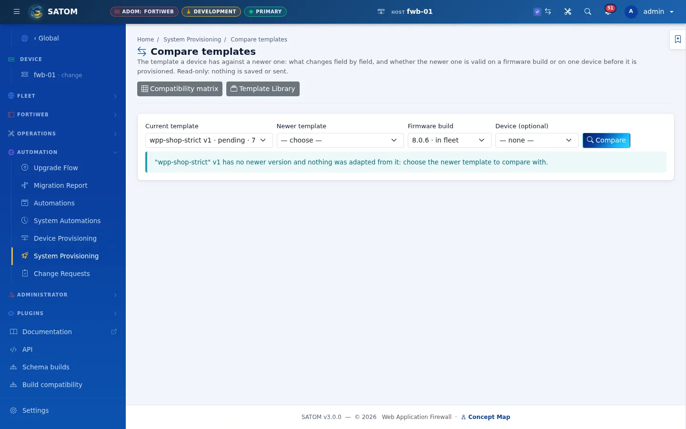
*Compare templates — the current template against a newer one, on a build or on one device.*

The result has four parts:

1. **The verdict.** The newer template is **valid** for the build only when it
   fits the build (nothing discarded, renamed, absent or unmeasured), decides
   every field the build adds and, on a device, has a value for each of its
   variables and no device-level block. Every reason it is not valid is listed.
   Approval is reported apart: a valid **pending** version can go to a single
   device, but a fleet rollout needs it approved.
2. **Side by side** — status, the build each was written for and how it got
   it (captured / authored / adapted), the verdict on the build, whether the
   approval covers the build, and the new fields of the build each one leaves
   undecided.
3. **On the device** (when one is chosen) — unset variables of its binding,
   blocks and warnings.
4. **What changes** — the field-by-field difference of the two bodies: objects
   added, removed or changed, and per changed object the fields added (`+`),
   removed (`−`) and changed (`~`, old → new). Identical bodies say so: then
   only the stamp, the status or the decisions differ.

Append `?format=json` (or send `Accept: application/json`) to get the same
result as JSON.

### 29.4 The template compatibility matrix

Template Library → **Compatibility matrix** (also from System Provisioning and
from Compare templates; `operations.view`). Every template of the ADOM is a
row, every firmware build the ADOM knows is a column: each build that has been
measured or runs in the fleet, newest first. A column header counts the
devices running that build (hover for their names) or says *not measured*.
Each row also shows the build the template was **written for** and its
**bound devices** (a number, or *all (no binding)*).

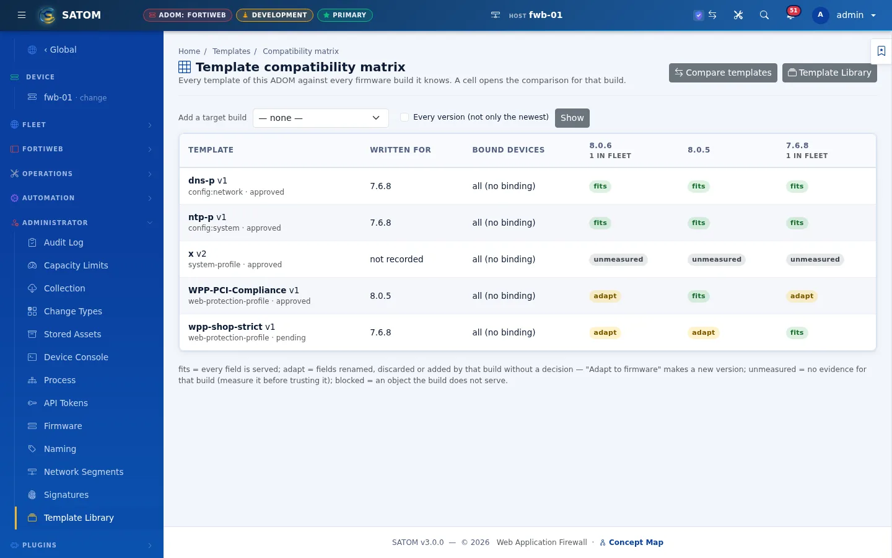
*The compatibility matrix — one verdict per template and build; a cell opens the comparison for that build.*

| Cell | Meaning |
|---|---|
| **fits** | every field is served by that build |
| **fits, warnings** | served, with warnings — for example fields that were never measured on that endpoint |
| **adapt** | fields renamed or discarded by that build, or fields it adds that the template has not decided: **Adapt to firmware** (29.1.2) makes a new version |
| **unmeasured** | no evidence for that build: measure it before trusting it |
| **blocked** | the build does not serve an object the template writes (or the check could not run) |

Hover a cell for the full verdict; click it to open **Compare templates** for
that template on that build (29.3).

Two controls above the grid:

- **Add a target build** — adds a column for a build you are considering, even
  one that has not been measured (expect *unmeasured* cells until it is).
- **Every version (not only the newest)** — by default each family shows only
  its newest version; tick this to see every version.

### 29.5 Templates and firmware upgrades

The upgrade pre-flight (on every product but FortiADC) checks, against the
target build, every template that governs the device: the templates it is bound to, plus every
approved template of its ADOM that has no binding at all. That `templates`
section is **graded**: a template that does not fit the target fails the
pre-flight, because its next apply after the upgrade would be refused, and
re-running the pre-flight changes nothing. Adapt the template (29.1.2), or
move the binding to an adapted version, before the window. Templates that fit
but leave new fields undecided are counted in the summary without failing it.
The pre-flight itself is described in §40.

## 30. The endpoint registry & the API explorer

Every product workspace has an API console (§17.1, §17.2, §17.3 and §17.4
cover the ADC, FAC, FAZ and FortiGate ones). This section documents the
**FortiWeb** one and, more importantly, the **registry model all five share**.

### 30.1 What the registry is

The registry is the map from a **logical endpoint name** the application uses
(`server_policy`, `dns`, `system_global`…) to the **concrete URI** on that
firmware. There is one catalog per product, each with its own API dialect
(FortiWeb `v2.0`, FortiADC `v1`, FortiAuthenticator `v1`, FortiAnalyzer
JSON-RPC).

It is **DB-first, seeded from an endpoint baseline**:

- the live catalog is a database table, editable from the console and captured by
  the nightly database dump;
- its **seed** is the product's endpoint baseline: the catalog promoted from what
  the API library measured on one firmware build (FortiWeb 7.6.8, FortiADC 8.0.3,
  FortiAuthenticator 8.0.3 and FortiAnalyzer 7.6.7 today), shipped sealed with
  each release. At boot the registry is reconciled to it once per promotion. A
  row you edited, disabled or created is **never** touched: the *updated by*
  column tells the two apart (`baseline:<product>@<build>` is the baseline's,
  anything else is an operator's);
- if the database cannot serve the catalog at all — an early script, a standalone
  tool, a fresh tree — the shipped baseline is served directly, so nothing ever
  breaks for want of a table.

A newer firmware is followed by **promoting** a baseline from its measurements
(`flask apilib baseline promote`), not by editing a file. The operator's view of
that, and `flask apilib baseline check` for drift, are in
[api-library.md](api-library.md) §9.

Reads go through a short-lived per-process cache. An edit invalidates the cache
of the worker that served it immediately; the other workers converge within a
minute.

**This is why §17.3's claim holds.** When a firmware upgrade moves a URI, the fix
is a registry edit on the affected product's console — a row change, audited,
effective across the workers within a minute. It is not a code change, not a
release, and not a redeploy.

### 30.2 Editing the catalog

Editing needs `registry_edit`, every change is **audited** with the before/after
URI, and it happens **in place on the console's API-menu tree** — the standalone
Registry page was fused into the explorer, so there is one page and one write
path rather than two that can disagree. Old `/registry` and `/registry/<section>`
bookmarks redirect to the explorer; `/registry/search` still serves a plain
name/URI search across the catalog.

Two rules on the write path:

- A name is validated (letters, digits, `_`, `-`, `.`) and a URI must be an
  absolute API path. A duplicate name within the same product and API version is
  refused, naming the row it collides with.
- **Removal is a soft delete.** Disabling a row sets `enabled=false` and *keeps
  the row*, precisely so the boot seeder cannot resurrect a name the operator
  removed. Re-enabling is the same button. Nothing here hard-deletes a catalog
  entry.

### 30.3 The FortiWeb API explorer

FortiWeb ADOM → **API** — the registry catalog browsed as the FortiWeb API menu
on the left, and a request console on the right: pick an appliance, pick or type
an endpoint, choose a method, supply a JSON body, execute.

- **GET is always allowed** to any user who can reach the page.
- **POST / PUT / DELETE / PATCH require the `registry.execute_write` permission**
  and are refused with that message otherwise. Note that this is a *separate*
  permission from `registry.edit`: one lets you change the catalog, the other
  lets you fire writes at a device through it. The internal pass-through under
  `/api/fw/<id>/proxy/…` and `/api/adc/<id>/proxy/…` applies the same rule.
- Every execution is audited with the method and endpoint.
- The device's own response is shown as it came back — a device error is rendered
  as the device's error, never smoothed into an empty result.

Unlike the FortiADC, FortiAuthenticator and FortiAnalyzer consoles (§17), the
FortiWeb explorer's writes are **not dry-run by default** — this is the raw
request console, and the confirmation is the permission.

**The FortiADC, FortiAuthenticator and FortiAnalyzer consoles share one write
policy:** a write without **Apply** returns the request (method, path, body) and
sends nothing; an applied write is audited whether the device accepted or
refused it (the refusal is recorded as the error); reads are not audited. Their
catalog editors go through the same writer as FortiWeb and FortiADC, so the
name/URI rules and the duplicate check of §30.2 apply to all four (a
FortiAuthenticator URI must also stay under `/api/v1/`).

Since 2.2.0 the explorer also knows **which firmware build** the selected
appliance runs and what that build serves: see §30.10.

Endpoint conventions, dialects and per-product quirks:
[docs/device-api.md](device-api.md).

### 30.4 Reconcile: what the fleet says about the catalog

**API explorer → Reconcile** (`/web/registry/reconcile`) or, in the FortiADC
workspace, **API hub → Reconcile** (`/adc/api/reconcile`). Needs
`registry_edit`, same as editing a row — because that is what Apply does.

The rediscovery sweep (§4) already asks a live appliance about every endpoint in
the catalog. This page reads those verdicts back across **all** live appliances
of the product and sorts the catalog into six cards:

| card | meaning |
|---|---|
| **Evidence** | which appliances were believed, and which were thrown out |
| **Not served by any live appliance** | the only bucket with a disable button |
| **Cannot conclude** | served by one appliance and absent on another, or simply not measured everywhere |
| **Never measured** | in the sweep plan, no sweep has ever asked |
| **Outside the sweep plan** | no sweep can ever answer — sub-tables that need an `mkey` |
| *(verified)* | counted in the header; nothing to do |

**An appliance can be excluded from its own evidence.** A device answering
errors to more than a quarter of the sweep — the threshold is **25 %** — is
reporting on *itself*, not on the catalog, and the page names it in the
Evidence card with the ratio. The real
case: an appliance whose licence had lapsed answered an error to 283 of 321
reads while the inventory still showed it green. Believed naively it would have
condemned the entire catalog.

> **Before you press Disable, read the warning at the top of the proposals card.**
> Absence is a statement about a **firmware release**, not about an endpoint. If
> every appliance you own runs the same line — which the card tells you — then
> "absent everywhere" means *"not in that release"*. On the first real run, of
> the 38 endpoints both healthy 7.6.8 appliances rejected, several were **8.0**
> features. Disabling them removes from the catalog exactly what your next
> upgrade needs.

Apply performs the ordinary soft delete: the row is kept, disabled, audited and
restorable from the explorer. Submitting a name the evidence does not condemn is
answered `rejected` — the form filters the proposals, it does not authorise
them.

### 30.5 API versions: what each firmware build actually takes

**API explorer → API versions** (`/web/registry/versions`, and the FortiADC
twin at `/adc/api/versions`). Also `registry_edit`.

**Where the answers come from (2.2.0).** Everything on this page is read from
the **API library** — the append-only record, in the database, of what each
build serves ([API library](api-library.md)). Evidence is never rewritten and a
retired appliance keeps what it proved, so a build does not vanish from this
page when its last appliance is deleted. The **API library:** selector under
the title switches product: FortiWeb and FortiADC get this whole page;
FortiAuthenticator, FortiAnalyzer and FortiGate get the library cards only
(§30.8). The **Library comparison** and **Endpoint drill-down** cards at the
foot of the page are described there too.

**Two firmware builds can speak the same API version and still not accept the
same payload — and so can two builds of the same line.** FortiWeb 7.6 and 8.0
are both `v2.0`; measured on this fleet's own data, `admin` has 40 fields on 7.6
and 42 on 8.0, `system_global` 60 versus 63, `ntp` 3 versus 4. And `8.0.4` and
`8.0.7` are both "8.0" while their CLI is not the same. If nothing tracks that,
a payload built against one build and written to another fails on the appliance
— which is the wrong place to find out.

So **the unit of evidence here is the full version** (`8.0.5`). The line
(`8.0`) survives as a rollup you can compare against, but it is no longer
tabulated on its own: with one measured build per line that table repeated the
build table row for row. It is called out only when it says something a build
row cannot — see *heterogeneous lines* below.

The page has four parts:

1. **Firmware versions** — one row per build SATOM knows of: what it was
   measured to serve, which appliances witnessed it, which CLI dump was
   captured on it, and *why SATOM knows about it at all* — an uploaded firmware
   image, an appliance running it, or an operator declaring it by hand. A build
   that is registered and never swept reads **`declared · unmeasured`**, which
   is not the same as a measured build that turned out empty. **Evidence**
   counts the library documents stored for the build and **First / last seen**
   dates them; a retired appliance still counts as a witness.
   Each row also carries a **Discovery run** link, scoped to that build: it
   aims the **Discovery run — API + CLI** card directly below this table, so
   the candidates, the appliances offered and the findings all answer about
   the build whose row you clicked. Starting a capture from it returns you
   here — still on that build, and watching the sweep it just started.
2. **Witnesses excluded** — the same honesty as §30.4: an unhealthy device is
   not evidence.
3. **Compare two of them** — build against build, or rollup against rollup,
   in **one table with one column per build**: `Endpoint / object`,
   `Evidence`, `URN`, then `7.6.8`, `8.0.5`, `Test`. One row per finding, and
   then everything measured *on 7.6.8* next to everything measured *on 8.0.5*.

   * **The first column is the name and nothing else.** What kind of finding a
     row is, is read off the columns that measured it. A **change** shows
     `absent` on one side and `served` on the other, or a field count on each
     side with the signed difference beside the one that moved. A row where one
     build column says **`not measured on 8.0.5`** is a **gap** — nobody asked
     that side. A row whose `Evidence` cell names a *different kind per build*
     is **incomparable** and is never subtracted. The class labels (`added on`,
     `gone on`, `fields known only on`, the `8 → 14` subtraction) were all
     removed from under the name during 2026-09-16: every one of them restated
     a cell already beside it.
   * **`Evidence`, in second position, says which kind of evidence the row
     rests on** — `sweep` (the raw collection the appliance put on the wire) or
     `schema` (a harvested field schema, which strips the wire-only companion
     of every enum). **The two are never subtracted from one another**: a naive
     subtraction across the two kinds reported 56 phantom removals on the first
     draft of this page. An **incomparable** row is incomparable *because* the
     sides disagree, and there the cell names both kinds and which build holds
     which.
   * **One name can be two rows, and each says so.** `user_group` is an
     endpoint a sweep asked about *and* an object a harvest described, so it
     appears twice — once per kind of evidence. The Evidence cell of each row
     carries an **`also: sweep` / `also: schema`** marker pointing at its twin,
     with the sentence explaining why the two are reported apart. It is a
     pointer and never a merge: neither row borrows the other's numbers.
     *Added 2026-09-17, after an operator read one twin's "not measured" as the
     other twin's sweep having failed.*
   * **Each build column is indented under the transport that produced its
     evidence** — `API` first, then `CLI`, with that transport's answer
     beneath it. The `CLI` half answers **only for the CLI**: under a head that
     already says CLI, a verdict naming the API repeats the line above it.
   * The **API** half says whether that build was measured to serve the object
     (`served`, `absent`, or `not measured on 8.0.5` — a rejection and an
     unasked question never share a word) and how many fields its evidence
     carries. The signed tally (`+6 added`) stays printed; the **field names
     open in a window** from the `[+]` button beside it, under the build that
     has them — the base column lists what was lost, the target column what was
     gained. *The names are not in the row's text, so typing one into the
     filter will not find it: a row counted as a hit on text the operator
     cannot see is worse than a miss.*
   * The **CLI** half is a verdict or a count, never a field list of the
     firmware's. It answers from *that build's own capture*, named in the
     tooltip on the word `CLI`, and a build with no dump of its own shows an em
     dash and says why rather than borrowing the other column's answer. There
     is deliberately no "CLI added / CLI removed" *of the firmware*: a dump's
     `set` lines are the fields somebody **configured on one appliance**, and
     the two columns are two different appliances. Where both builds printed a
     block the page does show `N set(s)` and a signed difference — with the
     two-appliance caveat on every number that carries it.

   **Why a side has no schema.** Schema evidence does not come from a sweep. It
   comes from an offline harvest (`scripts/build_field_catalog.py`) against
   **one reference appliance per firmware line**, and that harvest can only
   describe a table the appliance has actually populated. So an object can have
   no schema on a line for reasons that have nothing to do with the firmware,
   and the row would say only `not measured on 8.0.5`.

   Each harvest now **records what it could not do**, per object, into
   `data/field_schemas/<product>/<line>/_coverage.json`, and the page reads it:

   * a **coverage banner** above the table states, per compared side, how much
     of the catalog that line has, which appliance was harvested and when, and
     names every object that has no schema. A line nobody has ever harvested
     says exactly that — it is not reported as complete.
   * a **`why`** beside `not measured on …` opens the recorded reason: the
     table is empty on the reference appliance (*a fact about that box, not
     about the firmware — configure one row there and re-run the harvest*), the
     appliance rejected the URN (*which does not say whether the object is gone
     from this build or the registry path is wrong for this line*), or the
     device was unreachable.
   * an existing schema file still counts as coverage even when today's
     reference box can no longer re-derive it; the record says so rather than
     calling a measured artefact missing.

   A **sweep** gap carries no such reason — a sweep's silence is recorded
   nowhere, and lending it the harvest's sentence would explain one absence
   with another absence's cause.

   **But a gap is not automatically a question nobody asked.** When the sweep
   holds a verdict for that object on that build, the cell leads with it —
   `served` or `absent`, the same two badges the endpoint rows use — and states
   the missing half beside it as `no field names on 8.0.5`. Only a key the
   sweep has no record of keeps the bare `not measured on 8.0.5`. The export
   carries the same verdict, because a blank spreadsheet cell reads as *no
   finding*.

   The rule underneath explains most of this column: **a FortiWeb `cmdb` GET
   returns the entries somebody configured, not a schema.** There is no
   `action=schema` — measured against both reference appliances on 2026-09-17,
   every such query parameter is ignored and the reply is the same empty list.
   A build can serve a URN perfectly and still teach nobody a field name until
   a row exists on the box. The verdict says the object is there; the blank
   says nobody has configured one.

   **A new firmware line** therefore needs one entry in
   `SATOM_FIELD_CATALOG_SOURCES` (in `.env`: `fortiweb=8.2:<appliance>,…`) and
   one harvester run. Everything above follows from the record that run writes,
   with no code change.

   Each row also carries the REST path when its evidence has one and a **Test**
   button, which opens the live-appliance panel in a dialog. A row derived from
   a harvested object schema has no REST path of its own, so it offers no
   button rather than a button that cannot work. Comparing a rollup says so,
   and names the builds inside it.

   **Export CSV / Export PDF**, beside *Compare*, download exactly the
   comparison on screen — including the field names that live behind the `[+]`
   windows, which bucket each row came from, whether it **is a change**, and
   the recorded reason a side has no schema. Both formats document **every
   column**: the CSV below a blank row (so a spreadsheet's auto-range cannot sum
   the documentation), the PDF as a legend after the findings.

   *Before 2026-09-16 these findings were split across three tables, and a key
   whose only finding was a field delta was listed in one of them and absent
   from the other — an absent row reads as "nothing to report about it". The
   single Change cell that replaced them carried six different shapes and one
   object printed eighteen field names inline; it became fixed slots, then lost
   the "fields changed" label, then absorbed the two transport columns, then
   split into a column per build, gave up the evidence kind to a column of its
   own and the `added on` / `gone on` labels to the two build columns that
   already measured them — and then emptied the name column entirely.*
4. **Preflight** — name an object and the fields you intend to send, and get
   `ok`, `unknown_fields`, `absent`, `fields_unknown`, `version_unmeasured` or
   `unmeasured`.

**Heterogeneous lines.** When two or more *measured* builds share a line, the
page says so above the comparison: it names the builds the line merges and lists
the endpoints only *some* of them served. Those are reported as **partial**,
never as "the line serves it" — a merge is not a box. When every line holds a
single measured build there is nothing to say and nothing is shown.

**`unmeasured` is an answer, never a yes.** If SATOM has never seen that build,
it says so rather than guessing; the fix is to harvest an appliance running it
(**Harvest this appliance now** in the API explorer for a FortiWeb, §30.10;
**Schema builds → Harvest** for a FortiAnalyzer, §30.12) or its field
schemas. The page reads the library directly, so the new evidence shows on the
next load.

**`version_unmeasured` is the narrower one, and it is the whole point of the
build axis.** It means *that build* has no evidence while other builds of its
line do — and SATOM will not answer for it out of theirs, because 8.0.4 is not
8.0.7. It is not a refusal either: the line-granular answer is printed beside
it, labelled, so you can see what *is* known and decide.

**Registering a build.** Versions already proved by an uploaded firmware image
or by an appliance in the fleet appear on their own — they are derived on every
read, so no upload path can forget to register one. The form at the foot of the
table is for the builds nothing proves yet ("8.0.7 is coming and I want to see
its column"). Forgetting one only removes the hand-written note; a build an
image or an appliance proves stays listed.

**Evidence from before 2026-09-16** (the frozen FortiADC matrix) names a line,
not a build. It is kept as `legacy_matrix` evidence and shown as **patch
unknown** rather than reinterpreted as a build nobody ran. Nothing drops a
witness any more: an appliance deleted since its sweep is listed as `retired`,
and its build stays.

The same answers are available on a node whose web interface is down:

```
satom get api versions
satom get api preflight fortiweb09 admin fortiai old-password
satom get api preflight 8.0 admin fortiai old-password
```

Exit codes: `0` understood, `1` some field is not on that line, `4` unmeasured,
`2` you typed the command wrong. `4` is separate from `0` deliberately — a
script must never reach "go ahead" from "I have no evidence".

Both commands print when the matrix was built, because they read the export
file **Rebuild** writes from the library — a snapshot, not a live query. The
page itself needs no rebuild. Details, evidence rules and the CLI contract:
[docs/device-api.md](device-api.md) §6–§7.

### 30.6 When an object disappears: who the finding is about

A comparison that reports an object as **gone on 8.0.5** is stating that the
build rejected the path SATOM holds for it. That sentence is true in two
completely different worlds, and they need opposite work:

* the object was **removed in that firmware line** — a correct measurement of
  the appliance, and exactly what this page exists to produce;
* the object is **still on the appliance** and the path this catalogue holds is
  **wrong for that line** — a finding about SATOM, not about the firmware.

The REST API cannot tell them apart: a rejected URN looks the same either way.
So the page asks a **second source** — the appliance's own CLI configuration
dump, which is addressed in CLI syntax and therefore cannot inherit a mistake
in our URN — and prints its verdict beside the `absent` badge:

| verdict | what it means | what to do |
|---|---|---|
| **gone — corroborated** | the build rejects the path, its own dump has no block for it, and the dump of the build it is compared against does | nothing; this is the finding |
| **check the registry** | the build rejects the path but its dump **still holds a block** | verify the path in the console, then correct the catalog entry |
| **gone — one source** | the dump never held a block on either side, or the object is a runtime readout that cannot have one | capture a dump of the older build, if it should have one |
| **not corroborated** | no dump has been captured for that build | capture a CLI configuration dump of it |

The last two are **not doubts about the rejection** — the build answered. They
are statements about what a second source would add.

**Why a missing block is not, on its own, proof.** An empty table prints no
block, so "no block" cannot mean "not in this firmware". What makes the pair
conclusive is that the two weaknesses do not overlap: an empty-but-existing
table *still answers over REST*, so a rejected URN rules that story out, and
the earlier build's dump proves the object was ever there to lose. Corroborated
therefore requires all three — rejected now, no block now, a block before.

A counter above the table splits the gone rows across the four verdicts, and
the CSV and PDF exports carry the verdict in a `corroboration` column. The
column is blank on every row that is not a disappearance claim, which is not
the same thing as an uncorroborated one.

#### The ledger, and hearing about it without opening the page

The comparison is derived and is rebuilt on every sweep, so a finding it
produced yesterday leaves no trace of *when* it was first proved or whether
anybody looked at it. Corroborated disappearances are therefore also written to
a ledger (`object_absences`), keyed by product, name and the two scopes
compared. Re-proving one updates the row — it never mints a second — so
"since when has this been true?" stays answerable.

It is written at the two moments the evidence can change: at the end of a
**rediscovery sweep**, and on the **alert timer**. The alert family is
**API catalog integrity** (Settings → Alerts), and it deliberately reports the
two cases at two levels:

* a **contradiction** is a *warning* — the catalogue every service resolves
  names through is wrong for that line, and nobody would find out from a green
  page;
* a newly proved **disappearance** is *info* — it is a correct measurement, and
  alerting on it at warning level trains you to mute the family before the
  contradiction ever arrives.

A corroborated disappearance is **acknowledged automatically** (`absence.autoack`,
on by default): it keeps being reported on the page, but it stops being an open
question, and the review queue -- the chips in the comparison itself, see
below -- shows only what still needs a person. A
contradiction is never acknowledged automatically — it is precisely the case
that needs the person this would be replacing. A human decision is never
overwritten by the timer.

#### Reviewing a finding, on the row that reports it

The ledger is read back **inside the comparison**, so the queue is not a second
page you have to remember to open. Every gone row that the ledger holds a record
for carries a chip next to its name:

| chip | meaning |
|---|---|
| **needs review** | recorded and still open; click it to decide |
| **accepted · `<who>`** | somebody (or the automatic pass, as `system`) took it as true of the firmware |
| **refused · `<who>`** | somebody looked and said no; the row is kept so the refusal is on the record |

A row the ledger does not hold shows **nothing at all** — never an empty badge,
and never a neighbour's chip.

The chip is a **button only while the finding is open**. Clicking it opens a
window with both sources, the appliance the dump came from and when it was
captured, when the finding was first proved and how many times it has been
re-proved since, and two verbs: **Accept** and **Refuse**. Neither writes the
endpoint catalog (see below); both record who decided and when, and the page
returns to the comparison you were reading rather than to the default one.

**The scopes in that window are the ledger's own, and they may not be the two
on screen.** A disappearance is recorded against the firmware **line** that
removed it, so a `7.6.8 → 8.0.5` comparison shows the `7.6 → 8.0` record and
says so. That is deliberate: a decision taken here applies to the line, and a
window that showed it without its scopes would let it read as a decision about
those two builds, which nobody made.

Two comparisons get **no** ledger entry at all, each with its own sentence
above the table rather than a blank:

* **two builds of one line** — a disappearance belongs to the line that removed
  it, so there is nothing to record between `8.0.3` and `8.0.5`. That is not a
  claim that nothing disappeared between them.
* **a pair that skips a line** — `7.6 → 8.2` would count everything `8.0`
  removed a second time. Compare the adjacent lines to see the record.

The chip never changes the verdict beside it. The badge on the row is still the
one **measured** from that build's own evidence; the ledger only adds *since
when* and *who looked*. The CSV and PDF exports carry both as the
`ledger review` and `ledger scope and age` columns — the PDF gives them a third
table, joined to the findings by object name. A blank there means the row is
not in the ledger for this pair, which is not the same as unreviewed.

#### What is NOT auto-written, and why

The candidate CLI spelling is recorded and shown, and it is **not** written to
the catalog. `RegistryEndpoint` is keyed `(product, api_version, name)` with one
URN per name and **no firmware dimension**, and a contradicted row is by
construction one whose *base* scope is still served by the current URN — so
writing the other spelling would break the base line every single time.
Independently, a configuration dump cannot decide which of two spellings is the
wrong one. So the page offers no apply button rather than one that always
refuses. Giving the catalog a per-line dimension is what would unblock it, and
that is a change to the resolution path every service in the product goes
through.

### 30.8 The API library on the API versions page: products, compare, history

Since 2.2.0 the API versions page (§30.5) is a window on the **API library**:
the database record of every endpoint and field each firmware build serves,
where each fact came from, and when it was first and last seen. Evidence is
only ever added — re-harvesting the same build confirms what is there, and a
retired appliance's evidence stays. The reference is
[API library](api-library.md).

**The product selector.** Under the page title, **API library:** lists one
button per product, with the number of builds the library holds for it
(hover for endpoints and evidence documents). FortiWeb and FortiADC open their
full page. **FortiAuthenticator**, **FortiAnalyzer** and **FortiGate** open a
library-only page — the three cards below and nothing else, with **Back to**
returning you to the page you came from. FortiGate carries a **catalogue**
badge: SATOM does not manage FortiGates, and their API is held for reference.

Where each product's knowledge comes from:

| product | evidence |
|---|---|
| FortiWeb | rediscovery sweeps of your appliances, and harvested field schemas |
| FortiADC | sweeps, and a frozen line-level matrix from before the build axis |
| FortiAuthenticator | the appliance's own API schema, read live and read-only |
| FortiAnalyzer, FortiGate | the vendor's Ansible collections — a **claim, not a measurement** |

Every source is shown as a badge (`sweep`, `schema`, `vendor_doc`,
`legacy_matrix`, `manual`); hover one for what it means. Vendor evidence never
outranks a measurement of a real box, and an open vendor range stops at the
newest build the vendor data knew about — a later build reads **unmeasured**.

**Library builds** (on the library-only page) lists every version the library
knows, measured or not: **Status** (`measured`, `vendor only`, `unmeasured`),
**Origin**, **Sources**, **Evidence** (documents stored), **In fleet** and
**First seen** / **Last seen**. A build whose patch level was never recorded is
marked **patch unknown**. On the FortiWeb and FortiADC pages the same
information lives in the **Firmware versions** table.

**Library comparison** — pick a **base** and a **target** build and press
**Compare**. The default pair is the two newest measured builds, because the
usual question is *"what does the next upgrade change?"*. The badges total
**endpoints added / removed / unknown** and **fields added / removed / retyped
/ renamed**; below them:

* **Endpoints added or removed** — served on one build and absent on the other,
  both measured;
* **Field changes on endpoints both builds serve** — added, removed, retyped
  and **renamed** fields (renames come from §30.9);
* **Unknown — not a change** — evidence on one side only, or the two sides
  measured with different kinds of evidence. *Why the fields cannot be
  compared* says which. None of these is a removal or an addition.

A side that is `unmeasured` or `vendor only` is flagged above the totals, so a
claim is never read as a measurement.

**Endpoint drill-down** — pick a build and type an endpoint name (the box
suggests the endpoints that build serves), then **Show fields**. You get the
endpoint's status on that build (`measured`, `blind` — it answered but no row
revealed its fields, `absent`, `unmeasured`), a provenance table (which source
said what, its witnesses, first and last seen, and which one the answer
**used**), and the fields with **Type**, **Required**, **Default**, **Options**
and **Evidence**.

**Since which build?** Every field row has this button. It opens the field's
history: **first seen on** and **last seen on**, every build and source that
recorded it, and any vendor range — an open range is marked **open, capped**.

A FortiGate catalogue is about 720 endpoints per build across dozens of builds;
the page never renders it whole, so it opens as fast as the FortiWeb one.

### 30.9 API field renames: telling the library a field was renamed

`/web/registry/field-map` — find it on the Concept Map (§39) as **API Field
Renames**; the page links back to API versions. Needs `registry_edit`.

When a firmware renames a field, the library otherwise reads it as **one field
lost and an unrelated one added**: the clone pre-flight warns that the old name
is dropped and offers the new one as a stranger, and the upgrade pre-flight
counts a loss that the firmware migrates on its own. A mapping here makes the
build comparison (§30.8), the clone pre-flight (§41.8) and the upgrade
pre-flight report it as a **rename**.

**Add a rename** — product, endpoint, **old field name**, **new field name**,
optionally **from build** and **up to build**, and a note saying where the
rename is documented. Leave a build empty for "any": the mapping applies to a
comparison that crosses it — the old name on or before the first build, the new
name on or after the second. The form refuses two identical names, an old build
that is not earlier than the new one, a note over 500 characters, and a
mapping identical to one already in force.

After saving, the page tells you whether the library already has evidence for
both names. A mapping for a field nobody has measured yet is kept, and applies
once a build that serves it is measured.

**Mappings are never deleted.** A wrong one is **retired**: the **Retire**
button stamps who retired it and when, every reader stops applying it, and
**Show retired** lists it for the record. Re-adding it later creates a new
row with its own author. Both actions are audited.

**What a rename changes elsewhere.** On an upgrade a mapped rename is not a
loss — the firmware converts the configuration — and the pre-flight says
`N field(s) renamed`. On a **clone** it is still a warning: the copy carries
the source's old name, which the destination discards, so the clone dialog
offers the new field with the source's value beside it (§41.9).

### 30.10 The API explorer knows the build

The FortiWeb API explorer (§30.3) used to be keyed on the API *version* only,
so a 7.6.8 box and an 8.0.5 box looked identical and a request went anywhere.
Since 2.2.0 it resolves the selected appliance to its **exact firmware build**
and asks the API library what that build serves.

**The build banner** (above the console) names the product and version and
carries one status:

| status | meaning |
|---|---|
| **measured by** sweep / schema | a real appliance on this build was measured |
| **vendor data only** | only the vendor's documentation covers it — a claim, not a measurement |
| **unmeasured** | the library has no evidence for this build |
| **firmware unknown** | the appliance's firmware was never read from it |

Below it: the tally *API Menu on this build: N served · N absent · N unknown*,
and the evidence behind the answer (source, device, whether it covers the
build, its line or a vendor range, and when). The banner refreshes whenever
you pick another appliance; it is empty rather than guessed while it loads.

**The API menu is marked** per endpoint:

* **served** — the library measured this build serving it;
* **absent** — measured, and this build does not serve it (struck through);
* **unknown** — nobody measured it on this build. Unknown is its own state,
  never "served".

Tick **Only what this build serves** to hide everything else.

**Fields on this build** — selecting an endpoint lists the fields it serves on
this build with type, options and default. A field that is provably newer than
an older measured build carries a *since* hint. If this build is blind (an
empty table revealed no fields) and a schema was harvested for its line, the
line's fields are shown separately, labelled as the line's and not this
build's.

**Sending a request** is checked on the server, whatever the page shows:

* **served** — sent as before;
* **unknown** — sent, with an *Unverified* warning beside the response: the
  appliance decides;
* **absent** — **refused**, naming the build and whether the library measured
  it or the vendor's data says so. The browser asks you to confirm; confirming
  sends it once, with a *Sent despite the library* warning, and the audit
  record notes that you overrode it.

The write permission (`registry.execute_write`) is checked first, as before.

**Harvest this appliance now.** When the build is unmeasured, vendor-only or
its firmware unknown, the banner offers this button. It queues one background
harvest of that appliance — a rediscovery sweep for FortiWeb and FortiADC, a
read-only schema read for FortiAuthenticator and FortiGate, a read-only
per-object syntax walk for FortiAnalyzer — visible in the Job Manager. It
needs `appliances.apply`. A harvest that read nothing (for FortiAnalyzer: no
object answered its syntax, or most were refused) ends as a failed job with
the reason, never as evidence. The answer says so when it cannot: the
appliance kind has no live harvester, the appliance is in maintenance,
a harvest is already pending, or background harvesting is switched off on this
installation. SATOM also queues a harvest by itself when it sees an appliance
change firmware build; the `apilib_harvest` scheduled action (not scheduled by
default) sweeps up any build still missing.

The API explorer belongs to the FortiWeb ADOM, so its picker and this button
only offer FortiWeb appliances. A FortiAnalyzer is harvested on demand from
**Schema builds** (§30.12): its **Harvest** runs the same read-only syntax walk
and stores the same evidence. Other products rely on the firmware change and
the scheduled action above. On a FortiAnalyzer the CLI tree a knowledge pack
brings and the syntax walk describe the same objects, and the library reads
them as one: on 7.6.7, 1,494 fields are *both* and none is *REST only*.

**Harvest CLI schema.** A second button reads the appliance's CLI side: the
`tree` command (the whole CLI schema of the build: every object, field, type,
option and range) and `show full-configuration` (field names only, never
values), plus one REST read per object the library has not measured. It is
read-only on the box, runs as a device job and needs `appliances.apply`. It is
what fills the CLI columns of the Build compatibility page (§30.11).

### 30.11 Build compatibility: which fields exist on which build

The same REST API version carries different fields on different firmware
builds. **Build compatibility** (Automation → API in the sidebar;
`/web/registry/build-compat/`; needs the registry edit permission) shows, per product, every object and field
against the builds you pick, by channel. The full reference is
[Build compatibility](build-compatibility.md).

1. **Product and builds.** Pick a product and up to eight builds; by default the
   builds your fleet runs plus every build the library knows.
2. **The matrix.** One row per field, one column per build:

   | Cell | Means |
   |---|---|
   | **both** | REST and the CLI serve it |
   | **CLI only** | only the CLI serves it on that build |
   | **hidden** | only `show full-configuration` prints it |
   | **REST only** | REST serves it, the build's CLI schema does not list it |
   | **CLI (REST not measured)** | in the CLI schema; REST was never measured for that object on that build |
   | **meta** | REST bookkeeping (`_id`, `seq`, `q_type`, `*_val` …), not configuration |
   | **absent** | measured, not there |
   | **unknown** | nothing measured it |

3. **Filters.** *only differences* (default), *only CLI-only / hidden*, *all
   fields*, a search box and the meta switch. Results are paginated, 100 rows a
   page.
4. **Two-build diff.** *Diff from* … *to* …: objects and fields added and
   removed, option, type, range and default changes, **rename candidates**
   (a field that disappeared and a new one with the same CLI attribute id) and
   **moves** (a field that went to another object). Candidates are suggestions:
   record a real rename on **API field renames** (§30.9) and it shows as
   *mapped*.
5. **Field history.** Click a field to see every build it was seen on, by which
   channel and source.

**The same check runs on every write.** Template apply, approving a template
with auto-deploy, system profile and baseline apply, the WAF carve-out push and
the object editor (§7.3) all check the payload against each target's build
before writing:

- a field a target's build **does not have** is **skipped on that target
  only**, and the preview and the job result both say so (*Applies, but on 8.0.6
  `lb-algo` does not exist in …: it will be skipped on 3 appliances*);
- a field that exists **only in the CLI** is flagged: the REST write cannot set
  it;
- a value the build **does not accept**, or an object the build **does not
  have**, **blocks** — the apply is refused, naming every blocking line, unless
  someone with **Approve templates** gives an override reason (audited);
- a build nobody measured says *not measured — cannot be guaranteed*; it never
  reads as compatible. A **template** apply goes further: a target build with no
  evidence at all, or a device that reports no firmware, **blocks** the apply
  (someone with **Approve templates** can override with a reason, audited).

From the console: `sudo satom execute apilib compat fortiweb 7.6.8 8.0.6` and
`sudo satom execute apilib channels fortiweb 8.0.6`.

### 30.12 Schema builds — a build nobody harvested

When an appliance starts running a firmware build whose schema SATOM has never
harvested, every administrator gets **one** bell notification for that product
and build: *New build 8.0.7 on fweb-01: schema not harvested*. It links to
**Schema builds** (Automation → API in the sidebar — under Operations in a device ADOM, in the Global block in Global;
`/schema-builds/`; reading needs `registry.view`).

The page has three parts:

- **Adapters** — one per product (FortiWeb, FortiADC, FortiAuthenticator,
  FortiGate, FortiAnalyzer), with what it can read (CLI schema, hidden fields,
  REST schema, REST probe) and whether it was **verified** on a real device, on
  which build. All five are verified. FortiADC was verified on a FortiADC 7.6.7
  (build0676, 2026-10-13): 224 of the 225 REST endpoints the sweep reads land
  on a CLI-tree object under the path rule. On FortiADC, **CLI only** means the
  REST API answered 404 for the whole object; a CLI field REST does not name
  reads **unknown**. FortiAnalyzer was verified on a FortiAnalyzer 7.6.7
  (build3737, 2026-10-13): SATOM's own syntax walk read 139 objects, 11 absent,
  none refused. Its harvest reads the build off the box, and a
  walk that read nothing is kept as an unhealthy record and reported as a
  failure.
- **Builds without a harvested schema** — each appliance on such a build, with a
  **Harvest** button (needs `appliances.apply`; audited). For a
  FortiAuthenticator, give the **CLI password (optional)**: SATOM stores the REST
  API key, which cannot log into the CLI; the password is used for that harvest
  only and never stored. A product SATOM cannot read live (FortiGate) points to
  importing a harvester pack instead.
- **After a harvest** — the new build compared with the **closest** harvested
  build of the same product: every new or changed object and field, with its
  channel on the new build. An item whose REST side was not measured there reads
  *unknown — to verify*.

The `schema_watch` scheduled action repeats the check for the whole fleet; the
`schema_harvest` scheduled action harvests what is pending. Neither is scheduled
by default.

Instead of harvesting, you can import a **knowledge pack** (§22.3): each release
ships one with the builds the SATOM team measured in its lab.

## 31. Release notes & the SATOM changelog

**Two different things share the name "release notes", and confusing them wastes
an afternoon.** One is the **vendor's** notes for the *appliance* firmware,
harvested into the product. The other is **SATOM's own** changelog, which tells
you what changed in *this manager*. This section covers both, in that order.

### 30.7 What happens when a new firmware line ships

Nothing in the code has to change. Every axis on this page is **derived**:

* the selector lists whatever versions and lines the evidence, the firmware
  vault, the appliance table and the declare form know about — an appliance
  upgraded to **8.1.0** appears the moment its firmware string changes, marked
  `declared · unmeasured` until something sweeps it;
* the default comparison is oldest → newest **measured** build;
* the lifecycle ledger pairs **adjacent** lines, so `8.0 → 8.1` becomes a
  tracked pair on its own, without touching `7.6 → 8.0`;
* ordering is numeric everywhere, so `10.0` sorts after `8.0` rather than
  before it;
* the vendor release-note scan defaults to the **newest lines it just
  discovered**, and says which ones it kept. It no longer carries a typed list
  of firmware numbers, which is a filter that goes *wrong* rather than stale:
  it silently dropped any line added after the list was written.

Two things still need a person when a line appears, and the page says so rather
than pretending otherwise:

1. **A reference appliance for the field-schema catalog.** Add the line to
   `SATOM_FIELD_CATALOG_SOURCES` and re-run the harvest. Until then the
   coverage banner reads *"no harvest has ever been recorded for firmware line
   8.1 — its objects are unmeasured here, which is not the same claim as
   unchanged"*.
2. **A CLI configuration dump from a box on that line.** Without one, every CLI
   badge for it is `—`, which is the correct answer and not a zero.

#### A line that lands *between* two recorded ones

This is the case that used to lose data. The ledger pairs adjacent lines, so a
new **7.8** re-pairs `7.6 → 7.8` and `7.8 → 8.0`, and every row filed under
`7.6 → 8.0` — including decisions a person took — stopped being reachable from
any comparison while nothing re-proved them. Measured on the live ledger: five
decided rows went to zero visible rows, in silence.

Now such a pair is:

* **reported**, in a warning banner shown on *every* comparison of that product
  (the pair itself is no longer offered, so a banner on its own comparison
  would require you to already know which one to open), naming how many rows
  were recorded and how many were already decided;
* **still readable** on the comparison that recorded it, which says in its own
  words that the pair stopped being tracked;
* **alerted** on, at *warning* level, in the `catalog` family;
* **never re-filed** under the new pairing. A decision was taken about the pair
  it names; moving it would put a reviewer's name on a judgement they did not
  make.

### 31.1 Vendor release notes (the topbar modal)

In the FortiWeb, FortiADC, FortiAuthenticator, FortiAnalyzer and FortiGate ADOMs the top
banner opens a **Release Notes** modal. It reads a corpus of harvested vendor
notes — Known and Resolved issue tables plus the prose sections — and it is the
corpus §12 step 3 diffs against when it advises you on an upgrade.

The corpus comes from **signed packs only** (SATOM 3.0): the API pack that
ships with each release and the rolling **knowledge pack** fetched from the
knowledge feed or uploaded by hand (§22.4). SATOM itself no longer contacts
docs.fortinet.com. FortiGate release notes travel the same way. When a build
your appliances run has no notes on this node, the modal says **"No release
notes for this build in the local corpus — import a newer knowledge pack"**
instead of showing an empty list.

Above the tabs the modal names where its knowledge comes from: **"Knowledge
from `<pack>` (`<date>`)"**, with a **stale** badge when that pack is older
than 30 days or when no pack has been imported. The Upgrade Advisory (§12, §40)
and the Migration Report (§40.3) show the same line.

Three tabs:

| Tab | What it answers |
|---|---|
| **Issues** | Every Known / Resolved issue, filterable by version, status, topic and free text |
| **Upgrade advisor** | Pick a current and a target version: what the move **resolves**, what is still **known** in the target, and the relevant notes |
| **Notes** | The prose sections of a release, by version and section |

Reading any of it needs only the view permission. Two buttons:

- **⟳ Reload corpus** — re-reads the corpus from disk and says where it came
  from and how old it is. **Any signed-in user** may do this; it picks up a pack
  import another worker just finished, or a corpus the standby received by data
  replication.
- **Knowledge packs…** — **admin only**: opens Software Update → Knowledge
  packs, where the feed is checked and packs are imported.

The corpus holds every product in one shared file, tagged per row, and every
read is filtered by the ADOM you are in — a FortiADC workspace never shows
FortiWeb rows.

**No scan and no crawler any more.** Until 2.12 the scan panel offered a
*Firecrawl fallback* with an endpoint and a key; until 3.0 it offered a direct
scan of docs.fortinet.com. Both are gone: SATOM reads the release
notes from an API pack (§22.3). If you ran a Firecrawl service only for SATOM,
you can retire it. Crawling the vendor documentation is the job of the SATOM
team's separate harvester tool, whose output reaches you as the knowledge packs
([knowledge-harvester.md](knowledge-harvester.md)).

### 31.2 SATOM's own changelog — what changed in *your* version

The manager's own history lives in **`CHANGELOG.md`** at the repository root. It
is a normal Keep-a-Changelog file, one section per released version, and it is
the authoritative answer to "what is new since we last updated".

Where to read it:

- **On the published documentation site** — the release pipeline renders
  `CHANGELOG.md` into the site's **Releases** section, one page per version.
- **On the node, with no network at all** — the operator console (§20) prints it:

  ```bash
  satom show changelog          # the most recent release notes from the tree
  satom show docs changelog     # the same file through the manual reader
  ```

**Which version am I on?** Three answers, all equivalent:

- the **console footer** of every page prints `v<version>`;
- `satom show version` — the app, the CLI and Python;
- `satom get system status` — identity, version, HA role and your privilege
  level, in one place. On a pair, run it on **each** node: the code is per-node
  and a half-applied update is exactly the situation this tells you about (§22.2).

## 32. Troubleshooting

| Symptom | Likely cause / fix |
|---|---|
| Page shows a red *device error -20010: license not valid* banner | The appliance's (trial) license is expired/flapping. The UI keeps working from cache; SSH-based features (backups, console) still work. Fix the license, then Refresh. |
| Object editor opens with a blue *Showing locally cached data* banner | The live read failed (device down, TLS mismatch, license). Fields are editable; Save still goes to the device. |
| A policy/profile detail says *no deep capture* | Run Deep Capture for that device (appliance detail or Scheduled Actions). |
| "Add row" form shows no fields | The cache has no sample of that sub-table yet — run a deep capture, or the form seeds known defaults for common tables. |
| Buttons do nothing after navigating (historical) | Fixed — was a CSP/Turbo nonce issue. If you ever see it again on a new build: hard-refresh (F5) and report it. |
| Create fails with *errcode -56 Empty value isn't allowed* | The device requires a field the form marks required (e.g. custom service needs a port). Fill it — the app surfaces the device's real error message. |
| Job stuck at *running* after a service restart | The boot sweep marks orphaned jobs as errors automatically; re-run the job. |
| Login works on the edge URL but not on `http://IP:8000` | By design: session cookies are Secure-only; always use the HTTPS edge URL. |
| A clone plan reports 🔒 certificates | Expected: private-key material can't travel over REST. Upload the cert on the destination (Certificate Manager / SSH) and re-run. |
| A newly added appliance never syncs and stays *unknown* | Almost always `verify_ssl` left on for a device with a self-signed certificate: the TLS check fails **before** authentication, so nothing else is reached. Turn it off on the appliance row. |
| A device card is red but no mail arrived | Check the appliance is not in **maintenance** (which suppresses its alerts by design), that `alerts.enabled` is on, and that a recipient is set. `Settings → Alerts → Preview now` evaluates without sending. |
| Fleet health shows every device healthy on a fleet you know is broken | You are on a build older than the four-signal badge. Upgrade — the old badge graded only capacity headroom and could not turn red on an uncapped fleet. |
| A probe grades critical naming a port that "doesn't exist" | Correct behaviour: a watched interface that disappeared from the harvest is reported by name, never dropped from a shorter list. |
| A scheduled action leaves out something that works when run by hand (a device type, a new action) | The scheduler runs its own copy of the application and keeps the code it started with until it is restarted; restarting only the web service after an update leaves it behind. `satom get system health` warns about it (`satom diagnose code` has the detail). Fix: `sudo satom execute restart scheduler`, or `sudo satom execute restart-all` after any code change. |
| `satom get system health` says the schema is behind head | The code on disk carries database migrations the database has not recorded. Fix: `sudo satom execute restart-all` on the primary: it runs `flask db upgrade` before restarting (the standby follows by replication). |
| Scheduled actions all show *skipped (maintenance)* | Every target of that action is parked. Skipped does not count as a failure; unpark a device or retarget the action. |
| A chart shows fewer points than expected over a long range | The server dropped to hourly or daily roll-ups; the footer states which table it drew. Raw samples are capped per probe by design. |
| The console reports `nothing to repair` while files are clearly root-owned | The whole tree is root-owned, so the repair verb concludes the installation runs as root. Fix ownership manually, then re-run `satom diagnose privilege`. |
| A hypervisor's **Test** says it cannot create machines | Expected on a free-licensed ESXi: the write API is licensed, reads are not. Either license the host (or put it behind vCenter), or give the target SSH credentials to build over the host shell (21.3). |
| A Proxmox target reports that no storage can receive an image | No storage carries the `import` content type. Add it in *Datacenter → Storage* on the hypervisor — `images` and `import` are different roles and are often on different storages (21.4). |
| **Full** is unavailable on an ESXi target | By design, and not a licensing problem: a standalone ESXi exposes no serial console SATOM can drive, so the first-boot dialog cannot be automated. Use **Semi** (21.2). |
| A run was refused before creating anything | That is preflight working. The blockers are named on the page; a run that cannot finish is never started, so there is nothing to clean up. |
| A run says **paused**, not finished | *Semi* and *VM only* stop on purpose. The reason is printed verbatim — do the console step, then resume. |
| A machine SATOM just created is missing from the hypervisor's own list | Cluster-wide inventory in Proxmox is a cached aggregate and lags by seconds. Look at the node's own view, or wait for the refresh. The run log is authoritative about what was created. |
| Rollback left the appliance registered | Deliberate: a device that reached *onboarded* keeps its registration, because deleting it would orphan the configuration history and captures already hanging off it. Remove it from the appliance list if you really want it gone. |
| A probe grades on a number nobody typed on it | It is inheriting. The probe page prints the origin next to the value — `inherited from <product>` points at Settings → Thresholds; `factory default` means that scope has no value set either (14.10). |
| Editing a product threshold changed nothing for some probes | Those probes carry their own value, which always wins. Use **revert to inherited** on the probe to hand it back to the product default. |
| A threshold set to `0` is being ignored | `0` is not *unset* — it switches that level off, on purpose. Clear the field entirely to inherit instead. |
| A muted probe is still shown as failing on its own page | Correct: mute changes the grade, not the visibility. It stops raising the device badge and the mail, and is counted as lost coverage in both. |
| A probe started alerting again on its own | Mutes expire (720 h maximum) and there is no permanent mute. Re-mute it with a reason, or fix the condition. |
| Host disk alerts at 92 % rather than 95 % | Deliberate. A full filesystem stops PostgreSQL writing WAL, so the warning has to arrive while there is still room to act. Adjustable under the *SATOM machine* scope. |
| A page says the object is **locked by another user** | A lease lock. Edit pages hold a short lease on `<kind>:<name>` per appliance and refresh it with a heartbeat; a browser that closed or crashed stops heartbeating and the lease **expires by itself in about two minutes**. Wait it out. If the holder is genuinely gone and you cannot wait, the page offers an explicit take-over — deliberately explicit, because two concurrent editors on one device object is what the lease exists to prevent. |
| A plugin preview renders as a blank iframe | The frame is a sandboxed **opaque origin** by design (no `allow-same-origin`), so anything the plugin's JS tries to read from the parent app silently yields nothing. Use `window.pluginData` / `window.pluginParams`, which are injected into the frame — a plugin cannot fetch its datasets back (23.1). A *render* error would show as a red card instead, so a truly blank frame is usually empty output or JS reaching outward. |
| Lua **Deploy** returns a plan instead of pushing | Correct: deploy is dry-run by default. A real push needs `config_write` **and** an explicit confirmation, and the lint gate runs again first (23.2). A refusal naming *lint failed* means the script does not parse — fix it, then mark it tested. |
| The HA page shows the standby with growing WAL lag | Replication is streaming but not keeping up, or the standby is stalled. Read the replication card on Global → Administrator → **High Availability** (§24); it prints the sender/apply state and byte lag from Postgres itself. Do not promote a lagging standby: promotion is for a primary confirmed **down**. |
| Deployment mode / HA node changes will not save | The setting is in the **replicated** settings store, so it is writable only where Postgres is read-write — the **primary**. The standby's database is read-only and the page says so (§24). |
| An AppID import lands zero rows, or the wrong columns | The saved column mapping does not match this file. The importer says *no rows with a non-empty AppID were found* when the `app_id` column is mapped wrong. Re-upload, re-map on the preview, and import — the corrected mapping is then reused by later uploads **and** by the nightly (§25). |
| An AppID went **stale** after the nightly | It stopped appearing in the feed. That is a flag for review, not a deletion: the row, its billing and its policy bindings are all intact by design (§25). |
| LDAP/RADIUS sign-in fails, or a directory sync imports nothing | Use `Settings → Authentication → Test`, which runs against the values **in the form**, then check the sync group/OU. Remember that synced users are created **disabled** — they exist, pending your approval, and until you enable them their sign-in will fail (§26.7). |
| The node certificate expired although autopull is on | Autopull only applies to an **imported** certificate and only in `autopull` renew mode; in `alert` mode SATOM warns and renews nothing. Check the source connection with the one-off pull button on `Settings → Node TLS`, and confirm the mode (§26.8). |
| Diagnose Log Collection returns 403, or refuses the whole run | The page is `config_write`-gated even though it writes nothing to the device (27.1). A run refused with `Refused: '<command>': <reason>` means one line of the custom box fails the battery rule (27.2): not a `get`/`show`/`diagnose` command, or a `diagnose` command that changes the device, never returns or sends traffic. The whole run is refused rather than the offending line skipped. A battery command the device's build does not have is not a refusal: it is skipped and reported as `SKIPPED` in that device's file. |
| Diagnostic Battery discovery stops, or lists few commands | Only one discovery runs at a time across the fleet, and each stops after one hour or 8,000 nodes (the build table then shows **Truncated**). FortiWeb and FortiADC close the SSH session on some nodes; SATOM reopens it and reads those nodes by TAB completion, but stops after many failed sessions. Check the appliance's SSH user and password (§4) and the device's administrator session limit (27.2). |
| A template is stuck in **pending** and will not roll out to the fleet | Single-device apply works at any status; a **multi-device** rollout needs the template **approved** *and* the Run-operations permission. Approving is a separate permission (`operations.template_approve`) from authoring (29.1). |
| A registry-driven page 404s on the device after a firmware upgrade | The firmware moved that URI. Fix it as a **registry edit** on that product's API console — the catalog is DB-first, the edit is audited, and it converges across workers within a minute. No code change or release is involved (30.1). |
| `diagnose recovery` says the sealed envelope is **unreachable** | The envelope is on disk but not owned by the account that carries it, so the HA datasync skips it and the bundle writer records it absent. Re-run `satom execute seal recovery` on the primary — sealing hands the file to the tree owner. This is reported as **critical**, deliberately worse than an honest "not sealed": an unreadable envelope looks like durability and is not (11). |
| `satom execute seal recovery` printed the passphrase and I lost it | Re-run it. Sealing is idempotent and replaces the envelope, so a new passphrase is fine as long as **every** copy is re-sealed from the primary — the peer and the next bundle pick it up automatically. An old bundle stays locked to the old passphrase, which is why the copy you keep off-box needs the passphrase that matches it (11). |
| A registry endpoint you disabled came back after a restart | It did not — disabling is a **soft delete** and the row survives exactly so the boot seeder cannot resurrect the name. If the name is live again, someone re-enabled it; the toggle is audited (30.2). |

## 33. AI Advisor

Labelled **Scout** in the menu and in Settings since 2026-10-14 (the
fault-localisation ladder that used to be called Scout is now **Fault
Isolation**, §12). A chat assistant (`/advisor`, permission `advisor.use`) for three things:
interpreting a WAF false positive and drafting the exception for it, drafting
a Lua script, and searching the versioned device-configuration source of
truth. Full design write-up: `docs/ai-advisor.md`.

### 33.1 Turning it on

**Settings → Scout** (`advisor.configure`, admin-only) has three
switches, all off on a fresh install: **Enable Scout**, **Allow
read-only tool calls**, and **Allow external providers**. A local Ollama
provider (`ollama-local`, base URL `http://localhost:11434`) is seeded
**disabled** the first time the page is opened: edit it, point it at your
Ollama host and save it — saving enables it. With the feature enabled and the
other two switches off, chat stays entirely within the LAN.

### 33.2 Providers

Add a provider under the same tab: `ollama` (local, no key), `openai`
(OpenAI itself or any OpenAI-compatible gateway — the field for a corporate
LiteLLM/vLLM front door, not a personal login), or `anthropic`. **Test
connection** fires one real call with the form's current values before you
save anything. Delete a provider to revoke it instantly — its API key is
Fernet-encrypted at rest and never re-displayed.

### 33.3 Attaching context and the external-provider preview

The paperclip menu attaches a concrete piece of SATOM data (an appliance's
exception list, an existing Lua script) to the next message. If the active
conversation's provider is external, clicking Send first shows exactly what
will leave the LAN — the redacted text and how many internal identifiers were
rewritten — before anything is sent. Nothing goes out until you confirm.
Local Ollama has no such prompt: it never leaves the LAN, so there is nothing
to preview.

### 33.4 Proposals — how a chat turns into a change

When the model suggests a concrete change, it appears as a card under the
conversation with the exact JSON it proposed, **Apply as draft** and
**Dismiss**. Apply requires the SAME permission the manual form already
needs:

- A WAF/signature exception needs `config_write` and creates a row on the
  **Exceptions** page for that appliance, in the state it would be in had you
  filled the form in yourself. Pushing it to the device is still a separate,
  later step on that page.
- A Lua script needs `studio.lua_studio` (super-admin) and creates a
  **draft** script in Lua Studio, linted the same way a manually typed one is.

Dismissing a proposal just marks it dismissed — nothing was ever written
anywhere.

### Troubleshooting

| Symptom | What's happening |
|---|---|
| Sending a message returns *"Scout is disabled"* | The master switch in Settings → Scout is off (33.1). |
| Sending to a non-local provider returns *"external providers are disabled"* | A provider is configured but **Allow external providers** is off — two separate gates on purpose (33.1). |
| A provider shows *"no route to host"* / times out on the first message | If it's the local Ollama provider, a large model can take well over a minute to load into memory on a cold call — that is not a hang, wait for it (`docs/ai-advisor.md`). |
| A chat reply mentions a proposal but no card appears | The model's fenced `` ```satom-proposal `` block did not parse as valid JSON against the schema — the chat reply still reached you, the malformed block was silently dropped rather than turned into something that only looks valid. |
| **Apply as draft** is refused (403) | You don't hold the permission the MANUAL form for that kind requires (`config_write` for an exception, `studio.lua_studio` for Lua) — the AI path is never a shortcut around it (33.4). |

---

## 34. The Audit Log

Every write SATOM makes is recorded here: who, when, from which address, against
which target, with the payload. It is the page a compliance question ends on, so
it is read-only by construction — there is no edit or delete control, for anyone.

**Each entry has an ID, and it is the handle for everything else.** The first
column shows it as `#4821`. Click the ID to copy it — that click does *not* open
the detail panel, so copying the handle never buries it. Clicking anywhere else
in the row opens the panel, which repeats the ID at the top with its own **Copy**
button.

**Finding an entry again.** Paste the ID into the search box at the top of the
page. All three shapes resolve to the same row: `4821`, `#4821`, and the
zero-padded `AUD-004821` form that tends to end up in a ticket. The ID is
searched *in addition to* the text fields, so an ordinary numeric query — a port,
an appliance number — keeps matching the targets and payloads that contain it.

**The ID is a handle, not a key to another workspace.** The lookup runs inside
the same ADOM scoping as the rest of the page: a FortiWeb session cannot pull up
a FortiADC row by guessing its number.

**Why a timestamp was not enough.** One apply writes several rows inside the same
second, so "the 12:04:31 entry" can name three different things. The ID names
exactly one — and it is also what makes the listing's ordering checkable, since a
row that appeared twice would now be visibly the same row.

**Errors carry a second ID.** When an entry records a failure, the panel opens
with a red **Error reference** — an eight-character code you can `grep` in
`data/logs/satom.log` for the full traceback. That is a different identifier from
the entry ID and answers a different question: the entry ID names *the record*,
the error ID names *the crash*.

**Getting that reference out of the page.** The error page's **Copy** button
tries the browser clipboard API first. On a page served over plain `http` the
API does not exist at all (it is a secure-context feature), so the button falls
back to the legacy copy path — but only from *inside* the click, because that
path needs the user gesture a promise callback has already lost. If neither
works — a blocked clipboard permission, an extension, or a permission prompt
that never appears (the button stops waiting after 1.5 s) — it **selects the
reference and says so in yellow, and that message stays on screen**, naming the
browser's own reason. A failure you can read is a failure you can report; the
earlier version showed a ✗ for two seconds and then put the label back, which
looks exactly like a button that does nothing.

The reference is also **click-to-select on its own**, which depends on no
clipboard API at all.

---

## 35. Integrations: NetBox, change tickets and your own Python

**Settings → Integrations** (admin only) is where SATOM is wired to systems it
does not own. Everything here is optional: with all of it off, change requests
and upgrades work exactly as they did.

### 35.1 NetBox

Fill in the base URL and an API token, pick a timeout, and press **Test
connection** — it reports the NetBox version and how many milliseconds the round
trip took. A green tick with no numbers behind it is not evidence.

The token is stored encrypted. Leaving the token box blank when you save
**keeps** the token you already have; it never clears it.

**Maintenance-window backend.** NetBox core has no maintenance-window object —
that lives in third-party plugins — so SATOM records windows with core models
only, and works against any NetBox:

| Backend | What it writes | Trade-off |
|---|---|---|
| **Journal entry** (default) | A journal entry on the object with the change-request id, window and reason; closing posts a *second* entry | Full history, but journal entries are not filterable in the NetBox UI |
| **Object tag** | Adds `maint-window` to the object, removes it on close | Queryable from NetBox, but records *that* a window exists, not which one or when it started |
| **Object custom fields** | Sets `maint_window_start` / `_end` on the object | Structured, but the custom fields must already be defined **for that object type** — a field declared for devices does not exist on a virtual machine, and SATOM tells you by name and by type rather than quietly doing nothing |

**Devices and virtual machines are both targets.** NetBox models a virtual
machine as a different object from a device: another API path, another content
type, and a **separate id space** — device 95 and virtual machine 95 are
unrelated objects. That matters here because a virtual appliance (FortiWeb-VM,
FortiADC-VM, FortiAuthenticator-VM) is usually documented in NetBox as a
virtual machine, and a device-only integration would call a fully documented
appliance undocumented and switch its maintenance-window button off.

**Object mapping** binds each SATOM appliance to a NetBox object. A device is
its id on its own (`7`); a virtual machine carries its prefix (`vm:95`). Leave
a row blank and SATOM falls back to an exact *name* match — **devices first,
then virtual machines** — which works right up until somebody renames an object
on either side, which is why the page shows you which appliances rely on the
fallback.

Two names that differ only in case are two *different* objects to SATOM, even
though NetBox's own search will find either: the page names the near miss
(`NetBox has no device or virtual machine named 'PRT03'; it does have 'hypervisor03'`)
rather than binding to something you did not pick.

### 35.2 Issue tracker (Jira, OpenProject, Vikunja)

Pick a backend, fill in the URL, the API token and the project, and press
**Test connection**. Raising the CRQ on a change request then opens a real
ticket and writes its reference and URL straight onto the change — no Python
required.

| Backend | Authentication | Project field | Notes |
|---|---|---|---|
| **Jira Cloud** | Your account **e-mail** + an API token from `id.atlassian.com → Security → API tokens` | Project **key** (`OPS`, the prefix in `OPS-14`) — not the project name | Works on the free 10-user tier. SATOM builds the Atlassian Document Format description for you |
| **OpenProject** | API key from *My account → Access tokens* (SATOM sends the username `apikey` itself) | Project id or identifier | Type id `1` is *Task* on a default install. Watchers are **not** notified — a change window is not an announcement |
| **Vikunja** | API token from *Settings → API Tokens*, with at least `Create` on tasks | Project id (the number in the project URL) | Creation uses `PUT`; SATOM handles that |

The token is stored encrypted. Leaving the token box blank when you save
**keeps** the token you already have — tick **Clear the stored token** to
remove it.

**Test connection makes two calls, and the second is the one that matters.** It
authenticates, then fetches the configured project. A token that authenticates
but cannot see the project would otherwise show a green tick and fail at the
only moment anyone cares: while a change window is opening.

**What the ticket says.** The appliances **by name** (not database ids), the
affected services, the stored pre-upgrade evidence, and — named, never implied
— the appliances that have *no* baseline. An approver should not have to come
back here to find out what they are approving. When the change is in
**External** approval mode the ticket says so explicitly: it holds the gate.

**One ticket per window, and only one.** A change that already carries a
reference is a *re-request* — the window moved, the scope grew — and SATOM will
not open a second ticket for it. That is enforced in the orchestrator rather
than by disabling a button, so a double-click, a browser retry or a second
operator cannot produce a duplicate.

**If it fails, it says so.** A tracker that is switched on and then does not
open a ticket produces a red message naming the reason, and the failure is
recorded on the change's own timeline. It never degrades to silence, and a
tracker outage can never break the change request itself.

### 35.3 Integration hooks

A hook is a small Python script SATOM runs when it emits an event. The usual use
is opening a change ticket in your own CRM and handing the reference back.

Events: `change.requested`, `change.approved`, `window.opening`,
`window.closing`, `upgrade.finished`, `upgrade.failed` and `alert.fired`. The
editor lists the exact payload each one carries. `window.opening` and
`window.closing` fire when a change starts and finishes, whether or not NetBox
is configured; `window.closing` carries the change's status (`completed`,
`failed`) as its `outcome`.

`alert.fired` is the health engine's, and it behaves unlike the other six: it
fires **once per finding** rather than once per change, only for findings fresh
out of the cooldown window, and **only from the writable primary**. It is off
until you switch the *Integration hooks* sink on in **Settings → Email &
Alerts**, and a hook bound to it receives the finding's `key`, `family`,
`severity`, `title`, `detail`, `product`, `node` and `fired_at`.

**Starters.** *New hook* offers a working script you own the moment you save
it: **CRM change ticket** (`change.requested`), **Telegram**, **Slack** and
**Microsoft Teams** (all three on `alert.fired`). Picking one preselects the
event and names the secret to declare.

Starters rather than built-in vendor adapters, because one adapter per
messaging product is unbounded work whose failure mode is an integration that
goes stale without anything failing. Each starter carries the part that is
expensive to find out: the Teams Adaptive Card must be wrapped in an
`attachments` envelope — a bare card returns `202` and publishes nothing — and
the Telegram one sends no `parse_mode`, because a finding's detail is full of
`_`, `*` and `[` and Telegram answers `400` on unbalanced markup, which loses
the message entirely.

**Hooks never run inside the web application.** Saving one writes it to disk;
`satom-integrations.service` — a separate, unprivileged runner — executes it, in
its own process group, with a hard timeout. A hook that hangs on somebody else's
CRM cannot hang this console.

What that buys you, and what it costs:

- A syntax error is refused **when you save**, with the message. You do not find
  out at 03:00 inside a window.
- A hook receives only the secrets it declares, by name, through
  `ctx.secret("NAME")`. One it did not declare is not in its environment to
  leak. Never paste a token into the script itself. Once the hook is saved,
  its **Secret values** card stores each declared value (Administrators
  only, audited, write-only: the page shows *stored* or *not set*, never the
  value). Where it goes follows the mode under **Settings → Vault**, like every
  other secret: *vault only* keeps it only in the vault
  (`<mount>/hooks/<NAME>`), *both* keeps an encrypted local copy as the
  fallback, and with no vault it is encrypted in the SATOM database. The card
  says which. **Migrate existing credentials** and **Remove local copies**
  on the Vault tab cover hook secrets too, and a local copy is only removed
  after the vault copy has been read back and matched. If the vault cannot be
  read when a hook runs, the run record says so instead of reporting the
  secret as not configured.
- Captured output is redacted (declared secret values are masked) and then
  truncated before it is stored.
- The result comes back through `ctx.result(ok, data)`, not from what the script
  prints — so a hook cannot fake its own verdict by printing JSON.
- **A hook runs in a jail** (bubblewrap): its own process, user and network
  namespaces, with nothing of SATOM mounted — no application directory, no
  database socket, no other process to read. A node without `bubblewrap`
  refuses to run hooks at all; install it from **Settings → General → System
  packages**.
- **Network goes through a filter.** HTTP(S) works as usual (`ctx.http`,
  `urllib`, `requests` and `httpx` all pick up the proxy on their own). For
  anything else, such as SSH to an appliance, open the connection with
  `satom_sdk.tcp(host, port)` and hand it over, e.g.
  `paramiko.SSHClient().connect(host, sock=tcp(host, 22), …)`. Connections to
  this node itself (loopback or any of its addresses) and to link-local
  addresses are refused. Every attempt, allowed or refused, is listed in the
  run's record.
- **Dry run** queues the hook against the event's sample payload through the
  same runner. It reports *queued*, not *ran*, because that is what happened;
  the outcome appears in the runs table a moment later. A dry run will queue a
  hook that is switched off — testing before enabling is the point.

Keys SATOM understands in a `change.requested` result: `crq_ref` and `crq_url`.
When the run succeeds, the runner writes them onto the change request so the
ticket is one click away (a link that is not `http(s)://` is dropped, and a
closed change is left untouched). The run's status notes whether it was
recorded.

> **HA:** `satom-integrations.path` must be enabled on **both** nodes. A standby
> whose watcher is disabled accepts queued work and never runs it — silently.

### 35.4 What this changes on a change request

Create the change request as usual and set **Approval**:

- **Manual** — approved here in SATOM, exactly as before.
- **External** — an integration must approve it. This is **fail-closed**: the
  change cannot run until your system explicitly approves. Unreachable, slow and
  no answer all count as *not approved*. Withdrawing an approval makes it
  un-runnable again. Your system records the verdict with
  `POST /api/v1/change-requests/<id>/external-approval` (an `admin`-scope
  token, see the API v1 guide); a board that answers by mail or phone can be
  recorded by an Administrator on the **External change record** card
  (*Record external approval* / *Withdraw*), attributed and audited.

Once the window opens and the change starts running, SATOM opens the NetBox
window, runs the change, closes the window from the outcome, fires the hooks,
and emails the affected customers (§9). The **External change record** card on
the change request shows the ticket, the window state and the integration log.

The window state distinguishes **none requested** from **error**. *Error* means
SATOM asked NetBox and it refused or never answered — a device may still be
shown in maintenance there, and you have to know that.

If the change fails, the window still closes (it is over either way) but it
closes carrying the failure, and the customer notice says the change did not
happen. Nothing external — NetBox down, a hook erroring, SMTP refusing — can
change the recorded outcome of the change itself.


## 36. Putting any appliance under change control

A Change Request covers **every product**: FortiWeb, FortiADC,
FortiAnalyzer, FortiAuthenticator and FortiGate. Open **Change Requests** from
any ADOM; the device list shows the appliances that ADOM can see (the Global
console sees every product), and each device is labelled with its product.
Choosing an automated type greys out and unticks the devices it does not run
on (no automated action runs on FortiGate); a documentary type keeps every
device, or only the products it is offered for. SATOM ships one documentary
type, **Manual change (performed by hand)**, offered for every product: use
it for work done by hand on any device, FortiGate included. It is an ordinary
change type under **Administrator → Change Types → Your change types**, so you
can reword, hide or delete it; once deleted it is not recreated.

**Choosing the action.** The Action dropdown lists every automation that
touches a device and is either destructive or object-mutating — firmware
upgrade and its preparation, the new **Reboot**, enabling/disabling a server
policy or a backend, repointing a backend, swapping a certificate, the
certificate lifecycle sweep and a custom REST call. If an action does not
support the product of a device you picked, the form says so and refuses to
save rather than creating a change that would quietly do nothing.

**Reboot.** Destructive and one-shot: it runs **only** while bound to an
approved change request inside its window, and refuses to fire otherwise. It is
implemented for FortiWeb today; on another product it fails with a message
naming the product rather than sending an unverified command to your appliance.
A successful call means the box **accepted** the reboot — return to service is
confirmed by the window's own post-checks, not by that call.

**What the maintenance notice covers.** The affected-clients list is read in
each product's own shape: server policies on FortiWeb, virtual servers on
FortiADC. FortiAnalyzer and FortiAuthenticator publish no such object, so they
contribute no client rows — that is a fact about the product, not a failed
read.

### 36.1 The maintenance window is in *your* timezone

Window start and end are read in the timezone set under **Settings → General**,
and every field that asks for one says which zone it is in. That label matters:
a browser date-and-time field carries no timezone of its own, so without it the
number you type is a guess the server silently overrules.

Before this, the two halves disagreed. Times were *displayed* in your timezone
but *stored* as though you had typed UTC — a window entered as `22:00` on a
Europe/Zurich console opened at **midnight local**, two hours after the customer
had been told the outage would begin. Nothing errored, and the schedule and the
notice agreed with each other while both disagreed with you.

The same now applies to scheduled actions: `daily`, `weekly` and `monthly` times
are local times, so "every night at 02:00" stays at 02:00 through a daylight-
saving change instead of drifting an hour twice a year. An `interval` schedule
("every 30 minutes") is a duration and is unaffected, and a one-shot is already
an absolute moment.

If you paste a time that already carries an offset (`2026-08-10T22:00+00:00`),
SATOM takes it exactly as written — that is an explicit statement about an
instant, and re-reading it in the console's zone would overrule you.

### 36.2 From pre-upgrade to change request

**Appliances → *(a device)* → Upgrade Preparation** now *records* every run. The
page lists past runs with who ran them, the firmware at the time, the verdict
and how many published services were captured. A finished run offers **Raise
change request**, which opens the change form with the appliance, the action and
that run already selected.

Two grading rules are worth knowing, because they are deliberate:

* A section you did not tick cannot fail the run. Skipping the backup is a
  decision, not a defect.
* A published service that does not answer is recorded as a **baseline**, not as
  a failure. Finding out that a policy is already down *before* you change
  anything is the most useful thing the pre-flight produces; marking the run red
  for it would only teach people to re-run until it turns green. What *does*
  fail the run is not being able to enumerate the services at all — that is a
  missing baseline — plus a failed backup, a failed health capture, or an account
  without maintenance permission.

Runs are never overwritten. A re-run is a new record, because an approved change
cites a specific run and evidence you can edit in place is not evidence.

### 36.3 The affected-service list is frozen

When you raise a change, the published services it will take offline are
photographed onto it. The detail page, the document and the export all read that
photograph — not the appliances as they are right now.

That is on purpose. If the list were re-read at print time, the change your
manager approved on Monday and the change that runs on Thursday could describe
different customers, and the approval would be for the wrong one. Use **Compare
against the devices now** on the detail page to see drift; it is *reported*,
never merged into the record.

### 36.4 Exporting the affected services

Under the frozen list, tick the columns you want and export **.xlsx** or
**.csv**. Fourteen columns are available — device, product, management host,
policy, virtual server, service/port, admin status, probed URL, reachability,
HTTP status, response time, server pool, backends and note — with the first five
ticked by default.

Column *order* is fixed by SATOM regardless of the order you tick, so two
exports of the same change line up side by side. Ticking nothing exports the
default five rather than producing an empty file.

### 36.5 The formal change document (English or German)

Every change request can print a **13-section change document**: general
information, purpose, affected systems, justification, impact, risk analysis,
rollback plan, prerequisites, work to be performed, post-change validation,
communication plan, approvals, and outcome. Choose **English** or **Deutsch** on
the detail page; either can be viewed in the browser or downloaded as Markdown,
and the language you picked on the form is only the default.

Sections 2, 5, 6, 9 and 10 change with the action, so a reboot document does not
claim a firmware image is being installed. Points worth stating plainly:

* The upgrade text describes what a Fortinet upgrade **actually is** — a
  complete firmware image uploaded over the API, then a reboot into the target
  partition. It deliberately does not talk about operating-system updates or
  package installs. A document describing work that does not happen is worse
  than no document, because the approver signs the wrong thing.
* A **custom REST** change prints the literal method, endpoint and body and
  states that its impact is unknown by definition. Anything else would be
  invented.
* §8 (prerequisites) is filled from the linked pre-upgrade run when there is
  one: backup taken, health captured, services validated *n*/*n*.
* §12 prints the one approval SATOM actually recorded and leaves the other roles
  (system administrator, service owner, change manager, CAB) as blank rows for
  signature. SATOM will not fabricate approvals it never took.
* §13 is filled in once the window closes, from the real outcome.
* Anything missing prints an explicit *not recorded* / *nicht erfasst*, never a
  blank that reads as "nothing to report".

The change carries a reference of the form **CR-2026-0042**, stamped when it is
created and never recalculated, so a document already in circulation cannot be
renumbered later.

### 36.6 A live upgrade now needs an approved window

**Appliances → *(a device)* → Upgrade** refuses a live firmware push unless an
approved change request names that appliance and its window is open right now.
The page states which change authorises it, or names the closest candidate and
exactly why it does not — "before the maintenance window", "not approved",
"waiting for external approval".

**Dry runs are not gated.** They send nothing to the appliance, so validating an
image never needs a window.

When an authorised push starts, its change moves to *in progress*. Each
appliance's outcome is recorded on the change's timeline; the change is closed
— with the real outcome and the end-of-window notice — once **every** appliance
it names has a result (a one-appliance change closes at once). A failed
appliance can be flashed again inside the window; its newer result replaces the
failure. If the window ends with appliances never run, close the change with
**Mark completed** / **Mark failed**.

**The scheduler does not flash firmware.** A scheduled `upgrade` change reports
each target as *not executed* and closes as failed; the change page marks
upgrade changes *Flashed live, not by the scheduler*. Flash from each
appliance's Upgrade page inside the window.

The order to work in:

1. **Upgrade Preparation** → run it → *Raise change request*.
2. Fill in the window (in your timezone) and the rollback plan, save the draft.
3. Print the change document, circulate it, collect the approvals.
4. **Approve**, then flash each appliance from its Upgrade page inside the
   window.

Change-request lifecycle rules worth knowing:

- Only a **draft** can be approved, and a completed or failed change cannot be
  cancelled — the buttons were hidden before, now the server refuses too.
- **Schedule** pressed after the window has already started binds the run to a
  minute from now (rounds keep their spacing); after the window has closed it
  is refused.
- A **documentary** change type (one without an executor) is closed with
  **Mark completed** / **Mark failed** once approved (Administrators only,
  audited).
- **Mark notified** e-mails the maintenance notice to the change's own
  recipients (falling back to the Settings → Email default) when e-mail is
  configured; otherwise it only records the notice as sent.

## 37. The Tools menu: certificate inspector, false-positive explainer, tracer

The wrench icon in the header opens SATOM's helper tools. Four of them are pure
calculators (regex tester, regex cheat sheet, pattern library, network
calculator). The three below do more than arithmetic, and two of them make
**this server** open a connection on your behalf — so each one states what it
measured and what it only derived. The transaction tracer (§37.3) left the
Tools menu on 2026-10-16: it is a page under **Operations › Troubleshooting**.

### 37.1 Certificate inspector

Two ways in:

* **Paste PEM.** A certificate, a fullchain, or an `openssl s_client -showcerts`
  transcript pasted whole. Optionally a hostname to check, the private key and,
  for an encrypted key, its passphrase. Nothing leaves the process.
* **Probe a host.** SATOM opens a TLS connection and reads what the server
  presents. Appliances from your inventory are one click; any other host:port
  requires the `monitoring.probe_free` permission and every probe — including
  every refusal — is written to the audit log. An optional **SNI / hostname**
  field sends a different name than the target in the TLS handshake and checks
  the certificate against it.

What it reports:

| answer | how it was obtained |
|---|---|
| chain order, leaf first | reconstructed from subject/issuer names |
| each link verified | the child's signature checked with the parent's public key |
| chain complete / incomplete | the anchor above the last certificate, looked for in the bundle and then **by name** in this host's trust store |
| hostname covered | RFC 6125 matching against SAN, or CN when there is no SAN |
| private key matches | the two public halves compared in DER |
| expiry, key size, signature hash | read off each certificate |

**Chain completeness can come back `UNKNOWN`, and that is not `incomplete`.**
Python 3.11's TLS stack exposes only the peer certificate, so the full chain is
read with `openssl s_client`. On a node without that binary only the leaf can be
read, the panel says so, and no completeness claim is made. The two answers send
you to different places; collapsing them would manufacture an incident.

**Probing an appliance by address reports `hostname_is_ip` as informational,
not critical.** Management certificates carry names, not IP SANs, so a critical
verdict here would paint the whole fleet red on arrival — and an alarm that is
always on stops being read. To check the name a real client uses, probe that
hostname.

A wildcard covers **one** label and **not** the apex: `*.api.example.com` covers
`v1.api.example.com` and does not cover `api.example.com`.

### 37.2 False-positive explainer

Paste an attack-log entry — FortiWeb `key=value` syslog, JSON (envelopes are
unwrapped), or a raw HTTP request — and SATOM answers the question that decides
the fix: **which module blocked this, and therefore where the exception belongs.**
A signature exception does not clear an HTTP-protocol-constraint block, and
nothing on the log row says so in those words.

For each candidate carve-out type you get the fields that can scope it, which
of them SATOM would tick and why for each, the fields it skipped and why, and
the **exact FortiWeb payload** — produced by running the same assembly the
device-backed panel runs, not a friendlier copy of it.

Three things the panel says out loud:

* **Fields it could not place.** A key SATOM does not recognise is listed as
  *not used* — it is evidence the recommendation never saw, and a carve-out
  narrower than you expected is how that goes unnoticed.
* **Fields the entry does not carry**, each with what it decides. A raw HTTP
  request carries no `main_type` and no `signature_id`, so the module cannot be
  identified from it and the tool says so instead of guessing.
* **The payload, decoded.** Percent, HTML-entity, hex and base64 layers are
  peeled one at a time so you can see where the readable string appeared. A
  layer that does not decode to readable text is not reported: base64 will
  "decode" almost anything, and a coincidence dressed as evidence is worse
  than nothing.

**There is no Save button here, by design.** A carve-out is assembled from the
entry *as the device reported it*, never from values a browser sent back — a
page that lets a client supply the evidence lets a client author the exception.
To save, open the same entry in **Search Attack ID** (FortiWeb ADOM →
**Operations → WAF**) → the entry → **Carve-out**: the
recommendation is identical and the evidence is device-read.

Two optional fields: **Web Protection Profile** names that profile in the
"where on the device" path shown under each carve-out, and **Decode a payload on
its own** peels the encoding layers off a value you paste without a log entry.

### 37.3 Transaction tracer

**Operations › Troubleshooting › Transaction Tracer** (`/txn-trace/`), in every
ADOM. It is a page, not a window: the trace, its cookies and its HAR stay on
screen, and `?vip=`, `?backend=` and `?path=` in the address prefill the form.

Three legs, answering *is it the WAF or is it the app?*

* **Leg A** — SATOM to the VIP, through the appliance. Measured. Type the VIP;
  the inventory picker offers each appliance's **management address on its
  configured port**, which is the device itself, not a virtual server behind it.
* **Leg B** — what the appliance *forwards*. **Derived from its configuration,
  never measured.** SATOM is not in that path. Every row names the object and
  field it came from, and a field this firmware does not carry is listed under
  *settings SATOM did not read* rather than shown as "disabled".
* **Leg C** — SATOM straight to the backend, bypassing the appliance, carrying
  **the same `Host` header as leg A**. That is what makes the two comparable.
  A backend typed without a scheme is HTTPS on port 443 or 8443 and plain HTTP
  on any other port; write `https://` to force TLS.

Leg B reads FortiWeb server policies, so only FortiWeb appliances are offered
for it. **Correlate attack log** looks for entries in the trace window whose
source is the address this server traced from.

The diff gives one sentence:

| status | body | headers | verdict |
|---|---|---|---|
| differ | — | — | the appliance is **deciding** — check the attack log for this window |
| same | differ | — | something is rewriting the response, or the legs did not reach the same application |
| same | same | differ | the appliance is **transforming** — the table says which object does it |
| same | same | same | the appliance is not altering this transaction |

Volatile headers (`Date`, `ETag`, `Content-Length`, request ids…) are listed
separately rather than dropped: a `Content-Length` that differs while the body
hash matches is a real finding about transfer encoding.

Per-leg timing (TCP / TLS / TTFB / total), the TLS version, cipher and
certificate of each leg, and `curl` and HAR exports come with every trace. The
`curl` line carries `--resolve`, because the point of leg C is the same `Host`
against a different address and a `curl` without it reproduces a different
request.

**Guardrails.** `GET`, `HEAD` and `OPTIONS` are free. `POST`, `PUT`, `PATCH`
and `DELETE` are real writes to someone's application issued from inside the
management network, so they need the `monitoring.probe_free` permission **and**
an explicit tick per call. Redirects are never followed — following them traces
a different request from the one you asked about, and the redirect is often the
finding. `Authorization`, `Cookie` and friends are recorded as present and never
echoed back. Set-Cookie is reduced to its flags: the flags are the finding, the
value is a session credential.

**Cookies.** Every cookie each leg sets is listed with its flags (Secure,
HttpOnly, SameSite, Path, Domain, Expires / Max-Age), and the cookies the
request sent are named. Under the table, *what a browser does with them*:
`SameSite=None` without `Secure` and a broken `__Host-` / `__Secure-` prefix are
marked as rejections (the browser drops the cookie), a missing `Secure` on an
HTTPS response and a missing `HttpOnly` as warnings (a CSRF-token cookie is
meant to be readable by the page), no `SameSite` as information (browsers apply
Lax). With both legs traced, **Cookies A vs C** says which cookies the appliance
**issued** (set on A only — its own session or persistence cookie), which it
**removed** (set by the backend, missing on A) and which it **rewrote** (same
name and path, different flags). A rewritten cookie alone makes the verdict
*transforming*, even when the redacted header lengths happen to match.

**Reveal values.** A holder of `monitoring.reveal_secrets` (Administrator-only,
not in the Operator profile; `user_manage` passes too) sees a **Reveal values**
box. Ticked, the trace shows the real `Cookie`, `Set-Cookie`, `Authorization`
and API-key values, each marked *revealed*. They come back only in the answer to
the operator who asked, in a separate block the rest of SATOM never reads, with
`Cache-Control: no-store`; the audit log records **that** values were revealed
(`revealed: true` on `txn_trace.run`), never what they were. Asking without the
permission is refused and audited. Without it the page says which permission
would show them.

**HAR viewer.** **View HAR** renders the trace's HAR in the page: one row per
leg with method, status, URL, type, size, time and a waterfall bar; a click
opens its request and response headers, query string, cookies (as structured
HAR cookies), timings and content. **Open a HAR file** reads any HAR — one from
browser devtools included — **in your browser**; it is never uploaded to SATOM.
Files over 50 MB are refused rather than freezing the tab, and content is shown
as text, never rendered. The HAR SATOM builds carries the real start time of
each leg, its server address and its query string. Credential values and the
response body stay out of it unless **Include credential values and the response
body** is ticked — that needs `monitoring.reveal_secrets` and is audited as
`txn_trace.har_values`; without the permission the request is refused rather
than answered with a quietly redacted file.

**Destinations.** Inventory appliances are always available. A free `host:port`
— and a backend for leg C is always one — requires `monitoring.probe_free`; a
trace with only an inventory leg A needs nothing more. In both tools a holder of
the Administrator `user_manage` key passes the free-target check too: it can
grant itself the granular key anyway. Cloud instance-metadata addresses
(`169.254.169.254` and its siblings, including the `::ffff:` spelling) are
refused in every mode and that refusal is not configurable. Names are resolved
once and the **address** is dialled, with the hostname carried separately as
SNI and `Host`, so a name cannot answer differently between the check and the
connection.

**Security-header grade.** After a trace, a line under the legs gives the
HTTP Observatory grade of leg A's response headers (§37.4), with a link to the
Observatory. It scores only what the trace already returned — no request
leaves the server for it — and says it is partial: redirects, Subresource
Integrity, CORS and certificate trust are graded by the Observatory, not here.

### 37.4 HTTP Observatory

**Troubleshooting › HTTP Observatory** (`/observatory/`), in the Global,
FortiWeb and FortiADC ADOMs. It grades every site an appliance publishes with
the tests and the scoring of the MDN HTTP Observatory
(developer.mozilla.org/observatory, algorithm version 6), then says **who**
produced each result and, on a FortiWeb, applies the fix.

**What is graded.** One row per FortiWeb server policy or FortiADC virtual
server: its VIP, the HTTP and HTTPS ports it serves (both, when the policy has
an HTTP and an HTTPS service), and a **site name** — the `Host` and SNI the
requests carry. The site name defaults to the first plain name of the policy's
Protected Hostnames group and can be changed per row; the address dialled is
always the policy's VIP, never a name you type, so the page needs only the
`view` permission and no free-target permission. A disabled policy, or one
whose VIP cannot be resolved, is listed with the reason and not graded.

**Choosing the sites.** The table holds only the sites ticked in **Select
sites**, next to the appliance selector — an appliance can publish hundreds.
The list has a search box (policy name, site name, Protected Hostnames, VIP);
searching hides items but never unticks them. **Select all matches** ticks
what the search shows, **Clear selection** unticks everything, and the ✕ on a
row removes that site. **Grade selected (N)** grades the ticked sites that can
be graded. The selection is remembered per appliance in your browser.

**What is fetched**, as the Observatory does it: `https://<site>/` and
`http://<site>/`, each following its redirects, then `/robots.txt` and a CORS
preflight (`OPTIONS` with `Origin: https://observatory.satom.invalid`). A
redirect is followed only while it stays on the policy — the same name or the
VIP, on a port the policy serves; a hop anywhere else is recorded as *not
followed: outside this policy* and never dialled. The certificate is checked
against this node's trust store; an untrusted one is a graded finding, not a
failed scan.

**The grade.** Twelve tests: Content Security Policy, Cookies, Cross-Origin
Embedder Policy, Cross-Origin Opener Policy, CORS, Redirection, Referrer
Policy, HSTS, Subresource Integrity, X-Content-Type-Options, X-Frame-Options
and Cross-Origin Resource Policy. Every site starts at 100; penalties are
subtracted first, and bonuses count only when the penalties leave the site at
90 or more. Two differences from mozilla.org: a non-numeric HSTS `max-age` is
invalid (mozilla.org passes it by accident), and the registrable domain the SRI
test uses comes from a short built-in suffix list instead of the full Public
Suffix List.

**The HSTS preload list.** The node holds Chromium's HSTS preload list — the
file the MDN Observatory reads — so a preloaded site gets the same +5
(`hsts-preloaded`) as on mozilla.org, and an HTTP redirect chain whose every
host is preloaded passes Redirection. As in MDN's code: an exact name always
counts, a parent name only when its entry includes subdomains, and an
untrusted certificate does not cancel it. The page footer shows how many names
the list holds and how old it is (older than three weeks is flagged); the
action **HTTP Observatory — refresh the HSTS preload list**
(`hsts_preload_refresh`, weekly) downloads it again, and a failed download
keeps the stored copy. With *Run operations*, **Refresh now** downloads it on
the spot and **Import file** takes a copy of Chromium's
`transport_security_state_static.json` for a node without internet access. A
node without a list grades every site as not preloaded, and each result says
which list it was graded with.

**Who.** Each test carries one of:

| Badge | Meaning |
|---|---|
| **FortiWeb** | The appliance sets it: an HTTP Header Security row, HSTS or the HTTP-to-HTTPS redirect on the server policy, its own `cookiesession1` cookie. A header the profile adds **replaces** the one the application sends (measured on FortiWeb 8.0.6). |
| **Application** | The backend sent it and FortiWeb passed it through. |
| **Certificate** | The points are lost to an untrusted certificate: HSTS and the redirect test fail whatever the headers say. The summary shows the grade the site would get with a trusted certificate, and the fix links to Cert Manager. |
| **Not sent** | Nobody sends it. |

**Fixes** (FortiWeb, `config_write`). Tick them in the result, set the
options, press **Preview changes**: the page lists every write in order, the
server policies it reaches and the grade the site would get. **Apply** sends
the writes through the same path as the object editor — re-read from the
device after each one — and grades the site again.

| Fix | What it writes |
|---|---|
| Set X-Frame-Options, X-Content-Type-Options, Referrer-Policy, Content-Security-Policy | A row in the Web Protection Profile's HTTP Header Security profile; a profile named `satom-hdr-<policy>` is created and attached when there is none. An existing row for that header has its value changed instead of getting a twin. |
| Content Security Policy, step 1 — Report-Only | A `content-security-policy-report-only` row with the same starting policy. Browsers report what it would block (in the developer console, and to a `report-uri` if the policy names one) and block nothing. The grade does not change — the Observatory scores Report-Only like no CSP — and the preview says so. Once the row exists the finding names it, and **step 2 — enforce it** starts from that exact policy. Offered on builds whose profile rows accept it (7.6.8 and 8.0.6 do). |
| Set Cross-Origin-Resource/Opener/Embedder-Policy | The same, on builds whose profile rows accept them (FortiWeb 8.0.6 does, 7.6.8 does not — the build's choices come from the API library, and a header the build cannot carry is shown as unavailable with that reason). |
| Enable HSTS | `hsts-header`, `hsts-max-age` (one year by default), `hsts-include-subdomains`, `hsts-preload` on the server policy. Needs an HTTPS service. |
| Redirect HTTP to HTTPS | `http-to-https` on the server policy (FortiWeb answers 301 to the HTTPS service port). Needs both services. |
| Harden FortiWeb's own cookie | `internal-cookie-secure`, `-httponly`, `-samesite` on the server policy. `Secure` is added on HTTPS responses only. |
| Cookie flags for the application's cookies | `secure-cookie`, `http-only`, `samesite` on the profile's Cookie Security policy; one named `satom-ck-<policy>` with `security-mode no` (no signing or encryption) is created and attached when there is none. `HttpOnly` is offered on only when a session cookie lacks it: it hides cookies from the page's JavaScript. |

Refused before anything is sent: a template-managed Web Protection Profile
(change it in the Template Library), an edit lease another user holds, a
value that would not pass the test, a Content Security Policy that does not
parse, and a policy without a Web Protection Profile for the profile-based
fixes. When the change reaches other server policies (the Web Protection
Profile or the header profile is shared), they are named and **Apply** needs
the confirmation tick. Every scan is audited as `observatory.scan`, every fix
as `observatory.fix` (refusals as `observatory.fix.refused`). Subresource
Integrity and CORS are page content: they are explained, never "fixed" on the
appliance. FortiADC sites are graded and explained; the fixes are FortiWeb
only.

**Reverting a fix** (`config_write`). Every applied set of fixes is kept with,
for each write, the fields it changed and their previous values, and the id of
each row it added. **History → Fixes applied to this site** lists them, and
**Revert these changes** is offered right after **Apply**. **Revert** first
reads the appliance again and shows, newest write first, what it would undo:
*will undo* (restore those fields, remove a row the fix added, delete a
profile it created), *left as is* (with the reason) or *nothing to do*. A
field someone changed after the fix is never overwritten — the step is skipped
and named, e.g. "hsts-max-age is now 600 (the fix wrote 31536000)". A row
someone edited is not removed, and a profile the fix created is deleted only
when every row in it is one the fix added and no other Web Protection Profile
uses it. The same gates as a fix apply: a revert that reaches other server
policies needs the confirmation tick, and a template-managed profile or
another user's edit lease refuses it. The site is graded again afterwards; the
fix is marked reverted once nothing is left to undo (a partial revert can be
run again). Fields come back before the switch that governs them is turned
off, and each switch is turned off in a write of its own: FortiWeb answers 200
and silently keeps the old value of a dependent field written in the same
request that disables its switch (`hsts-max-age` and `hsts-include-subdomains`
next to `hsts-header disable`, measured on 8.0.6) — every write is re-read, so
such a drop would show as *mismatch*, not as success. Audited as
`observatory.fix.revert`.

**Exports.** **Export CSV** (next to *Reload*) downloads every published site
of the appliance with its site name, ports, latest grade, score, when and how
it was graded, and the result code of each test — one column per test. If the
appliance cannot be listed, the stored grades are exported and the `note`
column says why. **PDF report** (on a result) is that result as a document:
grade, what was graded and against which preload list, and per test who
produced it and the fixes — the findings the page shows. Both need `view` and
are audited as `observatory.export`.

**History and schedule.** Every grade is kept (60 per site): **History** lists
them and opens any of them with its findings recomputed against the current
configuration. The scheduled action **HTTP Observatory — grade published
sites** (`observatory_scan`, Administrator → Automation) grades every site of
its targets and names a grade lower than the previous run first in its
summary. A node arms it by itself (daily 05:30, every FortiWeb and FortiADC),
together with the weekly preload refresh (Monday 05:00); on a node installed
earlier, `satom execute seed actions --yes` adds the two, and `satom diagnose
install` reports them missing until then. Stored results keep headers, statuses, redirect routes and cookie
flags — never cookie values or page bodies.


---

## 38. Bookmarks: the panel you file yourself

The sidebar is organised the way the **product** is organised. `Bookmarks`
(`/bookmarks/panel`) is organised the way **you** work. Every signed-in account
has one; there is no permission to grant, and nothing here is admin-only.

### 38.1 The four kinds

| Kind | What it stores |
|---|---|
| **appliance** | A device in the inventory. Left unlabelled it shows the device's **live name**, so a rename in the inventory reaches your panel by itself; typing a label overrides it. Retiring the device removes the bookmark rather than leaving a tile that resolves to nothing. |
| **link** | Any URL — a wiki page, a ticket queue, another console. |
| **view** | A saved **filter**, not the rows it matched the day you saved it. Opening it re-runs the search, so a view of "policies in monitor mode" is still right tomorrow. Storing the rows would be the same staleness trap as copying a classification. |
| **folder** | The only grouping you create by hand (§38.3). |

Add a device from its own page or from `Bookmarks → Devices`; **Adopt** takes
an existing team bookmark and files it on your own panel, so you can move it
without touching what everybody else sees.

### 38.2 Personal, team, and whose permissions decide

There are two scopes: **personal** and **team**. "Team" here means *everyone
who operates this SATOM* — there is deliberately no roster to maintain.

**Sharing a bookmark is not a way to hand somebody a device.** The list you see
is filtered by **your** permissions, never the sharer's: the ADOM stamp filter
first, and then — for device bookmarks — the same visibility rule the inventory
itself uses. A colleague who shares a FortiADC you may not operate has shared
you nothing.

Two consequences worth knowing before you file a hundred devices:

- A device that enters maintenance drops off your panel and **comes back where
  you filed it**. Filtering a row out never deletes its placement, so one
  operator flipping a maintenance switch cannot wipe the team's filing.
- Team bookmarks keep their **author**, including after sharing. An entry that
  changes what every operator sees without a traceable origin is an
  unattributable change to the console.

**Favourite** pins an entry to the top of your own panel; **Hide** removes it
from your view without deleting it for anyone else. Both are per-user.

### 38.3 Grouping is computed, not stored

The panel groups by any of seven modes: **folder**, **zone**, **line**,
**department**, **segment**, **kind** (the product) and **tag**.

Only **folder** is stored. The other six are recomputed from the live inventory
on every render — which is why re-zoning a device, moving it to another
department or re-tagging it **re-files its bookmark with no migration and no
write**. Change the inventory; the panel is already right.

Two buckets exist so that two different facts never merge into one: a bookmark
that is not a device has no classification at all, and a device nobody has
classified yet is a different situation. They are shown separately rather than
both as "ungrouped".

### 38.1 When the rail says your session expired

The panel is kept alive across page changes rather than re-fetched on every
click, which is why it holds its scroll position and its open folders while you
move around the console. The cost of that is one thing worth knowing: the
security token it carries is minted when you **load** a page, not when you
navigate to one, and it has a **one-hour life**.

- In normal use you will never meet it: every answer the panel receives hands
  it a fresh token, so a session in which you use the panel keeps renewing it.
- If the token does lapse — a tab left open overnight, a sign-in that expired
  elsewhere — the next click says **"CSRF token missing or expired — reload the
  page and retry"**, and the panel is left exactly as it was. **Reload the page
  and the click works.** Nothing you had filed is lost; the panel is rebuilt
  from the server on every render.
- The rail never renders a reply it cannot identify as the panel. That rule is
  what stands between a lapsed session and a console page pasted into a 300px
  column — which is what it used to do, on every page, until the browser was
  reloaded.

The open/closed state of the rail is **yours and per browser**: it is
remembered locally, re-applied on every page you open, and it starts closed the
first time. Which folders are expanded, and whether hidden entries are shown,
are stored on the **server** against your account instead, so they follow you
to another browser.

---

**If the panel says something instead of showing the tree.** Two different
messages, and they mean different things. *"Your session expired — reload the
page to use bookmarks."* is exactly what it says: the rail asked for the tree
and the server answered with the login page. Anything else appears as
*"Bookmarks did not load — the server answered HTTP `<status>` from
`<path>`."* — that is not an expiry, and reloading or signing in again will not
change it; quote that line when reporting it, because the status and the path
are the whole diagnosis. Until 2026-08-30 both cases printed the first
message, so the ADC, FortiAnalyzer and FortiAuthenticator consoles told
readers to re-authenticate over a routing bug.

## 39. Concept Map: where does X live?

The sidebar answers *"what can I do here?"* by grouping pages under the product
they belong to. It never answers *"where does X live?"* — which is the question
an operator actually asks. `Concept Map` (`/map`) is that answer: every
navigable page in the console, tagged with the concepts it serves, searchable
as free text. Type "certificate", "rollback" or "who changed it" and land on
the page instead of on a manual.

Pages are clustered under **ten concepts**:

| Concept | Covers |
|---|---|
| **Fleet & Discovery** | Which devices exist, how they are wired, and how to find an object across all of them. |
| **Monitoring & Telemetry** | Is it healthy right now, what did it look like an hour ago, and who gets told when it is not. |
| **Web Application Firewall** | FortiWeb protection: policies, signatures, exceptions and the attacks they actually stopped. |
| **Application Delivery** | FortiADC load balancing — virtual servers, pools and the ADC signature sets. |
| **Device Configuration** | Reading and writing what is actually on a box, and the object model behind it. |
| **Automation & Change** | Turning an intention into a reviewed, scheduled, audited change on many devices at once. |
| **Backup, Firmware & Recovery** | The copies you fall back to, the versions you move between, and the second node that takes over. |
| **Identity & Access** | Who may do what, proven by certificates and recorded in the audit trail. |
| **Platform & Administration** | SATOM itself: settings, its own database, its updates and its reports. |
| **Developer & Extensibility** | Raw API access, tokens, scripting and custom views for people extending the product. |

Three rules keep the map honest, and each is enforced by a test rather than by
discipline:

1. **The URL map is the authority on what exists.** Every parameterless page in
   the console is either **on the map** (125 today) or **excluded with a written
   reason** (164 today — JSON feeds, downloads, redirects and fragments that
   are not pages). A page added without an entry fails the suite in the same
   commit that adds it, so the map can never be quietly missing something.
2. **Nothing here is a second source of truth.** Paths are generated from the
   route table and the permission is read off the page itself — never re-typed
   into the map. A hand-copied permission column is how a map ends up
   advertising a page that 403s.
3. **You only see what you may open.** The map is built for the account looking
   at it.

The concept keys are stable and appear in the URL (`/map/?c=waf`), so a cluster
you use daily can itself be bookmarked (§38).

---

## 40. Upgrade Flow: a maintenance window as one workflow

Every piece of a windowed firmware upgrade already existed in SATOM, and every
piece was per-device: the pre-flight lived on one appliance's page, the change
request could cite one run, and the customer-impact export came off that one
change. An engineer upgrading sixty FortiWeb walked that path sixty times and
still finished holding a change document whose evidence covered one box.

`Upgrade Flow` (`/upgrade-flow`) is the staged front for the whole window. It
needs the **backup** permission, because stage 1 takes a configuration backup
of every device it touches.

### 40.0 Where the window is going — the one question the flow never asked

Until **2026-09-21** this page asked everything about a maintenance window
except the thing that defines it. A pre-upgrade run recorded the version the
appliance was **running**; nothing recorded the version it was **going to**.

That is not a missing form field. It had three consequences:

* The same green pre-flight was equally valid evidence for `7.6.8 → 8.0.5` and
  for `7.6.8 → 8.0.6`. Those are different moves, with different release notes
  and different breaking changes, and a change request citing that run could
  not state which of them it had been pre-flighted for.
* Stage 2 created the change with **no executor parameters at all**. The
  `upgrade.finished` / `upgrade.failed` webhooks already read those parameters
  to name the image, so they went out naming nothing — permanently.
* **Upgrade Advisory** (called Scout until 2026-10-14) — the offline reviewer that reads harvested vendor release notes —
  was wired to the single appliance's page only, because the bulk page had no
  destination to give it. The page that plans sixty upgrades was the one page
  that could not say what the vendor had written about them.

**Stage 1 now asks first.** `Upgrade to` is the first control in the card,
above the backup/health/services options, and the sweep is **refused** without
it:

| You choose | What happens |
|---|---|
| nothing | Refused. Nothing is swept, nothing is stored. "Upgrade to the newest one we know about" is a decision, and a page that makes it silently writes a destination onto forty pieces of evidence nobody chose. |
| `latest`, or anything that is not a version | Refused, with its own message. |
| a version this console has never heard of | Refused, with its own message — and it names where to declare it. `9.9.9` parses perfectly and is still a destination with no image, no release notes and no verdict. |
| a version in the catalogue | Swept, and **stored on every run**. |

The three refusals are deliberately **three different sentences**: they send
you to three different places.

**Where the list comes from.** The same catalogue the *Firmware → API versions*
page shows — uploaded images, versions running in the fleet, and versions
declared by hand. Nothing is re-listed here, so a release you declare there
appears here without a code change.

Two distinctions the list preserves:

* **"No image uploaded" is said, not refused.** Pre-flighting a window before
  the `.out` lands is ordinary; blocking it would push the entire pre-flight to
  the last moment, which is the opposite of what a pre-flight is for. An image
  is required to *execute* a window, not to *prepare* one.
* **An install image is not an upgrade image.** A `.zip`/`.qcow2`/`.ova` builds
  a machine from nothing. The version still appears; it is simply not reported
  as "the image for it is here".
* **A line is not its `.0` patch.** `8.0` is offered under its own group,
  *Line only — no patch level declared*, so nobody picks one believing they
  named a flashable build.

### 40.0b The Move column, and Scout per appliance

Stage 1's table gained a **Move** column: `7.6.8 → 8.0.5` for each appliance,
read off **its own newest run** — never off the select above. Painting the
select there would show forty boxes as reviewed for a move none of them has
been pre-flighted for yet.

Under it sits **the Upgrade Advisory's verdict for that move**: `blocker`, `caution`, `clear`,
`unknown`, or `unavailable`. The last two are not the same thing and are never
merged — `unknown` means the Upgrade Advisory read the notes and found nothing about this
move; `unavailable` means it never got to read them, and it can never spell
itself `clear`. Hops with no harvested notes are counted out loud, because a
verdict computed over a ladder with holes in it is not the same claim as one
computed over a complete one.

An appliance whose newest run declared **no** destination gets **no badge** and
reads *no destination recorded*. Absent is absent: it is a different statement
from `unknown` and from `clear`.

The verdict is computed **when the page is drawn**, not frozen onto the run.
The Upgrade Advisory reads vendor prose, so a corpus that gains the 8.0.5 page tonight changes
this badge tomorrow without anybody re-running a sweep against forty live
appliances. The pre-flight measures the **box**; the Upgrade Advisory reads the **notes**.

### 40.0c How the destination reaches the change

It rides on the **evidence**, not on a hidden form field. Each run stores the
version it was swept towards; the change derives its destination from the runs
it cites, and stores it in the change's executor parameters — which is what the
upgrade webhooks read.

Two refusals protect that:

| Situation | What happens |
|---|---|
| The ticked runs were swept towards **two different versions** | **Refused.** One change request is one move. Raise one per destination. |
| The change **declares** 8.0.6 but its evidence was swept towards 8.0.5 | **Refused**, naming both. A document whose prerequisites section proves the wrong move reads exactly like a correct one. |

Stage 2's header states the destination the ticked evidence implies **before**
you fill the form in — including *Two destinations ticked*, so a split window
is read at the start instead of at submit time — and counts the appliances that
cite no destination at all. Stage 3's header states what was actually stored on
the change, read back from the change itself.

A change citing no evidence and declaring nothing **records no destination**,
and says so. Inventing one would put a firmware number on a document nobody
chose it for.

**What this does not yet do:** it does not resolve the destination to a
specific image file per appliance (hardware vs VM), and the `image` field of
the upgrade webhooks is still empty. That is stage 4's question, not stage 1's.

### 40.0d Only forward moves are offered

The list is narrowed to versions that are an **upgrade for at least one
appliance on the page**. A release every box has already passed is not a
maintenance window, and offering it is how one gets planned.

"Newer than the version the system is running" has no single referent here,
because a page lists boxes on different firmware — the lab is exactly that
case: `fortiweb15` and `fortiweb16` run 7.6.8, `fortiweb17` runs 8.0.5.
Narrowing to *newer than the highest* would hide **8.0.5**, the move two of
the three are waiting for, and leave an empty select in front of a perfectly
legal window. So the rule is *newer than at least one*, and each option says
what it would do:

```
8.0.6 · image uploaded · moves 3/3
8.0.5 · image uploaded · already in the fleet · moves 2/3 · fortiweb17 already there or ahead
```

The page narrows the choice; it does not make it. You can still sweep a window
that leaves one box untouched — you just read that before you run it instead
of afterwards from the evidence.

**A version is removed only when the page can SHOW it is not an upgrade.**
A destination missing from a select is unreportable: nobody can ask why the
version they came for is not there. So anything undecidable stays on the list:

| Case | Offered? | Why |
|---|---|---|
| 7.6.8, and every box is on 7.6.8 or later | **No** | Provably not an upgrade for anybody. |
| 8.0.5, boxes on 7.6.8 and on 8.0.5 | **Yes** | It moves two of them. Says `moves 2/3`. |
| `8.0` (line only) against a box on 8.0.3 | **Yes** | A line is not a patch. It could be 8.0.0 or 8.0.9 — unknown is not "older". |
| A FortiWeb version, with a FortiAuthenticator on 8.0.9 on screen | **Yes** | Compared per product. Two vendors' counters that share digits are not the same axis. |
| Any version, when the page lists no comparable appliance | **Yes** | Nothing to compare against proves nothing. |

Comparison is numeric, per component: **8.0.10 is newer than 8.0.9**, which is
the release the one-line string comparison gets wrong.

If the console knows versions but **none** of them is an upgrade for anything
on screen, the form says so and names the count — a different message from
"this console knows of no firmware version", which would send you to declare a
version that is already declared.

The same rule applies on POST, from the view, not from the template: a crafted
form naming a version the page hides is refused with its own sentence —
*"7.6.8 would not move any of these appliances forward — fortiweb15,
fortiweb16, fortiweb17 are already running it or something newer"* — and
nothing is started.

### 40.0e An appliance the destination cannot move is skipped, and says why

The filter above is **page-wide**; the sweep runs against the rows you
**ticked**. Those two sets are not the same, and the gap is reachable with no
crafted request at all: on a page holding `fortiweb15`/`fortiweb16` on 7.6.8
and `fortiweb17` on 8.0.5, the select offers 8.0.5 correctly (it moves two of
three) — untick the first two, sweep `fortiweb17` towards the version it is
already running, and every window-level rule passes while what gets stored is
evidence whose declared move is `8.0.5 → 8.0.5`.

So the destination is now checked **per appliance**, and an appliance it
cannot move is **skipped** with its own sentence:

```
fortiweb17 cannot be upgraded to 8.0.5: it is already running it,
so there is no upgrade to pre-flight.          It was skipped; the rest of the sweep ran.
```

**Skipped, not refused.** One box too many in a selection of forty must not
throw away the thirty-nine that were right — you would simply retick them and
press the same button. The whole window is refused only when **nothing** in it
moves, because then there is no sweep left to run:

```
Nothing was started: not one of the 1 selected appliance(s) would move
forward to 8.0.5. Pick a later version, or select an appliance that is
still behind it.
```

**Two sentences, because they are two mistakes.**

| The box runs | You picked | What it says |
|---|---|---|
| 8.0.5 | 8.0.5 | *already running it, so there is no upgrade to pre-flight* — pick a later version, or untick the row. |
| 8.0.6 | 8.0.5 | *it is already running 8.0.6, which is newer — that move is a **downgrade**, and the pre-upgrade reviews upgrades.* The version chosen for the **whole window** is behind something in it. |

Telling the second story with the first one's words would send you to reread a
selection that is not the mistake.

**Nothing is stored for a skipped appliance.** A row written to say "this did
not run" is still a row the citation picker offers and the Move column paints,
and evidence for a move that never happened is the thing the destination
column exists to prevent.

The skip is counted **apart from a failure** — `3 clean, 0 ran but not clean,
0 could not be pre-flighted. 1 skipped: already on 8.0.5 or past it.` — and
the summary comes up amber, not green: a box that was skipped because it is
already there had nothing go wrong with it, and folding the two together sends
somebody to debug a healthy appliance.

**Skipped only when the page can prove it.** An appliance of another product,
one whose firmware could not be read, or a comparison
(`firmware_versions.compare`) that refuses to decide — a line-only destination
such as `8.0` against a box already on that line — is **swept**. Absence of
evidence is not evidence of a no-op, and silently not running a box you ticked
is unreportable.

**The page says it before you press the button.** When a destination is
selected, each held row carries the *same sentence* the sweep would flash
back, beside the appliance name. The checkbox is deliberately **not** disabled:
what the form posts stays yours, and the skip is enforced by the view whether
or not that script ran.

### 40.1 The four stages

| Stage | What it does |
|---|---|
| **1 · Pre-upgrade (bulk)** | Runs the pre-flight against every selected device and **persists one record per device** — version, partitions, health, backup and, once a target version is picked, the **templates** that govern the device graded against that build (a template that does not fit fails the pre-flight until it is adapted). |
| **2 · Change request** | Raises **one** change of type `upgrade` citing **all** of those runs, so the change carries evidence for the whole window. |
| **3 · Customer impact** | The consolidated XLSX/CSV export off that change's **frozen, merged** inventory — not a live re-read at export time. |
| **4 · Execution** | The approved change's one-shot action, or manual. Progress is polled live. |

The page **owns no workflow of its own**. Stage 1 calls the same pre-flight
service an individual appliance page calls; stage 2 calls the **same create
path** the ordinary change-request form calls; stages 3 and 4 link into that
change. This is deliberate: a second implementation of "upgrade prep" is
exactly the defect this feature was built to remove.

### 40.1b Stage 2 is raised — and refused — without leaving the flow

Until **2026-09-19** stage 2 posted straight at `/change-requests/new`, which
cannot do either of the two things a stage inside a staged page has to do:

* on **success** it redirected to the new change's own page — out of the flow,
  two stages from the end, with no way back to the selection just built;
* on **refusal** it redirected to an **empty** `/change-requests/new`: the form
  you had deliberately not used, with everything you had typed gone, and the
  run you had picked per appliance gone with it.

Now the card posts to the flow itself:

| | What happens |
|---|---|
| **Raised** | You come back to the flow at `?cr=<id>`, with the change **open below the card as stage 3** (§40.1c). The card folds shut under a **Raised as** badge naming the change: what you submitted stays readable under *Show what was submitted (read-only)*, but it takes no more input, because submitting it again would raise a **second** change, not amend this one. For the next group of appliances, open `Upgrade Flow` again without the `?cr=` link. |
| **Refused** | The **same page** re-renders with the refusal at the top and the card as you left it: wording, owner, notification address, approval mode, the window as you typed it, the appliances still ticked and **the run each one cited** — including *no run cited*, which is a real answer and is kept as one. |

Two details that are not cosmetic:

* **The window comes back as you typed it**, in the console's timezone, never
  re-formatted out of the UTC value the parser produced. A refused change that
  came back with the hour shifted would look like you had typed it.
* **An untouched proposal is still a proposal.** A field you never edited keeps
  its `auto` mark and keeps following the change type and your selection; a
  field you did edit stays yours. Marking everything "edited" on the way back
  would freeze the wording for the rest of the session and claim text is yours
  that you never wrote.

**The proposal is on the page before any script runs.** Title, reason and rollback arrive filled in by the server with the wording set for the `upgrade` type under **Administration → Change Types**, so with scripting off you still read, and can submit, the administrator's words. Until a script runs, the place where the appliances are named reads as the change type's *no appliances* text. With scripting on, the fields follow your ticks and your document language as they did before. **Edit this wording**, beside **Restore proposal**, opens that change type.

**Or split the same selection into waves.** Below the form, stage 2 can raise the ticked appliances as several changes instead of one. You set the appliances per wave (default 5), the first window's start, each window's length in minutes (default 120) and the gap between windows (default 30). The appliances are chunked in name order, and each wave is an ordinary change request with its own window and its own approval, titled like the form's title with *— wave k/N* appended. Windows follow one another and never overlap. Leave the start empty to raise the waves now and schedule them later. The number of waves is capped (§40.2).

What a legal change *is* did not move: the rules stay in the one create path,
the same one the single-change form and the batched wave route use. Only the
two answers — where you end up — belong to this page. The change type stays
fixed at `upgrade` and is read from the code, not from the form.

### 40.1c Stage 2 *is* the change request — all of it

Raising the change inside the flow fixed the **submit**. It did not fix the
rest: approving the change, scheduling it, marking the client notified,
exporting the affected-service inventory, asking for the external ticket or
reading the change document were all still a trip to
`/change-requests/<id>` — which is the trip stage 2 exists to remove.

Since **2026-09-19**, once a change has been raised the flow renders it whole,
in place. Everything the change's own page shows is on the flow, as stage 3:

| Block | What it is |
|---|---|
| **Action bar** | Run-gate verdict and reason, plus **Approve**, **Schedule**, **Mark notified**, **Edit** and **Cancel CR** — the buttons, not links to them. |
| **Overview** | Action, risk, window in your timezone, the appliances, who asked and who approved, notification address and status, bound scheduled action. |
| **Change document** | The formal 13-section document, viewable and downloadable in every configured language. |
| **Affected services** | The **frozen** inventory with its per-appliance pre-upgrade evidence table, the live-drift comparison, and the column-picking `.xlsx` / `.csv` export. |
| **External change record** | Approval mode, change ticket, NetBox window, the integration log, and the button that queues `change.requested`. |
| **Timeline** | Every recorded event on the change. |
| **Maintenance notice** | The client-facing draft. |

Four things about how this is built are deliberate:

* **One author.** The blocks live in a single partial
  (`change_requests/_view.html`) built from a single function
  (`change_requests.cr_view_context`). Both pages include the one and call the
  other. A second copy would drift — and the embedded copy, read once at the
  end of a window nobody re-opens, would drift first.
* **Every button comes back here.** Approve, schedule, notify, cancel, the
  ticket request and even the Edit screen return to the flow, still citing the
  change. Pressed on the change's own page the very same buttons return there.
  This is carried as a **token**, never as a URL in the form: a redirect target
  read out of a request field is an open redirect, and these buttons now sit on
  a page more operators can reach.
* **"Compare against the devices now" does not leave the flow.** It is the same
  question asked about the page you are on.
* **A change you cannot see is not rendered.** An unknown id, or one naming a
  change outside your ADOM, reads as *no citation at all* — never as a 404, and
  never as the existence of something you may not open.

Above the change, the card that raised it folds shut and stops taking input
(*Raised* in §40.1b). A staged window is normally several changes over
different groups of appliances, and each one starts from a plain visit to
`Upgrade Flow`. A plain visit opens stage 3 for **no** change: its buttons act
on a real change, so they only appear over the one the `?cr=` link names.

### 40.2 Two limits that refuse rather than truncate

| Limit | Value | Why |
|---|---|---|
| Devices in one sweep | **40** | The sweep is sequential and each device takes a configuration backup. This is a request-timeout guard, not an opinion about your fleet. |
| Waves in one selection | **12** | Stage 2 can split a selection into batched waves. |

Both **refuse, naming the number**, rather than quietly doing less. A sweep
that silently pre-flights the first 40 of 60 boxes and reports success is how
nineteen devices enter a maintenance window with no baseline; a wave that
silently disappeared takes its appliances out of every window without anybody
being told. If you are over a limit, split the window — the tool will not do it
behind your back.

### 40.3 Migration Report: will the configuration survive the target build?

The pre-flight says whether the **box** can upgrade. The **Migration Report**
says whether its **configuration** survives the target build: every object and
field the appliance holds today (from its newest `show full-configuration`
backup), checked against what SATOM knows about the target build. Full
reference: [Migration report](migration-report.md).

**Where:** **Operations → Automation → Migration Report** (beside Upgrade Flow), the
**Migration Report** button on a FortiWeb, FortiADC or FortiGate appliance
page, and stage 1 of this flow. Same permission as the Upgrade Flow.

1. Pick the appliance and a **Target build**. The list offers the builds of that
   product whose CLI schema SATOM has (harvested here or imported from a pack).
2. Read the **verdict**:

   | Verdict | Means |
   |---|---|
   | **ready** | nothing blocks, nothing to warn about |
   | **ready with warnings** | something cannot be guaranteed — read the warnings |
   | **blocked** | the target would reject or lose configuration this box uses |
   | **cannot assess** | no usable configuration backup, unknown source build, or the target was never harvested — the reason is shown |

3. Read the findings, per object and one per row:

   | Class | Examples |
   |---|---|
   | **block** | an object or field the box uses is gone in the target; a value the target no longer accepts (an enum option removed, out of range, a type the value does not fit) |
   | **translate** | a renamed field covered by a rename you recorded (§30.9) |
   | **warn** | a probable rename (same CLI attribute id, not yet recorded); a default that changed under a field you never set; no evidence for that object on the target; a target build that is not completely measured (with the percentage) |
   | **info** | new objects and fields in the target, with their default when known; removed fields the box does not use |

4. **Export** the report as JSON or CSV for the change record.

The report **never contains a configuration value** — only object and field
names, counts of affected rows and facts about the build (allowed options,
ranges, defaults). Nothing is stored; it is computed when you open it.

**In stage 1** each appliance shows the migration verdict for the move its
newest pre-upgrade recorded, with a link to the full report. The comparison of
the two builds is computed once per move; at most 20 appliances are assessed per
page render, the others link to their report.

A typical first run (FortiWeb 7.6.8 → 8.0.6): **blocked**, with
`mobile-app-identification` set to a value 8.0.6 no longer accepts, and
`file-exception-policy` gone; warnings for three probable renames
(`token-header` → `jwt-token-name` among them). Record the renames you confirm on
**API field renames** and they become **translate** on the next run.

From the console: `sudo satom execute migration report fweb-01 --target 8.0.6`
(add `--backup <id>` to check a specific backup, `--json` for the full report).

## 41. Stored Assets: what each ADOM actually holds

`Administration → Stored Assets` (`/adom-assets`), added **2026-08-30**. Needs
the **user_manage** permission. It appears in every ADOM, including Global, and
is scoped to the ADOM you are in — Global means "every family", and is the only
scope where the two *unowned* buckets below can appear at all.

> **Fixed 2026-08-30 (same day).** For its first hours this page showed
> **FortiWeb in every ADOM**, Global included. It asked
> `branding.get_product(None)` for "the current ADOM", and `None` is not "the
> current one" — that call falls straight through to the default product. So a
> Global session rendered fourteen FortiWeb rows and FortiADC, FortiAnalyzer
> and FortiAuthenticator appeared nowhere at all, under a heading that said
> Global. The scope now comes from `g.product`, which the request gate resolves
> per request (`?_adom=` > `X-ADOM` > form field > session).

**Why it exists.** The four things an operator asks about a device lived in four
different places: the backup server's per-device folder, the `sot_version`
index, the firmware store and the appliance row. The only page that joined any
two of them — System Backup — joins them for the whole console at once. Inside
an ADOM you could see what SATOM *does* to a device and never what it *holds*
for it.

**The split with Settings is deliberate.** The knobs — how much SoT payload
stays local (§26.5), how many bundles stay on the node (§26.5b), where the
backup server is — are one console-wide configuration and stay in the admin
console. What each ADOM *holds* is per-ADOM data read while working inside that
ADOM. Putting both on one page is how a console-wide retention field ends up
being edited by somebody who came to check a backup date.

### What the page shows

A tile row, a filter bar, then **one card per kind of artefact** (restructured
**2026-08-30**):

| Card | What it holds | Written by | Scope |
|---|---|---|---|
| **1 · Device config backups** | the `.conf` files on the backup server, per device, expandable to the individual files | the **appliance**, on its own schedule | this ADOM |
| **1b · Unclaimed folders** | folders no device answers to (Global only) | the appliance | Global |
| **2 · Configuration SoT** | the permanent change log, de-duplicated by content hash, with the local/off-box split | **SATOM**, at every harvest | this ADOM |
| **3 · Firmware images** | images held to be installed **onto** a device | you, by upload or pull | this ADOM |
| **4 · SATOM's own backup** | the console's bundles (database, reports, SoT index) | SATOM's backup job | **Global only** |

**They are not copies of each other**, and the page is split so that stops
being an easy misreading: one row that carried *21 backups* beside *11
versions* invited exactly that. A device that has never pushed a backup file
can hold a hundred recorded SoT versions, and a device pushing daily can have
no history at all — the two cards are graded independently and each names its
own kind of silence (*never pushed*, *no history*).

Cards 1 and 2 keep the **section per device family**, built from the same rows
in the same ADOM-switcher order, so a device sits under the same heading in
both. A device whose family could not be established gets its own
**unassigned** section rather than being folded into a real one. Card 3 groups
firmware the same way and in the same order, so "FortiWeb" means one thing on
the whole page.

Card 1 lists one **device** per row: name (with every earlier name it has been
known by), **serial**, model and firmware, backups on the server and **last
push**. Expanding a row lists the individual files with size and date. Card 2
lists versions, where they are held, the stored size and the last configuration
change.

**A row is the CHASSIS, and the ADOMs of a device are not shown.** A FortiWeb
in ADOM mode is one appliance row per ADOM but has one flash partition and one
`execute backup` containing every ADOM (§41.1), so an ADOM row can never own a
backup folder — and listing them beside the device printed a permanent *never
pushed* line each, one per ADOM, for boxes that were pushing perfectly well.
They are folded onto the device and **their numbers are added, never dropped**:
the version counts, the byte totals and any folder a sibling really is pushing
under all survive the fold, and a device that pushes under two folder names
lists both, each file linked to the folder it is actually in. What is gone is
the per-ADOM *row*, because backups are per device.

A device is shown as **retired** only when every one of its rows is: a box with
one ADOM row still registered is a box still in service.

### Filtering

The filter is **server-side and lives in the URL**, so a narrowed view can be
shared, bookmarked and reloaded, and there is exactly one authority for which
rows exist:

| Control | Query parameter | Notes |
|---|---|---|
| Device type | `type=` | Global scope only; `unassigned` selects the devices whose family could not be established |
| Backup state | `state=` | `ok`, `stale` (both *stale* and *critical*), `never`, `unknown` |
| Free text | `q=` | matches the name, **every former name**, serial, host and model |
| Hide de-registered | `retired=hide` | hides only; nothing is removed from the server |

**`state=` deliberately narrows card 1 only.** It grades the *backup server*,
so applying it to the SoT card would hide precisely the devices somebody
filtering for *never pushed* went looking for — the ones whose two artefacts
disagree. The SoT card says so with a **backup state not applied here** badge
whenever that filter is set, and carries its own *showing N of M*. The other
three controls describe the **device**, not the artefact, so they narrow every
card; `type=` narrows the firmware card too.

An unrecognised value narrows **nothing** rather than emptying the table: a
typo in a hand-edited URL must not look like an ADOM with no devices. The five
tiles always describe the whole ADOM, never the filter — a count that shrinks
when you type reads as a claim about the estate — and the header says
*showing N of M* while a filter is active.

**"Last push" is the point of the page.** A folder with nothing in it and a
folder that stopped filling look identical, and only one of them is normal, so
the two are separate states and named separately:

| State | Meaning |
|---|---|
| **never pushed** | no file has ever arrived — this appliance has probably never been given a `config system backup` job |
| ≤ 8 days | healthy |
| 9 – 31 days | stale |
| > 31 days | critical |
| **date unreadable / unknown** | the server answered but the timestamp could not be parsed |

The thresholds are deliberately generous at the top: appliance backup jobs are
typically daily or weekly, and a red badge at three days would cry wolf on a
correctly configured weekly job.

**An unreachable backup server reads as *unknown*, never as *no backups*.** The
banner says so and the columns say so. That distinction is the difference
between "go configure the appliances" and "go fix the SFTP credentials".

### Card 4: SATOM's own backup (Global only)

Read-only here, and Global-only by construction: a bundle is a dump of the
**whole console** — every ADOM's devices, the credentials, the SoT index — so
rendering it inside one ADOM would assert that it belongs to that ADOM. There
is one such set of files however many ADOMs exist.

Each bundle carries **two independent badges**, `this node` and `backup
server`, never one combined "where": a bundle is only redundant if it has both.
The card states the two ways of having no redundancy, because they fail
differently:

- **every bundle off-box and none local** — the configured policy (local copies
  are evicted once the upload verifies, §26.5b), and it makes the backup server
  a single point of failure for SATOM's own recovery;
- **every bundle local and none off-box** — a backup stored beside the thing it
  backs up, lost with it.

A bundle present in both places under one name **with two different sizes** is
named explicitly: that is what a truncated upload looks like, and the name is
the only thing that lets you go and check which copy is short. An inventory
that could not be read renders as an error, never as *there are no backups* —
that reading is how somebody stops looking for a bundle they need.

Creation, restore and retention stay on **System Backup & Restore**: one page
should be able to overwrite a database, and it is not this one.

### The two unowned buckets (Global scope)

- **Unclaimed folders on the backup server** — files are arriving under a name
  no device in SATOM answers to. Either the appliance is pushing under a
  different name than it is registered with, or the device was removed from
  SATOM while its backups kept coming. Neither is an error, and neither was
  visible anywhere before.
- **Configuration history with no identity record** — devices the SoT remembers
  that no row claims, so their versions are filed under no ADOM. Pressing
  **Reconcile identity** adopts them.

### Reconcile identity

Idempotent, safe to press twice. It gives every appliance and every device the
SoT has ever recorded an identity row, and stamps the ADOM onto versions
recorded before that column existed. The ADOM of a device that no longer has an
appliance row is established by **fingerprinting its own snapshot** — matching
the endpoint keys it contains against the four shipped endpoint catalogs — not
by guessing from its name. A snapshot that matches nothing is left
**unassigned**: an unassigned device is visible and askable; one filed under the
wrong ADOM is neither.

### Identity, and why it is not a column

See §41.1. Deleting a backup from the server is the page's one destructive
action: an exact filename, an explicit typed **DELETE**, an audit entry naming
the device and the byte size — recorded whether or not it succeeded. There is
deliberately **no** "delete everything older than": the appliances author those
files, and a bulk delete of somebody else's artefacts is not something this page
should be able to do by accident.

### 41.1 Serial numbers and the record that outlives the device

Everything hanging off `appliances.id` is `ON DELETE CASCADE`: hardware,
certificates, probes, snapshots. De-registering a device destroys its record
along with it — which is exactly backwards for the question an operator asks
about a file sitting on the backup server: *whose is this?*

So identity lives in its own table, `device_identity`, **with no foreign key**.
A row here outlives the appliance it describes, the same way `sot_version`
outlives it by indexing on the device name. Retiring a device sets a timestamp;
nothing is deleted, and de-registering an appliance now records its identity
*before* the row goes.

**How the chassis of a row is decided.** In order of authority, and never by
reading the text after `@` on its own:

1. the **appliance row** — split by `models.appliance_name_parts`, the
   product's one answer to *what is this row called*, and accepted only when
   the row's `vdom` actually explains the suffix (`vdom` is `root` on every
   FortiWeb whether or not ADOM mode is on, so its presence proves nothing);
2. the **hostname the device itself reported** in its own last snapshot
   (`System / global.hostname`) — a measurement, and the only authority left
   for a de-registered device, whose appliance row and its `vdom` are gone;
3. otherwise **itself**. An unresolved row is its own chassis, never somebody
   else's.

Rule 2 is accepted only when that hostname names a device of the **same family**
that SATOM already knows. Two chassis answering to one hostname is a real
configuration; merging them would report one box's backups as another's. The
answer is stored on the identity row (`chassis_slug`, `adom`) rather than
recomputed, because by the time anybody asks the appliance row is gone and the
snapshot may be off-box — one SFTP round trip is fine behind *Reconcile
identity* and is not fine once per row of a page render.

**The identity is the serial number, not the name.** A name is a label an
operator typed and can change; the serial is what the chassis answers with. One
serial with three names is one box that was renamed twice — and on FortiWeb, one
chassis whose per-ADOM rows all report the **same** serial, which is precisely
why a backup taken from that chassis covers every one of them and must never be
presented as belonging to a single ADOM.

The serial is read off the **same status call** the firmware probe already
makes — every reader in `firmware_probe` was already extracting it to guess
`hw_type` and then throwing it away — so no extra device call was introduced
anywhere, which is the property that keeps that module safe on `/api/v1`.

`""` means **never observed**, never "this box has no serial", and a payload
that does not carry one never erases a serial an earlier probe established: the
four kinds answer with different payloads, and *this payload did not say* is not
*the value is now empty*. Same attestation rule the firmware probe applies to
`firmware_checked_at`.

### Folding

Every card on this page, and every device-family group inside a card, is a
toggle, and **they all start closed**.

| you click | you get |
|---|---|
| a card header (`2 · Configuration SoT`) | that card's family headers |
| a family header (`FortiWeb — 8 device(s) · 41 version(s)`) | that family's rows |
| a row's **Files** button | that one device's backup files |

`Expand all` and `Collapse all` are at the top right. What you open is
remembered in this browser, separately per ADOM — and only what you *opened*:
close everything and the page forgets, rather than remembering a list of closed
things that would later be read the wrong way round.

Three things deliberately do **not** fold, because folding them would retract
something the page is telling you:

- the summary tiles;
- every warning — an unreachable backup server, *these bundles exist in both
  places under one name with two different sizes*, and the notice that every
  bundle lives off this node, which makes the backup server a single point of
  failure for SATOM's own recovery;
- the counts in each header, so a closed card still says what it holds.

A closed **Filter** card still shows what is being filtered
(`filtered · type: fortiweb · state: never · text: fw12`). Filtering does not
open anything — the `showing N of M` badge on each card is how you see it
worked. Note that badge differs between cards 1 and 2 on purpose: the backup
state filter grades the backup server and does not narrow the SoT card.

A link to `#sec-backups`, `#sec-sot`, `#sec-firmware` or `#sec-satom` opens that
section when you arrive on it.

### 41.6 How the devices are arranged

The two device cards group devices by **family** first, and below that by
**your own classification lens** — the same one the bookmarks rail on the right
of every page uses. The chip at the top right of the page names the whole
order, for example *Product › Line › Zone › Department*, and links to
**Profile → Bookmarks — grouping order**, which is where you change it.

Four things worth knowing:

* **It is per-reader.** Two operators looking at one ADOM legitimately see
  different headings over identical rows. Nothing about the fleet changed; only
  the way each of you asked to see it. That is why the arrangement is written
  on the page rather than left to be inferred.
* **`Product` is fixed and cannot be nested twice.** If your lens contains
  *Product*, it is used for the family heading and skipped below it — nesting a
  dimension under itself would give every family one child named after the
  family.
* **A device only sinks as deep as it is classified.** One without a line, zone
  or department gets a single `(unclassified)` bucket, not three. One with a
  zone but no line still gets `(unclassified) → dmz` — that zone is a fact and
  the page will not swallow it to look tidy. `(unclassified)` and
  `(no segment)` always sort last.
* **Every heading counts everything beneath it.** A folded bucket still states
  its device count, backup count and version count, so folding never removes a
  number from the page. It draws only the devices that stop at that level; the
  ones classified deeper are under their own heading below.

Devices whose appliance record has been removed (de-registered boxes that only
the identity table still remembers) read `(unclassified)`: the record that held
the classification is gone, and the page will not guess one from the name.

**Firmware is grouped by family and by nothing else.** An image on a shelf has
not been installed on anything, so it has no line, zone or department; the card
header says so, because a table grouped silently differently from the two above
it reads like the classification is broken.

### 41.7 Folding

Every card and every heading folds, and the page **arrives folded** — at fleet
scale the expanded page is a minute of scrolling. *Expand all* / *Collapse all*
are at the top right, and what you leave open is remembered per ADOM in your
own browser.

A heading is only visible when **every** heading above it is open, so folding a
family puts away everything beneath it at once, however deep.

**The filter card does not fold.** Every other card on this page holds an
answer; the filter holds the question that decides which rows those answers
describe, so putting it away would hide the premise of every count below it.

---

## 42. Process: procedures the system walks for you

**Administrator → Process**, in every ADOM. Users without the user-manage
permission (read-only, operator) find the same entry under its own
**Process** group in the sidebar.

A recovery plan that lives in a document is a plan nobody has run. Process is
where you draw one as a diagram and let SATOM walk it: each step asks a
question of the running system, and the arrows say where to go depending on the
answer. The same shape covers a disaster-recovery plan, a post-upgrade
validation, an onboarding check and an incident runbook, so they are one page
rather than four.

### The parts

A process is a **key**, a **name**, the **ADOMs it is offered in** and a
**diagram**. Registration is per-process and can name one ADOM or several — the
same "fail the standby over and prove the service came back" applies whether the
box in front of you is a FortiWeb or a FortiADC. Ticking no ADOM leaves the
process a **draft**: it stays visible in the Global console only. A blank list
is not read as "everywhere", because that default would publish unfinished plans
into five consoles at once.

### The steps

| Step | What it asks | Writes? |
| --- | --- | --- |
| Start / End | where the walk begins, and each way it can finish | no |
| Decision | did an **earlier** step end pass / fail / unknown? | no |
| Manual gate | stops and waits for a person | no |
| HTTP check | status, latency and body of a URL | no |
| TCP check | one handshake — and it keeps *refused* apart from *timeout*, because a refusal proves the host is up | no |
| DNS check | resolve a name on a configured server and assert the answer | no |
| Console read | one read-only CLI command on the chosen appliance, asserted on its output | no |
| Appliance health | the same grade Monitoring shows — sync, cache, probe, capacity | no |
| Collect diagnostics | runs the read-only battery over SSH and saves the transcript **on this node** | no |
| Catalogue action | invokes an automation from the Scheduled Actions catalogue | **yes, when armed** |
| Console script | sends CLI lines to the chosen appliance | **yes, when armed** |
| Integration hook | queues one integration hook on this node and waits for its verdict | **yes, when armed** |

No step reimplements a question the product already answers somewhere else.
That is deliberate: two authors for "is this backend reachable" is how a page
and an alert mail start disagreeing.

### Arrows

An arrow carries an outcome: `always`, `pass`, `fail` or `unknown`. An explicit
outcome always wins over `always`, so a recovery branch is reachable in exactly
the graphs that need it. **A step may have only one arrow per outcome** — which
is what keeps a run in one place at a time, and therefore what lets a manual
gate be answered hours later instead of holding a worker open.

A retry loop is allowed. An endless one is stopped after 200 steps and the run
says so, rather than reporting a verdict about a walk that never finished.

### Rehearsal and arming

A run is a **rehearsal** unless you tick *Arm this run*. Unarmed, nothing is
changed — but the three writing steps say so differently, and the difference is
not cosmetic:

* a **Catalogue action** runs as a real dry run, because the automation itself
  has one: it computes what it would do and reports whether that worked. The row
  says `rehearsed`.
* a **Console script** and an **Integration hook** are **not sent at all**, and
  the step ends `unknown`. Neither has a dry run — classifying CLI text is a
  fact about the text, not about the appliance, and a hook run "with a sample
  payload" is still the hook, running, holding its real secrets.

So a rehearsal of a repair plan **stops where the repair would have been**,
rather than walking the "and then it was fixed" branch against a box nobody
fixed. What a rehearsal proves is that the plan is *sendable* — validated,
classified, and pointed at an appliance that can be dialled. Not that it works.

Arming is dropped automatically on a diagram that only reads: a run stamped
"armed" that could never have written anything teaches the wrong thing about
the badge.

### The write door

**Console script** is the first path in SATOM that sends a configuration line
to an appliance from a plan rather than from a person at a keyboard. It reuses
the Device Console's own rules and relaxes none of them:

* abbreviations count as the full command, as on the device CLI: `exe reb`
  asks for the same acknowledgement as `execute reboot`, `set passw` is a
  password change, and `exe fa` is refused like `execute factoryreset`;
* commands that wipe or reformat are **refused outright** — you cannot save a
  diagram containing one, at any permission level;
* disruptive commands (reboot, shutdown, restore, HA changes, password changes)
  require the step to **name the one appliance it may disrupt**. At run time
  that name must equal the appliance the run is pointed at, or the step refuses
  and sends nothing. Aiming the same process at another box does not reboot it.
  This is deliberately stricter than the Console page, where typing the name
  only proves you read the warning — a process has no human at 3 a.m., so the
  agreement has to be written into the plan;
* the whole script is checked **before the session opens**, and a failure stops
  the rest, because the FortiOS CLI is modal and lines after a failure would run
  in the wrong context;
* everything sent is written to the audit trail under the **same** name the
  Console page uses, marked as having come from a process. Asking "what has
  been sent over the console" must not require knowing there are two doors.

One thing this step does **not** get you: `delete_guard` cannot see a `delete`
inside a CLI `config` block, so a shared object the web UI would have refused to
remove can be removed from here. That is the cost of the level, and it is
written on the page as well as here.

**Integration hook** queues one hook from *Administrator → Integrations* and
waits for its verdict. The step never executes anything itself — it writes a
request file, and a separate privileged unit turns that into a process. The wait
is bounded by the hook's own timeout and cannot be lengthened from the diagram,
since a longer wait cannot outlive a job the runner already killed. A request
still sitting in the queue when the wait runs out ends `unknown` and names the
unit that did not pick it up — silence there is a fact about this node, not
about the hook.

Actions that require an approved change request are **not offered**. A process
is a plan, not an approval — raise the change request and let it schedule the
action.

### Reading a run

Four outcomes, and the difference between the last two is the whole point:

* **pass** — the step asked and the answer was good.
* **fail** — the step asked and something is broken.
* **unknown** — SATOM *could not look*. No appliance chosen, SSH refused, the
  target denied. It is never rendered as health and it never counts as a
  failure; it makes the verdict **partial**, and the summary says so in a
  sentence: *nothing failed, but N steps could not be looked at — this is a
  partial walk, not a clean bill of health.*
* **skipped** — **not reached**, because an earlier step stopped that path.
  Skipped is not a pass. A branch the plan deliberately did not take is not
  listed at all; only what the plan wanted to reach and could not.

A run keeps its **own copy of the diagram it walked**. Editing a process
therefore never rewrites its own past, and deleting one keeps its history —
each run carries the name, the key and the graph it ran.

### Importing and exporting a process (XML)

A procedure is usually written down long before the night it is needed, and
rarely by the person sitting in this console: it arrives as a customer runbook,
it is kept in version control beside the rest of the installation's
documentation, or it was built on the lab install and has to reach production.
**Process → Import XML** loads one as a file, and any process can be downloaded
from its own page with **Export XML**. The two are the same format, so a plan
travels between installations without being drawn twice — which is how two
installations end up with two different procedures that share a name.

The file is refused **whole or accepted whole**. Nothing at all is written
unless every check passes, and the graph is handed to the *same validator the
editor saves through* — a console step carrying a forbidden command is refused
on import exactly as it is refused when you draw it. The importer is not a
second door into the appliance.

```xml
<?xml version="1.0" encoding="UTF-8"?>
<satom-process key="dr-failover-check" name="DR failover check" enabled="yes">
  <description>Prove the standby answers before anyone is told it does.</description>
  <adoms>
    <adom>fortiweb</adom>
  </adoms>
  <steps>
    <step key="start" kind="start" label="Start" x="60" y="40"/>
    <step key="vip" kind="tcp_check" label="VIP answers" x="60" y="140">
      <param name="host">192.0.2.249</param>
      <param name="port">443</param>
    </step>
  </steps>
  <arrows>
    <arrow from="start" to="vip" branch="always"/>
  </arrows>
</satom-process>
```

Four things are worth knowing before you write one by hand:

* **Every parameter is an element, never an attribute.** XML replaces a literal
  newline inside an attribute with a space — only an escaped `&#10;` survives —
  so a console script written as an attribute would arrive as a single line
  that is no longer the command you wrote. Elements keep it as typed, and a
  hand-indented script is de-indented as a block, so relative indentation is
  preserved.
* **Naming no `<adom>` leaves the process a draft**, visible in the Global
  console only. An empty list is never read as "everywhere".
* **An ADOM this installation does not have is an error, not something dropped.**
  Moving a process between installations is the case the format exists for, so
  a missing ADOM is the likely mistake and is said out loud rather than
  silently turning your plan into a draft.
* **Re-importing an existing key replaces that process** — its steps, its
  arrows and its settings — and is refused until you type the key in the
  confirmation box. Run history is kept either way: every run carries its own
  copy of the diagram it walked, so past reports keep saying what they always
  said and a run parked on a manual gate resumes through its own snapshot.

draw.io, BPMN and Visio files are **named and refused**, never half-read. A
drawn box carries a shape and a caption; it does not carry the step kind or the
parameters that make a step runnable, so importing one would produce a diagram
that looks like your plan and cannot execute a single check.

### Permissions

Reading a process and its runs needs `view` — that includes **Export XML**,
which hands back the content the page already shows. Drawing, editing,
importing, running and answering a gate need `config_write`.


---

## 43. Upgrading to 2.0

**Read this if you are coming from 1.20.0 or earlier.** The upgrade itself is
the ordinary one (§22) — enqueue it, watch the steps, roll back from the bundle
if you have to. This section exists because 2.0 is the first major version this
product has cut, and a major number is a promise that something moved.

### What actually breaks

Two routes were **removed**, not deprecated:

| Gone | Where the capability lives now |
|---|---|
| `/artifacts/manage` | **`/artifacts/inventory`.** It was a second copy of the inventory — same rows, same verbs, one more place for a scope gate to be fixed on only one of the two. The three add verbs (upload / author / capture) are now three buttons with one dialog each, posting to the **same endpoints**. `back=manage` is still accepted as an input, so a bookmarked round trip lands on the inventory rather than a 404. |
| **"Push this version to an appliance"** | **Nothing replaces it, on purpose.** Content reaches a device at *create* time: the clone/migrate engine uploads the bytes for every file-backed object a run creates, under a pre-flight that refuses to proceed unacknowledged when one of them is absent or empty. The standalone button was the one control that wrote to a box with nothing bound to the write — no plan, no policy, no reconciliation report — and its only real use left content SATOM could not tie to anything. |
| The migration-coverage table on `/artifacts/inventory` | The clone/migrate **pre-flight checklist**, and `/artifacts/audit` per device and exportable. "Which server policies can move today" is asked *when migrating*, and on a holdings page it cost a blob read per edge on every render to answer a question nobody had asked yet. |

If you have a bookmark or a script that posts to either route, it now returns
404. **That is the whole of the incompatibility.**

### What does not break

Your data, your credentials, your scheduled actions, your API tokens and your
stored assets are untouched by the version number. 2.0 carries no migration of
its own beyond the ordinary ones the updater applies (§22), and the upgrade is
the same enqueue-and-watch flow it has always been.

### Why 2.0 at all, then

Because a URL that worked stopped working. A minor version promises that it
will not; this window breaks that promise twice, so the number moves. The rest
of the release — Process, the Change Calendar, Scout, the container install
shape, the Device Console, HA failover from the device page, the WAF fleet
inventory — is additive, and none of it would have justified a major on its
own. The full list is in the [changelog](../CHANGELOG.md) (§31 reads it inside
the product).


### 41.8 API surface: what the destination build actually takes

Two places now compare a configuration against the API of the firmware it is
about to meet.

**Cloning or migrating** (FortiWeb menu → **Server Policy** → *Clone to* or
*Migrate to* → the pre-flight checklist). A line reading
`API surface: fwb-01 (7.6.8) → fwb-02 (8.0.5)` appears
beside the other checks. It reports, per object that would actually be
written:

* fields the destination build has **no evidence for** — a cmdb write answers
  **200 and discards them**, so the copy looks complete in the destination GUI
  and is not;
* object types the destination **does not serve at all** (this one blocks when
  a real appliance was measured rejecting it; when only the vendor's data says
  so, it is a warning);
* fields **renamed** between the two builds, when an operator has recorded the
  rename (§30.9) — a warning on a clone, because the copy carries the old name;
* fields that exist on the destination and never existed on the source — the
  dialog now **offers** them (§41.9);
* everything that could **not** be measured, named rather than implied.

**Where the answer comes from.** Both appliances are resolved to their
**exact** firmware builds and compared in the API library (§30.8). Every line
says what kind of evidence it rests on: an object judged on the vendor's
documentation only is counted and labelled as a *claim*, not a measurement.

**Before an upgrade** (Upgrade flow → pre-flight sweep, once a target version
is picked). The same comparison, run against the appliance's **stored**
configuration — offline, so it costs the appliance nothing and works on a box
that is already unreachable. Its result is appended to the pre-flight summary
and **does not** make the run "not clean": a field the new build drops is
something to decide about, not a reason the window cannot open.

**What it will honestly refuse to tell you.** FortiWeb has no schema endpoint
(seven probe styles were measured answering 200 with an ordinary row list), so
the fields of a version are knowable only from evidence harvested off a box
running it — and a build whose collection is **empty** records no fields at
all. Asking about a version nothing in the fleet runs answers `no evidence for
that build`, never "compatible". In the current lab that is why
`server_policy` compares as *fields never measured* against 8.0.5: the one
8.0.5 appliance has no server policies on it. SATOM harvests a build as soon as
it sees an appliance running it; to do it by hand, use **Harvest this
appliance now** in the API explorer (§30.10).

### 41.9 The fields the destination build adds (clone dialog)

When the pre-flight finds fields the **destination build** serves that the
source's build never had, the clone and migrate dialog shows them in a table,
**Fields the destination build adds (optional)**, below the checklist:

| column | what it says |
|---|---|
| **Object** | the object type, with `×N` when this run creates several |
| **Field** | the field, its type and default; a renamed field says *renamed from* `old` and shows the source's value under the old name |
| **Evidence** | **measured** (a real box on that build) or **vendor claims** (only the vendor's documentation) |
| **Value** | a list when the field has documented options, a text box otherwise |

**Nothing is added unless you fill a value.** Every row starts at *leave
unset*; a blank row is not sent. Sub-table fields cannot be set here — the row
says to set them on the destination after the copy.

Rules the server enforces, whatever the page sent:

* only fields the destination build is **known** to serve, and the source's
  build lacks, are accepted; anything else refuses the run;
* each value is checked against the field's type and options (integer, IP
  address, one of the listed options, enable/disable…);
* **one bad value refuses the whole set** — nothing is written, and the error
  names the field;
* values go only onto objects **this run creates**. An object the destination
  already has is not edited, and a value meant for one is reported as *not
  set* with the reason;
* a value never overwrites a field the source object already carries.

Changing a value clears the preview, so the preview you apply is the one that
shows the values. The result lists each **new field** set, and each one **not
set** with the reason. Nothing is offered when the destination build is
unmeasured, and only recorded renames when the source build is: SATOM does not
offer a field nobody knows the destination serves.

## 44. Container operations (Docker nodes)

**System → Container operations** (`/system/container/`, admin: the
`user_manage` permission). It is the container counterpart of Software Update
(§22), Settings → Services (§26.1b) and Node TLS (§26.8): restart a
service of this stack, switch the stack to another release, install the
certificate the proxy serves.

The nav entry appears **only on a container node**. On a host install the page
says *"This node is a host install. Its services, updates and certificate are
managed from Settings → Services, Software Update and Node certificate."* and
offers nothing.

**Nothing on this page does the work itself.** Every button only queues a
request. The work is done by the optional **operations agent**, a separate
container that is the only one holding the Docker socket; it re-checks each
request against a closed list and refuses anything else. Without the agent
the page still opens, explains why nothing can be done, and the operator
works on the host with the `satom-docker` wrapper instead. The agent is off by
default, because whoever controls it is root on the host: the operator manual,
[docker-compose.md](docker-compose.md) §7, explains the trade-off and how to
enable it.

Every request is recorded in the Audit Log (§34) as `container_ops.service`,
`container_ops.update` or `container_ops.cert`.

### 44.1 Operations agent

The card's badge says which of three states the node is in:

| Badge | Meaning | What the card shows |
|---|---|---|
| **live** | the agent is enabled and has reported within the last 60 s | the age of the last heartbeat; the agent's version and the stack's; the **layout** (`installer` or `manual`) |
| **not answering** | the agent is enabled but has not reported for more than 60 s (or never has) | the reason, and *"Nothing is queued while the agent is silent. On the host:"* `satom-docker ps agent` · `satom-docker logs agent` |
| **not enabled** | the stack runs without the agent | how to enable it (run the installer again and answer yes, or set `SATOM_SETUP_AGENT=yes` on a manual checkout) and the warning that the agent mounts the Docker socket |

Two notes can appear under **live**:

* **agent and stack differ** — an update from this page recreates every
  service *except* the agent, so after an update the agent still runs the
  previous version. Run `satom-docker up -d` on the host to bring it level.
  Until then everything keeps working; the note is there so the difference is
  not a surprise.
* **updates from the console need the installer layout** — on a node set up
  by hand rather than with `satom-setup.sh`, the agent restarts services,
  installs certificates and reports health, but does not update. The Update
  card is disabled there.

### 44.2 Capabilities

One row per capability the container runtime withholds from a host-style
console: `self_update`, `service_control`, `cert_activation`, `unit_health`
and `ha_promote`. Each is either **via agent** (the agent performs it now) or
**unavailable**, with the reason in the third column — the same sentence the
rest of the console shows when you try the action elsewhere.

`ha_promote` is always **unavailable** on a container node, with or without
the agent: failover is a manual PostgreSQL procedure there
([docker-compose.md](docker-compose.md) §10.6). The other four are **via
agent** exactly while the agent is **live**.

### 44.3 Services of this stack

One row per service the agent may act on, with its container state and
health, a note on what the service is, and the buttons it allows:

| Service | Buttons offered |
|---|---|
| Web application (`web`) | **restart** only — a stop would take away the page that could start it again |
| Scheduler (`scheduler`) | **restart** and **stop** while it runs; **start** while it is stopped |
| Periodic jobs (`cron`) | the same as the scheduler |
| TLS proxy (nginx) (`proxy`) | **restart** only — a stop ends your session with no way back except a shell |
| PostgreSQL (`postgres`) | **restart** only; the application reconnects |
| Redis (rate limits) (`redis`) | **restart** only; rate-limit windows reset |
| Metrics store (`victoria-metrics`) | **restart** only; dashboards report query errors while it is down |

The state badge is green when every container of the service runs and is
healthy (or has no healthcheck), red otherwise, and grey **no container** when
the stack has none. The agent itself and the one-shot `tls-init` job are never
listed: they cannot be controlled from the console.

Each button asks for confirmation, queues the request, and follows it until it
finishes; the page then reloads with the request highlighted in *Recent agent
requests* (§44.6). After a start or restart the agent waits up to three
minutes for the service to be running and healthy, and reports a failure if
it is not. **Restarting `web` or `proxy` interrupts the page for a moment.**
That is expected: the page keeps polling through the gap.

When the agent is not live the table is empty and shows the reason instead.
The **Services** card on the General settings tab (§26.1b) behaves the same
way on a container node: the stack's containers with the agent, the reason without it.

### 44.4 Update

The card states the release the stack runs and lists the releases already on
this host (**tree only** marks a release whose source is present but whose
image is not on this host yet).

To update: type the version (`X.Y.Z`, for example `2.3.1`), type `UPDATE` in
the confirmation box, and press **Update this node**. Without the typed
confirmation nothing is queued. The agent then:

1. downloads the release's source from GitHub, unless it is already on this
   host, and refuses a tree that is not a SATOM Docker release, that carries
   invalid networks, or that predates the agent (a release before 2.3.0 is
   switched to with `satom-setup.sh --version` on the host instead);
2. gets its image: it downloads the image the release publishes on GitHub,
   checks it against the published `.sha256`, loads it, and checks that it
   really is the version you typed. It builds the image on this host (5–15
   minutes the first time) only when the release publishes none (releases
   before 2.4.0), when the host is not x86_64, or when the operator set
   `SATOM_AGENT_IMAGE=build`. A download that fails or does not match is
   **not** replaced by a build: the request fails and the stack keeps running
   the current release. The request's steps say which way it went —
   *image: downloaded and verified* or *image: built here* and why;
3. recreates every service **except the agent** on the new image, then
   reloads the proxy gracefully so it serves the new release's configuration;
4. waits up to 7 minutes for the console to come back healthy — and **rolls
   back** to the previous release and image if it does not.

The console restarts during step 3, so the page loses its connection for a
while; it keeps polling and reloads when the request finishes. The steps, with
the download, build and recreate output, are in *Recent agent requests*.

What the update does **not** do: it takes no backup, and a rollback restores
the previous release's files and image, **not the database**. Back up first
([docker-compose.md](docker-compose.md) §11.2). Older versions are accepted
too, as long as they ship the operations agent (2.3.0 or later), which makes a
downgrade possible and just as much a database question.

The card's own note: *"Per node: on a primary + standby pair, update the
primary first — schema changes can only be applied on the writable primary —
then the standby. Releases without the operations agent are refused here:
switch to them with satom-setup.sh on the host."*

The fields are disabled when the agent is not **live**, and on a manual
layout (§44.1). The Software Update page (§22) stays unavailable on a
container node even with the agent: its git and library updaters do not apply
where the code is the image, and their refusal points here.

### 44.5 Proxy certificate

Choose the **Certificate (PEM)**, the **Private key (PEM)** and, optionally,
the **Chain**, then press **Install and reload the proxy**. The files go
through the same validation, renewal journal and audit as the node
certificate import (§26.8); a pair that does not match is refused before
anything is queued. The agent then imports the pair into the proxy's
certificate store and **reloads** the proxy gracefully — it checks the
configuration with `nginx -t` first, then tells nginx to reload. It does not
restart it: your own request travels through that proxy, and a restart would
cut it and report a failure for an import that worked. If nginx rejects the
new pair, the previous certificate is put back and nothing changes.

The page waits up to 90 seconds for the agent's verdict and shows either
*installed:* with the subject and the days left — of the certificate now
served, because the agent refreshes its report before it answers — or the
reason for the refusal. The private key travels only inside the request, which the agent
deletes as soon as it picks it up — also when it refuses it. It never appears
in the request history.

The button is disabled when the agent is not **live**. Issuing a certificate
from the internal CA is not available on a container node, with or without
the agent; import one instead.

### 44.6 Recent agent requests

The last 15 requests handled by the agent, newest first:

| Column | Content |
|---|---|
| **Request** | the request id |
| **Kind** | `ctr-restart`, `ctr-update` or `ctr-cert` |
| **Target** | the service and action, the version, or *proxy certificate* |
| **By** | the user who asked |
| **State** | **success**, **failed**, or — in yellow — **queued** or **running** |
| **Log** | each step with ✓ or ✗ and its detail, and the error of a failed request |

A request that waited more than 10 minutes before the agent picked it up is
**failed** with *request expired*: the agent does not run a restart or an
update late, on a stack that may since have been fixed by hand.

### 44.7 When the agent is off or silent

| Agent | What you see | What to do |
|---|---|---|
| **not enabled** | the badge, how to enable it, every capability **unavailable** with its reason, an empty service table, disabled update and certificate controls | do the operation on the host with `satom-docker` ([docker-compose.md](docker-compose.md) §7.3), or enable the agent (§7.1 there) |
| **not answering** | the badge and the reason (for example *last heartbeat 95 s ago*), every capability **unavailable** with *"The operations agent is enabled but not answering …"*, an empty service table, disabled controls; any action you still send is refused and nothing is queued | on the host: `satom-docker ps agent` and `satom-docker logs agent`; `satom-docker up -d` recreates it |

Nothing is ever queued behind a silent agent, so nothing fires later by
surprise when it comes back.

## 45. Upgrading to 3.0

3.0 is applied like any update (§22). What changes underneath is **where vendor
knowledge comes from and which key may sign it**:

| Change | What you notice |
|---|---|
| Packs use schema `satom.api-pack/2` | 3.0 imports them and still imports 2.x packs; a 2.13 node refuses 3.0 packs (`unsupported pack schema`) |
| One key, one use | update packages: the update trust store, unchanged; packs: the key of their lane (`api_pack`, `knowledge`), shipped with the release (§22.3) |
| No vendor crawler | release notes, the Upgrade Advisory and upgrade paths come only from imported packs (§31.1); the *Scan from Fortinet* panel is gone |
| Knowledge packs outside the update | the release carries its API pack; the rolling knowledge pack comes from the feed or by upload (§22.4) |
| New: FortiGate workspace | read-only (§17.4) |
| New: signature database freshness | daily `signature_check` and a device alert (§8.1) |

**What to do.** Online: update. An update to 3.3.2 or later also installs the
Script Library unit, the SQL console role and the 3.x scheduled actions by
itself; going to an older 3.x, run `sudo satom execute seed actions --yes` once
on the primary so `knowledge_fetch` and `signature_check` exist.
Air-gapped: the same, then download the knowledge pack elsewhere and upload it
under **API library packs** (§22.4). **Verify** with `satom show trust` (three
purposes: `update`, `api_pack`, `knowledge`) and `satom show knowledge`.
**Rollback** is a normal downgrade plus, for a clean state, the database backup
the update took. The full procedure, the key fingerprints and the rollback
caveats: [Upgrading to 3.0](upgrading-to-3.0.md).

---

## 46. Wiki: articles the team writes for itself

**Operations › Wiki** is the first entry of Operations in every device ADOM,
and of the Global block in the Global ADOM. Articles are written in Markdown
(headings, lists, tables, code blocks, links) by the people who run the
console, for each other: how a certificate is renewed here, why a policy is
built the way it is, what to check first when a backend fails.

### 46.1 Who can read an article

The editor's **Who can read it** card sets the audience. A reader must pass
both filters:

| Filter | Default | Example |
|---|---|---|
| **ADOMs** | **Global** ticked: every ADOM | FortiWeb + FortiADC |
| **Profiles** and **Groups** | nothing ticked: everyone who can see those ADOMs | the `admin` profile, or the *Network team* group |

**Global** is its own checkbox. Ticking an ADOM clears it; unticking the last
ADOM ticks it again. ADOMs you cannot list yourself stay on the article when
you save it.

- With profiles or groups ticked, a reader needs one of the ticked profiles
  **or** membership of one of the ticked groups.
- A reader confined to some ADOMs by their profile never sees an article
  published only to other ADOMs, even when their profile is ticked.
- You can only publish to the ADOMs your own profile reaches.
- The author always reads their own articles; moderators read every article.
- An article you may not read does not exist for you: it is not listed, its
  tags are not offered, and opening it by its address answers *not found*.
- Deleting the last profile or group an article was limited to never opens
  it to everyone: it stays readable by its author and the moderators only,
  and says so on the article.

### 46.2 Topics, tags and finding an article

Each article sits in at most one **topic**, in a tree (*FortiWeb › Certificates*).
Filtering by a topic includes its sub-topics. **Tags** are free: type them
comma-separated; they are stored in lower case, so `TLS` and `tls` are one
tag. The **Description** (one or two sentences) is shown under the title in
the list and on the article.

The menu on the left of the list and of every article holds **New article**,
**Search the Wiki**, the topic tree — each topic with the number of articles
you can read, sub-topics included; the branch you are in is open — and the
tags. A search matches an article when every word appears somewhere in its
title, description, text, tags, author, or the name or description of its
topic or any topic above it. The list also filters by ADOM (one checkbox per
active ADOM plus **Global**), status, topic, tag and **Mine**. In a device
ADOM the list opens on that ADOM's articles plus the Global ones; in the
Global ADOM it opens on every ADOM. When the Wiki is narrower than about
520 px the menu moves above the list.

### 46.3 Writing, drafts and versions

**New article** opens a dialog; the full editor is behind **Edit** on any
article you may edit. The text is written in a rich-text editor that stores
Markdown (without JavaScript the plain Markdown field remains). Pasted or
dropped files are not stored: link an image by its `https://` address.

- **Changes are saved automatically as a draft**, 2.5 seconds after you stop
  typing and when you leave the page; **Save draft** saves at once. Readers
  keep the published version until someone presses **Publish**.
- **Publish** releases the draft as a new numbered version, with an optional
  *What changed* note. Publishing with nothing new creates no version.
- **Discard draft** drops the unpublished changes; readers are unaffected.
- A new article is a draft only you can see until its first publication.
- **History** lists every published version; each can be read as it was.
- If someone else saved the draft while you were editing, your save is
  refused and autosave stops with a message: reload to see their changes.
  Nobody's text is overwritten.
- **Archive** (on the article) takes it out of the default list without
  deleting it; **Restore** brings it back.

### 46.4 Permissions and moderation

| Permission | Allows |
|---|---|
| `wiki.view` (*Read the Wiki*) | open the Wiki and read the articles whose audience includes you |
| `wiki.write` (*Write Wiki articles*) | create articles; edit the text, topic and tags of any article you can read |
| `wiki.moderate` (*Moderate the Wiki*, admin) | read, edit and delete every article; manage **Topics** and **Groups** |

Who can read an article, archiving it and deleting it stay with its author
and the moderators; other editors see the audience fields disabled.

The `readonly` system profile has `wiki.view`, `operator` adds `wiki.write`,
and `admin` has all three. Custom profiles get none of them until an
administrator adds them under **Profiles**.

**Groups** (Wiki › Groups) name people across profiles — a team, an on-call
rota. A group is the Wiki's own; it grants nothing outside the Wiki.

Raw HTML in an article is shown as text, and links to anything but `http`,
`https`, `mailto`, in-page anchors and relative addresses are removed. Do not
paste passwords, keys or tokens into an article: everyone in its audience can
read it and every earlier revision.
